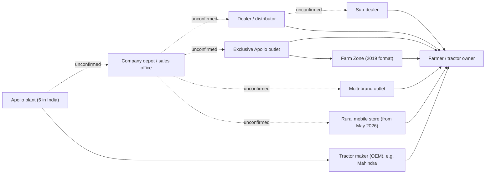

# 01 Apollo Tyres: Company Research

Prepared 6 November 2026

**Purpose.** This file sets out what is publicly known about Apollo Tyres and its farm (tractor) tyre business in India. It is the factual base for the proposal on using cricket to win farm tyre sales in rural India.

> **How to read this file**
>
> - **[Verified fact]**: primary source (filing, transcript, annual report) or two independent credible sources.
> - **[Fact - single source]**: one source only, not cross-checked.
> - **[Unverified]**: secondary summary, search snippet or unsourced article.
> - **[Interpretation]**: our reading or arithmetic, not a company number.
> - **[Forecast]**: guidance or projection.
>
> Terms: **Consolidated** = whole group (India, Europe, others). **Standalone** = the Indian listed company only, including exports from India. **A&P** = advertising and sales promotion. **OEM** = original equipment manufacturer; here, tractor makers who fit tyres on new tractors. **TBR** = truck-bus radial. **PCR** = passenger car radial. Rs 1 crore = Rs 10 million.

Full source list with reliability ratings: 17_Source_Register_and_Verification.md

---

## 1. What matters most

- Farm is **6% of standalone (India) revenue in FY26** (5% in FY24 and FY25). The case brief's "8-10%" comes from a 2019 press release and is outdated. [Verified fact]
- By arithmetic, Indian farm revenue was **about Rs 1,200 crore in FY26** (6% of Rs 19,816 crore is Rs 1,189 crore; the 6% is a rounded figure), give or take about Rs 100 crore. Apollo does not report farm revenue, profit, volume or share. [Interpretation]
- Management says the BCCI deal is bringing rural "traction" in PCR, two-wheeler and farm tyres. No number backs this. [Verified fact on what was said]
- Farm tyres were **short of capacity** in February 2026, yet all announced growth capex is for car and truck tyres. [Verified fact]
- Apollo is building rural sales machinery: a Head of Rural Sales, "One District, One ARD", 25 planned rural mobile stores, and sub-dealer warranty registration. [Verified fact / Fact - single source]
- Farm-specific marketing is thin. The last farm campaign found was a Virat TV advertisement in May 2024. [Interpretation]
- All Apollo farm tyres carry a **7-year manufacturing-defect warranty**, its longest in India. [Verified fact]
- Standalone A&P rose 38% in FY26 to Rs 524 crore with the jersey deal; management will bring it back to "around 2.5% plus" of sales. [Verified fact]

---

## 2. Company overview

### 2.1 Business model and brands

Apollo sells two brands. **Apollo** covers mass to premium tyres in all categories, including farm. **Vredestein** is premium; in Europe it also sells agricultural tyres. Sales reach 100+ countries. Indian plants: Perambra and Kalamassery (Kerala), Limda (Gujarat), Chennai, Chinnapandur (Andhra Pradesh). Hungary remains; Enschede (Netherlands) stopped production by 30 June 2026. [Verified fact] — [FY26 Annual Report](https://corporate.apollotyres.com/content/dam/orbit/apollo-corporate/investors/financial-reporting/annual-report/2025-26/AGM%20Notice%20and%20Annual%20Report%20FY2026.pdf)

### 2.2 Revenue and profit (consolidated)

Converted from INR million (FY26 revenue: INR 284,706 million). [Verified fact] — [Q4 FY26 investor presentation](https://nsearchives.nseindia.com/corporate/APOLLOTYRE1_15052026115522_intimationpreseentation.pdf); [Q4 FY26 press release](https://corporate.apollotyres.com/press-and-media/news/financial/q4-fy26/)

| Rs crore | FY25 | FY26 | Q4 FY25 | Q3 FY26 | Q4 FY26 |
|---|---|---|---|---|---|
| Revenue | 26,123 | 28,471 (+9.0%) | 6,424 | 7,743 | 7,336 (+14.2%) |
| EBITDA (margin) | 3,572 (13.7%) | 4,143 (14.6%) | 837 (13.0%) | 1,186 (15.3%) | 1,069 (14.6%) |
| Exceptional items | 169 | 1,034 | 119 | 27 | 456 |
| PAT | 1,121 | 1,372 | 184 | 470 | 631 |

- The press release confirms the brief's "Rs 28,471 crore, up 9%". [Verified fact] CRISIL gives Rs 28,463 crore. [Fact - single source]
- FY26 PAT includes a Rs 742 crore after-tax charge (mainly Enschede) and a Rs 574 crore one-off tax reversal, so headline PAT growth hides underlying performance. [Verified fact] — [Q4 FY26 call transcript](https://nsearchives.nseindia.com/corporate/APOLLOTYRE1_18052026174646_transcriptintimation.pdf)
- **Standalone FY26:** revenue Rs 19,816 crore (INR 198,162 million, +9.0%), EBITDA margin 14.5% (12.1% in FY25), PAT Rs 1,852 crore. Q4 FY26 was India's best quarter ever at Rs 5,237 crore. [Verified fact]
- **Q1 FY27 (Apr-Jun 2026):** revenue Rs 7,398 crore (+12.8%), EBITDA Rs 868 crore (margin 11.7%, down about 150 bps), PAT Rs 349 crore; standalone revenue Rs 5,462 crore (+15.6%). [Fact - single source] — [FilingReader](https://filingreader.com/news-wire/mumbai/2026-08-07/apollo-tyres-reports-q1-revenue-growth-at-inr-73978-mn). Kotak Neo gives EBITDA Rs 950 crore on a total-income base. [Fact - single source] — [Kotak Neo](https://www.kotakneo.com/financial-results/apollo-tyres-share-price-q1fy2026-27-results/)
- **Q2 FY27 (Jul-Sep 2026):** published 4 November 2026. Consolidated revenue Rs 7,968 crore, up 16.7% on Rs 6,831 crore. Net profit Rs 292 crore, up 13.3%. Operating profit Rs 855 crore against Rs 1,021 crore, a margin of about 11% against 15.3% (the margin is an aggregator's figure). The coverage read made no comment on farm tyres, rural demand or the cricket sponsorship. Apollo's own release, presentation and call transcript were not opened. [Fact - single source; company release not opened]

### 2.3 Revenue by region (share of consolidated)

| | FY24 | FY25 | FY26 |
|---|---|---|---|
| India (APMEA in FY24) | 67% | 63% | 63% |
| Europe | 30% | 29% | 30% |
| Others | 3% | 8% | 7% |

[Verified fact] — [Q4 FY26 deck](https://nsearchives.nseindia.com/corporate/APOLLOTYRE1_15052026115522_intimationpreseentation.pdf); [Q4 FY25 deck](https://corporate.apollotyres.com/content/dam/orbit/apollo-corporate/investors/announcements/2025-26/Investor%20Presentation-Q4%20FY25.pdf); [Q4 FY24 deck](https://corporate.apollotyres.com/content/dam/orbit/apollo-corporate/investors/ir-presentation/2023-24/Quarterly%20Investor%20Presentation-Q4FY24.pdf)

### 2.4 Product and channel mix

From company pie charts. [Verified fact; CRISIL reports the same domestic split, tractor 6%] — [CRISIL, 14 Aug 2026](https://www.crisil.com/mnt/winshare/Ratings/RatingList/RatingDocs/ApolloTyresLimited_August%2014_%202026_RR_399633.html)

| Share of revenue | Standalone FY24 | Standalone FY25 | Standalone FY26 | Consolidated FY24 | Consolidated FY25 | Consolidated FY26 |
|---|---|---|---|---|---|---|
| Truck & Bus | 57% | 55% | 55% | 42% | 41% | 40% |
| Passenger vehicle | 22% | 23% | 22% | 38% | 38% | 38% |
| Light commercial / light truck | 8% | 8% | 9% | 6% | 6% | 7% |
| **Farm** (standalone) / **Farm + Off-Highway** (consolidated) | **5%** | **5%** | **6%** | **8%** | **9%** | **10%** |
| Others (incl. two-wheeler) | 8% | 9% | 8% | 5% | 5% | 6% |
| Replacement | 63% | 63% | 63% | 78% | 80% | 79% |
| OEM | 25% | 24% | 24% | 22% | 20% | 21% |
| Export | 12% | 13% | 13% | n/a | n/a | n/a |

### 2.5 Market position

The CFO says official market-share data is unavailable or lags. By internal estimates Apollo gained TBR and PCR replacement share in FY26, and "MRF and us would be the two leading players in the TBR category". [Fact - single source] — [Q4 FY26 transcript](https://nsearchives.nseindia.com/corporate/APOLLOTYRE1_18052026174646_transcriptintimation.pdf). Competitors: 07_Competitor_Analysis.md.

### 2.6 Strategic priorities and named initiatives

- Pillars: Digitalisation, Technology & Innovation, People, Brand, Sustainability. [Verified fact]
- Initiatives: **Mission 300K** (TBR replacement), **One District, One ARD** (rural), premium PCR 16-inch+, **Truck Trek 15** (fleets). [Verified fact]
- The SWOT names CV radialisation, PV premium and two-wheelers as opportunities. **Farm is not named as a strength or opportunity.** [Verified fact] — [FY26 Annual Report](https://corporate.apollotyres.com/content/dam/orbit/apollo-corporate/investors/financial-reporting/annual-report/2025-26/AGM%20Notice%20and%20Annual%20Report%20FY2026.pdf)
- Cricket deal terms: 02_Cricket_Assets_and_Sponsorships.md.

---

## 3. The agricultural and rural business

### 3.1 Farm share of revenue: the brief's figure is outdated

| Claim | Source | Label |
|---|---|---|
| "farm segment contributes nearly 8-10% to Apollo Tyres Indian revenues" (31 May 2019) | [Apollo Farm Zone press release](https://corporate.apollotyres.com/press-and-media/news/corporate/apollo-farm-zone/) | [Fact - single source] |
| Farm 5% (FY24), 5% (FY25), 6% (FY26) of standalone revenue | Company decks; CRISIL | [Verified fact] |

The case brief's "8-10%" is outdated; the company's latest disclosures say 5-6%. The gap cannot be explained from public data. The 2019 figure may have used another base (such as including industrial tyres), or farm may have shrunk as a share while truck and car tyres grew. [Interpretation]

### 3.2 Estimate of Indian farm revenue

| | FY25 | FY26 |
|---|---|---|
| Standalone revenue | Rs 18,174 crore | Rs 19,816 crore |
| Farm share (rounded) | 5% | 6% |
| Farm revenue by arithmetic | about Rs 910 crore | about Rs 1,200 crore |

[Interpretation] Caveats: the shares are rounded, so the true figure could be about Rs 100 crore either side. The slice includes farm exports from India. The consolidated "Farm + Off-Highway" slice (about Rs 2,850 crore) mixes Indian farm, industrial and European agricultural tyres and is not India farm revenue. This is arithmetic, not a company number.

No Indian farm market share is published; CRISIL says only "established positions" in tractors. [Fact - single source] A Motilal Oswal note dated 27 December 2025, written after a meeting with Apollo's management, says "only approximately 25% of the farm category is replacement-driven". It does not say whether this describes Apollo's farm business or the industry. [Unverified as to scope]

### 3.3 Farm range

| Product | Use | Company claim | Sizes |
|---|---|---|---|
| Farm King | Radial; farming, haulage | "India's No. 1 Farm Radial Tyre"; "1.5 Times Longer Life" than bias | 12.4 R28, 340/85 R28, 380/85 R28, 420/85 R28 |
| FX 222 | Deep puddling (wet paddy) | "leading the radialization of Indian agricultural tyres" | 14 sizes incl. 13.6-26 |
| Virat 23 | Hard soil | "India's 1st 23 Lug Tractor Tyre for Hard Soil Application" | 12.4-28, 13.6-28, 14.9-28, 16.9-28 |
| Virat (20 lugs) | Farm and haulage, all soils | Dual-tapered lugs | Not stated |
| Krishak Gold | All-round | "Tyre Designed for All-round Application" | 4 sizes |
| Dhruv | Trolleys, loaders | – | Not stated |

[Fact - single source] — [Apollo agricultural tyres](https://www.apollotyres.com/en-in/agricultural-tyres); [Farm King](https://www.apollotyres.com/en-in/agricultural-tyres/products/1299-FARMKING/); [Virat 23](https://www.apollotyres.com/en-in/agricultural-tyres/products/1430-VIRAT-23/). Retail sites also list Krishak Premium, Powerhaul, Agrex 85 and FX 212. **Conflict:** the 2019 release says Farm King lasts "nearly twice" as long as bias; the product page says 1.5 times. "India's first" claims are unchecked company claims.

### 3.4 Warranty

Farm tyres: 7 years from the week of manufacture, manufacturing defects only, pro-rata on tread. Cuts, punctures, wrong inflation, overloading and unauthorised dealers are excluded. Truck tyres get 3 years, PCR 5, two-wheelers 5-6. [Verified fact] — [Apollo warranty page](https://www.apollotyres.com/en-in/warranty/)

### 3.5 Street prices (Rs per tyre, viewed 6 Nov 2026)

| Size / model | TractorGyan | TractorJunction |
|---|---|---|
| 13.6-28 Krishak Gold Drive (rear) | 16,400 | 16,000 |
| 14.9-28 Krishak Premium Drive (rear) | 18,450 | 18,900 |
| 14.9-28 Krishak Gold Drive (rear) | 17,000 | – |
| 16.9-28 Krishak Premium Drive (rear) | 22,000 | – |
| 12.4-28 Krishak Premium / Gold Drive | 14,000 / 14,500 | 13,900 (Premium) |
| 6.00-16 Krishak Premium CR (front) | 3,540 | 3,000 |

[Fact - single source each; within about 5% of each other, so indicative] — [TractorGyan](https://tractorgyan.com/tyre/apollo-tractor-tyre-in-india); [TractorJunction](https://tractorjunction.com/apollo-tyres). Prices vary by state. Farm King, Virat, Virat 23 and Powerhaul show no online price, so the premium over Krishak cannot be measured. [Interpretation]

### 3.6 Launches

- **Farm King:** first major OEM win on Mahindra's Arjun tractors, August 2009. [Fact - single source] — [Modern Tire Dealer](https://www.moderntiredealer.com/industry-news/commercial-business/article/11507378/apollo-wins-radial-farm-tire-fitment-in-india-2009-08-05)
- **Virat (20 lugs):** launched 6 May 2022, Chandigarh, with farmers; target states Punjab, Haryana, UP, Rajasthan, MP, Maharashtra, AP, Karnataka. [Verified fact] — [Tyre Trends](https://tyre-trends.com/news/apollo-tyres-launches-new-gen-agri-tyres)
- **FY26:** Virat extended into Compact, Row Crop and Front; "Steel breaker tyres in the Tractor Rear segment"; "Tractor Rear tyres continued to be a key driver of value within the category." [Verified fact] — [FY26 Annual Report](https://corporate.apollotyres.com/content/dam/orbit/apollo-corporate/investors/financial-reporting/annual-report/2025-26/AGM%20Notice%20and%20Annual%20Report%20FY2026.pdf)
- No farm launch dated 2025-26 was found.

### 3.7 Tractor-maker (OEM) relationships

Mahindra & Mahindra is the only confirmed tractor OEM customer (Arjun fitment 2009; "Business Partner of the Year" for its Farm Division, 2017). [Fact - single source each] — [Autonewspress](https://autonewspress.com/?p=15079). No supply evidence was found for Swaraj, TAFE, Sonalika, Escorts Kubota, John Deere or New Holland. The India farm OEM-versus-replacement split is not disclosed.

---

## 4. Financial and operational facts relevant to a farm push

**Consolidated company performance is not farm-tyre performance.** Apollo does not separately disclose farm revenue, profit, volume or market share. Strong group or India results do not show that farm tyres are doing well.

### 4.1 Capacity and the admitted farm shortage

| Utilisation | FY24 | FY25 | FY26 | Q1 FY27 |
|---|---|---|---|---|
| India | 75% | 81% | 85% | 91% |
| Europe | 76% | 80% | 93% | 94% |

[Verified fact for FY24-26; Q1 FY27 Fact - single source]

- Neeraj Kanwar, 5 Feb 2026: "we are also seeing shortages in TBR and passenger car, and in farm"; TBR "close to 100% utilisation". [Verified fact] — [Q3 FY26 transcript](https://corporate.apollotyres.com/content/dam/orbit/apollo-corporate/investors/shareholding-information/investors-call-transcript/2025-26/Q3FY2026%20Analyst%20Call%20Transcript.pdf)
- Which plant makes farm tyres is not confirmed (Limda, per one article). [Unverified]

### 4.2 Capex and where it goes

| Item | Figure | Label |
|---|---|---|
| FY25 / FY26 capex outflow | Rs 769 crore / Rs 1,403 crore (INR 7.69 bn / 14.03 bn) | [Verified fact] |
| FY27 guidance, Q4 call (15 May 2026) | Rs 3,500 crore (INR 35 bn), about 80% growth, "largely committed" | [Forecast] |
| FY27, Q3 call and CRISIL | About Rs 3,000 crore | [Forecast] |
| Andhra Pradesh plant (Feb 2026) | Rs 5,810 crore (some say Rs 5,800 crore) by FY29: +3.7 mn PCR, +1.3 mn TBR a year | [Verified fact] |

The FY27 figures differ; both are shown. **None of the announced capex is for farm capacity.** [Verified fact] — [Projects Today](https://www.projectstoday.com/News/Apollo-Tyres-to-invest-Rs-5810-cr-by-FY29-to-expand-capacity-at-Andhra-Pradesh-plant)

### 4.3 A&P spend and its path

| Rs crore | FY25 | FY26 |
|---|---|---|
| Standalone A&P | 379.9 (INR 3,798.57 mn) | 524.4 (INR 5,243.95 mn), +38% |
| Consolidated A&P | 655.3 (INR 6,552.50 mn) | 785.0 (INR 7,849.52 mn) |

[Verified fact] — [FY26 Annual Report notes](https://corporate.apollotyres.com/content/dam/orbit/apollo-corporate/investors/financial-reporting/annual-report/2025-26/AGM%20Notice%20and%20Annual%20Report%20FY2026.pdf)

- Normal A&P was about 2% of sales. Q3 FY26 was about Rs 150 crore; Q4 FY26 was about 4% of sales. [Verified fact]
- It will settle at "around 2.5% plus" of sales. [Forecast]
- Q1 FY27 A&P was reportedly cut about 50%, tracking the BCCI schedule; the base is unclear. [Unverified]
- The extra Rs 145 crore of standalone A&P in FY26 mostly relates to the jersey deal. [Interpretation]

### 4.4 Cost inflation and price increases

- 15 May 2026: raw materials to rise "high teens" sequentially; 6-8% price increases for Q1 FY27; "More price increases would further be needed". [Verified fact]
- Q1 FY27 call summary: India prices up 7-9% in Q1, about 15-16% needed in total. [Unverified] **Conflict:** the raw material rise is given as about 25% (call summary) and about 17% (InvestyWise); definitions are unclear.
- CRISIL expects operating margin of about 10-11% in FY27. [Forecast]
- Farm-tyre price changes: not found. Industry prices, GST and rubber: 03_Latest_Developments_and_News.md.

---

## 5. Distribution and rural reach

### 5.1 Network size

| Figure | What it counts | Label |
|---|---|---|
| About 6,500 dealerships ([CRISIL, Aug 2026](https://www.crisil.com/mnt/winshare/Ratings/RatingList/RatingDocs/ApolloTyresLimited_August%2014_%202026_RR_399633.html)) | Dealers, including exclusive Apollo outlets | [Fact - single source] |
| 20,000+ touchpoints ([Autocar Professional, Feb 2024](https://www.autocarpro.in/news-national/apollo-tyres-targets-higher-growth-from-rural-india-with-expanded-distribution-network-119049)) | Branded and multi-brand outlets plus distributors | [Fact - single source] |

These do not conflict. The larger figure adds every multi-brand shop and distributor selling Apollo. Neither says how many outlets are rural or stock farm tyres. Dealers by state: 06_Rural_Distribution_and_Geography.md.

Dashed lines are not confirmed by the notes; stock points and sales offices are undocumented.

### 5.2 Rural initiatives

- **Rural sales head:** Rohit Singh, December 2025, national mandate to "accelerate trade penetration, strengthen channel partnerships and deepen distribution across non-urban markets". No targets disclosed. [Fact - single source] — [Indiantelevision](https://indiantelevision.com/mam/apollo-tyres-names-rohit-singh-as-rural-sales-head-251224/)
- **"One District, One ARD":** listed in the FY26 annual report as a "multi-channel strategy" for rural expansion. ARD is not defined. [Verified fact (text)]
- **Rural Mobile Store:** first van 20 May 2026, Pandavapura, Mandya (Karnataka); 25 vans over 18-24 months; farm tyres not mentioned. [Verified fact] — [Autocar Professional](https://www.autocarpro.in/news/apollo-tyres-launches-mobile-store-to-reach-rural-customers-132704)
- **Village targets (Feb 2024):** "Our plan is to be there in every possible village with a 50,000-and-below population size", later 20,000 and 5,000 (Vikram Garga). [Fact - single source]
- This rural push targets car and two-wheeler tyres as much as farm. [Interpretation]

### 5.3 Farm Zones

First at Satana, Nashik, 31 May 2019, with a tyre changer, display and an agronomist for farmers; aim "at least one Farm Zone in almost every state". A second opened at Kapurthala (Punjab) in August 2019. [Fact - single source] — [Apollo release](https://corporate.apollotyres.com/press-and-media/news/corporate/apollo-farm-zone/); [Krishi Jagran](https://krishijagran.com/industry-news/northern-indias-1st-farm-zone-inaugurated-full-service-outlet-for-farmagriculture-tyres-in-kapurthala). No later count or news was found. [Interpretation: not scaled]

### 5.4 Digital dealer platform

The B2B (business-to-business) platform added **warranty registration for sub-dealers** and shipment tracking in FY26. [Verified fact]

---

## 6. Existing marketing and brand positioning

**Corporate platform.** "Har Safar Mein Dum Hai" (FY26), built on "performance, resilience and trust", alongside "#GoTheDistance". [Verified fact] Cricket activation: 02_Cricket_Assets_and_Sponsorships.md.

**Farm-specific marketing found.** A Virat TV advertisement (11 May 2024) presenting Virat as "progress" on modern farms [Fact - single source] — [Deccan Chronicle](https://www.deccanchronicle.com/business/driving-progress-apollo-tyres-tvc-spotlights-innovation-with-apollo-virat-tyre-893497); the 2022 Virat launch with farmers [Verified fact]; Farm Zones with agronomists (2019) [Fact - single source].

**Below-the-line.** The annual report cites "dealer-led programmes, digital activations and consumer outreach initiatives" and "on-ground activations and trade engagement programmes across urban and rural markets". **No farm programme is named.** [Verified fact]

**Non-cricket sponsorships.** Manchester United globally; Vredestein events in Europe. [Verified fact]

**CSR with rural reach.** Trucker healthcare centres in 21 states; "Navya" rural women livelihood programme. About 83% of a CSR beneficiary group recognised the brand (not farmers). [Fact - single source]

**What Apollo appears to do well**
- Corporate brand building, credited by management with volume and premium gains. [Interpretation]
- Product-led farm launches with farmer events. [Interpretation]
- A wide range, including radial and region-specific tyres. [Fact - single source]
- A long 7-year farm warranty. [Verified fact]

**Where farm and rural marketing looks thin**
- No farm campaign found after May 2024. [Interpretation]
- No farmer or mechanic loyalty programme found. [Interpretation]
- No farm-specific social or YouTube channel found. [Interpretation]
- No measured rural or farm marketing results published. [Interpretation]
- Farm Zones not reported since 2019. [Interpretation]
- The annual report's brand section names no farm activity. [Verified fact]

Farmer behaviour: 04_Farmer_Consumer_Behaviour.md.

---

## 7. What management has said about cricket, rural demand and farm tyres

All [Verified fact] on what was said, except the last row.

| Speaker | Date | Quote | Source |
|---|---|---|---|
| Neeraj Kanwar, VC & MD | 14 Nov 2025 | "Cricket transcends age, religion and income and is India's strongest unifier." | [Q2 FY26 transcript](https://corporate.apollotyres.com/content/dam/orbit/apollo-corporate/investors/shareholding-information/investors-call-transcript/2025-26/Q2FY2026%20Analyst%20Call%20Transcript.pdf) |
| Neeraj Kanwar | 14 Nov 2025 | "I am hopeful and optimistic that this will give us reach in the rural markets of the country, where we see after GST, a huge demand for our car tyres and for two-wheel tyres. It will also have impact on agri and on truck." | [Q2 FY26 transcript](https://corporate.apollotyres.com/content/dam/orbit/apollo-corporate/investors/shareholding-information/investors-call-transcript/2025-26/Q2FY2026%20Analyst%20Call%20Transcript.pdf) |
| Gaurav Kumar, CFO | 14 Nov 2025 | "The big demand upliftment in terms of volume growth was in the farm segment, the two-three wheelers and the others." | [Q2 FY26 transcript](https://corporate.apollotyres.com/content/dam/orbit/apollo-corporate/investors/shareholding-information/investors-call-transcript/2025-26/Q2FY2026%20Analyst%20Call%20Transcript.pdf) |
| Neeraj Kanwar | 5 Feb 2026 | "we are also seeing shortages in TBR and passenger car, and in farm. Given what we have been able to do with BCCI, we are seeing a lot of traction coming from the rural market, specifically in three categories which is PCR, two-wheeler and farm category. And that's where the growth is coming." | [Q3 FY26 transcript](https://corporate.apollotyres.com/content/dam/orbit/apollo-corporate/investors/shareholding-information/investors-call-transcript/2025-26/Q3FY2026%20Analyst%20Call%20Transcript.pdf) |
| Neeraj Kanwar | 5 Feb 2026 | The jersey sponsorship "has boosted dealer morale and is already translating into positive business outcomes" | [Q3 FY26 transcript](https://corporate.apollotyres.com/content/dam/orbit/apollo-corporate/investors/shareholding-information/investors-call-transcript/2025-26/Q3FY2026%20Analyst%20Call%20Transcript.pdf) |
| Gaurav Kumar | 5 Feb 2026 | "with the jersey sponsorship, we are seeing very good traction on the passenger car, two wheelers and farm, including in the rural segment" | [Q3 FY26 transcript](https://corporate.apollotyres.com/content/dam/orbit/apollo-corporate/investors/shareholding-information/investors-call-transcript/2025-26/Q3FY2026%20Analyst%20Call%20Transcript.pdf) |
| Q4 FY26 investor deck | 15 May 2026 | "Enhanced brand equity and visibility due to BCCI sponsorship gave a boost to volumes and premiumization" | [Q4 FY26 deck](https://nsearchives.nseindia.com/corporate/APOLLOTYRE1_15052026115522_intimationpreseentation.pdf) |
| Onkar Kanwar, Chairman | May 2026 | "we remain optimistic about sustained demand momentum in India, supported by positive rural sentiment." | [Q4 FY26 release](https://corporate.apollotyres.com/press-and-media/news/financial/q4-fy26/) |
| FY26 Annual Report | July 2026 | Farm replacement helped by "favourable monsoons, higher farm incomes and policy support such as reduction in GST on tractor tyres" | [FY26 Annual Report](https://corporate.apollotyres.com/content/dam/orbit/apollo-corporate/investors/financial-reporting/annual-report/2025-26/AGM%20Notice%20and%20Annual%20Report%20FY2026.pdf) |
| Q1 FY27 call (third-party summary) [Unverified] | 6 Aug 2026 | Truck, bus and farm replacement demand "surprisingly strong" | [Cofacto summary](https://cofacto.ai/market-news/apollotyre-q1-fy27-earnings-call) |

No recall, rural dealer or farm volume figure supports these claims. FY26 farm growth also had non-marketing tailwinds (GST cut, monsoon, farm incomes), so it is hard to credit the sponsorship. [Interpretation] Dated tailwinds: 03_Latest_Developments_and_News.md.

---

## 8. Constraints the company has admitted

| Constraint | Evidence | Label |
|---|---|---|
| Farm capacity shortage | "shortages in TBR and passenger car, and in farm" (Feb 2026) | [Verified fact] |
| High utilisation | About 90% in Q4 FY26; "Through April, we struggled in terms of keeping up with the demand" (CFO, 15 May 2026) | [Verified fact] |
| Cost inflation | "More price increases would further be needed" | [Verified fact] |
| A&P discipline | Back to "around 2.5% plus" of sales | [Forecast] |
| No market-share data | "We don't have the official data ... or it comes with a significant lag" | [Verified fact] |
| Pricing power | Intense competition (CRISIL); CCI penalty of Rs 425.5 crore not provided for | [Fact - single source] |
| Distribution change | SWOT threat: "consolidation of dealer networks and increasing influence of digital and online channels" | [Verified fact] |
| European agri ends | Enschede was the only European agri plant | [Verified fact] |
| Field force | "engagement gaps in remote working" field staff | [Verified fact] |

No direct admission of weak rural reach was found, but the run of rural fixes since December 2025 suggests a gap. [Interpretation] Diagnosis: 09_Problem_Diagnosis.md.

---

## 9. Data gaps

| What could not be found | Status |
|---|---|
| Farm revenue, profit, volume, growth; domestic (non-export) farm revenue | Data unavailable – requires primary research or company confirmation. |
| Apollo's Indian farm market share (total, OEM, replacement, radial) | Data unavailable – requires primary research or company confirmation. |
| Basis of the 2019 "8-10%" figure | Data unavailable – requires primary research or company confirmation. |
| Farm OEM vs replacement split; current tractor OEM list | Data unavailable – requires primary research or company confirmation. |
| Plant-wise or planned farm capacity | Data unavailable – requires primary research or company confirmation. |
| Prices for Virat, Virat 23, Farm King; farm-specific 2026 price changes | Data unavailable – requires primary research or company confirmation. |
| Launch dates for Farm King, Virat 23, Krishak and FY26 Virat lines | Data unavailable – requires primary research or company confirmation. |
| Farm Zones today; rural and farm-stocking dealers; sub-dealers; sales offices | Data unavailable – requires primary research or company confirmation. |
| Meaning of "ARD" and districts covered | Data unavailable – requires primary research or company confirmation. |
| Farm A&P budget, farmer meets, mechanic or dealer schemes, campaign results | Data unavailable – requires primary research or company confirmation. |
| Rural or farm recall and sales effect of the cricket deal; farm or rural targets | Data unavailable – requires primary research or company confirmation. |
| Q2 FY27 call transcript and any farm or rural comment; official Q1 FY27 deck and transcript | Data unavailable – requires primary research or company confirmation. |

---

## 10. Implications for the case

- [Interpretation] Farm is about 6% of Apollo's Indian revenue, about Rs 1,200 crore by arithmetic. Any farm programme has to be sized against that business, not against the Rs 579 crore jersey fee.
- [Interpretation] Management already says the cricket deal is bringing rural traction, including in farm, but has published no number. The missing piece is measurement, and that is where a proposal can add most.
- [Interpretation] Farm capacity was short in February 2026 and all announced growth capex is for car and truck tyres. A farm demand push needs ring-fenced supply and should aim at product mix (Virat, Virat 23, steel-breaker rears) as well as volume.
- [Interpretation] Apollo is already building rural machinery: a rural sales head, "One District, One ARD", 25 mobile stores and sub-dealer warranty registration on its dealer platform. A farm programme should run on these, not beside them.
- [Interpretation] Farm-specific marketing has been thin since May 2024: no farmer or mechanic programme was found and the 2019 Farm Zone format shows no follow-through. The layer that turns awareness into a dealer visit is missing.
- [Interpretation] The 7-year farm warranty is Apollo's longest and is little used in its marketing; it covers manufacturing defects only, so it supports a durability message but does not prove it.
- [Strategic hypothesis] The jersey says "Apollo Tyres" while the tractor tyre a farmer sees is sold as Virat, Krishak or Farm King. The link between the jersey name and the farm product is not being made for him.
