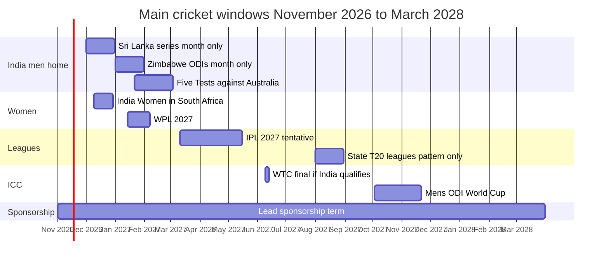

# 02 Cricket Assets and Sponsorships

Prepared 6 November 2026

**Purpose.** This file sets out which cricket rights Apollo Tyres actually holds, which it could partner for, and which would be new. It also records what is known, and not known, about whether cricket reaches farmers and landowners in rural India.

Full source list with reliability ratings: 17_Source_Register_and_Verification.md

> **How to read this file**
>
> **Evidence labels.** **[Verified fact]** confirmed by an official or primary source, or several independent ones. **[Fact - single source]** one source, not cross-checked. **[Reported by press]** in press reports, not confirmed by the BCCI or Apollo (several outlets may repeat one original). **[Unverified]** a secondary claim (snippet, vendor page, listing) that could not be checked. **[Forecast]** a tentative date or figure. **[Assumption]** an industry norm not checked for Apollo's contract. **[Interpretation]** the research team's reading of the evidence. **[Strategic hypothesis]** a proposition the plan must test.
>
> **Asset classes.** **(i) Existing contractual right**: Apollo holds it now. **(ii) Potential partnership**: a property someone else owns that Apollo could buy into. **(iii) Entirely new opportunity**: nothing exists to buy; Apollo would build it.
>
> **Abbreviations.** BCCI: Board of Control for Cricket in India, which runs Indian cricket and sells Team India's sponsorships. ICC: International Cricket Council, which runs world events such as the World Cups. IPL: Indian Premier League, the BCCI's men's franchise T20 league; WPL is the women's version. BARC: Broadcast Audience Research Council, India's official TV ratings body. Tennis-ball cricket: informal cricket played with a taped or hard tennis ball instead of a leather ball; the usual format in streets and villages.

Related files: company profile and management strategy in 01_Apollo_Tyres_Company_Research.md; dated news in 03_Latest_Developments_and_News.md; how farmers buy and which channels reach them in 04_Farmer_Consumer_Behaviour.md; competitors in depth in 07_Competitor_Analysis.md; budget in 13_Budget_and_Commercial_Model.md.

---

## 1. What matters most

- The only cricket right confirmed by both the BCCI and Apollo is the Apollo logo on the Team India jersey, men's and women's, all formats, to about March 2028. [Verified fact]
- Apollo's web page also claims home-international and domestic title rights, but the BCCI named Muthoot FinCorp as home title sponsor to March 2028 by official release on 26 September 2026, as reported by Business Today. Apollo is the lead (jersey) sponsor; Muthoot FinCorp is the home title sponsor. Treat Apollo's page rights as not held. [Interpretation]
- The Rs 579 crore value, the 121 + 21 match count and every per-match figure come from the press; the BCCI has not disclosed the amount. [Reported by press]
- Kit, imagery, hospitality and player-access rights are not public. [Assumption: lead sponsors have historically received some of them]
- No current data shows how many farmers or tractor owners watch India matches; the only rural-versus-urban BARC split found is from 2017. [Verified fact: none found]
- On the largest scoring app, 68.6% of 2025 matches were tennis-ball cricket and players aged 40+ were about 1.5% of active players. [Fact - single source, company self-report]
- Tyre rivals already hold IPL positions: CEAT as IPL official partner to about 2028, BKT with 8 of 10 IPL teams in 2026. [Verified fact]
- Tractor makers have used cricket and cricketers, but none has published results. [Verified fact: none found]

---

## 2. The Team India lead sponsorship

The BCCI named Apollo lead sponsor of the men's and women's teams on 16 September 2025, replacing Dream11 ([Onmanorama, quoting BCCI](https://www.onmanorama.com/sports/cricket/2025/09/16/bcci-announces-apollo-tyres-lead-sponsor-replacing-dream11.amp.html); [Apollo](https://corporate.apollotyres.com/press-and-media/news/corporate/BCCI-sponsorship/)). Dream11 left after the Promotion and Regulation of Online Gaming Act 2025 banned real-money gaming; the men's team played the Asia Cup 2025 with no shirt sponsor. [Verified fact]

| Item | Confirmed by BCCI or Apollo | Reported by press only | Not public: needs company confirmation |
|---|---|---|---|
| Value | BCCI has not disclosed it; Apollo's BSE filing reportedly did not state it ([Business Today](https://www.businesstoday.in/markets/stocks/story/apollo-tyres-in-focus-after-bagging-bcci-indian-cricket-team-lead-sponsorship-494293-2025-09-17)) | Rs 579 crore, repeated widely but traced to one report (Campaign India credits the Times of India) ([Campaign India](https://www.campaignindia.in/article/apollo-tyres-replaces-dream11-as-team-india-jersey-sponsor/504896)). Dream11's deal: Rs 358 crore, July 2023 to March 2026 | Contract value |
| Term | "3-year strategic partnership", effective immediately ([Apollo](https://corporate.apollotyres.com/press-and-media/news/corporate/BCCI-sponsorship/)) | About 2.5 years to March 2028 ([Business Standard](https://www.business-standard.com/industry/news/apollo-tyres-bcci-team-india-lead-sponsor-2028-125091601135_1.html)); Angel One and Nenow say 2027 ([Angel One](https://www.angelone.in/news/market-updates/apollo-tyres-replaces-dream11-as-indian-cricket-team-sponsor-until-2027)). The brief's March 2028 matches most reports | Exact end date; renewal option |
| Match count | Not stated | 121 bilateral + 21 ICC = 142 ([Khel Now](https://khelnow.com/cricket/indian-cricket-team-bcci-apollo-tyres-202509)) | Whether India A and U-19 count |
| Per-match figures | None | Base prices Rs 3.5 crore per bilateral and Rs 1.5 crore per ICC match (Cricbuzz via Khel Now). Headline "about Rs 4.77 crore per game" is an industry estimate: 579/142 = Rs 4.08 crore, 579/121 = Rs 4.79 crore, so 4.77 seems to count bilateral matches only. Others: Rs 4.5 crore (Angel One); Rs 4.77 crore bilateral and Rs 1.72 crore ICC (Bridge Chronicle, as cited in the notes) | Official per-match fees |
| Bidders | None | Canva Rs 544 crore (some say Rs 554 crore); JK Cement Rs 477 crore (Campaign India says "JK Tyre", against most outlets). Shankh Air and Omniyat showed interest but did not bid or qualify ([The Morning Context](https://themorningcontext.com/sports/why-apollo-tyres-is-spending-rs-579-crore-on-indias-cricket-jersey)) | Official bid list |
| Jersey placement | BCCI: logo on both teams' jerseys, all formats. Apollo: "front and leading arm" | Same | Placement at ICC events (section 10) |
| Barred categories | None | Invitation 2 Sep 2025. Barred: online and real-money gaming, betting, crypto, tobacco; reports add alcohol, sportswear, banking and financial services, insurance and others | Tender document not found |
| First outings | None | Men: home Tests against West Indies from 2 Oct 2025. Women: ICC Women's World Cup from 30 Sep 2025. Also Australia white-ball tour and India A against Australia ([Campaign India](https://www.campaignindia.in/article/apollo-tyres-replaces-dream11-as-team-india-jersey-sponsor/504896)) | - |
| Activations | Apollo promises "impactful fan engagement, innovative activations"; the brief says Apollo can "work with the BCCI on activations and fan engagement" | None itemised | What these cover |

**Purpose as stated by management.** At launch Neeraj Kanwar spoke of "national pride, strengthening consumer trust", with no mention of farmers or measurement ([Storyboard18](https://www.storyboard18.com/brand-marketing/this-partnership-is-about-national-pride-apollo-tyres-md-on-new-team-india-sponsorship-81033.htm)). Later, on the Q2 FY26 call (14 November 2025), he tied rural reach first to car and two-wheeler tyres, with agri and truck as the addition: it should "give us reach in the rural markets" and "also have impact on agri and on truck" ([Q2 FY26 transcript](https://corporate.apollotyres.com/content/dam/orbit/apollo-corporate/investors/shareholding-information/investors-call-transcript/2025-26/Q2FY2026%20Analyst%20Call%20Transcript.pdf)), and linked it to rural traction in car, two-wheeler and farm tyres ([Q3 FY26 transcript](https://corporate.apollotyres.com/content/dam/orbit/apollo-corporate/investors/shareholding-information/investors-call-transcript/2025-26/Q3FY2026%20Analyst%20Call%20Transcript.pdf)). [Verified fact] No metric supports this. [Interpretation] Detail in 01_Apollo_Tyres_Company_Research.md.

### The scope conflict

Apollo's corporate page lists "Title Sponsor Rights for all home international matches (men's and women's)" and for "domestic cricket tournaments organised by the BCCI" ([Apollo](https://corporate.apollotyres.com/press-and-media/news/corporate/BCCI-sponsorship/)). No other source confirms this.

The press treats home title sponsorship as a separate BCCI property. IDFC First Bank held it to August 2026 at about Rs 4.2 crore per match, covering home internationals and domestic events ([exchange4media](https://www.exchange4media.com/media-others-news/bcci-invites-bids-for-title-sponsorship-rights-for-domestic-international-events-156511.html)). On 25 September 2026 the press reported Muthoot FinCorp as home title sponsor to March 2028, about Rs 4.85 crore per match and Rs 150 crore for around 35 matches, branded "Blue Muthoot" ([Onmanorama](https://www.onmanorama.com/sports/cricket/2026/09/25/bcci-signs-150-crore-deal-muthoot-fincorp-title-sponsorship-team-india-.html)). The BCCI confirmed it by official release on 26 September 2026, as reported by [Business Today](https://www.businesstoday.in/sports/story/muthoot-fincorp-becomes-bccis-title-sponsor-for-home-cricket-till-2028-558061-2026-09-27). Scope as reported: international series hosted in India and BCCI domestic competitions; reported value about Rs 130 to 150 crore. [Fact - single source; BCCI release reported by press] Apollo remains lead (jersey) sponsor; its own web page still lists title-sponsor rights for home internationals and BCCI domestic tournaments for "three years", so only the jersey logo is treated as a confirmed Apollo right. Campa, SBI Life and ChatGPT joined as associate partners for 2026-27 and 2027-28, together over US$13.6 million ([Sportcal](https://www.sportcal.com/news/bcci-adds-chatgpt-sbi-life-campa-sponsorships/)). [Reported by press]

**Conclusion:** treat only the jersey logo as confirmed. Apollo shares the team's sponsor space with at least four other brands. [Interpretation]

### What the deal does not include

Inferred from how the rights are structured; no source states it. [Interpretation: inferred from structure]

- Broadcast advertising inventory, which belongs to the broadcaster (JioStar).
- The IPL, a separate BCCI property.
- ICC event marks and Global Partner rights, sold by the ICC.
- Individual player endorsements (section 10).

---

## 3. Asset register

A class (ii) or (iii) item is not something Apollo owns.

| Asset | What it is | Class (i / ii / iii) | Held by Apollo? | Active now? | Audience | Geography | Can it reach farmers? | Can it be repurposed for rural marketing? | What activation needs | Limits | Source |
|---|---|---|---|---|---|---|---|---|---|---|---|
| Jersey lead sponsorship | Logo, front and leading arm, men's and women's, all formats | (i) | Yes | Yes, to about Mar 2028 | All India viewers | National, overseas | Indirectly | Only via BCCI-approved use of marks | BCCI written approval; ICC approval at ICC events | No broadcast slots, IPL, ICC marks or player rights [Interpretation] | [Apollo](https://corporate.apollotyres.com/press-and-media/news/corporate/BCCI-sponsorship/) |
| Unconfirmed extras: designation, training kit, imagery, content, tickets and hospitality, player access | Rights lead sponsors have historically received | (i) only if in contract | Unknown | Unknown | - | - | - | Possibly (e.g. tickets as rewards) | Contract copy | Not public [Assumption] | Notes D |
| Home-series title | "Blue Muthoot" naming of home matches | Not available | No (Muthoot FinCorp) [Fact - single source; BCCI release reported by press] | Yes, other brand | - | - | - | No | - | Conflicts with Apollo's page | [Onmanorama](https://www.onmanorama.com/sports/cricket/2026/09/25/bcci-signs-150-crore-deal-muthoot-fincorp-title-sponsorship-team-india-.html); [Business Today](https://www.businesstoday.in/sports/story/muthoot-fincorp-becomes-bccis-title-sponsor-for-home-cricket-till-2028-558061-2026-09-27) |
| Sachin Tendulkar | Brand ambassador (one report: since 2018); Feb 2026 film, Apterra SUV campaign | (i) | Yes, per press; terms not public | Yes (Feb 2026) | Cricket fans, car buyers | National | Not farm-targeted so far | Depends on contract | Contract terms | Dates, scope, exclusivity unknown [Fact - single source] | [Indian Television](https://indiantelevision.com/mam/apollo-tyres-ropes-in-sachin-tendulkar-signs-a-five-year-association-with-the-sports-icon/) |
| Other cricketers | None contracted | (iii) if signed | No | - | - | - | - | - | Individual contracts | Film players appeared in Team India jerseys only | [Manifest Media](https://www.manifest-media.in/video/campaigns/040226/apollo-tyres-drives-into-familiar-territory-with-a-rousing-ode-to-indi.html) |
| "Har Safar Mein Dum Hai" film | 4 Feb 2026 brand film: Tendulkar as mentor; Kohli, Rohit Sharma, KL Rahul, Gill, Arshdeep Singh in Team India jerseys | (i) Apollo's own creative | Yes | Published | General; target not stated | National | Not targeted: "cities and small towns", no farm or tractor | Unknown | BCCI and player clearances | No farm message [Fact - single source] | [Manifest Media](https://www.manifest-media.in/video/campaigns/040226/apollo-tyres-drives-into-familiar-territory-with-a-rousing-ode-to-indi.html) |
| Manchester United | Global tyre partner, extended June 2025 to 2028 | (i) | Yes [Verified fact] | Yes | Football fans | Global | No | Low | - | Not cricket | [Man Utd](https://www.manutd.com/en/news/detail/apollo-tyres-extends-partnership-with-man-utd-until-2028) |
| India A, U-19 and women's fixtures | Senior women covered; India A mentioned at launch | (i) senior women; uncertain for A and U-19 | Partly | 2026-27 fixtures listed | Niche (A, U-19) | Home venues | Low | Low | Contract copy | A and U-19 coverage unconfirmed | [BCCI](https://www.bcci.tv/articles/2026/news/55556339/bcci-announces-venues-and-fixtures-for-team-india-senior-women-india-a-and-india-u19-bilateral-series) |
| Free-to-air India matches (DD Sports / DD Free Dish) | Free carriage of India matches, as at Asia Cup 2025 | (ii) via rights holder or Prasar Bharati | Audience only | Event by event | About 49 mn Free Dish homes | National | Plausibly | Jersey visible on feed | None for jersey exposure | Ad slots not Apollo's; 2026-28 carriage unconfirmed | [Latestly](https://www.latestly.com/socially/sports/cricket/asia-cup-2025-live-telecast-to-be-available-on-dd-sports-for-india-specific-matches-and-final-7090795.html) |
| State T20 leagues | State-association leagues | (ii) | No | Mostly Aug; 2026 over | State fans | One state each | Varies | Yes, regionally | Deal with association or its agency | Prices not public | Section 6 |
| ISPL | Tennis-ball T10 franchise league on JioStar | (ii) | No | Season 3 ended Feb 2026 | Young; women 43% of TV | Metros, towns | Unknown | Possibly | ISPL deal | No rural data or prices | [Sunday Guardian](https://sundayguardianlive.com/sports/indian-street-premier-league-season-3-set-to-return-on-january-9-202620250928165726-152749/) |
| Village and panchayat tournaments | Local knockouts, prizes in Rs lakh | (iii) | No | Seasonal (e.g. Jan) | Village men, youth | Haryana, Punjab found | Yes | Yes | Local organisers, panchayats | No central body; scale unknown | [Tribune](https://www.tribuneindia.com/news/haryana/cricket-craze-strengthens-community-bond-in-sirsa-fatehabad-villages/) |
| Government and politician-run rural festivals | Multi-sport rural events including cricket | (ii) | No | Varies | Rural youth | Rajasthan, Haryana, HP, UP | Yes | Unknown | Agreement with government or MP | Partner terms not found | Section 6 |
| CricHeroes and local-cricket platforms | Scoring and streaming app | (ii) | No | Yes | Young; 40+ about 1.5% | Metro-led | Weakly | Possibly | Platform deal | No price list; other apps not searched | [CricHeroes](https://blog.cricheroes.com/?p=11809) |
| BCCI domestic cricket | Ranji and other domestic events | (ii) | No (see scope conflict) | Yes | Niche | Venues | Low | Low | Title bundle sold with home internationals | Muthoot FinCorp, per BCCI release reported by press | [exchange4media](https://www.exchange4media.com/media-others-news/bcci-invites-bids-for-title-sponsorship-rights-for-domestic-international-events-156511.html) |
| IPL and ICC event rights | League, team and ICC Global Partner deals | Not held | No | - | Very large | National | Yes | - | Separate deals | Tyre rivals present | Section 9 |

No IPL, WPL or state-league deal by Apollo, and no Apollo cricket campaign aimed at farmers since September 2025, was found. [Verified fact: none found]

---

## 4. Does cricket reach rural and farming households?

**What exists**

- **Ormax 2024.** Cricket audience 612 million out of 678 million sports viewers (12,000 respondents, urban and rural). The public page gives no rural, state, age or occupation numbers ([Ormax](https://ormaxmedia.com/insights/stories/678-million-sports-audiences-in-india-game-on.html)). [Fact - single source]
- **DD Free Dish.** About 49 million homes (Prasar Bharati FY2024-25) ([Storyboard18](https://storyboard18.com/media-and-entertainment/dd-free-dish-nears-rs1060-crore-in-revenue-maintains-scale-of-49-million-homes-94090.htm); [exchange4media](https://www.exchange4media.com/media-others-news/dd-freedish-reaches-49-mn-homes-youtube-grows-63-of-tvs-reach-in-india-ficci-ey-report-142163.html)); no rural count. [Verified fact] Estimates of 50-60 million and 60+ million exist. [Unverified] DD Sports carried all India matches and the final of the Asia Cup 2025 ([Latestly](https://www.latestly.com/socially/sports/cricket/asia-cup-2025-live-telecast-to-be-available-on-dd-sports-for-india-specific-matches-and-final-7090795.html)). [Fact - single source] Carriage of 2026-28 matches is unknown.
- **BARC, 2017.** Women's World Cup final: 9.9 million rural against 9.5 million urban impressions, the only match that tournament where rural led ([Medianews4u](https://www.medianews4u.com/ind-vs-eng-womens-world-cup-match-attracts-19-53-million-impressions/)). Rural markets gave 46% of IPL 2017 viewing, up from 38% (share of viewing, not of households) ([Business Standard](https://business-standard.com/article/current-affairs/ipl-2017-continues-to-grab-eyeballs-117042701446_1.html)). [Fact - single source, dated]
- **Axis My India, April 2023.** Phone survey, 10,034 people, about 66% rural: 42% would watch that IPL season, 19% every match; about 32% of rural respondents were keener on mobile IPL because it was free ([Social Samosa](https://www.socialsamosa.com/2023/04/watching-ipl-on-tv-mobile-axis-my-india-report)). No farmer or rural-only split. [Fact - single source]
- **Women's World Cup 2025.** ICC release, based on broadcaster data: more than 60 million reach for the first 13 matches; TV reach 72 million for the first 11 (the release mixes bases) ([ICC](https://www.icc-cricket.com/media-releases/icc-women-s-cricket-world-cup-india-2025-smashes-viewership-records-across-jiohotstar-and-star-sports-network)). [Verified fact, broadcaster data] Final, 2 November 2025: JioHotstar self-reported 185 million users and 446 million digital reach for the tournament ([Tribune](https://www.tribuneindia.com/news/sports/icc-womens-cricket-world-cup-india-2025-final-attracted-185-million-viewers-on-digital)). Self-reported digital figures, not comparable with BARC. [Fact - single source] No rural split.
- **JioHotstar ended unconditional free IPL streaming.** Access is now by subscription or bundled recharge ([Financial Express via Magzter](https://www.magzter.com/ja/stories/newspaper/Financial-Express-Bengaluru/IPL-FREE-ON-JIOHOTSTAR-WITH-CONDITIONS)). [Reported by press] The 2023 survey's mobile interest dates from the free era. A vendor projects Tier 2, Tier 3 and rural at 52% of the IPL 2026 JioHotstar audience. [Unverified]
- **CricHeroes, 2025.** 4,872,624 matches scored, 68.6% tennis-ball; 12.38 million active players, of whom 183,459 (about 1.5%) were 40+; Delhi NCR, Bengaluru and Hyderabad lead; nothing on villages ([CricHeroes](https://blog.cricheroes.com/?p=11809)). [Fact - single source, company self-report]

**What does not exist:** any BARC or broadcaster rural or state split for 2022-26; any data on farming households; any data on middle-aged landowners or on viewing by age and occupation.

**The reach of cricket among tractor owners is unmeasured.** Free Dish is big enough that free India matches reach rural homes, but no measured rural audience was found. [Interpretation]

---

## 5. Calendar, November 2026 to March 2028

Already played: India men against West Indies (Sep-Oct 2026), Senior Women against Zimbabwe (Oct 2026), India A series (Sep-Oct 2026).

| Dates | Fixture or event | Host or venues | How firm |
|---|---|---|---|
| Nov-Dec 2026 | U-19 Women against England | Baroda, Surat | Month only [Verified fact, [BCCI](https://www.bcci.tv/articles/2026/news/55556339/bcci-announces-venues-and-fixtures-for-team-india-senior-women-india-a-and-india-u19-bilateral-series)] |
| Dec 2026 | Men against Sri Lanka: 3 ODIs, 3 T20Is | Visakhapatnam (first ODI, moved from Delhi per a BCCI item), Bengaluru, Ahmedabad; Rajkot, Cuttack, Pune | Month only [Verified fact, [BCCI](https://www.bcci.tv/articles/2026/news/55556333/fixtures-unveiled-for-team-india-s-international-home-season-2026-27)] |
| 9-30 Dec 2026 | Women in South Africa: 3 ODIs, 1 Test, 3 T20Is | South Africa | [Fact - single source] ([MyKhel](https://www.mykhel.com/cricket/india-women-tour-of-south-africa-2026-27-sr12464/)) |
| Jan 2027 | Men against Zimbabwe: 3 ODIs | Kolkata, Hyderabad, Mumbai | Month only [Verified fact, BCCI] |
| 14 Jan-7 Feb 2027 | WPL 2027 | India | [Fact - single source] ([Telangana Today](https://telanganatoday.com/tata-wpl-2027-schedule-announced-auction-set-for-october-28)) |
| 21 Jan-3 Mar 2027 | Five Tests against Australia: Nagpur 21-25 Jan, Chennai 29 Jan-2 Feb, Guwahati 11-15 Feb, Ranchi 19-23 Feb, Ahmedabad 27 Feb-3 Mar | India | [Verified fact, BCCI] |
| 14-28 Feb 2027 | Women's Champions Trophy | Not stated | [Unverified] |
| Not stated | India A Women against England A Women; U-19 men against Australia | Pune, Navi Mumbai; Rajkot, Ahmedabad | Month not given [Verified fact, BCCI] |
| 10 Mar-15 May 2027 | IPL 2027 | India | [Forecast] ([Khel Now](https://khelnow.com/cricket/ipl-2027-start-final-date-revealed-202606)) |
| 9-13 Jun 2027 | World Test Championship final | The Oval, England | [Verified fact] ([Wisden](https://www.wisden.com/cricket-news/historical-bangladesh-visits-ashes-no-likely-ipl-clash-major-talking-points-from-englands-2027-home-schedule)); India's place unknown |
| Aug 2027 | Most state T20 leagues | State cities | [Forecast] from 2026 pattern |
| 2 Oct-21 Nov 2027 | Men's ODI World Cup; India against Australia 7 Oct (Cape Town), against Pakistan 10 Oct (Johannesburg); semis 17-18 Nov; final 21 Nov | South Africa, Zimbabwe, Namibia | The ICC announced the schedule on 1 October 2026 (seen through a search summary; ICC page not opened). The tournament runs from 2 October (a Super Series in Namibia) to the final on 21 November 2027 in Johannesburg; the main group stage starts 7 October. [Fact - single source; ICC page not opened] ([Esquire India](https://www.esquireindia.co.in/culture/sports/icc-odi-world-cup-2027-schedule-dates-fixtures-india-matches-venue-sony-sports-jiohotstar)) |
| Apr 2027-Mar 2028 | Men's away tours, Asia Cup 2027, women's ICC events | - | Data unavailable – requires primary research or company confirmation. |
| Mar 2028 | Lead sponsorship ends | - | [Reported by press] |

The 2026-27 home season has 22 men's internationals in 17 cities; the BCCI release lists no women's home fixtures. [Verified fact] Crop seasons are in 04_Farmer_Consumer_Behaviour.md.

**Schedule-change risk.** The first Sri Lanka ODI moved from Delhi to Visakhapatnam; Dream11 lost the jersey mid-contract; the home title tender failed at first; the 2027-31 Future Tours Programme was reportedly unfinalised; IPL 2027 dates are tentative. [Reported by press]

---

## 6. Regional and grassroots properties

### State T20 leagues

| League | Controlled by | When | Sponsor, price, broadcast | Source |
|---|---|---|---|---|
| UP T20 League | UP Cricket Association | 14 Aug-6 Sep 2026; Lucknow, Kanpur | Jio title sponsor 2023, amount undisclosed; later sponsors not found. Prize pool Rs 3 crore | [Asianet Newsable](https://newsable.asianetnews.com/sports/upt20-season-4-to-be-held-in-lucknow-and-kanpur-from-august-14-2026-articleshow-iy9ihr6) [Reported by press] |
| Sher-e-Punjab T20 | Punjab Cricket Association | Late Aug, Mohali | Punjab Kings "powered by"; winner Rs 25 lakh (earlier edition) | [Sportskhabri](https://sportskhabri.com/?p=154502) [Unverified] |
| Maharaja Trophy | Karnataka association; TCM Sports | Aug | Shriram Capital reported title; FanCode (2024) | Notes D [Unverified] |
| TNPL | Tamil Nadu association | 4-28 Aug 2026; Dindigul, Chennai | Shriram Capital title in 2020, 2026 unconfirmed; Star Sports 1 Tamil. BKT listed TNPL among its sponsorships (2020) | [DT Next](https://www.dtnext.in/news/sports/shriram-capital-is-tnpl-title-sponsor) [Unverified] |
| Maharashtra Premier League | Maharashtra association | June | Aditya Birla Group reported title 2026. **Conflict:** notes J tie the same deal and source to the Madhya Pradesh League | Notes D [Unverified] |
| Madhya Pradesh League | MP association | 2026 | Aditya Birla Group title; value undisclosed | [Pulse](https://www.pulse.bot/sports-business/news/aditya-birla-group-strengthens-regional-cricket-push-with-mpl-t20-deal-a3986eb7-7090-433d-8b93-89557b07cd58/) [Fact - single source] |
| Bengal Pro T20 | Cricket Association of Bengal | Not stated | JSW Sports three-year commercial mandate, fee undisclosed; empty stands reported | [Free Press Journal](https://www.freepressjournal.in/sports/jsw-sports-secures-3-year-mandate-to-power-bengal-pro-t20-league-growth) [Fact - single source] |
| Rajasthan Premier League | Rajasthan association | Not stated | JioCinema rights; no sponsor value | [Wikipedia](https://en.wikipedia.org/wiki/Rajasthan_Premier_League) [Fact - single source] |
| T20 Mumbai League | Mumbai association | 2026 | Nuvama Private title | [Free Press Journal](https://www.freepressjournal.in/sports/mca-signs-nuvama-private-as-title-sponsor-for-t20-mumbai-league-2026-inaugural-t20-mumbai-womens-league) [Fact - single source] |

**Cost:** no league has a published deal value. **Unknown:** prices, viewership, rural audience share; Andhra, Saurashtra, Chhattisgarh, Delhi and Haryana leagues not found.

### Tennis-ball and village cricket

- **ISPL** (controlled by the league). Season 2: about 27.9 million TV viewers and 47.4 million digital views reported with JioStar; women 43% of TV audience (BARC); 66% of digital viewers under 29. Season 3: 9 January-6 February 2026, 44 matches ([Sunday Guardian](https://sundayguardianlive.com/sports/indian-street-premier-league-season-3-set-to-return-on-january-9-202620250928165726-152749/)). [Fact - single source] Rural share and prices unknown.
- **Village tournaments** (local organisers, no central body). Badopal, Fatehabad: about two decades, 11 days, winner Rs 1.70 lakh. Chakkan, Sirsa: 5 days, 52 teams from three states. Jalalana, Sirsa: January, funded by NRI brothers, gifts including tractors. Funded by panchayats, local businesspeople and NRIs; streamed on social media; no brand sponsor named ([Tribune](https://www.tribuneindia.com/news/haryana/cricket-craze-strengthens-community-bond-in-sirsa-fatehabad-villages/)). [Fact - single source] National count unknown. Village stream claims need scepticism: a 2022 fake "IPL" in Gujarat was streamed to fool bettors. [Unverified]

### Government and politician-run rural sports festivals

Figures are registrations, not turnout or audience. [Interpretation]

| Festival | Controlled by | When | Participation claim | Cost known |
|---|---|---|---|---|
| Rajasthan Rajiv Gandhi Gramin Olympics 2022 ([The Bridge](https://thebridge.in/olympics/rajasthan-rajiv-gandhi-rural-olympics-massive-response-34763)) | State government, panchayat level | 29 Aug-5 Oct 2022 | About 30 lakh registrations, 2 lakh+ teams, six sports incl. tennis-ball cricket [Fact - single source]; 2023 edition 54.70 lakh (42.28 lakh rural) [Unverified] | Not found |
| Sansad Khel Mahotsav, Kurukshetra ([Tribune](https://www.tribuneindia.com/news/haryana/over-3-30lakh-register-for-sansad-khel-mahotsav-in-kurukshetra-lok-sabha-constituenc)) | MP Naveen Jindal | 14 Nov-24 Dec 2025, in three levels | Over 3.30 lakh registered [Fact - single source] | Rs 2 crore prize money |
| Sansad Khel Mahakumbh, Hamirpur ([DT Next](https://www.dtnext.in/news/sports/anurag-singh-thakur-inaugurates-sansad-khel-mahakumbh-30-bats-with-rohit-sharma-772114)) | MP Anurag Thakur | Jan 2023; Mar 2024 | 42,700 then 45,700+ youth; 3.0 target 75,000 [Fact - single source] | Prize Rs 20 lakh or Rs 50 lakh (conflict) |
| NaMo Tennis Ball Cricket League ([UNI](https://www.uniindia.com/north-india/sports-tennis-cricket-haryana/193135)) | Not named | Final 28 Sep-4 Oct 2026, Panchkula | Nationwide qualifiers [Fact - single source] | Winner Rs 21 lakh |

**Unknown:** partner terms, budgets, festivals in other states.

### CricHeroes

Private platform, year-round (December busiest). Organiser tools free; village cricketer plan Rs 99 a month in 2023 ([The Week](https://www.theweek.in/news/sports/2023/04/06/crickheroes-an-app-to-identify-and-nurture-hidden-talents-of-cricket.html)). [Fact - single source] It offers sponsors viewership metrics but no price list ([handbook](https://cricheroes.com/cricket-tournament-organiser-handbook)). **Unknown:** village share, state split, partnership prices.

---

## 7. What activation would cost

Budget build-up is in 13_Budget_and_Commercial_Model.md.

| Item | Figure | Source type |
|---|---|---|
| Umpires; balls; one-time kit ([CricSmart](https://cricsmart.in/blog/corporate-cricket-league-playbook-2026)) | Rs 500-1,500 per umpire per match (two minimum); balls Rs 200-500 per match; stumps, cones, scoreboard Rs 2,000-5,000. Written for corporate leagues | Vendor estimate |
| Team entry fees ([Gomantak Times](https://www.gomantaktimes.com/my-goa/things-to-do/7th-all-goa-limited-overs-hard-tennis-ball-cricket-tournament)) | Rs 5,000 (Mumbai); Rs 10,000 (Maharashtra village); Rs 40,000 (Goa) | Press quote |
| Prize pools ([Tribune](https://m.tribuneindia.com/news/archive/features/haryana-premier-league-from-feb-4-348381)) | Rs 3.75 lakh (Navi Mumbai area); Rs 21 lakh (Haryana league, old) | Press quote |
| CricHeroes ([App Store](https://apps.apple.com/us/app/cricheroes-cricket-scoring-app/id1222844050)) | Pro US$24.99 a year; live stream US$4.99 per 50-over match | Published rate (app store) |
| Stream score overlay ([DBN Media](https://dbnmedia.in/pricing)) | Rs 2,999 a month or Rs 11,999 a year | Vendor estimate |
| UP T20 League ([CricTracker](https://www.crictracker.com/cricket-press-release/upt20-announce-jio-as-their-title-sponsor-for-inaugural-season/)) | Franchises Rs 5.5-6.5 crore; sponsor amounts undisclosed | Press quote |
| IPL title, context ([Sportcal](https://www.sportcal.com/sponsorship/tata-extends-as-ipl-title-sponsor-in-major-five-season-deal/)) | Rs 2,500 crore over five years | Press quote |
| Ex-cricketer appearances ([Business Standard](https://www.business-standard.com/article/specials/ganguly-powers-down-the-endorsement-pitch-117022600728_1.html)) | No current day rate. Ganguly 2017: Rs 1-1.5 crore for 4-5 days a year, or Rs 20-25 lakh a day (sources conflict) | Press quote, old |
| Screening licence; LED village screening | Data unavailable – requires primary research or company confirmation. | - |

Entry fees suggest local tournaments partly fund themselves; rural Haryana and UP norms were not verified. [Interpretation] No organiser budget for a village, block or district tournament was found.

---

## 8. Precedents

- **Mahindra & Mahindra** (cars and tractors): associate sponsor on Star Sports and Disney+ Hotstar for the 2023 ODI World Cup, with "Click to Book Test Drive"; no farmer message, value or results ([Indian Television](https://indiantelevision.com/news-headline/mahindra-to-sponsor-icc-men-s-cricket-world-cup-2023-on-disney-star-for-auto-and-farm-business-230905/)). [Verified fact]
- **Sonalika Tractors:** "Jeetne Ka Dum" during IPL 2026 playoffs on JioHotstar, linking players' resolve to the farmer; no reach, budget or sales figures ([Meri Kheti](https://www.merikheti.com/en/blog/sonalika-tractors-brings-jeetne-ka-dum-tata-ipl)). [Fact - single source]
- **Swaraj Tractors** uses MS Dhoni ("Bharosa" campaign); **New Holland** signed Yuvraj Singh in March 2025 ([Autocar Pro](https://www.autocarpro.in/news/swaraj-tractors-renews-ms-dhoni-endorsement-deal-launches-bharosa-campaign-131325)). Values not found. [Reported by press]
- **Wonder Cement** "Saath7 Cricket Mahotsav" (2017), about 48,000 participants in three states ([EssentiallySports](https://www.essentiallysports.com/wonder-cements-saath7-formula-ball-park)). [Unverified: snippet only]
- No tractor brand's village tournament was found.

**Published results: none found** for any tractor, tyre, agri-input or telecom cricket programme. [Verified fact: none found]

---

## 9. Tyre and tractor rivals in cricket

Profiles are in 07_Competitor_Analysis.md.

- **CEAT.** IPL Strategic Timeout partner since 2015; five-year IPL official partner deal from February 2024, about Rs 240 crore, so to about 2028 ([Storyboard18](https://www.storyboard18.com/quantum-brief/bcci-names-ceat-as-official-partner-for-ipl-to-sponsor-certain-segments-matches-24256.htm)). [Verified fact; notes C call the Rs 240 crore figure a snippet] Management links its cricket spend to car-tyre "saliency" ([CEAT Q1 FY26 transcript](https://www.ceat.com/content/dam/ceat/ceat-revemp/pdf/ceat-earnings-call-transcript-q1fy26.pdf)). [Verified fact]
- **BKT.** A farm-tyre specialist and direct rival. Official Tyre Partner of 8 of 10 IPL teams in 2026 and of WPL teams, aimed at its new consumer tyres, not stated as farm ([Autocar Pro](https://www.autocarpro.in/news/bkt-tyres-signs-on-as-official-tyre-partner-for-eight-ipl-teams-ahead-of-2026-season-131803)); R. Ashwin is an ambassador ([BKT presentation](https://nsearchives.nseindia.com/corporate/BALKRISIND_29072026192246_BKT_Investor_Presentation_July_2026_FINAL.pdf)). [Verified fact] Earlier it backed Pro Kabaddi from 2018 and took farmers to matches ([SportzPower](https://sportzpower.com/sports-sponsorship-is-about-positive-contribution-to-society-2/)). [Fact - single source]
- **MRF.** Ended its 8-year ICC partnership in May 2024 ([afaqs](https://www.afaqs.com/news/mktg/mrf-ends-partnership-with-international-cricket-council-ahead-of-2024-t20-world-cup-report)). [Verified fact per notes C; notes D hold only an unverified snippet] Keeps its Kohli bat sponsorship. [Unverified]
- **Tractor makers:** Mahindra, Sonalika, Swaraj and New Holland (section 8).

Whether any exclusivity clause links Apollo's rights and rivals' IPL rights is unknown; all three tyre makers were active in 2026. [Interpretation]

---

## 10. Restrictions and risks

- **BCCI approval.** Using BCCI marks or team imagery in advertising needs written BCCI approval. [Assumption] Rules on group images and "Team India" marks at dealerships are not public.
- **Player rights versus team rights.** The BCCI's stated position (2017) is that players may sell only their own rights; rights tied to representing Team India belong to the BCCI ([DNA India](https://www.dnaindia.com/sports/report-bcci-s-endorsement-rights-eclipse-that-of-players-1112384)). Not a court ruling. [Reported by press, old]
- **[Interpretation]** Apollo's tractor tyre range is named Virat. Using that name to suggest an endorsement by Virat Kohli, without an individual contract with him, would risk a personality-rights claim; his appearance in Apollo's February 2026 film was in a Team India jersey alongside other players.
- **ICC events and logo placement.** Old ICC rules (2005 and 2013 copies): the board chooses the team's commercial logo; logos need ICC approval; event rules prevail ([ICC copy](https://mumbaicricket.com/download/ICC/regulations_advertising_clothing.pdf)). [Fact - single source, dated] Teams must add the tournament logo ([WION](https://www.wionews.com/cricket/india-champions-trophy-news-teams-are-obligated-to-have-host-logo-says-icc-india-vs-pakistan-jersey-logo-row-bcci-secretary-saikia-says-will-follow-rules-8644565)). At the 2023 World Cup, Dream11 stayed on the chest ([SportsLogos.Net](https://news.sportslogos.net/indian-national-cricket-team-tweaks-jerseys-as-they-prepare-to-host-icc-world-cup)). [Fact - single source] India reportedly moved its sponsor to the sleeve at a WTC final ([CricTracker](https://crictracker.com/icc-allows-teams-to-display-front-of-shirt-sponsor-logos-in-tests)). [Unverified] ICC events add a clean-site regime run through ICC Global Partners. [Assumption] The 2023 ambush-marketing advisory was not read.
- **Public-screening licences.** Rights-holder permission is needed. Valuable Media reportedly polices IPL commercial screenings; the Delhi High Court (2014) stopped bars screening Star's World Cup coverage without a licence; the ICC ran a screening-permission portal in 2019, including for non-commercial events ([LegallyIndia](https://www.legallyindia.com/content/bam-delhi-hc-ex-parte-bans-bars-from-screening-star-s-tv-cricket-world-cup-coverage-without-copyright-licence-20140322-4486); [ICC](https://www.icc-cricket.com/media-releases/icc-opens-online-portal-for-public-screening-requests-of-icc-cricket-world-cup-2019); [S.S. Rana](https://ssrana.in/articles/broadcasting-and-live-performances-in-sporting-events/)). [Reported by press] No rule for free village LED screenings was found; a brand-sponsored one is plausibly "commercial". [Interpretation]
- **Category conflicts.** BCCI tenders bar surrogate branding by barred categories. [Reported by press] Rival IPL exclusivity terms are unknown.
- **Schedule and regulatory risk.** See section 5. The 2025 gaming ban ended Dream11's deal early. [Verified fact]

---

## 11. Data gaps

| Gap | Status |
|---|---|
| Itemised lead-sponsor rights, tender document, contract value, per-match fees | Data unavailable – requires primary research or company confirmation. |
| Whether Apollo holds home or domestic title rights | Data unavailable – requires primary research or company confirmation. |
| India A and U-19 coverage; Tendulkar contract terms | Data unavailable – requires primary research or company confirmation. |
| Rural and state viewing splits, 2022-26 | Data unavailable – requires primary research or company confirmation. |
| Farming households, tractor owners and middle-aged landowners who follow cricket | Data unavailable – requires primary research or company confirmation. |
| DD Sports carriage and viewing, 2026-28 | Data unavailable – requires primary research or company confirmation. |
| India's fixtures from April 2027 to March 2028 (the 2027 World Cup dates were announced by the ICC on 1 October 2026, but the ICC page itself was not opened) | Data unavailable – requires primary research or company confirmation. |
| State-league prices, viewership, title holders | Data unavailable – requires primary research or company confirmation. |
| Village tournament numbers and organiser budgets | Data unavailable – requires primary research or company confirmation. |
| CricHeroes village share and partnership prices | Data unavailable – requires primary research or company confirmation. |
| Screening licence fees and village screening rules | Data unavailable – requires primary research or company confirmation. |
| Current ICC logo and clean-site rules | Data unavailable – requires primary research or company confirmation. |
| Exclusivity versus rivals' IPL rights | Data unavailable – requires primary research or company confirmation. |
| Results of any tractor or tyre cricket campaign | Data unavailable – requires primary research or company confirmation. |

---

## 12. Implications for the case

- **[Interpretation]** Only one cricket right is confirmed in public: the logo on the jersey. Every other use has to be marked "confirm with the BCCI" or "would need to be bought". The plan should work even if the jersey is all Apollo has.
- **[Interpretation]** The jersey gives Apollo three things no rival can buy: the standing of being Team India's sponsor, a calendar of national occasions, and (if the contract allows) tickets, merchandise and access that can be used as rewards.
- **[Interpretation]** No current evidence shows how many tractor owners watch India matches. The baseline survey must measure it; the plan cannot assume it.
- **[Interpretation]** Rural cricket participation is mainly tennis-ball cricket played by young men; players over 40 are about 1.5% of active players on the one large scoring app. **[Strategic hypothesis]** The land-owning tractor owner is more likely to be a patron, organiser or spectator of a village tournament than a player.
- **[Interpretation]** State T20 leagues are played in city stadiums in August, at prices that are not public. They look a weaker fit for tractor owners than village-level cricket.
- **[Interpretation]** Two windows stand out: the five home Tests against Australia from 21 January to 3 March 2027, and the ODI World Cup in October and November 2027, which falls at kharif harvest and rabi sowing.
- **[Interpretation]** Tyre rivals already occupy the IPL. Buying more cricket inventory there would be costly and would not single out farmers.
- **[Interpretation]** Tractor makers that have used cricket or cricketers have published no results, so there is no proof that celebrity cricket sells farm equipment.
