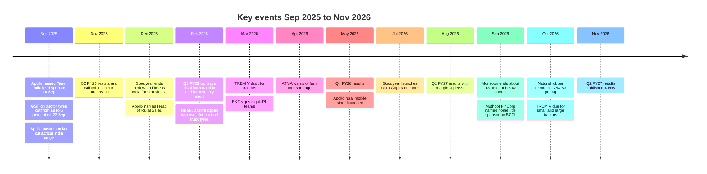

# 03. Latest Developments and News (January 2025 to November 2026)

Prepared 6 November 2026

**Purpose.** This file lists what has happened since January 2025 that bears on Apollo Tyres, the Team India sponsorship and the Indian farm-tyre market. It explains why each development matters for the case and keeps reported facts apart from forecasts and opinion.

Full source list with reliability ratings: 17_Source_Register_and_Verification.md

> **How to read this file**
> - **[Verified fact]**: a primary source, or two independent credible sources.
> - **[Fact - single source]**: one source only. Treat with care.
> - **[Interpretation]**: a reading of the facts by the research team. Not a reported fact.
> - **[Forecast]**: a projection by a rating agency, analyst or company.
> - **[Unverified]**: a secondary claim not confirmed by a primary source, or a page the researchers could not open.
> - Where a figure was seen only in a search snippet, the row says so. Where sources disagree, both figures appear.
> - Money is in Rs crore (1 crore = 10 million). Results are consolidated unless stated. "FY26" is April 2025 to March 2026.
> - Related files: company profile in 01_Apollo_Tyres_Company_Research.md; cricket rights and calendar in 02_Cricket_Assets_and_Sponsorships.md; competitors in depth in 07_Competitor_Analysis.md; forward-looking trends in 08_2028_Market_Trends.md.

---

## 1. What matters most

- **Record FY26 tractor year.** Domestic tractor dispatches reached about 11.6 lakh units (+23.5%) after the Goods and Services Tax (GST) cut. This enlarged the base of tractors that will need replacement tyres. [Verified fact]
- **Tyre GST fell from 18% to 5% on tractor tyres (22 September 2025).** Every brand benefited, so FY26 farm growth cannot be credited to cricket. [Verified fact]
- **Management links cricket to rural and farm traction, but publishes no measurement.** The key quote is from the 5 February 2026 earnings call. [Verified fact] that it was said; the claim itself is management assertion.
- **Costs and prices are rising.** Natural rubber hit a record Rs 284.50 per kg on 13 October 2026, and Apollo targets cumulative India price rises of 15-16%. [Verified fact] on the record price; [Fact - single source] on the 15-16% target.
- **The 2026 monsoon ended about 13% below normal.** Farm cash flow in the second half of FY27 is under pressure. [Verified fact]
- **Farm tyre supply is tight.** Apollo's vice chairman and managing director said on 5 February 2026 there were shortages "in farm". The tyre-makers' body (ATMA) warned of farm-tyre shortages on 29 April 2026. The announced Rs 5,800 crore capex covers car and truck-bus tyres only. [Verified fact] / [Fact - single source]
- **Apollo is organising for rural.** It named a national Head of Rural Sales (December 2025) and launched rural mobile stores (20 May 2026). [Fact - single source] / [Verified fact]
- **Rivals are moving.** Goodyear kept its India farm business and launched a tractor tyre (1 July 2026). JK launched a farm tyre and rural outlets. BKT signed eight IPL teams (25 March 2026). [Verified fact] / [Fact - single source]
- **Q2 FY27 results were published on 4 November 2026.** Revenue Rs 7,968 crore (+16.7%); net profit Rs 292 crore (+13.3%); operating margin about 11% against 15.3% a year earlier. The coverage read made no comment on farm, rural demand or the cricket sponsorship. [Fact - single source; company release not opened]

---

## 2. Timeline at a glance

---

## 3. Chronology, January 2025 to November 2026

No relevant dated events for January to March 2025 were retrieved. Publication dates are given where the notes give them.

| Event date | What happened | Source (publication date) | Label | Why it matters |
|---|---|---|---|---|
| Apr 2025 | Goodyear India's US parent announced a strategic review of its India farm business. Press reported a possible sale at about Rs 2,500-2,700 crore. | [Autocar Pro](https://autocarpro.in/news/goodyear-to-review-farm-tire-business-in-india-125986); [Tyre News UK](https://www.tyrenews.co.uk/news/goodyear-considers-2-500-crore-sale-of-indian-farm-tyre-business) (Apr 2025; month only, seen as snippets) | [Verified fact] (review); [Unverified] (sale price) | Apollo's main farm rival spent most of 2025 with an uncertain owner. |
| May 2025 | JK Tyre started "Steel Wheels" rural centres (first in Farrukhnagar, Haryana) for towns of 1 lakh people or fewer, run by local entrepreneurs. | [TyrePress](https://www.tyrepress.com/2025/05/jk-tyre-expands-retail-footprint-in-rural-india/) (May 2025) | [Fact - single source] | A rival is building rural retail, though not farm-specific. |
| Jun 2025 | Birla Tyres took a new identity after revival by Himadri Speciality and Dalmia Bharat Refractories (acquired Oct 2023). FY26 revenue Rs 187 crore; AgriPlus and AgriWin tractor tyre series launched; target Rs 3,000 crore. | [Insolvency Tracker](https://insolvencytracker.in/2026/08/03/birla-tyres-targets-%E2%82%B93000-crore-revenue-as-himadri-revives-bankrupt-brand-with-premium-products-exports/) (3 Aug 2026) | [Fact - single source]; target is [Forecast] | A small but growing value rival is aiming at agri tyres. |
| 3 Sep 2025 | The 56th GST Council cut GST on tractors and tractor tyres (rates in Section 5). Effective 22 Sep 2025. | [Autocar Pro](https://www.autocarpro.in/news/gst-on-tractors-and-tractor-parts-cut-to-5-128423) (3 Sep 2025; no effective date in text); [Apollo release](https://corporate.apollotyres.com/press-and-media/news/corporate/gst-benefit) (Sep 2025) | [Verified fact] | Lower tyre and tractor costs lifted demand for all brands. |
| 13 Sep 2025 | CEAT said tax cuts should lift tractor-tyre demand and that it would pass the benefit on. Farm tyres are about 10% of CEAT revenue. | [Republic World](https://www.republicworld.com/business/ceat-sees-tax-cuts-driving-demand-for-tractor-and-entry-level-motorcycle-tyres) (13 Sep 2025) | [Fact - single source] | Shows rivals expected the same GST tailwind as Apollo. |
| 16 Sep 2025 (c.) | BCCI named Apollo lead sponsor of the Indian men's and women's teams after Dream11 left (online gaming ban). Term: Apollo says "3-year"; press says about 2.5 years to March 2028 (one source: 2027). Reported value Rs 579 crore (BCCI has not disclosed it; filing reportedly silent). Apollo's page lists home-series title rights; the BCCI named Muthoot FinCorp home title sponsor by official release on 26 Sep 2026 (see below). Rival bids reported: Canva Rs 544 crore (some outlets Rs 554 crore), JK Cement Rs 477 crore. | [Apollo release](https://corporate.apollotyres.com/press-and-media/news/corporate/BCCI-sponsorship/) (undated page); [Onmanorama](https://www.onmanorama.com/sports/cricket/2025/09/16/bcci-announces-apollo-tyres-lead-sponsor-replacing-dream11.amp.html) (16 Sep 2025); [Autocar Pro](https://www.autocarpro.in/news/apollo-tyres-secures-team-india-jersey-sponsorship-in-%E2%82%B9579-crore-deal-128686) (Sep 2025) | [Verified fact] (award); [Fact - single source] (Rs 579 crore); terms disputed | Apollo's release states no rural or farm objective. Full rights detail is in 02_Cricket_Assets_and_Sponsorships.md. |
| 22 Sep 2025 | Apollo cut prices across its India range, including agri tyres, passing on "100% of the tax benefits". | [Apollo release](https://corporate.apollotyres.com/press-and-media/news/corporate/gst-benefit); [Outlook Business](https://www.outlookbusiness.com/corporate/apollo-tyres-to-reduce-prices-to-pass-on-gst-rate-cut-benefit-to-customers) (Sep 2025) | [Verified fact] | Agri tyres were named in the price cut, which coincided with the tractor boom. |
| Sep 2025 | Tractor makers' (TMA) domestic dispatches 1,46,180 units, +45% year on year. The linked headline says 43%; the notes give 45%. | [Autocar Pro](https://www.autocarpro.in/news/domestic-tractor-sales-soar-43-in-september-fueled-by-gst-cut-festive-demand-129171) (Sep 2025) | [Fact - single source] | Sets a very high base for September 2026 comparisons. |
| Sep-Nov 2025 | Works Council settlement on closing Apollo's Enschede plant in the Netherlands. Notes disagree on timing: Sep 2025 (Annual Report) vs Nov 2025 (InvestyWise). Cost: about EUR 17 million estimated restructuring (InvestyWise) vs EUR 43 million fixed-asset write-off plus about EUR 55 million cash provision (Annual Report and Q4 FY26 call). Production stopped by 30 Jun 2026. Enschede was the group's only European agri and off-highway plant. | [InvestyWise](https://www.investywise.com/?p=24995) (18 Nov 2025); [Annual Report FY2026](https://corporate.apollotyres.com/content/dam/orbit/apollo-corporate/investors/financial-reporting/annual-report/2025-26/AGM%20Notice%20and%20Annual%20Report%20FY2026.pdf) (Jul 2026) | [Verified fact] (closure); costs and timing conflict | Europe is being cut back, so India is where growth money goes. The CFO said the lost European agri business was loss-making. |
| 14 Nov 2025 | Q2 FY26 results and earnings call (Section 4). Neeraj Kanwar tied the sponsorship's rural reach first to car and two-wheeler tyres, with agri and truck as the addition: it would "give us reach in the rural markets" and have impact "on agri and on truck". | [Business Standard](https://www.business-standard.com/markets/capital-market-news/apollo-tyres-slides-after-q2-pat-slumps-13-yoy-to-rs-258-cr-125111401207_1.html) (14 Nov 2025); [Apollo Q2 FY26 transcript](https://corporate.apollotyres.com/content/dam/orbit/apollo-corporate/investors/shareholding-information/investors-call-transcript/2025-26/Q2FY2026%20Analyst%20Call%20Transcript.pdf) (Nov 2025) | [Verified fact] | First results after the GST cut and the sponsorship signing. |
| Nov 2025 | India's trade body began a probe (DGTR) into dumping of a synthetic rubber used in tyre inner liners, from the US and China. | [Autocar Pro](https://www.autocarpro.in/news/dgtr-initiates-dumping-probe-against-us-and-china-over-key-tyre-rubber-129607) (Nov 2025) | [Fact - single source] | An input-cost issue; the outcome is not in the notes. |
| 5 Dec 2025 | Goodyear's parent ended its review and kept the India farm business. | [Tyre Trends](https://www.tyre-trends.com/news/goodyear-shelves-plan-to-exit-india-farm-tyre-business-after-strategic-review) (Dec 2025) | [Verified fact] | The farm rival stays in the market, with a settled owner. |
| Dec 2025 | Provisional EU deal moved the EU Deforestation Regulation (EUDR) to 30 Dec 2026 for large and medium firms. Final adoption not confirmed. | [Fibre2Fashion](https://www.fibre2fashion.com/news/sustainability-news/eu-leaders-agree-to-delay-simplify-deforestation-free-rules-306948-newsdetails.htm) (Dec 2025) | [Fact - single source] | Relevant to rubber supply and exports only; no effect on Indian farm demand was found. |
| 18 Dec 2025 | Revised SMAM (farm-mechanisation subsidy scheme) guidelines issued. Reports say emphasis shifts to custom hiring centres and farmer producer organisations. Subsidy rates quoted as 25-50%, 40-50% and 40-80%. | [HP Agriculture Dept PDF](https://agriculture.hp.gov.in/wp-content/uploads/2026/02/SMAM-Revised-Operational-Guidelines-dated-18-12-2025.pdf) (not opened) | [Unverified] | Subsidised purchases feed the tractor base, but the rates are unconfirmed. |
| 24 Dec 2025 (reported) | Rohit Singh took charge as national Head, Rural Sales: expand rural trade reach and non-urban distribution. No targets disclosed. | [Indiantelevision](https://indiantelevision.com/mam/apollo-tyres-names-rohit-singh-as-rural-sales-head/) (24 Dec 2025) | [Fact - single source] | An owner for any rural or farm programme. |
| Jan 2026 | A SportBusiness headline reads "Apollo expands dealer network in wake of Team India deal". The page returned an error and was not read. | [SportBusiness](https://sponsorship.sportbusiness.com/2026/01/apollo-expands-dealer-network-in-wake-of-team-india-deal/) (Jan 2026) | [Unverified] | Do not cite as evidence of dealer growth until read. |
| 4 Feb 2026 | Apollo launched the cricket campaign "Har Safar Mein Dum Hai" with Tendulkar, Kohli, Rohit Sharma, KL Rahul, Shubman Gill and Arshdeep Singh. No rural mention. | [Tyre Trends](https://tyre-trends.com/news/apollo-tyres-launches-new-ad-campaign-honouring-indias-cricketing-spirit) (4 Feb 2026) | [Fact - single source] | The campaign is aimed at a general audience, not farmers. |
| 5 Feb 2026 | Q3 FY26 results and call (Sections 4 and 7). The board approved Rs 5,800 crore (some sources Rs 5,810 crore) capex for FY27-FY29 for car and truck-bus tyres at the Andhra Pradesh plant. Neeraj Kanwar: "shortages in TBR and passenger car, and in farm". | [Apollo Q3 FY26 transcript](https://corporate.apollotyres.com/content/dam/orbit/apollo-corporate/investors/shareholding-information/investors-call-transcript/2025-26/Q3FY2026%20Analyst%20Call%20Transcript.pdf) (5 Feb 2026); [Apollo release](https://corporate.apollotyres.com/press-and-media/news/financial/q3-fy26/) | [Verified fact] | Farm is named as short of supply, yet no announced capex is for farm tyres. |
| 14-16 Feb 2026 | JK Tyre launched Shresth Plus at the Krishi Darshan Expo, Hisar, with live tractor stunts and a stated "premiumisation" strategy. Sizes, price and warranty not stated. | [Equipment India](https://equipmentindia.com/construction-machinery-news/top-equipment-news/webexclusive/JK-Tyre-Strengthens-Farm-Portfolio-with-Launch-of-Shresth-Plus-/130460) (16 Feb 2026) | [Fact - single source] | A rival is investing in farmer-facing launches. |
| 3 Mar 2026 | Draft tractor emission rules (TREM V) reported (Section 5). | [Autocar Pro](https://www.autocarpro.in/news/govt-drafts-trem-v-for-tractors-from-october-2026-25%e2%80%9375-hp-segment-gets-a-breather-131469) (3 Mar 2026) | [Fact - single source]; final text unconfirmed | The core 25-75 hp tractors are unaffected until later. |
| 18 Mar 2026 | CRISIL forecast FY27 tractor sales growth of 0-2%, citing a high base and El Nino. | [CRISIL](https://www.crisilratings.com/en/home/newsroom/press-releases/2026/03/high-base-effect-el-nino-dampener-for-tractor-sales-growth-next-fiscal.html) (18 Mar 2026) | [Forecast] | Sets the expected plateau after FY26. |
| 22 Mar 2026 | Neha Agarwalla named Divisional Head, Marketing Communications and Sponsorships. Udyan Ghai reportedly said cricket will be central to brand activity for three years. Seen in a search snippet only. | [Pulse CMO](https://www.pulse.bot/cmo-pulse/news/apollo-tyres-names-neha-agarwalla-as-divisional-head-marketing-comms-sponsorships-1725b8e3-40c3-4950-a4f6-43e8ab6e7e6a); [exchange4media](https://www.exchange4media.com/marketing-news/no-jersey-jinx-talk-its-always-data-for-us-apollo-tyres-udyan-ghai-on-team-india-deal-147610.html) (page blocked) (Mar 2026) | [Unverified] | Suggests cricket stays central, but the claim is unconfirmed. |
| 25 Mar 2026 | BKT became Official Tyre Partner of 8 of 10 IPL teams for 2026 (KKR, RCB, SRH, RR, MI, GT, PBKS, LSG). BKT is a farm and off-highway specialist. The article does not say the activity targets farm tyres. | [Autocar Pro](https://www.autocarpro.in/news/bkt-tyres-signs-on-as-official-tyre-partner-for-eight-ipl-teams-ahead-of-2026-season-131803) (25 Mar 2026) | [Verified fact] | A direct farm-tyre rival is now in IPL cricket. CEAT's IPL deal runs to about 2028 (see 02_Cricket_Assets_and_Sponsorships.md). |
| Apr-Aug 2026 | Price rises: Apollo 6-8% for the quarter (Autocar Pro, 7 Jun 2026); 7-9% across three lots in Q1 with a 15-16% cumulative target (call summary); passenger-car replacement rises of 2-5% signalled by several makers from April. Farm-specific pricing is not in the notes. | [Autocar Pro](https://www.autocarpro.in/news/tyre-makers-walk-tightrope-in-fy27-as-demand-holds-firm-but-costs-surge-132973) (7 Jun 2026); [VahanBazaar](https://vahanbazaar.in/news/tyre-price-hike-april-2026-mrf-apollo-ceat) (25 Apr 2026) | [Verified fact] (hikes); 15-16% is [Fact - single source] | Farmers face higher tyre prices in a weak-monsoon year. |
| 10 Apr 2026 | FY26 tractor totals published (Section 6). | [Autocar Pro](https://www.autocarpro.in/news/tractor-industry-ends-fy26-on-a-high-march-domestic-sales-rise-29-on-festive-demand-132068) (10 Apr 2026) | [Verified fact] | Confirms the record year. |
| 29 Apr 2026 | ATMA asked for wider customs-duty relief on tyre inputs, warning that "Farm tyre shortages in particular could affect agricultural supply chains". | [Autocar Pro](https://www.autocarpro.in/news/tyre-industry-body-seeks-duty-relief-amid-west-asia-supply-disruptions-132307) (29 Apr 2026) | [Fact - single source] | The industry itself flags farm tyres as supply-tight. |
| 13 May 2026 | Cabinet approved kharif (monsoon-season) minimum support prices (MSP) for 2026-27. | [GKToday](https://www.gktoday.in/union-cabinet-approves-higher-msp-for-14-kharif-crops/) (13 May 2026) | [Verified fact] | See Section 6. |
| 14 May 2026 | Q4 and FY26 results (Section 4). Chairman cited "positive rural sentiment". | [Apollo release](https://corporate.apollotyres.com/press-and-media/news/financial/q4-fy26/); [TyrePress](https://www.tyrepress.com/2026/05/apollo-tyres-q4-fy26-revenue-up-14/) (14 May 2026) | [Verified fact] | Confirms Rs 28,471 crore FY26 revenue. |
| 20 May 2026 | Apollo flagged off its first Rural Mobile Store van at Pandavapura, Mandya (Karnataka). 25 vans planned over 18-24 months. Vans carry a tyre selection and staff who explain tyre care; farm or tractor tyres are not mentioned. | [Autocar Pro](https://www.autocarpro.in/news/apollo-tyres-launches-mobile-store-to-reach-rural-customers-132704) (20 May 2026); [TyrePress](https://www.tyrepress.com/2026/05/apollo-tyres-launches-rural-mobile-store/) (May 2026) | [Verified fact] | A new rural channel, though not yet farm-specific. |
| 19 Jun 2026 (notification) | Five-year anti-dumping duty (USD 75-1,748 per tonne) on tyre-chemical sulphenamide accelerators from China, the EU and the US. A temporary customs-duty exemption on synthetic rubber and some resins ran to 30 Jun 2026; what happened after is not in the notes. | [Angel One](https://www.angelone.in/news/economy/india-enforces-anti-dumping-duty-on-chemical-imports-from-china-eu-us) (Jun 2026) | [Fact - single source] | Input duties, not finished-tyre protection. |
| 30 Jun 2026 | Enschede production stopped (see Sep-Nov 2025 row). | Annual Report FY2026 (link above) | [Verified fact] | Closes European agri manufacturing. |
| 1 Jul 2026 | Goodyear India launched the Ultra Grip tractor tyre (14.9-28 first) at a Chandigarh showcase for about 100 dealers. MD Arvind Bhandari cited "rising demand from Indian farmers". | [Autocar Pro](https://www.autocarpro.in/news/goodyear-india-launches-ultra-grip-tractor-tire-for-farm-segment-133345) (1 Jul 2026) | [Fact - single source] | The farm leader is refreshing its range and courting dealers. |
| 2 Jul 2026 | ICRA noted a weak June monsoon: kharif sowing -23% year on year (25 June) and reservoirs at 26% of live capacity vs 36% a year earlier. | [ICRA](https://www.icra.in/Research/ViewResearchReport/7012) (2 Jul 2026) | [Verified fact] | Early warning of rural stress. |
| 6-7 Aug 2026 | Q1 FY27 results (Section 4); sources split on the date and on margin. | [Kotak Neo](https://www.kotakneo.com/financial-results/apollo-tyres-share-price-q1fy2026-27-results/); [InvestyWise](https://www.investywise.com/?p=104606) (11 Aug 2026); [FilingReader](https://filingreader.com/news-wire/mumbai/2026-08-07/apollo-tyres-reports-q1-revenue-growth-at-inr-73978-mn) (7 Aug 2026); [call summary](https://cofacto.ai/market-news/apollotyre-q1-fy27-earnings-call) (Aug 2026) | [Fact - single source] per metric | Growth is strong, but margins fall as raw materials surge. |
| Aug 2026 | Farm tractor retail: August 87,977 units (+0.84%), hit by monsoon deficit. | [Autocar Pro](https://www.autocarpro.in/news/tractor-retail-sales-flat-at-87977-units-amid-monsoon-stress-fada-134566) (Sep 2026) | [Fact - single source] | First clear sign that retail demand cooled. |
| 25-26 Sep 2026 | Press reported (25 Sep) Muthoot FinCorp as title sponsor of India home matches to March 2028, about Rs 4.85 crore per match (about Rs 150 crore for around 35 matches), branded "Blue Muthoot". The BCCI confirmed it by official release on 26 Sep 2026, as reported by Business Today. Scope as reported: international series hosted in India and BCCI domestic competitions; reported value about Rs 130 to 150 crore. Campa, SBI Life and ChatGPT were added as associate partners. | [Onmanorama](https://www.onmanorama.com/sports/cricket/2026/09/25/bcci-signs-150-crore-deal-muthoot-fincorp-title-sponsorship-team-india-.html) (25 Sep 2026); [Sportcal](https://www.sportcal.com/news/bcci-adds-chatgpt-sbi-life-campa-sponsorships/) (2026); [Business Today](https://www.businesstoday.in/sports/story/muthoot-fincorp-becomes-bccis-title-sponsor-for-home-cricket-till-2028-558061-2026-09-27) (27 Sep 2026) | [Fact - single source; BCCI release reported by press] | Contradicts Apollo's page. Apollo should not be presented as holding home-series title rights. |
| 30 Sep 2026 | 2026 monsoon ended about 12.6-13% below normal (Section 6). Rabi MSP for 2027-28 approved about this date (wheat Rs 2,610 per quintal per a headline, snippet only). | [UNI](https://www.uniindia.com/national/weather-monsoon-deficit/198635) (30 Sep 2026); [Business Standard MSP topic](https://www.business-standard.com/topic/msp) | [Verified fact] (monsoon); [Unverified] (wheat MSP) | Weak rural cash flow ahead. |
| Sep 2026 | FADA retail: 76,906 units (+13.75%; rural +15.6%, urban +6.4%). FADA says the September 2025 base was distorted by pre-GST deferrals. Mahindra domestic 50,208 (-23%); Escorts Kubota domestic 14,911 (-16.2%). | [Autocar Pro](https://www.autocarpro.in/news/tractor-and-ce-retail-show-mixed-september-performance-fada-135072) (Oct 2026, snippet); [Mahindra](https://www.mahindra.com/news-room/press-release/en/mahindra-farm-equipment-business-sells-50208-tractors-in-september-2026) (Oct 2026); [TractorJunction](https://www.tractorjunction.com/tractor-news/escorts-kubota-sells-15214-tractors-in-september-2026/) (Oct 2026) | [Fact - single source] (retail); [Verified fact] (Mahindra) | Retail and factory dispatches tell different stories; read with care. |
| 1 Oct 2026 | TREM V due to apply to tractors below 25 hp and above 75 hp (draft; final status unconfirmed). | Autocar Pro and CRISIL (above) | [Fact - single source] | Does not touch the core band. |
| 13 Oct 2026 | Natural rubber (RSS-4, Kottayam/Kochi) hit a record Rs 284.50 per kg (prior record Rs 284 on 1 Aug 2026). | [Onmanorama](https://www.onmanorama.com/news/business/2026/10/13/rubber-price-in-kerala-hits-record-high-domestic-rates-top-global-market.amp.html) (13 Oct 2026) | [Fact - single source] | Pushes tyre prices up just as farmers face a weak monsoon. |
| Oct 2026 | Mahindra domestic 62,626 (-13%); Escorts Kubota domestic -10.9%. Both cite the high GST-cut base and festive timing. | [CMV360 Mahindra](https://www.cmv360.com/news/mahindra-tractor-sales-fall-13-in-october-2026-as-festive-calendar-shifts); [CMV360 Escorts Kubota](https://www.cmv360.com/news/escorts-kubota-tractor-sales-fall-10-to-16-921-units-in-october-2026-exports-grow-36) (Nov 2026) | [Fact - single source] | FY27 tractor sales are flattening on a high base. |
| 4 Nov 2026 | Apollo published Q2 FY27 results (Section 4): revenue Rs 7,968 crore (+16.7%), net profit Rs 292 crore (+13.3%), operating margin about 11% against 15.3%. | [Autocar Pro](https://www.autocarpro.in/news/apollo-tyres-q2-net-profit-rises-13-percent-to-rs-2923-crore-135721); [Multibagg](https://www.multibagg.ai/market-pulse/articles/apollo-tyres-q2-fy27-results-cmw335dzg000y2gtavmkppre1) | [Fact - single source; company release not opened] | Latest hard evidence on Apollo's July-September trading. The coverage read made no comment on farm, rural or the cricket sponsorship. |

---

## 4. Apollo's results and guidance

**Q2 FY27 (July to September 2026) results were published on 4 November 2026** (see the Q2 FY27 row in 4a). Q4 FY25 and Q1 FY26 were not retrieved; only FY25 revenue (Rs 26,123 crore), FY25 profit after tax (PAT, Rs 1,121 crore) and Q1 FY26 PAT (Rs 12.9 crore) are known.

### 4a. Reported results

| Quarter | Revenue | Growth | Margin | Profit after tax | Management comment on rural, farm or sponsorship | Label |
|---|---|---|---|---|---|---|
| Q2 FY26 (announced 13-14 Nov 2025) | Rs 6,831 crore (India about Rs 4,715 crore) | +6.1% (India +5.7%; one source +6%) | EBITDA Rs 1,021 crore, 14.9% (India 15.3%) | Rs 258 crore, -13.2% (restructuring charges) | Recovery "significantly bolstered by the recent GST rationalization". Kanwar tied rural reach first to car and two-wheeler tyres, with agri and truck as the addition: sponsorship "will give us reach in the rural markets... It will also have impact on agri and on truck." CFO: India volume +4%; "The big demand upliftment in terms of volume growth was in the farm segment, the two-three wheelers and the others." | [Verified fact] |
| Q3 FY26 (5 Feb 2026) | Rs 7,743 crore (highest ever); India Rs 5,139 crore | +12% (India +13%+) | Operating profit Rs 1,186 crore, 15.3% (vs 13.7%); India EBITDA 14.5% (vs 11.1%) | Rs 471 crore, +40% | CFO credited demand plus "the reduced GST rates" and sponsorship visibility "especially in the consumer tyres category". See Section 7 for the farm quote. | [Verified fact] |
| Q4 FY26 (14 May 2026) | Rs 7,336 crore | +14% | Operating profit Rs 1,069 crore (+28%); about 14.6% derived by the research team | Rs 631 crore (includes a Rs 574 crore one-off tax reversal) | Chairman: "optimistic about sustained demand momentum in India", citing positive rural sentiment. Farm not mentioned. | [Verified fact]; margin is [Interpretation] |
| FY26 | Rs 28,471 crore (vs Rs 26,123 crore) | +9% | Operating profit Rs 4,143 crore (+16%); about 14.6% | Rs 1,372 crore (after Rs 742 crore after-tax restructuring and impairment charges) | Total dividend Rs 6 per share. India recorded its highest-ever quarterly revenue in Q4. | [Verified fact] |
| Q1 FY27 (6-7 Aug 2026) | Kotak Neo: total income Rs 7,456 crore. InvestyWise: about Rs 7,400 crore. FilingReader: INR 73,978 million. India Rs 5,460 crore (FilingReader: INR 54,619 million) | Kotak +13.3%; others +12.8%. India +15.6% (highest ever, volume-led) | **Conflict.** InvestyWise and FilingReader: EBITDA margin 11.7% (-150 bp), EBITDA about Rs 870 crore. Kotak: EBITDA Rs 950 crore, 12.7% of total income. Different bases. Europe EBITDA 8.9% | Kotak: Rs 349 crore (vs Rs 12.9 crore, a restructuring-hit base). FilingReader: INR 3,488 million | Call summary says demand for "truck, bus, and farm replacement tyres" was "surprisingly strong" despite El Nino risk. | [Fact - single source] per metric; the primary release and transcript were not retrieved |
| Q2 FY27 (4 Nov 2026) | Rs 7,968 crore (+7.7% on Q1 FY27 Rs 7,398 crore) | +16.7% on Rs 6,831 crore | Operating profit Rs 855 crore against Rs 1,021 crore; margin about 11% against 15.3% (aggregator's figure) | Rs 292 crore, +13.3% (Rs 258 crore a year earlier); exceptional pre-tax charge Rs 26 crore (Europe restructuring) | The coverage read made no comment on farm tyres, rural demand or the cricket sponsorship. Apollo's own release, presentation and call transcript were not opened. | [Fact - single source; company release not opened] |

**Raw-material cost in Q1 FY27 is disputed.** InvestyWise says costs rose about 17%. A call summary says the basket rose about 25%, including 7-8 points from rupee depreciation. Definitions are unclear. [Fact - single source] each.

### 4b. Guidance, plans and forecasts (not results)

| Statement | Source and date | Label |
|---|---|---|
| Q3 FY26 revenue growth at least at par with Q2, with stable or better profitability (Q3 beat this). | Q2 FY26 call, Nov 2025 | [Forecast] |
| India capacity utilisation in the high 80s; TBR near 100% (Neeraj Kanwar). Replacement pricing "largely remained stable" with no pricing action. | Q3 FY26 call, 5 Feb 2026 | [Verified fact] (statements) |
| FY27 consolidated capex: "closer to Rs 3,000 crores" (CFO, 5 Feb 2026), of which growth capex about Rs 2,000 crore. **Conflict:** Autocar Pro (7 Jun 2026) gives Rs 3,500 crore. Rs 5,800 crore for FY27-FY29 (some sources Rs 5,810 crore) is for car and truck-bus tyres. | Q3 call; [Autocar Pro](https://www.autocarpro.in/news/tyre-makers-walk-tightrope-in-fy27-as-demand-holds-firm-but-costs-surge-132973) | [Forecast] |
| Advertising and promotion (A&P): about Rs 150 crore (A&P plus certain sales promotion) in Q3 FY26, called an "anomaly". Normal level about 2% of sales, settling at "about 2.5%" from FY27. | Q3 FY26 call | [Verified fact] (what was said); level is [Forecast] |
| A&P cut about 50% in Q1 FY27, with spend to track the BCCI schedule. The base period is unclear. | Call summary, Aug 2026 | [Unverified] |
| Further 1-2 price rises to reach about 15-16% cumulative; natural rubber expected to cool from Q3 after rising from Rs 225 to about Rs 260 per kg in Q2. Competitors matched 9-10% rises. | Call summary, Aug 2026 | [Forecast]; [Fact - single source] |
| Raw-material cost expectations for Q1 FY27: Apollo "high teens" sequentially; CEAT 15-20%; JK Tyre 18-20%. | [Autocar Pro](https://www.autocarpro.in/news/tyre-makers-walk-tightrope-in-fy27-as-demand-holds-firm-but-costs-surge-132973), 7 Jun 2026 | [Forecast] |

---

## 5. Policy and regulation

### 5a. GST rates (56th GST Council, announced 3 Sep 2025, effective 22 Sep 2025)

GST is the Goods and Services Tax charged on sales. [Verified fact]

| Item | Old rate | New rate |
|---|---|---|
| Tractors | 12% | 5% |
| Tractor tyres and tubes | 18% | 5% |
| Road tractors for semi-trailers above 1800 cc | 28% | 18% |
| Other new pneumatic tyres (cars, trucks, two-wheelers) | 28% | 18% |

The old rate on tractor parts is reported differently by sources (18% in most, 28% in one), so parts are left out of the table. Road tractors above 1800 cc are excluded from the cut.

Reported effect: tractor ex-showroom prices fell Rs 40,000-60,000 per unit [Fact - single source]. CRISIL calls the cut the main catalyst of FY26 tractor volume growth (about +22%). The Autocar Pro rate article gives no effective date; Apollo's release and CRISIL give 22 Sep 2025. A Busy.in page still shows old rates; ignore it.

### 5b. Other rules

| Topic | What the notes show | Label |
|---|---|---|
| Tractor emission norms (TREM) | Draft from the transport ministry, reported 3 Mar 2026: below 25 hp and above 75 hp move to TREM V from 1 Oct 2026. 25-50 hp moves to TREM IIIAA on 1 Apr 2028, then TREM V on 1 Apr 2032. 50-75 hp (now TREM IV) moves to TREM V in 2032. CRISIL says the 25-75 hp band is about 90% of volume and is unaffected until FY2032. Under the earlier all-segment 1 Apr 2026 plan, prices in that band could have risen 15-20%. A July 2026 Tribune item (snippet) says norms start in phases from 1 Oct 2026. **Draft. Whether the final text kept the deferral is unconfirmed.** Pull-forward buying ahead of TREM V is cited as an FY26 volume driver. | [Fact - single source] |
| Trade remedies and input duties | Anti-dumping duty on sulphenamide accelerators (19 Jun 2026, five years). DGTR probe on inner-liner synthetic rubber (opened Nov 2025). Temporary customs-duty exemption on synthetic rubber and some resins to 30 Jun 2026. No 2026 duty notification on finished tyres was found, though an Apollo call summary expects anti-dumping duties on Chinese tyres to help lower-end brands. | [Fact - single source] |
| ATMA request (29 Apr 2026) | Wider customs relief on cord fabric, bead wire, steel cord, carbon black, oils and chemicals; temporary exemption from quality-control orders on bead wire. Crude-linked inputs are 60-70% of tyre raw-material cost. | [Fact - single source] |
| Rubber-related rules | EUDR delayed to 30 Dec 2026 (provisional; final adoption unconfirmed). A Rubber Board official said the delay supports rubber markets short term. | [Fact - single source] |
| Subsidy schemes (SMAM) | Revised guidelines dated 18 Dec 2025; shift toward custom hiring centres and farmer producer organisations; rates quoted vary widely. Maharashtra and Bihar expanded farm-machinery support (Autocar Pro, Apr 2026). | [Unverified] |
| BIS tyre labelling | Data unavailable – requires primary research or company confirmation. | n/a |

[Interpretation] GST cut, subsidies and credit enlarged the installed tractor base. Replacement-tyre demand follows with a lag.

---

## 6. Industry backdrop

**Tractors.** TMA is the tractor makers' body (wholesale dispatches). FADA is the auto dealers' body (retail registrations).

| Measure | Figure | Label |
|---|---|---|
| FY26 domestic wholesale (TMA) | 11,60,231 units, +23.47%; exports 1,05,593 (+7%). CRISIL estimates about +22%. | [Verified fact] |
| FY26 retail (FADA) | 10,50,077 vs 8,82,825 (+18.9%); first time above 10 lakh; rural 81% of retail | [Fact - single source] |
| March 2026 domestic wholesale | 1,03,193 (+29%), flattered by Navratri timing | [Fact - single source] |
| FY26 drivers cited | GST cut, above-normal monsoon, MSP rises, state subsidies, TREM V pull-forward, about 95% of purchases on credit with 125 bp of rate cuts, 2018-19 replacement cycle | [Fact - single source] |
| FY27 forecasts | CRISIL: 0-2% growth to about 1.2 million; replacement 60-65% of domestic sales, first-time buyers 35-40%. ICRA: domestic +1% to +4%, moderating. | [Forecast] |
| FY27 year to date, wholesale | April 2026: 1,05,021 (+26.8%). ICRA: April-July +19% (secondary summary). Mahindra Apr-Sep domestic 2,62,872 (+6%). Escorts Kubota Apr-Sep domestic 68,085 (+11.3%); Apr-Oct total about 87,800 (+5.5%). | [Fact - single source] |
| FY27 year to date, retail (FADA) | June +25%; July +28.1%; August +0.84%; September +13.75% | [Fact - single source] |
| Industry-wide TMA total for April-October 2026 | Data unavailable – requires primary research or company confirmation. | n/a |

**Monsoon.** The long-period average (LPA) is the normal seasonal rainfall. El Nino is a Pacific warming pattern that tends to weaken the monsoon.

- **2025:** 108% of LPA (937.2 mm vs 868.6 mm), "normal"; second straight above-normal year. [Verified fact] (seen as a snippet of the IMD document)
- **2026:** IMD forecast cut from 92% (13 Apr) to 90% (29 May). Onset 4 June, three days late. June rain 60% of LPA. Season ended 30 Sep at about 87% of LPA (759 mm), 12.6-13% below normal. Rankings differ: "fourth weakest since 2001" (UNI, citing IMD) vs "worst since 2015" (Business Standard). El Nino to peak in November. ICRA sees FY27 agricultural growth at risk at 1.4% (FY26: 3.0%). [Verified fact] on the outcome; the ICRA figure is [Forecast].
- Kharif production and sowing final numbers: Data unavailable – requires primary research or company confirmation.

**Minimum support price (MSP)** is the government price at which it buys crops. Kharif 2026-27 (approved 13 May 2026): common paddy +Rs 72 to Rs 2,441 per quintal (about 3%; some farmer groups called it inadequate). [Verified fact] Rabi 2027-28 (about 30 Sep 2026): wheat Rs 2,610 per quintal per a headline seen as a snippet. [Unverified] Rabi 2026-27 round (Oct 2025): Data unavailable – requires primary research or company confirmation.

**Rubber and tyre prices.** Natural rubber: about Rs 195 per kg (Feb 2026, Apollo), Rs 225 (Q1), about Rs 260 expected in Q2 (call summary), record Rs 284.50 on 13 Oct 2026 (international RSS-4 Rs 282.16). [Fact - single source] for the October price. Brent crude reportedly fell from USD 110 to USD 80-85 (call summary). Tyre price rises: Apollo 6-8% and a 15-16% target; CEAT about 5% plus 5% more; JK Tyre 4-5% on replacement plus 5-6%; BKT 3-5% plus 2%. No price cuts after the September 2025 GST pass-through. [Verified fact], multiple sources.

**Rural wages and rural demand indicators.** Data unavailable – requires primary research or company confirmation.

---

## 7. How the Team India sponsorship has performed so far

**Short answer:** management has asserted benefits. Nothing independent has been measured and published. No recall figure, rural or farm sales figure, or farm-segment effect size exists in the retrieved sources.

| Date | What was said or published | Label |
|---|---|---|
| 14 Nov 2025 (Q2 FY26 call) | Neeraj Kanwar: "Cricket transcends age, religion and income and is India's strongest unifier." On purpose: "I am hopeful and optimistic that this will give us reach in the rural markets of the country, where we see after GST, a huge demand for our car tyres and for two-wheel tyres. It will also have impact on agri and on truck." | [Verified fact] that it was said; hope, not result |
| 5 Feb 2026 (Q3 FY26 call) | Kanwar: the sponsorship "has garnered us extensive media attention and coverage, driving unparalleled brand reach and visibility and adding distribution" and "has boosted dealer morale and is already translating into positive business outcomes". On capacity: "Given what we have been able to do with BCCI, we are seeing a lot of traction coming from the rural market, specifically in three categories which is PCR, two-wheeler and farm category. And that's where the growth is coming." | [Verified fact] that it was said; the claim is management assertion |
| 5 Feb 2026 | CFO: brand visibility "has also led to the strong performance, especially in the consumer tyres category". A&P plus promotion about Rs 150 crore in Q3, an "anomaly". | [Verified fact] (statement) |
| 14 May 2026 | Chairman cites "positive rural sentiment"; the results release does not mention farm tyres. | [Verified fact] |
| Aug 2026 (Q1 FY27 call summary) | Farm replacement demand "surprisingly strong"; A&P cut about 50%. | [Unverified] |
| 2026 | Apollo's own brand-strength release reportedly cites Brand Finance: familiarity +15.8%, understanding +26.4%. A June 2026 report calls Apollo the "fastest climber in brand strength rankings for 2026". Pages not opened; company-published. | [Unverified] |
| Sep 2025 onward | Reports say Apollo will track awareness and recall before and after, and that sales gains "will take time". Apollo has said the deal should pay for itself through higher sales and margin (Angel One, snippet). | [Fact - single source] |
| Sep 2025 onward | Business Standard (29 Sep 2025) and Free Press Journal ran analysis; analysts expected a short-term margin hit. Pages not read. | [Unverified] |
| n/a | Rural or farm-specific recall or sales measurement. | Data unavailable – requires primary research or company confirmation. |

[Interpretation] The rural-traction claim and the Head of Rural Sales appointment point to a deliberate rural link. Attribution of farm sales to cricket cannot be verified from public data. This matters for the "measurable" requirement.

---

## 8. Data gaps

| Gap | Status |
|---|---|
| Q2 FY27 call transcript and any farm or rural comment | Data unavailable – requires primary research or company confirmation. |
| Apollo Q4 FY25 and Q1 FY26 results | Data unavailable – requires primary research or company confirmation. |
| Q1 FY27 primary release and call transcript (figures above come from secondary sources) | Data unavailable – requires primary research or company confirmation. |
| Apollo farm-tyre revenue share, volume or growth in 2025-26 | Data unavailable – requires primary research or company confirmation. |
| Apollo farm-tyre-specific pricing in 2026 | Data unavailable – requires primary research or company confirmation. |
| Any Apollo farm or tractor tyre launch dated 2025-26; digital farm moves; farm dealer count | Data unavailable – requires primary research or company confirmation. |
| Rural network size and Head of Rural Sales targets | Data unavailable – requires primary research or company confirmation. |
| Itemised Team India rights, per-match fees, and whether Apollo holds home-series title rights | Data unavailable – requires primary research or company confirmation. |
| Rural or farm recall and sales measurement of the sponsorship | Data unavailable – requires primary research or company confirmation. |
| Rural and farmer share of 2025-26 match viewing | Data unavailable – requires primary research or company confirmation. |
| Final TREM V gazette text | Data unavailable – requires primary research or company confirmation. |
| BIS tyre labelling rules | Data unavailable – requires primary research or company confirmation. |
| Finished-tyre anti-dumping status in 2026 | Data unavailable – requires primary research or company confirmation. |
| Industry-wide TMA tractor totals, April-October 2026 | Data unavailable – requires primary research or company confirmation. |
| Kharif production and sowing final numbers; rural wages | Data unavailable – requires primary research or company confirmation. |
| Rabi MSP, 2026-27 round (October 2025) | Data unavailable – requires primary research or company confirmation. |
| MRF and CEAT 2026 farm-tyre launches | Data unavailable – requires primary research or company confirmation. |

---

## 9. Implications for the case

- [Interpretation] The record FY26 tractor year enlarged the installed base, which supports replacement-tyre demand from 2027 onward; FY27 tractor sales are flattening on a high base.
- [Interpretation] The 2026 monsoon ended about 13% below normal and Apollo is raising prices by 15-16% as rubber hits records. Farmers will be more price-sensitive in the first half of 2027, so credit, exchange and proof of tyre life matter more than a price cut Apollo cannot afford.
- [Interpretation] The GST cut on tractor tyres from 18% to 5% in September 2025 lifted demand for every brand, so FY26 farm growth cannot be credited to the sponsorship. Any claim of sponsorship impact needs a control group.
- [Interpretation] Apollo named a national Head of Rural Sales in December 2025 and launched rural mobile stores in May 2026: there is an owner and a channel for a farm programme.
- [Interpretation] Management has linked the cricket deal to rural and farm traction on two earnings calls but has published no measurement. A measured pilot would be the first evidence.
- [Interpretation] Farm tyres were named as supply-short in February 2026 and ATMA warned of farm-tyre shortages in April 2026. A demand programme must secure supply first.
- [Interpretation] Rivals are active: Goodyear launched a new tractor tyre in July 2026 after deciding to keep its India farm business, JK launched a farm tyre and rural outlets, and BKT took tyre partnerships with eight IPL teams.
