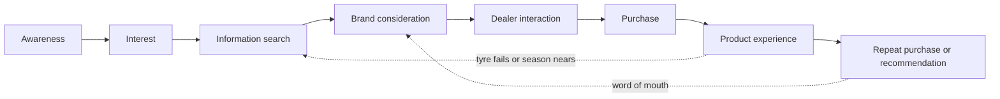

# 04. How farmers and landowners buy tractor tyres

Prepared 6 November 2026.

**Purpose.** This file sets out who actually buys a tractor tyre in India, what is known about how they choose, which channels reach them, and what the purchase journey looks like. It also says, plainly, where no evidence exists.

Full source list with reliability ratings: `17_Source_Register_and_Verification.md`.

**How to read this file.**

| Label | Meaning |
|---|---|
| [Verified fact] | Primary source, or two independent credible sources |
| [Fact - single source] | One credible source; not independently confirmed |
| [Proxy evidence] | Evidence about a neighbouring purchase (tractors, lubricants, crop advice), not tyres |
| [Unverified] | Seen only in a vendor page, blog or search snippet |
| [Interpretation] | Our reading of the evidence |
| [Strategic hypothesis] | A belief the baseline survey and pilot must test |

---

## 1. What matters most

1. **No published Indian study covers how farmers buy tractor tyres.** Searches of journals, theses and trade press found nothing on who decides, which attributes rank highest, brand awareness, or loyalty. Everything on those questions is a hypothesis until a baseline survey is run. [Verified fact that none was found]
2. **The buyer is a tractor owner, and most farmers are not owners.** In 2009, 38% of farmers with over 10 hectares owned a tractor, 18% of those with 2 to 10 hectares, and under 1% of those with less than 2 hectares. [Fact - single source, dated]
3. **Owners who rent the tractor out and haul with it are the heaviest tyre users.** District studies put tractor use at 780 to 860 hours a year, with 34% to 64% of those hours hired out. [Fact - single source each; small, older district studies]
4. **Tyre wear is the tractor owner's most common and most bothersome problem, and durability is what drives tyre satisfaction.** This held in three J.D. Power surveys across 14 states. [Fact - single source, syndicated survey]
5. **Most new-tractor buyers do not choose the tyre brand.** J.D. Power found satisfaction is higher when they do, which implies that usually they do not. The first replacement is therefore often the first real brand choice. [Interpretation]
6. **Advice comes from other farmers and from dealers.** In the national survey for 2018-19, 23% of farm households took crop advice from progressive farmers and about 20% from input dealers; government extension reached under 10%. [Proxy evidence]
7. **Mechanics and peers are trusted more than shops and advertising** in the one study of tractor upkeep purchases found (lubricants; 80 farmers, 10 mechanics). [Proxy evidence]
8. **Digital reach is large, but its effect on a tyre purchase is unmeasured.** Rural India had 488 million internet users in 2024, and the largest farm YouTube channels have 5 to 6.5 million subscribers. [Verified fact for reach]

---

## 2. Quality of the evidence

| Tier | Source type | What it covers | Limits |
|---|---|---|---|
| 1 | Official surveys (NSS 77th round 2018-19, Agriculture Census 2015-16, NABARD NAFIS 2021-22) | Landholding, sources of farm advice, credit | Not about tyres. Tractor-ownership tables could not be retrieved. |
| 2 | J.D. Power India tractor studies 2014, 2017, 2018 | Tyre problems, satisfaction drivers | Syndicated; known only through press releases. Owners of tractors 12 to 24 months old, so little on replacement. |
| 3 | District studies and theses | Hours of use, custom hiring | One district each; several seen only as abstracts or snippets. |
| 4 | Proxy studies | Tractor purchase factors, lubricant advice, social media use | Small samples, different purchases. |
| 5 | Portals and maker blogs | Prices, tyre life | Low reliability. |

Where a question has only tier 4 or 5 evidence, we say so and treat the answer as a hypothesis.

---

## 3. Who owns tractors, and who only uses them

### 3.1 Landholding and ownership

| Size class | Share of holdings | Share of operated area [Unverified - secondary source] | Tractor ownership (2009) |
|---|---|---|---|
| Marginal (under 1 ha) | 68.45% | 24.03% | Under 1% (all under 2 ha) |
| Small (1 to 2 ha) | 17.62% | 23.54% | Under 1% (all under 2 ha) |
| Semi-medium (2 to 4 ha) | 9.55% | 23.61% | 18% (all 2 to 10 ha) |
| Medium (4 to 10 ha) | 3.80% | 19.96% | 18% (all 2 to 10 ha) |
| Large (10 ha and above) | 0.57% | 8.85% | 38% |

- Holdings: Agriculture Census 2015-16. The shares of holdings are calculated from the official PIB table of holdings by size class (1,46,454 thousand holdings in all). [Fact - single source; calculated] — [PIB release PRID 2085181](https://www.pib.gov.in/PressReleasePage.aspx?PRID=2085181)
- Area: the shares of operated area are from a secondary table and are unverified. [Unverified - secondary source] — [IASpoint table](https://iaspoint.com/?p=507923)
- Ownership: [IFPRI Discussion Paper 1715 (2018)](https://cgspace.cgiar.org/handle/10568/146967), which cites earlier work for 2009. [Fact - single source, dated]

Put together, roughly 14% of holdings (those above 2 hectares) hold about 52% of the land (area share unverified) and nearly all owner-held tractors. [Interpretation; the two tables are for different years]

Two cautions:

- The 2009 pattern is old. IFPRI notes that farmers with 2 to 3 hectares now buy tractors and rent them out for farm and non-farm work, as "more of an entrepreneurial move" than a farm investment. [Fact - single source]
- An unconfirmed figure puts tractor ownership at 4.4% of agricultural households in June 2018. [Unverified]

Official tables that would settle this (Input Survey 2016-17; NSS 77th round) could not be pulled from the government portals. Data unavailable – requires primary research or company confirmation.

### 3.2 How many tractors

| Figure | What it measures | Label | Source |
|---|---|---|---|
| 5.81 million | Cumulative tractor registrations, 2012 | [Fact - single source] | [IFPRI DP 1715](https://cgspace.cgiar.org/handle/10568/146967) |
| About 6 million | Four-wheel tractors in use, mid-2010s estimate | [Fact - single source] | Same |
| About 1.01 crore | Registered tractors, 31 March 2022 (transport ministry data via an aggregator) | [Fact - single source] | [Dataful](https://dataful.in/datasets/23333/) |
| About 21.6 lakh | Registered trailers, 31 March 2022 | [Fact - single source] | Same |

Registrations are cumulative and include scrapped tractors, so they overstate tractors in use. A current count of working tractors: Data unavailable – requires primary research or company confirmation. Annual sales since then are in `03_Latest_Developments_and_News.md`.

### 3.3 Owners are not the same as users

- Most small and marginal farmers hire tractor services. About 44% of holdings under 2 hectares used farm machinery, owned or hired (Input Survey 2011-12, via a secondary source). [Fact - single source, snippet]
- Tractor owners are often service providers. Hours hired out as a share of all hours: 64% in Ahmednagar (Maharashtra), 59% in Sirsa (Haryana), 34% in Mahakoshal (Madhya Pradesh). Annual use: 830, 784 and 856 hours. These are small, older district studies. Sirsa: a 2011 thesis, 80 owners. Ahmednagar: a 2003 thesis, about 60 respondents. Mahakoshal: published in 2017, sample size and survey year not stated. They should not be read as current or representative. [Fact - single source each; small, older district studies] — [Ahmednagar thesis](https://krishikosh.egranth.ac.in/server/api/core/bitstreams/ce361500-67ae-4895-ac77-b69cb9b9267d/content); [Sirsa thesis](https://krishikosh.egranth.ac.in/items/989d45bc-569c-4227-aa8d-9762d41b4ff5); [Mahakoshal study](https://www.vegetosindia.org/article/status-and-utilization-of-tractor-power-in-mahakoshal-region-mp-india)
- Transport was 31% of tractor use in Ahmednagar. [Fact - single source]
- An industry presentation claimed about 30% of India's tractors are used outside farming. [Unverified] — [Lube Report Asia](https://www.lubesngreases.com/lubereport-asia/4_20/trust-key-for-india-tractor-operators/)
- Non-farm use wears tyres faster: 6.5 more tyre-wear problems per 100 tractors, and more owners had already replaced or retreaded their original tyres within two years (J.D. Power 2017, 3,440 owners, 14 states). [Fact - single source] — [Tyrepress](https://tyrepress.com/2017/06/j-d-power-tyre-wear-most-bothersome-problem-for-tractor-owners-in-india)

National shares for owners who rent out, and for haulage hours: Data unavailable – requires primary research or company confirmation.

---

## 4. Segments

Farmers are not one group. The segments below are ours [Interpretation]; the evidence column shows what supports each. The "values most" column is a hypothesis for the baseline survey to test.

| Segment | Who they are | Evidence | Tyre use | Likely to value most [Strategic hypothesis] | Priority |
|---|---|---|---|---|---|
| **A. Owner who rents out and hauls** | Owns one tractor, often on 2 to 10 ha or less; earns from ploughing, threshing and transport for others | District studies: 780 to 860 hours a year, 34% to 64% hired out; IFPRI on 2 to 3 ha "entrepreneur" owners | Highest hours; mixed field and road; earliest replacement | Tyre life per rupee; grip; puncture resistance; quick availability; credit | **1** |
| **B. Larger landowner, own-farm use** | 4 ha and above; may own more than one tractor; a hired driver often operates it | 2009 ownership by size; Agriculture Census | Moderate hours, mostly field | Brand standing, reliability, advice of his dealer; the driver's view | **2** |
| **C. Haulage and non-farm user** | Brick, sand, sugarcane, construction transport; tractor with trolley | Ahmednagar 31% transport; ICCT on peri-urban Haryana; J.D. Power on non-farm wear | Road-heavy; fastest wear; trailer tyres as well | Load and wear life; price; retreadability | **2** |
| **D. Fleet-type buyers** | Custom Hiring Centres, farmer producer organisations, cooperatives, contractors | Policy shift toward hiring centres (`08_2028_Market_Trends.md`); 10,000 FPOs registered | Several tractors; planned buying | Total cost, invoice and warranty, service | **3** |
| **E. New-tractor buyer** | First-time (35 to 40% of tractor sales) or replacing a tractor (60 to 65%) | CRISIL, March 2026 | Tyres arrive with the tractor | Usually does not choose the tyre brand | **3** (through tractor dealers) |
| **F. Farmer who hires a tractor** | Most holdings under 2 ha | 2009 ownership; Input Survey 2011-12 | Buys no tractor tyres | Not a buyer | Not targeted for sales |

People around the buyer:

| Influencer | Role at the purchase | Evidence |
|---|---|---|
| Tyre dealer | Stocks, recommends, gives credit, handles warranty | Input dealers were an advice source for about 20% of farm households (2018-19) [Proxy evidence] |
| Mechanic or puncture-shop owner | Sees the failed tyre first; advises on repair, retread or replace | Farmers trust mechanics more than shop owners for lubricants; one parts seller put it at 7 or 8 customers in 10 (anecdote) [Proxy evidence] |
| Tractor driver or operator | Uses and maintains the tractor in segments B and C | No evidence found |
| Other tractor owners | Word of mouth on tyre life | Progressive farmers were an advice source for 23% (2018-19) [Proxy evidence] |
| Tractor dealer | Decides or steers the original tyres | J.D. Power 2018 [Interpretation] |
| Family, especially sons | Younger, more online | No tyre evidence found |

### Regional lens

Soil and work differ by region, and so does the right tyre. Apollo's own range reflects this: FX 222 for deep puddling in wet paddy, Virat 23 for hard soil, Virat for mixed farm and haulage, Dhruv for trolleys (`01_Apollo_Tyres_Company_Research.md`). [Verified fact for the range]

Which regions fall into which use pattern is not documented for tyres. No study measures tyre wear or tyre choice by soil or region. Data unavailable – requires primary research or company confirmation. The state-level picture of tractors, crops and seasons is in `06_Rural_Distribution_and_Geography.md`.

---

## 5. Purchasing behaviour: question by question

| Question | What the evidence says | Label | Gap |
|---|---|---|---|
| Who decides? | Nothing published for tyres. | – | Data unavailable – requires primary research or company confirmation. |
| Who influences? | For tractor upkeep, peers and mechanics first; sales reps, retailers and advertisements "a much smaller role" (lubricant study). For crop advice, progressive farmers 23%, input dealers 20%. | [Proxy evidence] | Tyre-specific shares unknown |
| Who pays? | 75.5% of agricultural households borrowed from institutions ([ThePrint](https://theprint.in/economy/monthly-income-of-rural-households-increased-by-57-6-per-cent-in-5-years-nabard-survey/2305670)) and 44.1% had a Kisan Credit Card ([Down To Earth](https://www.downtoearth.org.in/agriculture/agrarian-crisis-landholding-recedes-by-13rd-loans-swell-for-farm-households-finds-nabard-survey)) (NAFIS 2021-22). About 95% of tractors are bought on credit. A tyre-finance product exists (Shriram Finance); uptake unknown. | [Verified fact] for NAFIS; [Fact - single source] for the rest | Dealer credit and harvest-time payment for tyres: Data unavailable – requires primary research or company confirmation. |
| Who uses and maintains the tractor? | Only 8% of owners were contacted by dealers about routine maintenance; 70% paid part or all of service costs (J.D. Power 2014). | [Fact - single source] | Owner versus driver roles unknown |
| How often are tyres replaced? | Maker and portal claims only: 1,500 to 2,500 hours (Apollo blog); 2,000 to 4,000 hours (TractorGyan). | [Unverified] | No measured tyre life in Indian conditions |
| What triggers replacement? | Wear is the top problem; non-farm users replaced or retreaded within two years. | [Fact - single source] | Wear versus cuts versus season start: unknown |
| What decides the brand? | Durability was the most important of four factors (durability, traction, ride, appearance) in J.D. Power's 2018 tyre study. | [Fact - single source, via MRF's release] | Weights, sample and brand scores not published |
| How much does price matter? | A 13.6-28 rear tyre lists at about Rs 16,000 to 17,700 across Apollo, Goodyear and MRF; cheaper little-known brands list from about Rs 9,500. | [Fact - single source, portals] | Willingness to pay more for a brand: unknown |
| How much does dealer trust matter? | Farmers follow advice only when they believe the adviser has no vested interest (lubricant study). | [Proxy evidence] | Unknown for tyres |
| Established brand or word of mouth? | For tractors, brand reputation ranked below fuel efficiency, subsidy and maintenance cost in one district; durability and brand image led in another. | [Proxy evidence] | Unknown for tyres |
| Do buyers re-buy the tyre that came on the tractor? | No study. | – | Data unavailable – requires primary research or company confirmation. |
| When in the year do they buy? | For tractors, September to November is the peak. | [Proxy evidence] | Tyre seasonality unknown |
| Retreads, second-hand and look-alike tyres? | Non-farm users retread; fake tyres have been seized on their way to villages in Odisha (not tractor-specific). | [Fact - single source] | Shares unknown |

Sources for this table: [J.D. Power 2014 via Autocar Professional](https://autocarpro.in/news-national/tractor-owners-key-tyre-quality-service-timing-inaugural-jd-power-survey-7733); [J.D. Power 2017 via Tyrepress](https://tyrepress.com/2017/06/j-d-power-tyre-wear-most-bothersome-problem-for-tractor-owners-in-india); [J.D. Power 2018 via MRF](https://www.mrftyres.com/news/mrf-ranks-highest-in-tractor-tyre-customer-satisfaction); [Afton study via Lube Report Asia](https://www.lubesngreases.com/lubereport-asia/4_20/trust-key-for-india-tractor-operators/); [NSS analysis, Foundation for Agrarian Studies](https://fas.org.in/access-to-information-and-agriculture-extension-services-for-farmer-households-evidence-from-the-situation-assessment-surveys/); [NAFIS via ThePrint](https://theprint.in/economy/monthly-income-of-rural-households-increased-by-57-6-per-cent-in-5-years-nabard-survey/2305670); [TractorJunction prices](https://www.tractorjunction.com/tyres/rear/13-6-x-28/); [Apollo tyre-life blog](https://www.apollotyres.com/en-in/stories/blogs/tyre-guides/maintenance-tips-to-improve-the-life-of-tractor-tyres/); [TractorGyan](https://tractorgyan.com/tractors-question-hub/how-many-hours-do-tractor-tyres-last/580).

### An illustration of replacement frequency

This is arithmetic on unverified inputs, shown only to explain why segment A matters. It is not a finding.

| Input | Value | Status |
|---|---|---|
| Tyre life | 1,500 to 4,000 hours | Maker and portal claims [Unverified] |
| Hours a year, owner who rents out | About 800 | District studies |
| Implied life | About 2 to 5 years | Arithmetic |

An owner who works the tractor half as many hours would replace half as often. So a programme that reaches heavy users reaches more purchases per person. [Strategic hypothesis]

### Warranty

Apollo gives 7 years on farm tyres, CEAT gives 7 years on tractor tyres made from January 2019, and MRF gives 6, each on the company's own policy page. Apollo's and MRF's run from the date of manufacture; CEAT counts from manufacture or registration. All cover manufacturing defects only, and Apollo's and MRF's pay pro-rata on remaining tread. Apollo's farm warranty page does not say how a farm buyer registers a purchase; its dealer platform added warranty registration for sub-dealers in FY26. [Verified fact] — [Apollo](https://www.apollotyres.com/en-in/support/warranty/); [MRF](https://mrftyres.com/warranty-policy); [CEAT](https://www.ceat.com/warranty-policy.html)

Warranty length does not separate the brands. How farmers experience claims: Data unavailable – requires primary research or company confirmation.

---

## 6. Channels that inform and influence

The ratings below are our judgement [Interpretation] from the evidence cited. They are not measured shares. "Unknown" means no evidence was found and the baseline survey must ask.

| Channel | Awareness | Consideration | Purchase | Reach | Cost and access for Apollo | Credibility with farmers | Can Apollo influence it? | Evidence |
|---|---|---|---|---|---|---|---|---|
| Local tyre dealer | Medium | High | High | Every buyer passes through one | Already in Apollo's network; margin and schemes | Medium to high; depends on perceived self-interest | Yes, directly | Input dealers 20% of advice (proxy); Apollo about 6,500 dealerships |
| Tractor dealership | Medium | Medium | High for original tyres | Every new tractor | Needs tractor-maker or dealer tie-up | High at tractor purchase | Partly | J.D. Power 2018 |
| Mechanic, repair and puncture shop | Low | High | High | Present when a tyre fails | No programme today; many small shops | High (lubricant study) | Yes, with a programme | Afton study (proxy) |
| Other tractor owners | Medium | High | High | Village-wide | Cannot be bought; earned through product experience | Highest | Indirectly | Progressive farmers 23% (proxy) |
| Village leaders, large landowners | Medium | Medium | Low to medium | Village | Through events and relationships | Unknown | Indirectly | No tyre evidence |
| Cooperatives and credit societies | Low | Low | Low today | Wide membership | Institutional; slow | Unknown | Through partnership | Not retrieved |
| Farmer producer organisations | Low | Low to medium | Low today | 10,000 registered; membership reported at 20 to 30 lakh | Through partnership | Unknown | Through partnership | Lok Sabha reply, March 2025 |
| Agricultural fairs | Medium | Medium | Low | PAU Kisan Mela "over 100,000"; KISAN Pune over 200,000 (organiser figures) | Stalls about Rs 34,000 to 75,000 at PAU | Medium | Yes | Organiser claims; PAU rate card |
| Mandi | Medium | Low | Low | Where owners gather after harvest | Activation priced by vendors at Rs 15,000 to 30,000 a day | Unknown | Yes | Vendor estimate |
| Extension workers and KVKs | Low | Low | Low | KVKs 1.3%, extension workers 3.1% of households | Not a commercial channel | Trusted but rarely reached | Barely | NSS 2018-19 |
| Government programmes | Low | Low | Low | Combined under 10% | Not a commercial channel | Mixed | No | NSS 2018-19 |
| WhatsApp groups | Medium | Medium | Low | Preferred messaging app in small studies; young Punjab farmers kept 4 to 5 farm groups | About Rs 1 a marketing message; needs opt-in | Depends on who forwards | Yes, with a list | District studies |
| YouTube | Medium | Medium | Low | Farming Leader about 6.5 million subscribers; Indian Farmer about 5 million; Tractor Junction about 0.7 million | Creator fees not published | Unknown for tyres | Through creators | Trackers, trade press |
| Facebook and regional social apps | Low to medium | Low | Low | Third after WhatsApp and YouTube in one district | Paid targeting | Unknown | Yes | Guntur study (n=90) |
| Radio and TV (DD Kisan, DD Free Dish) | Medium | Low | Low | DD Free Dish about 49 million homes; DD Kisan weekly reach 1.68 crore (year unclear) | Official rate cards not found | Unknown | Yes, paid | Prasar Bharati report |
| Cricket broadcasts | Unknown | Low | Low | 612 million watch cricket nationally; no rural or farmer split | Jersey already paid for; advertising extra | Unknown for tyres | Jersey only, unless more is bought | `02_Cricket_Assets_and_Sponsorships.md` |
| Local sporting events | Medium (hypothesis) | Low | Low | Village tournaments common in Haryana; state festivals claim lakhs of entries | Low per event; fragmented | Unknown | Yes | File 02 |
| Demonstrations and trials | Low | High | High | Small | Costly per person | High when a neighbour's tractor is the proof | Yes | Rivals' practice (`07_Competitor_Analysis.md`); no results published |

What the table shows:

- The channels with the most influence on the purchase (dealer, mechanic, other owners, trial) have small reach and cannot be bought with media. [Interpretation]
- The channels with the widest reach (television, cricket, YouTube) have little demonstrated influence on a tyre purchase. [Interpretation]
- Apollo controls one of the high-influence channels (its dealers) and has no programme in two others (mechanics, trials). [Interpretation; see File 01]

`05_Farmer_Influence_Venn_Diagram.md` maps where these channels overlap.

Sources: [NSS analysis](https://fas.org.in/access-to-information-and-agriculture-extension-services-for-farmer-households-evidence-from-the-situation-assessment-surveys/); [IAMAI-Kantar 2024](https://www.iamai.in/sites/default/files/research/Kantar_%20IAMAI%20report_2024_.pdf); [Telangana study](https://ojs.pphouse.org/index.php/IJBSM/article/view/4919); [Punjab study](https://epubs.icar.org.in/index.php/IJEE/article/view/111678); [Guntur study](https://sasapjas.org/utilization-pattern-of-social-media-by-the-farmers-of-guntur-district-of-andhra-pradesh/); [Farming Leader](https://indiantelevision.com/mam/balwaan-krishi-acquires-farming-leader-to-expand-farmer-reach/); [DD Free Dish](https://storyboard18.com/media-and-entertainment/dd-free-dish-nears-rs1060-crore-in-revenue-maintains-scale-of-49-million-homes-94090.htm); [FPOs](https://sfacindia.com/UploadFile/Statistics/LS%20Qus%20No.%205043%20dt.%2027.03.2025.pdf); [PAU stall rates](https://stallbooking.pau.edu/download_Stall_Rates); [Ormax](https://ormaxmedia.com/insights/stories/678-million-sports-audiences-in-india-game-on.html).

---

## 7. The purchase journey

Behaviour and barriers below are hypotheses built from the evidence in sections 3 to 6, unless a source is named. Interventions are options, assessed in `11_Strategic_Alternatives.md`.

| Stage | What the owner does | Who decides or shapes it | Main influences | Barriers for Apollo | What Apollo could do | Indicator |
|---|---|---|---|---|---|---|
| **Awareness** | Knows tyre names from his own tractor, neighbours' tractors, the dealer's board | Owner; family | Tyres fitted at the factory; village sightings; media | The jersey says "Apollo Tyres"; the tyre he sees is called Virat or Krishak. Rivals arrive on new tractors. | Tie the jersey name to the tractor tyre in every rural touchpoint | Unaided and aided recall for "tractor tyre" among owners |
| **Interest** | Notices when a neighbour's tyres last, or fail | Owner | Other owners; mechanic | No visible proof of Apollo's tyre life | Put Apollo tyres on tractors people watch | Share of owners who can name an Apollo farm tyre |
| **Information search** | Asks the mechanic, another owner, the dealer; some watch YouTube | Owner; son | Mechanic; peers; dealer | Mechanics have no reason to name Apollo; no farm content | Mechanic programme; regional-language tyre content | Mechanic recommendation rate; content views to dealer enquiries |
| **Brand consideration** | Narrows to two or three brands at similar prices | Owner | Dealer; price; warranty; credit | Durability reputation sits with rivals (MRF ranked first in 2018) | Proof of life: demonstration tyres, hour-meter stories, the 7-year warranty explained | Share naming Apollo among brands considered |
| **Dealer interaction** | Visits one or two shops in the nearest market town | Dealer; owner | Stock on the day; dealer margin; credit | Tyre not in stock; multi-brand dealer earns more on a rival; farm tyres short at the plant | Assured farm stock at named dealers; dealer scheme tied to registered sales | Enquiries logged; stock-out days |
| **Purchase** | Buys, often on credit, often urgently | Owner pays; dealer fits | Price; credit; exchange value of old tyre | 15 to 16% price rise in 2026; weak monsoon | Exchange offer, harvest-timed credit, guaranteed gift | Registered sales; conversion from enquiry |
| **Product experience** | Judges life and grip over seasons | Owner; driver | Soil, load, inflation | Wrong tyre for the soil; poor inflation practice shortens life | Right-tyre advice; free pressure and wear checks | Complaints; warranty claims; re-check attendance |
| **Repeat and recommendation** | Tells others; buys again in a few years | Owner | Experience; dealer relationship | No record of who bought; no reason to refer | Registration record, reminders, referral reward | Repeat rate; referrals per buyer |

The table points to three places where a sale is lost that media cannot fix: the mechanic's advice, the dealer's shelf and recommendation, and proof of tyre life. [Interpretation] The full diagnosis is in `09_Problem_Diagnosis.md`.

---

## 8. Other factors that could change the outcome

| Factor | What is known | Label |
|---|---|---|
| Season | Tractor buying peaks September to November; tyre seasonality is not documented | [Proxy evidence] |
| Credit | Institutional borrowing and Kisan Credit Cards are widespread; dealer credit for tyres is undocumented | [Verified fact] / gap |
| Authenticity | Fake tyres have reached villages in at least one state; Apollo's warranty excludes tyres from unauthorised dealers | [Fact - single source] |
| Shared ownership | No data on jointly owned tractors | Data unavailable – requires primary research or company confirmation. |
| Age | Players over 40 are about 1.5% of active players on India's largest cricket scoring app; an unconfirmed figure puts the average farmer's age at about 50 | [Fact - single source] / [Unverified] |
| Brand switching | No evidence | Data unavailable – requires primary research or company confirmation. |
| Lifetime value | A tractor needs two rear and two front tyres, replaced several times over its life; the arithmetic is in `13_Budget_and_Commercial_Model.md` | [Interpretation] |

---

## 9. What the baseline survey must find out

Because no study exists, the pilot's first step is a survey of tractor owners, mechanics and dealers. It doubles as the measurement baseline (`14_KPI_and_Impact_Measurement.md`). It should answer:

1. Which tyre brand comes to mind first for a tractor? Which others?
2. Which brand is on the tractor now, front and rear, and was it chosen or did it come with the tractor?
3. Who chose the last replacement tyre, who advised, who paid, and how?
4. What made the owner replace it, and in which month?
5. How many hours a year does the tractor work, and how much is hired out or on the road?
6. Which three things matter most in choosing a tyre?
7. Does he watch India's cricket matches? On what? Can he name the sponsor on the jersey, and what that company sells?
8. Does he, or his sons, play in or attend local cricket tournaments?
9. Which phone apps does he use, and in which language?
10. How far is the shop where he last bought a tyre?

## 10. Implications for the case

- The target is the tractor owner, and within that group the owner who rents out and hauls, because he buys most often and is seen by the most people. [Interpretation]
- Durability is the attribute to own. Rivals hold it today. [Interpretation]
- The sale is decided by a small circle near the farm: dealer, mechanic, other owners. Cricket cannot replace that circle. Its job is to bring that circle together under Apollo's name and to give them a reason to act. [Strategic hypothesis]
- Whether tractor owners watch India's matches is unknown. The plan must measure it before relying on it. [Verified fact that it is unmeasured]
- A baseline survey is a requirement, not an option. Without it, neither the diagnosis nor the results can be defended. [Interpretation]
