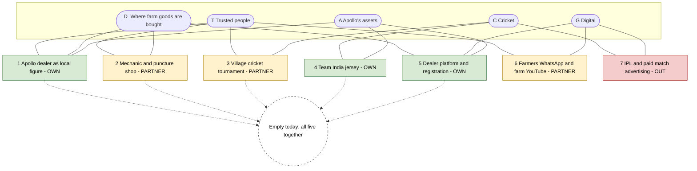

# 05. Farmer influence map: where five kinds of influence overlap

Prepared 6 November 2026.

**Purpose.** This file maps the channels that reach a tractor owner onto five overlapping sets, and finds the overlaps where Apollo can change a purchase most cheaply. It builds on the channel evidence in `04_Farmer_Consumer_Behaviour.md` and the asset register in `02_Cricket_Assets_and_Sponsorships.md`.

Full source list: `17_Source_Register_and_Verification.md`.

**How to read this file.** The placement of each channel is our judgement [Interpretation], based on the evidence cited in Files 01, 02 and 04. It is a map of hypotheses for the baseline survey to test, not a measurement.

---

## 1. The five sets

| Code | Set | What belongs in it |
|---|---|---|
| **T** | Traditional rural influence | People whose word an owner trusts: other tractor owners, mechanics, large landowners and village leaders, family, tractor drivers |
| **D** | Agricultural distribution and purchasing | Places where farm goods are bought or sold: tyre dealers and sub-dealers, tractor dealerships, input shops, mandis, fairs, cooperatives, farmer producer organisations, hiring centres |
| **G** | Digital information | WhatsApp groups, YouTube farm channels, Facebook, tractor portals, SMS and voice calls |
| **C** | Cricket and entertainment | India match broadcasts, village and tennis-ball tournaments, rural sports festivals, state T20 leagues, the IPL |
| **A** | Apollo's own assets | Dealer network, rural sales team, mobile stores, Farm Zones, dealer platform and warranty registration, the Team India jersey, Sachin Tendulkar, the farm range and its 7-year warranty |

And four levels of access:

| Tag | Access | Meaning |
|---|---|---|
| **Own** | Apollo already controls it | Apollo can change it by its own decision |
| **Partner** | Reachable through a partnership | Needs an agreement, a fee or a programme |
| **Indirect** | Can only be influenced | Earned through product experience or other people |
| **Out** | Inaccessible or impractical | Not for sale, already taken by rivals, or poor value for farm tyres |

---

## 2. Why this is a matrix and not five circles

A true Venn diagram of five sets has 31 regions and cannot be read. The table below carries the same information: each row is a channel, and the ticks show which sets it sits in. Section 3 draws the overlaps that matter.

| # | Channel | T | D | G | C | A | Sets | Access | Influence on the purchase (from File 04) |
|---|---|:-:|:-:|:-:|:-:|:-:|:-:|---|---|
| 1 | Apollo dealer who is also a local figure (gives credit, known in the villages) | ✓ | ✓ | | | ✓ | 3 | Own | High |
| 2 | Apollo dealer platform with sub-dealer warranty registration | | ✓ | ✓ | | ✓ | 3 | Own | Low today; high value as a data source |
| 3 | Apollo rural mobile store (25 planned) | | ✓ | | | ✓ | 2 | Own | Unknown; launched May 2026 |
| 4 | Apollo Farm Zone (two documented, 2019) | | ✓ | | | ✓ | 2 | Own | Unknown; no follow-through reported |
| 5 | Team India jersey | | | | ✓ | ✓ | 2 | Own | Low on its own |
| 6 | Sachin Tendulkar and the "Har Safar Mein Dum Hai" film | | | ✓ | ✓ | ✓ | 3 | Own | Low on its own; no farm message |
| 7 | Multi-brand tyre dealer and sub-dealer | ✓ | ✓ | | | | 2 | Partner | High |
| 8 | Mechanic and puncture-shop owner | ✓ | ✓ | | | | 2 | Partner | High |
| 9 | Tractor dealership | ✓ | ✓ | | | | 2 | Partner | High for original tyres |
| 10 | Other tractor owners | ✓ | | | | | 1 | Indirect | High |
| 11 | Owner who rents out and hauls (seen by many villages) | ✓ | ✓ | | | | 2 | Indirect, then Partner | High as an example to others |
| 12 | Large landowners and village leaders | ✓ | | | ✓ | | 2 | Indirect | Medium; often patrons of village tournaments |
| 13 | Village and tennis-ball cricket tournament | ✓ | | | ✓ | | 2 | Partner | Low on its own; gathers the village |
| 14 | Government or politician-run rural sports festival | ✓ | | | ✓ | | 2 | Partner | Low; carries political association |
| 15 | Farmers' WhatsApp groups | ✓ | | ✓ | | | 2 | Indirect | Medium |
| 16 | Farm and tractor YouTube creators | ✓ | | ✓ | | | 2 | Partner | Unknown for tyres |
| 17 | Tractor portals (prices and reviews) | | ✓ | ✓ | | | 2 | Partner | Unknown |
| 18 | Mandi and agricultural fair | ✓ | ✓ | | | | 2 | Partner | Low to medium |
| 19 | Farmer producer organisations, cooperatives, hiring centres | ✓ | ✓ | | | | 2 | Partner | Low today |
| 20 | India matches on free-to-air television (DD Free Dish) | | | | ✓ | | 1 | Out (carriage is not Apollo's to decide) | Low; carries the jersey |
| 21 | Paid streaming and television advertising in India matches | | | ✓ | ✓ | | 2 | Partner, at a price | Low for farm tyres |
| 22 | State T20 leagues | | | ✓ | ✓ | | 2 | Partner, price unknown | Low; city stadiums |
| 23 | IPL team and league sponsorship | | | ✓ | ✓ | | 2 | Out (CEAT and BKT hold tyre positions) | Low for farm tyres |
| 24 | Government extension (KVKs, extension workers) | ✓ | | | | | 1 | Out (not a commercial channel; reaches under 10% of households) | Low |
| 25 | Agri-commerce apps | | ✓ | ✓ | | | 2 | Out for now (none found selling tractor tyres) | None today |

Evidence for rows: dealer network, mobile stores, Farm Zones and platform in `01_Apollo_Tyres_Company_Research.md`; jersey, Tendulkar, leagues, tournaments, festivals and IPL in `02_Cricket_Assets_and_Sponsorships.md`; influence ratings and reach in File 04; agri-commerce in `08_2028_Market_Trends.md`.

---

## 3. The overlaps that matter

Reading the diagram: each numbered box is an overlap, joined to the sets it sits in. Green boxes are Apollo's own, yellow need a partner, red are out of reach or poor value. The dashed circle is the overlap of all five sets.

| # | Overlap | Sets | Why it matters | State today | Access |
|---|---|---|---|---|---|
| 1 | **The Apollo dealer who is trusted locally** | T ∩ D ∩ A | The only place where a trusted voice, the product and Apollo's control meet | Exists, but Apollo has about 6,500 dealerships for all tyre types and no count of those that stock farm tyres | Own |
| 2 | **The mechanic and puncture shop** | T ∩ D | Present when a tyre fails; trusted over shops and advertisements in the one study found | Apollo has no mechanic programme (File 01) | Partner |
| 3 | **The village cricket tournament** | T ∩ C | Brings owners, their sons, landowning patrons and neighbouring villages to one ground for several days | Run by panchayats and local sponsors; no tyre brand present (File 02) | Partner |
| 4 | **The Team India jersey** | C ∩ A | The one cricket asset no rival can buy | Seen nationally; says nothing about tractors; rural reach unmeasured | Own |
| 5 | **The dealer platform and warranty registration** | D ∩ G ∩ A | Can record who bought which tyre, where and when | Platform exists for dealers and sub-dealers; no registration step for the farm buyer is described on Apollo's farm warranty page | Own |
| 6 | **Farmers' WhatsApp groups and farm YouTube** | T ∩ G | Advice passed on by people the owner knows, in his language | Apollo has no farm channel or creator tie-up | Partner |
| 7 | **IPL and paid advertising in India matches** | C ∩ G | Reach | Tyre rivals hold IPL positions; no way to single out tractor owners is confirmed | Out |

---

## 4. What the map shows

**1. The centre is empty.** No channel today sits in all five sets. Nothing joins a trusted local voice, a shop with the tyre in stock, a digital record, cricket and Apollo's name in one place. [Interpretation]

**2. Apollo's strongest asset and its strongest influence do not touch.** The jersey sits in C and A only. The purchase is decided in T and D. Between them there is no bridge. This is the map's version of the gap described in `09_Problem_Diagnosis.md`. [Interpretation]

**3. The bridge can be built from parts Apollo owns or can cheaply reach.** Overlaps 1, 4 and 5 are already Apollo's. Overlaps 2 and 3 need partners who are local, numerous and not tied to a rival. If an Apollo dealer hosts a village tournament, brings the area's mechanics and heavy-use owners, and records every enquiry and sale on the platform, all five sets meet. [Strategic hypothesis]

**4. The village tournament is the most useful cricket overlap, because it is the only one that touches T.** Broadcast cricket reaches people one household at a time. A tournament gathers the purchase circle in one place. [Strategic hypothesis]

**5. The most valuable partner to win is the mechanic.** He sits in two of the high-influence sets and belongs to no brand. [Interpretation]

**6. Three areas are not worth chasing for farm tyres.** IPL inventory is crowded with rivals and cannot be aimed at owners. Government extension reaches few households and is not open to brands. Agri-commerce apps do not sell tractor tyres. [Interpretation]

---

## 5. Which overlaps to act on first

| Priority | Overlap | Action in one line | Why first |
|---|---|---|---|
| 1 | 1 and 5 | Name the farm-tyre dealers, stock them, and make registration of every farm sale simple | Nothing else works without stock and a count |
| 2 | 2 | Enrol mechanics around each named dealer | Highest influence, no programme today |
| 3 | 3 with 4 | Run dealer-hosted village cricket under the Team India sponsor's name | Gives cricket a job the broadcast cannot do |
| 4 | 6 | Regional-language tyre content through creators and WhatsApp lists built from registrations | Support and follow-up, not the core |
| – | 7 | Do not buy | Poor fit and already occupied |

How these become a programme, what each costs and how each is tested is in `11_Strategic_Alternatives.md`, `13_Budget_and_Commercial_Model.md` and `14_KPI_and_Impact_Measurement.md`.

---

## 6. What the baseline survey should check about this map

- Do owners name the mechanic, the dealer or another owner as their main adviser on tyres?
- Do owners attend or sponsor village tournaments, or only their sons?
- Do owners connect the name on the jersey with tractor tyres?
- How many owners are in a farming WhatsApp group, and who posts in it?
- Which Apollo dealers do owners already know by name?

If the answers move a channel to a different set, the priorities in section 5 change with it.
