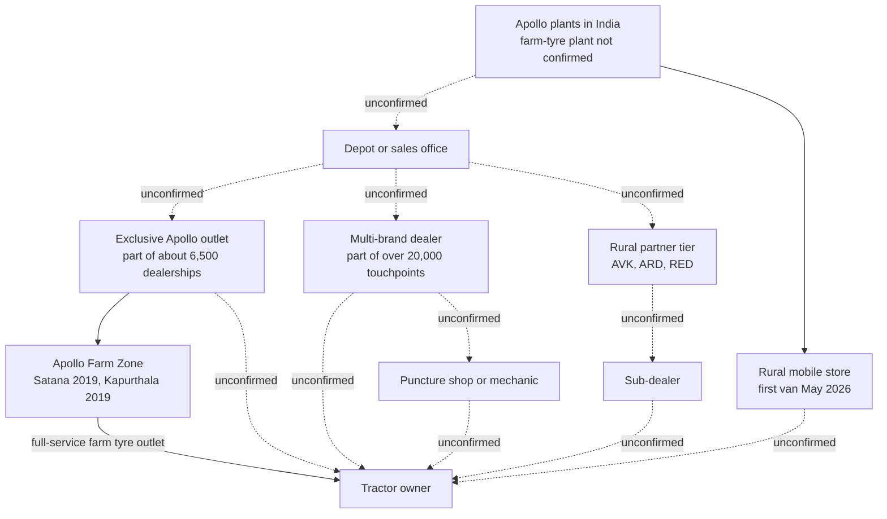

# 06. Rural Distribution and Geography: where the tractors are, and whether an Apollo farm tyre is there too

Prepared 6 November 2026

**Purpose.** This file sets out what public data says about where tractor owners are in India and how an Apollo farm tyre reaches them. It then turns that evidence into a way of choosing where a cricket-led farm-tyre programme should and should not run.

Full source list with reliability ratings: 17_Source_Register_and_Verification.md

> **How to read this file**
>
> Every important number or claim carries one label:
> - **[Verified fact]**: a primary source, or two independent credible sources.
> - **[Fact - single source]**: one credible source only.
> - **[Unverified]**: a secondary claim we could not check (snippets, job boards, blogs, listing sites).
> - **[Interpretation]**: our reading of the evidence, not a sourced fact.
> - **[Forecast]**: a forward-looking statement.
> - **[Planning assumption]**: a working figure or choice for the plan, to be confirmed.
> - **(computed)**: arithmetic we did on sourced numbers.
>
> Where nothing could be found, the file says: "Data unavailable – requires primary research or company confirmation."
>
> No village-level distribution statistic is given anywhere in this file, because none is public; where the plan needs one, the file says how Apollo can get it.

Terms used: **VAHAN** is the transport ministry's online vehicle registration system. An **RTO** is a Regional Transport Office, where vehicles are registered. **FADA** is the Federation of Automobile Dealers Associations, which reports retail sales by dealers. **TMA** is the Tractor and Mechanization Association, which reports manufacturers' wholesale dispatches. An **APMC** market (a mandi) is a regulated wholesale market for farm produce. A **tehsil** is a sub-district, the administrative unit below the district. A **hectare** (ha) is 10,000 square metres. **Horsepower (HP) bands** group tractors by engine power: 31-40 HP, 41-50 HP, and 51 HP and above.

---

## 1. What matters most

- **No public source shows where Apollo farm tyres are stocked.** None of the sources searched gives Apollo dealer counts by state, farm-tyre-stocking outlets or a current Farm Zone count. [Interpretation]
- **New tractor sales sit in five states.** Uttar Pradesh, Maharashtra, Rajasthan, Madhya Pradesh and Gujarat took about 62% (computed) of FY26 registrations. [Fact - single source]
- **The tractor stock is spread differently.** In 2012 Uttar Pradesh held 19% of registered tractors, Punjab and Haryana 8.9% each. Punjab leads on tractors above 50 HP. [Fact - single source; dated]
- **Bareilly and Bathinda are not top-volume districts.** Neither appears in any top-20 registration list found; their counts are not published. [Fact - single source]
- **Apollo is building a link from town dealer to village.** A "One District, One ARD" strategy and 25 rural mobile vans from May 2026. [Verified fact]
- **"ARD" is not defined in any public source.** A job listing suggests a rural partner tier with sub-dealers attached. [Unverified]
- **Farm tyres were short of supply in early 2026,** in management's own words. [Verified fact]
- **Cash arrives in two main windows in the north-west:** wheat procurement in April-May, paddy from late September or October. Uttar Pradesh cane payments are due in 14 days, but arrears recur. [Fact - single source]

---

## 2. How an Apollo farm tyre reaches a farmer

### What the notes support

No public source found describes the full chain from plant to farmer, with tiers and margins. The pieces are:

- **Plants.** Which of Apollo's five Indian plants make farm tyres is not confirmed. One undated snippet names Limda (Gujarat). [Unverified] — [Tire Review](https://www.tirereview.com/?p=56935)
- **Depot or sales office.** No source describes Apollo's depots. For comparison, Tolins runs 8 depots for 3,737 dealers, about 470 per depot (computed). [Fact - single source] — [Autocar Professional](https://www.autocarpro.in/news/tolins-tyres-launches-heavy-duty-tractor-rear-tyres-expands-agricultural-portfolio-128227)
- **Dealers and exclusive outlets.** About 6,500 dealerships, including exclusive Apollo outlets. [Fact - single source] — [CRISIL, 14 Aug 2026](https://www.crisil.com/mnt/winshare/Ratings/RatingList/RatingDocs/ApolloTyresLimited_August%2014_%202026_RR_399633.html)
- **Multi-brand dealers.** Counted within "more than 20,000 touchpoints". [Fact - single source] — [Autocar Professional, 6 Feb 2024](https://www.autocarpro.in/news-national/apollo-tyres-targets-higher-growth-from-rural-india-with-expanded-distribution-network-119049)
- **Rural partner tier (AVK, ARD, RED).** An undated Meerut job listing sets volume targets for "each AVK, ARD and RED" and asks the holder to keep the "Sarpanch & sub-dealer network attached to each AVK/ARD". No acronym is expanded. [Unverified] — [joinsaarthi.com listing](https://joinsaarthi.com/jobs/apollo-tyres/regional-rural-manager-meerut-meerut/541c75f0-3954-49e8-b87f-f892f368ac33)
- **Sub-dealers.** Apollo's B2B platform added warranty registration for sub-dealers in FY26, so sub-dealers exist in the channel. Which tier supplies them is not stated. [Verified fact] — [FY26 Annual Report](https://corporate.apollotyres.com/content/dam/orbit/apollo-corporate/investors/financial-reporting/annual-report/2025-26/AGM%20Notice%20and%20Annual%20Report%20FY2026.pdf)
- **Rural mobile store.** First van flagged off on 20 May 2026 at Pandavapura, Mandya (Karnataka); 25 vans planned over 18 to 24 months for places "where dealerships are thin or non-existent". Farm tyres are not mentioned. [Verified fact] — [Autocar Professional](https://www.autocarpro.in/news/apollo-tyres-launches-mobile-store-to-reach-rural-customers-132704); [Apollo corporate](https://corporate.apollotyres.com/press-and-media/news/corporate/rural-mobile-store/)
- **Farm Zone.** A full-service farm-tyre outlet. The first opened at Satana, Nashik (Maharashtra) on 31 May 2019, with a tyre changer, an agronomist and repair kits; Apollo aimed for one in "almost all states". [Fact - single source, company] — [Apollo corporate](https://corporate.apollotyres.com/press-and-media/news/corporate/apollo-farm-zone/). A second opened at Kapurthala (Punjab) in August 2019. [Fact - single source] — [Krishi Jagran](https://krishijagran.com/industry-news/northern-indias-1st-farm-zone-inaugurated-full-service-outlet-for-farmagriculture-tyres-in-kapurthala). No later count was found.
- **Puncture shop.** The role of puncture shops, mechanics and tractor dealerships: Data unavailable – requires primary research or company confirmation.

### The chain as far as it is known

Solid lines are links the notes confirm. Dashed lines are links the notes do not confirm.

The mobile store's link to the owner is dashed because no launch report mentions farm tyres. The ARD-to-sub-dealer link rests on one undated job listing.

### What "ARD" might mean

Apollo's FY26 annual report lists "enabling rural expansion through the 'One District, One ARD' multi-channel strategy" among its focus areas. It does not define ARD. [Verified fact for the text] — [FY26 Annual Report](https://corporate.apollotyres.com/content/dam/orbit/apollo-corporate/investors/financial-reporting/annual-report/2025-26/AGM%20Notice%20and%20Annual%20Report%20FY2026.pdf)

The job listing treats ARD as a rural partner with sub-dealers and Sarpanch contacts attached, so "One District, One ARD" would mean one such partner per district. [Interpretation] ARD is not defined in any public source found. Its meaning and the mechanics of the strategy: Data unavailable – requires primary research or company confirmation.

Other rural moves: Rohit Singh became national head of rural sales in December 2025 [Fact - single source] — [Indiantelevision](https://indiantelevision.com/mam/apollo-tyres-names-rohit-singh-as-rural-sales-head-251224/). In February 2024 Apollo said it aimed to reach every village of 50,000 people or fewer, and named Rajasthan, Uttar Pradesh, Madhya Pradesh and parts of South India as key rural markets. [Fact - single source] — [Autocar Professional](https://www.autocarpro.in/news-national/apollo-tyres-targets-higher-growth-from-rural-india-with-expanded-distribution-network-119049)

### Network size: why the counts differ

| Figure | What it counts | Source and date | Label |
|---|---|---|---|
| About 6,500 | Dealerships, including exclusive Apollo outlets | [CRISIL, Aug 2026](https://www.crisil.com/mnt/winshare/Ratings/RatingList/RatingDocs/ApolloTyresLimited_August%2014_%202026_RR_399633.html) | [Fact - single source] |
| More than 20,000 | Touchpoints: branded and multi-brand outlets plus distributors | [Autocar Professional, Feb 2024](https://www.autocarpro.in/news-national/apollo-tyres-targets-higher-growth-from-rural-india-with-expanded-distribution-network-119049) | [Fact - single source] |
| About 5,000 dealers, over 2,500 exclusive | Dealers (definition not stated) | Undated Tyre Market article | [Unverified] |
| 10 | Apollo dealers in Punjab on a third-party directory | [Tractor Gyan directory](https://tractorgyan.com/tyre-dealers/apollo/punjab) | [Unverified]; incomplete, not a count |

The counts differ because they count different things: the 20,000 includes multi-brand shops and distributors, the 6,500 counts dealerships, and the 5,000 has no stated definition or date. They cannot be reconciled from public sources. [Interpretation] None says how many outlets stock farm tyres: Data unavailable – requires primary research or company confirmation.

Company network detail beyond distribution is in 01_Apollo_Tyres_Company_Research.md.

---

## 3. Where the tractors are

### State registrations, FY26

These figures are VAHAN registrations (retail), published by Tractor Gyan, a tractor-listing website. They are not TMA wholesale figures and not FADA figures. Tractor Gyan's FY26 national total is 10,30,895. FADA's FY26 retail total is 10,50,077. [Fact - single source each] — [Tractor Gyan FY26](https://tractorgyan.com/tractor-industry-news-blogs/2368/retail-tractor-sales-in-fy-2026-and-march-2026); [Autocar Professional, 10 Apr 2026](https://www.autocarpro.in/analysis/the-million-unit-milestone-fy26-redefines-indias-tractor-market-132056). The notes give no TMA total.

| State | FY26 registrations (Apr 2025 to Mar 2026) | Share of 10,30,895 | Label |
|---|---|---|---|
| Uttar Pradesh | 1,46,811 | 14.24% (stated) | [Fact - single source] |
| Maharashtra | 1,46,810 | about 14.24% (computed) | [Fact - single source] |
| Rajasthan | 1,30,540 | about 12.66% (computed) | [Fact - single source] |
| Madhya Pradesh | 1,20,956 | 11.73% (stated) | [Fact - single source] |
| Gujarat | 92,529 | about 8.97% (computed) | [Fact - single source] |
| **Top five** | **6,37,646** | **about 61.9% (computed)** | |
| Punjab, Haryana, Karnataka, Bihar, Andhra Pradesh, Telangana | not published | — | Data unavailable – requires primary research or company confirmation. |

Uttar Pradesh and Maharashtra differ by one unit, so treat them as joint top (not Uttar Pradesh leading). The Maharashtra, Rajasthan and Gujarat shares are computed, not printed on the source page. Through February 2026, Tractor Gyan's year-to-date table put Maharashtra first with 1,40,287 units (14.76%). So the rank of the top two flips by period. [Fact - single source, via search summary] — [Tractor Gyan, Feb 2026](https://tractorgyan.com/tractor-industry-news-blogs/2309/retail-tractor-sales-in-february-2026)

FY25 national total: 8,69,874; Uttar Pradesh 1,39,886 (about 16.1%, computed). [Fact - single source] Volumes, monsoon and GST: see 03_Latest_Developments_and_News.md.

### Tractor stock, 2012

These are cumulative registrations from the transport ministry, compiled by IFPRI. They count every tractor ever registered, so they likely overstate tractors still in use. [Fact - single source; the overstatement is Interpretation] — [IFPRI Discussion Paper 1715 (2018), Table 3.2](https://cgspace.cgiar.org/handle/10568/146967)

| State | Tractors registered by 2012 | Share of 5.81 million |
|---|---|---|
| Uttar Pradesh | 1.106 million | 19.0% |
| Rajasthan | 0.700 million | 12.0% |
| Madhya Pradesh | 0.661 million | 11.4% |
| Punjab | 0.518 million | 8.9% |
| Haryana | 0.517 million | 8.9% |
| Gujarat | 0.495 million | 8.5% |
| Maharashtra | 0.419 million | 7.2% |
| Karnataka | 0.364 million | 6.3% |
| Andhra Pradesh (undivided) | 0.342 million | 5.9% |
| Bihar | 0.267 million | 4.6% |
| Tamil Nadu | 0.187 million | 3.2% |

No state-wise tractor stock newer than 2012 was found. The only later figure is Punjab's stock of "more than 5.20 lakh" in 2018. [Fact - single source] — [Tribune, 16 Jun 2018](https://www.tribuneindia.com/news/archive/business/affluent-farmers-drive-sale-of-high-end-tractors-in-punjab-606280). Current tractor stock by state: Data unavailable – requires primary research or company confirmation.

### Regional shares and horsepower mix

- **Regions, FY26.** North "over a third" of sales; West strongest at "nearly 40%"; East (Bihar, West Bengal, Jharkhand, Odisha) the highest commercial-use share; no South figure. In the South, paddy drives roughly 35-40% of tractor volume. [Fact - single source each] — [Autocar Professional, 10 Apr 2026](https://www.autocarpro.in/analysis/the-million-unit-milestone-fy26-redefines-indias-tractor-market-132056); [Autocar Professional, 4 Mar 2026](https://www.autocarpro.in/news/escorts-kubota-targets-doubling-south-india-market-share-to-tap-paddy-growth-131472)
- **National HP mix.** 41-50 HP rose from under half of sales in FY19 to nearly two-thirds in FY26; 51 HP and above is "a small share". [Fact - single source] — [Autocar Professional](https://www.autocarpro.in/analysis/the-million-unit-milestone-fy26-redefines-indias-tractor-market-132056)
- **State HP mix.** In FY18, 42% of Punjab's sales were above 50 HP, against 20% in Haryana, 8% in Uttar Pradesh and 8% nationally (state shares set against a national share; eight years old). [Fact - single source] — [Tribune, 2018](https://www.tribuneindia.com/news/archive/business/affluent-farmers-drive-sale-of-high-end-tractors-in-punjab-606280). In April-May 2025 Punjab was still the top state for above-50 HP, with 565 units, 20.21% of that national segment. [Fact - single source] — [Tractor Gyan](https://tractorgyan.com/tractor-industry-news-blogs/1860/above-50hp-trem-iv-tractor-sales-may-2025)
- **Intensity of use.** Tractors are used most intensively in Punjab, Haryana, western Uttar Pradesh and the central rice-wheat belt. [Fact - single source] — [IFPRI DP 1715](https://cgspace.cgiar.org/handle/10568/146967)

HP mix by state for FY26: Data unavailable – requires primary research or company confirmation. Who owns these tractors, and how they are hired out, is covered in 04_Farmer_Consumer_Behaviour.md.

### The district picture

Credible district data exists only as top-20 rankings from Tractor Gyan, based on VAHAN. The rankings are by RTO office, not strictly by district. Malegaon and Srirampur, for example, are RTO towns. [Fact - single source]

**FY25 top 20 (April 2024 to March 2025)** — [Tractor Gyan](https://tractorgyan.com/tractor-industry-news-blogs/1854/top-20-districts-with-highest-tractor-registrations-fy-2025) [Fact - single source]

| Rank | RTO / district | State | Registrations |
|---|---|---|---|
| 1 | Banaskantha | Gujarat | 10,620 |
| 2 | Bikaner | Rajasthan | 6,634 |
| 3 | Ahmednagar | Maharashtra | 5,738 |
| 4 | Nashik | Maharashtra | 5,620 |
| 5 | Shivpuri | Madhya Pradesh | 5,273 |
| 6 | Chhatrapati Sambhajinagar | Maharashtra | 5,223 |
| 7 | Nagaur | Rajasthan | 5,050 |
| 8 | Surendranagar | Gujarat | 4,812 |
| 9 | Alwar | Rajasthan | 4,724 |
| 10 | Barmer | Rajasthan | 4,606 |
| 11 | Malegaon | Maharashtra | 4,539 |
| 12 | Chittorgarh | Rajasthan | 4,506 |
| 13 | Badaun | Uttar Pradesh | 4,340 |
| 14 | Srirampur | Maharashtra | 4,134 |
| 15 | Rajkot | Gujarat | 4,100 |
| 16 | Sabarkantha | Gujarat | 4,077 |
| 17 | Jodhpur | Rajasthan | 4,063 |
| 18 | Raisen | Madhya Pradesh | 3,975 |
| 19 | Aligarh | Uttar Pradesh | 3,953 |
| 20 | Vidisha | Madhya Pradesh | 3,928 |
| | **Top 20 total** | | **99,915 = 11.49% of 8,69,874 (stated)** |

**What the April-August 2025 list adds.** Seven Rajasthan, five Maharashtra and five Gujarat RTOs, plus Shivpuri, Purnea (Bihar) and Bijapur (Karnataka). New names are Sri Ganganagar (1,723), Solapur (1,863), Dharashiv (1,664), Ahmedabad Rural (1,907), Kheda (1,870), Purnea (1,738) and Bijapur (1,758). No Uttar Pradesh or Punjab district appears. Top 20 = 41,344, or 10.93% of the national year-to-date figure. [Fact - single source] — [Tractor Gyan, 9 Sep 2025](https://tractorgyan.com/tractor-industry-news-blogs/1973/top-20-districts-by-retail-tractor-sales-in-august-2025). In Q1 FY26, Rajasthan held 8 of the top 20, including Sri Ganganagar at 1,150. [Fact - single source, via search summary] — [Tractor Gyan, Q1 FY26](https://tractorgyan.com/tractor-industry-news-blogs/1883/top-20-districts-with-highest-tractor-registrations-q1-fy26)

**Seasonal caution.** In August 2025 alone, 18 of the top 20 districts were in Gujarat. The top 20 that month took 21.16% of national registrations of 83,952. [Fact - single source] — [Tractor Gyan](https://tractorgyan.com/tractor-industry-news-blogs/1973/top-20-districts-by-retail-tractor-sales-in-august-2025). A single month's ranking says more about local seasons than about the size of a market. Only full-year lists should be used to rank districts. [Interpretation]

District registrations for Uttar Pradesh, Punjab, Haryana, Karnataka, Bihar, Andhra Pradesh and Telangana beyond these entries: Data unavailable – requires primary research or company confirmation.

---

## 4. The brief's two examples: Bareilly and Bathinda

Neither Bareilly nor Bathinda appears in any top-20 registration list found (FY25, Q1 FY26, April-August 2025 or August 2025). [Fact - single source for each list]

What this means: neither district is among the 20 biggest sources of new tractor registrations. What it does not mean: it does not show that they have few tractors, few tractor owners, or weak replacement demand. Replacement tyres follow the tractors already in use, and no current stock or registration figure for either district was found. [Interpretation]

| Item | Bareilly (Uttar Pradesh) | Bathinda (Punjab) |
|---|---|---|
| State context | UP: 14.24% of FY26 registrations; 19% of 2012 stock [Fact - single source] | Punjab: FY26 figure not published; 8.9% of 2012 stock; top state for above-50 HP in Apr-May 2025 [Fact - single source] |
| Average holding | 0.71 ha, from about 4.59 lakh holdings (CEEW portal; page blocked, snippet only) [Unverified]. UP state average 0.73 ha (2015-16) [Unverified - search summary of a Lok Sabha reply] | District: Data unavailable – requires primary research or company confirmation. Punjab state average 3.62 ha (2015-16) [Unverified - search summary of a Lok Sabha reply] |
| Irrigation | District: Data unavailable – requires primary research or company confirmation. UP state net irrigated area 83.2% of net sown [Fact - single source] | About 99% of net sown area irrigated (295 of 297 thousand ha); canals 72.8% of irrigated area, the rest tubewells; 2008-09 data [Verified fact for what the plan says; about 15 years old] |
| Crops | Crop areas: Data unavailable – requires primary research or company confirmation. Normal rainfall about 1,107 mm; agro-climatic zone UP-4, shared with Badaun [Fact - single source, snippet] | Kharif cotton 165 and rice 86 thousand ha; rabi wheat 245 thousand ha; cropping intensity 187% [Verified fact, dated]. Cotton-wheat 30.0% and rice-wheat 26.6% of area, c. 2003-04 [Fact - single source, old]. 4 of 7 blocks have over-exploited groundwater [Verified fact, dated] |
| Tractor count | Data unavailable – requires primary research or company confirmation. | 22,500 tractors, year not stated (2011 plan, mostly 2008-09 data) [Verified fact for what the plan says; dated] |
| Current registrations | Data unavailable – requires primary research or company confirmation. Neighbouring Badaun ranked 13th in FY25 with 4,340 [Fact - single source] | Data unavailable – requires primary research or company confirmation. Sri Ganganagar (Rajasthan) appears in the Apr-Aug 2025 list with 1,723 [Fact - single source] |
| Cash windows | Wheat procurement from 1 April, largely private purchase in UP [Fact - single source]. Cane payable within 14 days of supply; arrears recur, e.g. Pilibhit farmers owed over Rs 220 crore about 50 days into the 2025-26 season [Fact - single source] | Wheat procurement from 1 April to mid or late May; paddy from 1 October (2024) [Fact - single source]. Cotton picking and payment months: Data unavailable – requires primary research or company confirmation. |
| Apollo presence | Data unavailable – requires primary research or company confirmation. An Apollo rural manager role is listed for Meerut, also in UP [Unverified] | One dealer listed for "Bhatinda" (D I Tyres) on a third-party directory, not a count [Unverified]. Nearest documented Farm Zone: Kapurthala, 2019 [Fact - single source] |

Sources: [CEEW Bareilly](https://ceew.in/portal/datastory/bareilly-uttar-pradesh/); [Lok Sabha AU1123](https://eparlib.sansad.in/bitstream/123456789/983752/1/AU1123.pdf); [Pinwas IAS](https://pinwas.com/agriculture-census/); [ICAR-CRIDA / PAU Bathinda plan](https://icar-crida.res.in/CP/Punjab/PAU,%20Ludhiana/PUNJAB%202-Bathinda%2030.04.2011.pdf); [Tractor Gyan FY25](https://tractorgyan.com/tractor-industry-news-blogs/1854/top-20-districts-with-highest-tractor-registrations-fy-2025); [Rural Voice](https://eng.ruralvoice.in/wheat-procurement-reaches-263-lakh-tonnes-up-emerges-as-private-procurement-hub-due-to-lower-prices); [Newsonair](https://www.newsonair.gov.in/paddy-procurement-in-full-swing-in-punjab-over-13000-crore-released-to-farmers); [Chini Mandi](https://www.chinimandi.com/?p=357634); [Tractor Gyan Punjab dealers](https://tractorgyan.com/tyre-dealers/apollo/punjab); [Krishi Jagran](https://krishijagran.com/industry-news/northern-indias-1st-farm-zone-inaugurated-full-service-outlet-for-farmagriculture-tyres-in-kapurthala).

The two districts are useful as types. Bareilly stands for very small holdings on irrigated plains, with wheat and cane. Bathinda stands for large, near-fully irrigated, canal-fed farms with cotton, rice and wheat, in the state that leads on high-HP tractors. [Interpretation]

---

## 5. Access and cash timing

### Market density

Market towns can only be measured here through APMC regulated markets. The figures below mix national and state numbers; each line says which.

- **National.** One regulated market serves about 406 sq km, against the National Commission on Farmers (NCF) norm of 80 sq km. The same reply lists 436 regulated markets in Punjab and 633 in Uttar Pradesh. [Fact - single source, via search summary] — [Lok Sabha AU2419](https://eparlib.nic.in/bitstream/123456789/2979639/1/AU2419_AxlOSY.pdf). Other documents give 485 sq km (Dalwai model law) and 457 sq km (a 2014 summary); the national figures differ by year and source. [Fact - single source, secondary] — [Slideshare summary](https://www.slideshare.net/slideshow/developments-in-agricultural-marketingpptx/258639466)
- **Punjab, a state figure against the national one.** The 2014 summary gives Punjab 118 sq km per market, the lowest in India. Punjab's 436 markets over roughly 50,000 sq km give about 116 sq km (computed). A Punjab market therefore serves roughly a quarter of the national average area. [Interpretation]
- **Punjab against Haryana.** Counting all Agmarknet mandis, Punjab has 6.9 per 1,000 sq km and Haryana, the next highest, 3.3. [Fact - single source] — [Cornell TCI](https://tci.cornell.edu/?p=6050)
- **Uttar Pradesh.** Area per market was not in the sources; no figure is given.

### Road connectivity

Under PMGSY-I, the rural roads scheme, 99.7% of sanctioned habitations were connected nationally by 31 July 2025 (1,62,818 of 1,63,339). PMGSY-IV targets 25,000 habitations still unconnected. This is a national figure for sanctioned, eligible habitations only. [Fact - single source] — [The Statesman](https://www.thestatesman.com/india/pmgsy-iv-aims-to-provide-all-weather-road-connectivity-to-25000-unconnected-rural-habitations-1503530625.html). State-wise PMGSY figures: Data unavailable – requires primary research or company confirmation.

### Village-to-town distance

This could not be found. Mission Antyodaya 2020 village files record distance bands to the nearest bank and all-weather road, and whether a weekly market (haat) exists [Fact - single source] — [India Data Portal](https://ckandev.indiadataportal.com/dataset/mission-antyodaya/resource/c453c04a-e34b-43cf-8a10-c357c5bd5f55). The Census 2011 Village Directory has a "nearest town" field. [Fact - single source] Neither was processed. Share of villages more than 5 or 10 km from a town, and distance to the nearest tractor-tyre seller: Data unavailable – requires primary research or company confirmation.

### Cash calendar

Procurement is when the government buys grain at the minimum support price and pays farmers. Payment goes to farmers' bank accounts. [Fact - single source]

- **Wheat.** In 2025-26 the central pool bought 106.83 lakh tonnes in Punjab, 69.24 in Madhya Pradesh and 67.45 in Haryana; Uttar Pradesh wheat is largely bought privately. [Fact - single source] — [Rural Voice](https://eng.ruralvoice.in/wheat-procurement-reaches-263-lakh-tonnes-up-emerges-as-private-procurement-hub-due-to-lower-prices); [Deccan Herald](https://www.deccanherald.com/india/government-wheat-procurement-reaches-6-mn-tonne-so-far-in-2025-26-season-3494732)
- **Paddy.** By 29 October 2024, about Rs 13,211 crore had been paid to 3.5 lakh Punjab farmers and about Rs 10,529 crore in Haryana. [Fact - single source] — [Newsonair, 30 Oct 2024](https://www.newsonair.gov.in/paddy-procurement-in-full-swing-in-punjab-over-13000-crore-released-to-farmers)
- **Sugarcane (Uttar Pradesh).** Mills must pay within 14 days of supply or pay 15% annual interest. In 2025-26 Pilibhit farmers were owed over Rs 220 crore about 50 days into the season, and Sambhal mills still owed money in April 2026. [Fact - single source] — [Chini Mandi](https://www.chinimandi.com/?p=357634). Crushing-season dates (often cited as November to April) are not confirmed here: Data unavailable – requires primary research or company confirmation.

**Month by month, limited to what the notes support**

| Month | Wheat-paddy cycle (Punjab, Haryana) | Wheat-cane cycle (Uttar Pradesh) |
|---|---|---|
| March | No procurement event in the notes (MP and Gujarat open mid-March) | No event in the notes |
| April | Wheat procurement opens 1 April; payment to bank accounts | Wheat procurement opens 1 April; largely private purchase |
| May | Wheat procurement closes mid-to-late May | No event in the notes |
| June to August | No cash event in the notes | No cash event in the notes |
| September | Haryana paddy opens 27 September (2024) | No event in the notes |
| October | Punjab paddy opens 1 October (2024); large payments by 29 October | Cane payments due within 14 days of each supply, once mills run; season dates not confirmed |
| November | Paddy window continues [Interpretation: the notes treat October-November as the paddy window] | As October; arrears recorded about 50 days into the 2025-26 season (Pilibhit) |
| December to February | No cash event in the notes | Cane payments, where mills pay on time; arrears recur |

Whether farmers actually spend on tyres in these windows: Data unavailable – requires primary research or company confirmation. No tractor-tyre seasonality data was found. A generic crop calendar (kharif sown June-July and harvested September-October; rabi sown October-December and harvested March-May) comes only from low-reliability sites. [Unverified] — [Kshema](https://kshema.co/kharif-and-rabi-crops-differences)

### Competing brands

- **JK Tyre** launched "Steel Wheels" on 2 May 2025: outlets run by local entrepreneurs in towns of 1 lakh people or fewer, starting in Haryana, Bihar, Uttar Pradesh, Maharashtra, Tamil Nadu and Telangana. JK has nearly 900 exclusive shops and over 6,000 channel partners. [Fact - single source] — [Tribune / ANI](https://www.tribuneindia.com/news/business/jk-tyre-expands-retail-footprint-in-rural-india-to-boost-last-mile-mobility-and-local-entrepreneurship)
- **Tolins** runs 8 depots and 3,737 dealers. [Fact - single source, snippet] — [Autocar Professional](https://www.autocarpro.in/news/tolins-tyres-launches-heavy-duty-tractor-rear-tyres-expands-agricultural-portfolio-128227)
- **Goodyear India** launched its Ultra Grip tractor tyre at Chandigarh to about 100 dealers and partners from across India. [Fact - single source, snippet] — [Autocar Professional](https://www.autocarpro.in/NEWS/goodyear-india-launches-ultra-grip-tractor-tire-for-farm-segment-133345)
- **Market share.** The claims found are from unsourced blogs and contradict each other. One says Apollo has over 25% of tractor tyres and CEAT is the largest; others say BKT leads off-highway. [Unverified] — [TractorForEveryone](https://www.tractorforeveryone.com/knowledge-center/Best-Tractor-Tyre-Brands-In-India)

Which competitor brands are on the shelf in each district, and each brand's regional strength: Data unavailable – requires primary research or company confirmation.

### After-sales service

Apollo built the Farm Zone because farm tyres had "received inadequate attention in service centres, trained personnel, and service environments". [Verified fact, company statement] — [Apollo corporate](https://corporate.apollotyres.com/press-and-media/news/corporate/apollo-farm-zone/). J.D. Power linked faster tractor-tyre wear to wrong inflation, switching between fields and paved roads, and uneven haulage loads. [Fact - single source] — [Tyrepress, 2017](https://tyrepress.com/2017/06/j-d-power-tyre-wear-most-bothersome-problem-for-tractor-owners-in-india). Mechanics able to fit farm tyres near each dealer: Data unavailable – requires primary research or company confirmation.

### The supply-side constraint

On 5 February 2026, Apollo's vice chairman and managing director said: "we are also seeing shortages in TBR and passenger car, and in farm". [Verified fact] — [Q3 FY26 call transcript](https://corporate.apollotyres.com/content/dam/orbit/apollo-corporate/investors/shareholding-information/investors-call-transcript/2025-26/Q3FY2026%20Analyst%20Call%20Transcript.pdf). In May 2026 the CFO put overall capacity at about 90% in Q4 FY26 and said: "Through April, we struggled in terms of keeping up with the demand". [Verified fact] — [Q4 FY26 call transcript](https://nsearchives.nseindia.com/corporate/APOLLOTYRE1_18052026174646_transcriptintimation.pdf)

Demand raised where stock is short may be filled by competitors. [Interpretation] Plant-wise farm capacity: Data unavailable – requires primary research or company confirmation.

---

## 6. Geographical prioritisation framework

### Two tests

**Demand test: how many tractor owners can one dealer's catchment reach?** Public indicators:
- state share of tractor registrations;
- district registrations;
- average holding size;
- horsepower mix.

**Supply test: can an owner there buy an Apollo farm tyre within a normal trip to his market town?** The indicators come from Apollo's own data and are not public:
- outlets that stock farm tyres in each tehsil (sub-district);
- days of farm-tyre stock;
- distance to the depot;
- whether a rural partner exists;
- mechanics near the dealer.

### Four categories

| Category | Definition | What Apollo should do | What Apollo should not do |
|---|---|---|---|
| **A** | High owner density + strong dealer cover | Run the full programme. These are the pilot areas. | — |
| **B** | High owner density + weak dealer cover | Fix distribution first: appoint a rural partner or sub-dealers, place a rural mobile store, stock farm tyres. Start dealer and mechanic work once stock is in place. | No advertising or events before stock is in place. |
| **C** | Lower owner density + strong dealer cover | Low-cost, always-on work through the existing dealer: mechanic programme, sale registration. | No events. |
| **D** | Lower owner density + weak dealer cover | Serve from the nearest town. Revisit once a year. | No programme. |

### The stock test

**Rule: No tehsil gets marketing until it has a named Apollo farm-tyre dealer, the four to six farm tyre sizes that suit the local soil in stock, and a replenishment promise from the depot.** The "four to six" figure is a [Planning assumption].

### First cut by state from public data [Interpretation]

Public data can sort states only by demand. The split between A and B needs Apollo's dealer data.

- **Volume states for new registrations:** Uttar Pradesh, Maharashtra, Rajasthan, Madhya Pradesh and Gujarat, with about 62% of FY26 registrations (computed).
- **Stock-and-value states:** Punjab and Haryana. They have large average holdings (3.62 ha and 2.22 ha; [Unverified - search summary of a Lok Sabha reply]), the highest share of high-horsepower tractors, dense markets, and about 9% each of the 2012 tractor stock. Replacement-tyre demand follows the number of tractors in use, not this year's tractor sales.
- **Other states:** all the rest, to be sorted once Apollo's dealer data and fuller registration data are in hand.

### Proposed pilot belts [Planning assumption]

Both belts are subject to confirmation against Apollo's dealer data and a district map.

**1. The "Bathinda belt".** Neighbouring districts in the Punjab-Haryana-Rajasthan cotton-and-wheat canal belt, for example Bathinda, Mansa, Sirsa, Fatehabad, Hanumangarh and Sri Ganganagar. Supporting evidence in the notes:
- Bathinda irrigates about 99% of its net sown area, mostly by canal, and grows cotton and rice in kharif and wheat in rabi. [Verified fact, dated]
- Sri Ganganagar appears in the April-August 2025 top-20 list (1,723) and in Q1 FY26 (1,150). [Fact - single source]
- Village cricket tournaments are documented in Sirsa and Fatehabad. The Chakkan tournament in Sirsa drew 52 teams from Haryana, Punjab and Rajasthan. [Fact - single source] — [Tribune](https://www.tribuneindia.com/news/haryana/cricket-craze-strengthens-community-bond-in-sirsa-fatehabad-villages/). Details are in 02_Cricket_Assets_and_Sponsorships.md.
- Punjab leads India on high-horsepower tractors. [Fact - single source]

Mansa and Hanumangarh are named as neighbours only. The notes hold no district data for them. Sirsa and Fatehabad have cricket evidence but no registration data.

**2. The "Bareilly belt".** Rohilkhand, Uttar Pradesh, for example Bareilly, Badaun, Pilibhit, Shahjahanpur, Rampur and Moradabad. Supporting evidence in the notes:
- Badaun ranked 13th in FY25 registrations (4,340), the only Rohilkhand district in any top-20 list. [Fact - single source]
- Bareilly's average holding is about 0.71 ha. [Unverified]
- Bareilly and Badaun share one agro-climatic zone (UP-4). [Fact - single source, snippet]
- Sugarcane dues of over Rs 220 crore were reported in Pilibhit in the 2025-26 season. [Fact - single source]

Pilibhit, Shahjahanpur, Rampur and Moradabad are named as neighbours only. The notes hold no registration data for them, and Bareilly's own count is not published.

**Why two contrasting belts.** One belt is made of large, irrigated, high-horsepower farms. The other is made of very small holdings, where the tractor owner often rents his tractor out to neighbours (see 04_Farmer_Consumer_Behaviour.md). Running both shows whether the same programme works for two very different kinds of buyer, which a single belt could not show.

Pilot design and measurement are in 14_KPI_and_Impact_Measurement.md.

### Scale candidates after the pilot

From the registration lists (FY25 counts shown) [Fact - single source for the counts]:
- **Rajasthan:** Bikaner (6,634), Nagaur (5,050), Alwar (4,724), Jodhpur (4,063).
- **Madhya Pradesh:** Shivpuri (5,273), Vidisha (3,928), Raisen (3,975).
- **Gujarat:** Banaskantha (10,620), Surendranagar (4,812), Rajkot (4,100).
- **Maharashtra:** Nashik (5,620), Ahmednagar (5,738). Apollo's first Farm Zone was at Satana in Nashik district.

### Where not to launch

Any tehsil that fails the stock test, however many farmers it has.

### How Apollo can fill the village-level gap cheaply

1. **Its own dealer billing data by pin code.** This shows where farm tyres are already sold and stocked.
2. **The transport ministry's registration data by RTO.** This gives tractor registrations for districts missing from the top-20 lists. A compiled version exists on Dataful (dataset 23333). — [Dataful](https://dataful.in/datasets/23333/)
3. **The Census village directory.** This gives each village's nearest town.
4. **One question in the baseline survey:** distance to the shop where the owner last bought a tyre.

---

## 7. Data gaps

| Gap | Status |
|---|---|
| Apollo dealer and outlet counts by state and district | Data unavailable – requires primary research or company confirmation. |
| Outlets that stock farm tyres, and their days of stock | Data unavailable – requires primary research or company confirmation. |
| Meaning of ARD, AVK, RED and RBU; districts with an ARD | Data unavailable – requires primary research or company confirmation. |
| Current Farm Zone count and locations | Data unavailable – requires primary research or company confirmation. |
| Depot locations and depot-to-dealer distance | Data unavailable – requires primary research or company confirmation. |
| Role of puncture shops, mechanics and tractor dealers | Data unavailable – requires primary research or company confirmation. |
| FY26 registrations for Punjab, Haryana, Karnataka, Bihar, Andhra Pradesh, Telangana | Data unavailable – requires primary research or company confirmation. |
| Registrations for Bareilly, Bathinda and the other belt districts | Data unavailable – requires primary research or company confirmation. |
| Tractor stock in use by state and district, newer than 2012 | Data unavailable – requires primary research or company confirmation. |
| HP mix by state, FY26 | Data unavailable – requires primary research or company confirmation. |
| Holdings above 2 ha and 4 ha by state (except UP) | Data unavailable – requires primary research or company confirmation. |
| Village-to-town and village-to-tyre-seller distance | Data unavailable – requires primary research or company confirmation. |
| Cane crushing dates; cotton payment months; Maharashtra and Karnataka cane payment timing | Data unavailable – requires primary research or company confirmation. |
| Seasonality of tractor-tyre purchases | Data unavailable – requires primary research or company confirmation. |
| Competitor shelf presence and regional strength | Data unavailable – requires primary research or company confirmation. |
| Plant-wise farm-tyre capacity and expansion plans | Data unavailable – requires primary research or company confirmation. |

---

## 8. Implications for the case

- Public data can show where tractors are sold. It cannot show where an Apollo farm tyre is on a shelf. That second map exists only inside Apollo and is the first thing the pilot needs. [Interpretation]
- Bareilly and Bathinda are useful as two contrasting kinds of market, not as the biggest ones. The largest registration counts are in Rajasthan, Gujarat, Maharashtra and Madhya Pradesh. [Interpretation]
- Replacement tyres are bought where tractors already are. Punjab and Haryana sell fewer new tractors than the volume states but hold a large, older, higher-horsepower stock. [Interpretation]
- Apollo's own moves (mobile stores for places with few dealers, a rural partner in each district) show that it sees a gap between the town dealer and the village. [Interpretation]
- Farm tyres were short of supply in early 2026. Geography should be chosen with the supply team, so that the pilot areas can be kept in stock. [Interpretation]
- Cash arrives in two main windows in the north-west (April to May after wheat, October to November after paddy), and irregularly where cane payments are late. Activity should be timed to these. [Interpretation]

Trends to 2028 are in 08_2028_Market_Trends.md. The recommendation is in 16_Final_Strategic_Recommendation.md.
