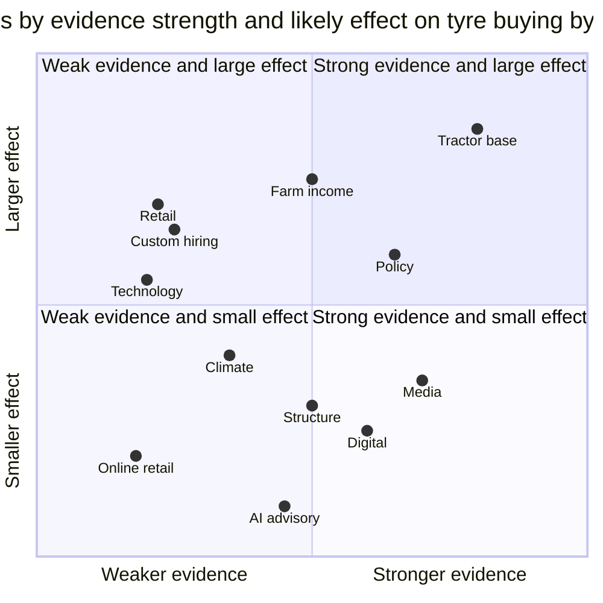

# 08. Market Trends to 2028: What Could Change How Farmers Buy Tractor Tyres

Prepared 6 November 2026

**Purpose.** This file sets out the trends that could change how Indian farmers and landowners buy tractor and farm tyres between November 2026 and the end of the Team India sponsorship in March 2028. It separates what is observed today from what forecasters expect and from what the team assumes.

Full source list with reliability ratings: 17_Source_Register_and_Verification.md

> **How to read this file.** Every statement is marked as observed, forecast or assumption. Labels used:
> - **[Observed - verified]**: a primary source, or two independent credible sources, confirm it.
> - **[Observed - single source]**: one source only, or several sources that all trace back to one origin.
> - **[Forecast]**: someone else's projection. The forecaster and the date are always named.
> - **[Assumption]**: the team's working assumption. No forecaster stated it.
> - **[Interpretation]**: the team's reading of the evidence. It is not a fact.
> - **[Unverified]**: a secondary claim the team could not confirm.
>
> A label is never upgraded. If a figure is missing, the text says: "Data unavailable – requires primary research or company confirmation."
>
> Many figures were read through news reports of agency or company statements, not the original agency documents. Reliability notes are in 17_Source_Register_and_Verification.md. Related files: 03_Latest_Developments_and_News.md (dated news and policy detail), 04_Farmer_Consumer_Behaviour.md (farmer behaviour and channels today), 06_Rural_Distribution_and_Geography.md (geography), 07_Competitor_Analysis.md (competitors).

---

## 1. What matters most

- **Tractor sales are flattening after a record year.** FY26 domestic wholesale was 11,60,231 units, up 23.47% [Observed - verified] ([Autocar Professional, 10 Apr 2026](https://www.autocarpro.in/news/tractor-industry-ends-fy26-on-a-high-march-domestic-sales-rise-29-on-festive-demand-132068)). CRISIL Ratings (18 Mar 2026) forecasts FY27 growth of 0-2%; ICRA (17 Jun 2026) forecasts 1-4% [Forecast]. No forecaster has published an FY28 volume.
- **2027 looks harder for farm cash than 2025-26.** The 2026 monsoon ended about 12.6-13% below normal [Observed - verified]. NielsenIQ reports rural FMCG volumes down 5% in April-June 2026 [Observed - single source]. A lender expects delays in tractor-loan instalments [Observed - single source].
- **The tyre-replacement pool is growing even if new sales are flat.** The 2018-19 and FY26 tractor cohorts are large. The Autocar Professional analysis says the 2018-19 cohort is now falling due for replacement [Observed - single source].
- **Policy support is moving toward groups and hire services.** Revised guidelines for the Sub-Mission on Agricultural Mechanization (SMAM) exist, dated 18 Dec 2025. Reports say they favour Custom Hiring Centres (CHCs) and farmer producer organisations (FPOs). The guideline text was not read, so this is [Unverified].
- **Phones are near-universal in rural homes; internet depth is thin.** 94.2% of rural households have a phone [Observed - verified]. Internet subscriptions per 100 people are 49.07 rural against 129.03 urban [Observed - single source]. Farm-specific behaviour data are small regional studies only.
- **Television is shifting toward free satellite and connected TV, and pay TV is shrinking.** FICCI-EY (Mar 2026) forecasts pay-TV homes of about 83 million by 2028 [Forecast]. Rural cricket viewing was never measured in the sources found.
- **No agri-commerce platform was found selling tractor tyres.** The dealer is the evident point of sale. Apollo has started a rural mobile-van pilot [Observed - verified].
- **Larger tractors point to larger tyres, but slowly.** The 41-50 hp band is now nearly two-thirds of sales [Observed - verified]. The last measured farm-radial share is 2-3%, from 2009 [Observed - single source].

---

## 2. Summary table

| Trend | What is happening now | Evidence strength | What may change by 2028 | How it could affect tractor-tyre buying | How Apollo could benefit | Main uncertainty |
|---|---|---|---|---|---|---|
| 1. Tractor ownership and mechanisation | FY26 domestic wholesale 11,60,231, +23.47% [Observed - verified]; 41-50 hp about two-thirds of sales [Observed - verified]; Mahindra Oct 2026 domestic dispatches -13% [Observed - single source] | Strong for FY26 and hp mix; moderate for FY27 | FY27 +0-2% (CRISIL, 18 Mar 2026) and +1-4% (ICRA, 17 Jun 2026) [Forecast]; Mahindra 9% a year to FY30 (20 Nov 2025) [Forecast] | Bigger tractor park and a due replacement cohort support replacement tyres; new-tractor (OE) volumes flat [Interpretation] | Larger installed base to serve [Interpretation] | No FY28 forecast; agency and OEM views differ |
| 2. Rural income and farm economics | Rural FMCG volume -5% in Apr-Jun 2026 [Observed - single source]; rural wage data disputed [Observed - single source]; 2026 monsoon about 13% short [Observed - verified] | Moderate | No farm-income forecast to 2028 found; weak cash flow delays big purchases to early 2027 [Assumption] | Replacement may be postponed or downtraded in stress [Interpretation] | Credit and exchange value could matter more than price [Interpretation] | Newest household income survey missing |
| 3. Changing farming practices and climate | Punjab direct-seeded rice (DSR) up 36% to over 4 lakh acres in Kharif 2026 [Observed - single source] | Weak to moderate | None found | Tyre effect not quantified [Interpretation] | None shown by the evidence | Most climate and practice items not covered |
| 4. Custom hiring, rental and CHCs | CHC counts conflict (75,915 vs 27,554 plus 25,608 farm machinery banks) [Unverified] | Weak | None found; growth is an [Assumption] | More tyres bought by fleet operators [Interpretation] | Pitch on cost per hour and service [Interpretation] | Counts, scale and guideline text unverified |
| 5. Digital adoption, smartphones and internet | 94.2% of rural households have a phone [Observed - verified]; 548 million rural internet users [Observed - verified]; 49.07 vs 129.03 subscriptions per 100 [Observed - single source] | Moderate to strong on access; weak on farmer behaviour | Continued rural user growth [Assumption] | Phones carry information; no tyre-purchase evidence | Support and data-capture channel [Interpretation] | Shared devices; no national farmer data |
| 6. Rural e-commerce and WhatsApp commerce | No platform found selling tractor tyres; Apollo rural van from 20 May 2026 [Observed - verified] | Weak for tyres | None found | Dealer remains the point of sale [Interpretation] | Physical availability stays decisive [Interpretation] | Online share of farm tyres unknown |
| 7. Media consumption and regional-language content | 193 million TV homes in 2025; Free TV 53 million; connected TV about 40 million weekly active [Observed - verified on direction] | Strong on totals; weak on rural split | TV homes above 200 million within two years; pay TV about 83 million by 2028 (FICCI-EY, Mar 2026) [Forecast] | Reach of the jersey depends on free carriage [Interpretation] | Free-to-air matches reach rural homes [Interpretation] | No rural TV or cricket viewing data |
| 8. AI farm advisories and digital agriculture programmes | 7.63 crore farmer IDs; Kisan e-Mitra over 93 lakh queries [Observed - verified] | Moderate | Target 11 crore farmer IDs by 2026-27 [Forecast, government target, secondary] | Information on tyres not part of the programmes found | Not shown by the evidence | Usage after launch unknown |
| 9. Government policy and regulation | GST on tractor tyres cut from 18% to 5% on 22 Sep 2025 [Observed - verified]; TREM V draft; waste-tyre rules in force | Moderate to strong | Draft TREM V: 25-75 hp exempt to FY2032 [Forecast]; ICRA says 30-50 hp step moves to April 2028 [Forecast] | GST cut already in prices; costs of waste-tyre rules unknown | None shown | Final TREM V text; farm-tyre standards |
| 10. Tractor and tyre technology | 2-3% radial share measured in 2009 [Observed - single source]; electric tractors minimal | Weak | Vendor claims of radial growth [Unverified] | Larger, more valuable tyres over time [Interpretation] | Higher-value tyres [Interpretation] | Current radial share unknown |
| 11. Structural change in farming | Average holding 1.08 ha; 86.21% of holdings small or marginal (2015-16) [Observed - verified] | Moderate but dated | None found | Fragmentation may favour hire [Interpretation] | Fleet buyers [Interpretation] | Leasing, age and FPO data missing |
| 12. Distribution and retail behaviour | Apollo plans 25 rural vans in 18-24 months [Observed - single source]; dealers sparse in some areas [Observed - single source] | Weak | None found | Physical access shapes purchase [Interpretation] | Network reach [Interpretation] | No dealer-behaviour data |

---

## 3. Trend blocks

### Trend 1. Tractor ownership and mechanisation

**(1) What is happening now.** Tractor demand hit a record in FY26. Domestic wholesale was 11,60,231 units, up 23.47%. Retail registrations (FADA, the dealers' federation) were 10,50,077, against 8,82,825 in FY25 [Observed - verified] ([Autocar Professional analysis, Apr 2026](https://www.autocarpro.in/analysis/the-million-unit-milestone-fy26-redefines-indias-tractor-market-132056)). About 95% of tractors are bought on credit [Observed - single source]. The 41-50 hp band rose from under half of sales in FY19 to nearly two-thirds in FY26 [Observed - verified; sources are not fully independent]. FY27 has slowed. Mahindra Finance's tractor disbursements grew 13% in July-September, its slowest segment ([Autocar Professional, 22 Oct 2026](https://www.autocarpro.in/news/mahindra-finance-flags-softer-tractor-demand-as-drought-risk-builds-over-festivals-135401)) [Observed - single source]. Mahindra's October domestic dispatches were 62,626, down 13% ([Autocar Professional](https://www.autocarpro.in/news/mahindra-tractor-domestic-sales-decline-13-percent-in-october-135613)) [Observed - single source]. Mahindra says Diwali fell in November. A 5 Nov 2026 headline says Mahindra cut its FY27 industry outlook to broadly flat [Unverified].

**(2) Evidence.** FY26 wholesale: strong. Horsepower mix: three sources agree, but they trace to one origin. FY27 momentum: moderate, because it rests on company and lender statements. Industry-wide October 2026 totals: Data unavailable – requires primary research or company confirmation.

**(3) What might change by 2028.**
- CRISIL Ratings (18 Mar 2026): FY27 growth 0-2%, about 1.2 million units [Forecast] ([CRISIL](https://www.crisilratings.com/en/home/newsroom/press-releases/2026/03/high-base-effect-el-nino-dampener-for-tractor-sales-growth-next-fiscal.html)).
- ICRA (17 Jun 2026): FY27 domestic wholesale +1-4%, with a high base and El Nino risk [Forecast] ([Autocar Professional](https://www.autocarpro.in/news/tractor-industry-growth-forecast-slashes-to-1-4-percent-for-fy27-icra-133124)). El Nino is a warming of the Pacific Ocean linked to weaker Indian monsoons.
- Mahindra (20 Nov 2025): industry growth of 9% a year to FY2030 [Forecast, made before the 2026 slowdown] ([Autocar Professional](https://www.autocarpro.in/news/mahindra-projects-9-annual-growth-in-india-tractor-market-to-122-million-units-by-2030-129862)).
- Emission norms (TREM, India's tractor emission standards): see Trend 9.
- FY28 volume or hp-mix forecast: Data unavailable – requires primary research or company confirmation.

**(4) Effect on tyre purchasing.** [Interpretation] Replacement tyres follow the size and age of the tractor park, not this year's sales. CRISIL (Mar 2026) puts replacement at 60-65% of domestic sales [Forecast, CRISIL, 18 Mar 2026]; its January 2024 note put it at 50-60% [Observed - single source], so the two CRISIL figures differ. Ownership life is 6-9 years [Observed - single source] ([Autocar Professional, 9 Jan 2024](https://www.autocarpro.in/news/tractors-enter-slow-lane-after-having-a-field-day-118603)). The share of replacement buyers who move up in hp is not quantified.

**(5) How Apollo could benefit.** [Interpretation] A larger and older tractor park gives a bigger pool of replacement buyers through 2028.

**(6) Risks and uncertainties.** A weak monsoon may stretch replacement cycles in lower-income states [Assumption, drawn from CRISIL's remark on longer cycles there]. Growth in implements that load tyres harder: Data unavailable – requires primary research or company confirmation. Dated news detail is in 03_Latest_Developments_and_News.md.

### Trend 2. Rural income and farm economics

**(1) What is happening now.** The National Bank for Agriculture and Rural Development (NABARD) survey for 2021-22 gave average monthly rural household income of Rs 12,698 and agricultural-household income of Rs 13,661 [Observed - single source] ([IASGyan relay](https://www.iasgyan.in/daily-current-affairs/nabard-all-india-rural-financial-inclusion-surveynafis-for-2021-22)). One source gives non-agricultural income as Rs 11,438 and another as Rs 10,675; the notes could not settle this. NielsenIQ (reported 28 Sep 2026): rural FMCG volume -5%, prices +2.1% in April-June 2026 [Observed - single source] ([Daily Pioneer](https://dailypioneer.com/news/fmcg-growth-moderates-in-june-quarter-nielseniq)). Rural wage growth is disputed: one analyst adjusts it to about 4-4.3% a year, with real wages falling [Observed - single source] ([Deccan Chronicle](https://www.deccanchronicle.com/amp/nation/current-affairs/rural-wage-growth-of-march-jumps-to-17-pc-due-to-flaws-in-sampling-1966664)). The 2026 monsoon ended 12.6-13% below normal, the fourth weakest since 2001 on one ranking and the worst since 2015 on another ([UNI, 30 Sep 2026](https://www.uniindia.com/national/weather-monsoon-deficit/198635)) [Observed - verified on the outcome]. Mahindra Finance said 282 districts are drought-prone and half-yearly tractor-loan instalments fall due a couple of months after October [Observed - single source].

**(2) Evidence.** Moderate. The income survey is old and was read through exam-prep sites. The wage series is contested.

**(3) What might change by 2028.** No farm-income forecast to 2028 was found. ICRA's note of 2 Jul 2026 sees FY27 agricultural output growth at risk of falling to 1.4% from 3.0% in FY26 [Forecast] ([ICRA](https://www.icra.in/Research/ViewResearchReport/7012)). Weak kharif cash flow reducing big-ticket purchases into early 2027 is [Assumption]. Newest household survey, PM-KISAN amounts and the farm cash-flow estimate for 2026-27: Data unavailable – requires primary research or company confirmation.

**(4) Effect on tyre purchasing.** [Interpretation] Tyres are smaller tickets than tractors, so they may be postponed or downtraded in stress rather than dropped.

**(5) How Apollo could benefit.** [Interpretation] When cash is tight, proof of tyre life and financing options can count for more than price.

**(6) Risks and uncertainties.** Tyre prices rose sharply in 2026: Apollo 6-8% announced for the quarter, CEAT about 5% plus 5%, JK Tyre 4-5%, BKT 3-5% [Observed - verified] ([Autocar Professional, 7 Jun 2026](https://www.autocarpro.in/news/tyre-makers-walk-tightrope-in-fy27-as-demand-holds-firm-but-costs-surge-132973)). Natural rubber hit a record Rs 284.50 a kilogram on 13 Oct 2026 [Observed - single source] ([Onmanorama](https://www.onmanorama.com/news/business/2026/10/13/rubber-price-in-kerala-hits-record-high-domestic-rates-top-global-market.amp.html)). See 03_Latest_Developments_and_News.md.

### Trend 3. Changing farming practices and climate

**(1) What is happening now.** Punjab direct-seeded rice (DSR) area rose 36% to over 4 lakh acres in Kharif 2026, against 2.94 lakh acres in 2025 [Observed - single source] ([DT Next](https://www.dtnext.in/news/business/punjab-dsr-area-rises-36-to-over-4-lakh-acres-in-kharif-2026-minister)). Another source gives the 2025 base as 2,35,899 acres, so the base conflicts. Punjab offers 80% subsidy to panchayats and 50% to individuals for stubble-management machinery [Observed - single source]. National DSR area: Data unavailable – requires primary research or company confirmation.

**(2) Evidence.** Weak to moderate. One state, read through a search summary.

**(3) What might change by 2028.** Punjab's 2026-27 target is 5 lakh acres [Observed - single source: a state target, not a forecast by an outside party]. Heat trends, groundwater stress, sugarcane and horticulture tractor growth: Data unavailable – requires primary research or company confirmation.

**(4) Effect on tyre purchasing.** [Interpretation] DSR removes wet puddling passes, and residue machinery adds new tractor work. No source quantifies the tyre effect. Data unavailable – requires primary research or company confirmation.

**(5) How Apollo could benefit.** The evidence does not show a benefit. Gap: Data unavailable – requires primary research or company confirmation.

**(6) Risks and uncertainties.** Fertiliser availability amid the West Asia conflict was flagged as an FY27 tractor-demand risk [Observed - single source]. Weak-rain years delay purchases (see Trend 2).

### Trend 4. Custom hiring, rental and Custom Hiring Centres (CHCs)

**(1) What is happening now.** Custom hiring means farmers rent tractors and machines by the hour or acre. CHC counts conflict. Autocar Professional (Apr 2026) gives 75,915 CHCs "as of 2025", Punjab leading with 11,148, with no underlying source [Unverified]. Search summaries of parliamentary answers give 27,554 CHCs, 646 hi-tech hubs and 25,608 farm machinery banks, and another figure of 43,954 combined ([Lok Sabha Q370](https://eparlib.sansad.in/bitstream/123456789/2989204/1/AU370_l7gluj.pdf)) [Unverified]. The notes show both sets of figures. Definitions probably differ. Platforms: Mahindra Krish-e since 2020 ([Autocar Professional](https://www.autocarpro.in/feature/mm-krishe-has-redefined-the-art-of-bonding-with-farmers-81774)); TAFE JFarm, whose 2020 free-rental scheme covered 18,000 customers ([TAFE](https://tafe.com/news-room/TAFE-JFarm-Services-Media-Release.php)) [Observed - single source, company claims, dated]. 2026 scale of these platforms: Data unavailable – requires primary research or company confirmation.

**(2) Evidence.** Weak. Counts conflict and the SMAM guideline of 18 Dec 2025 was not read ([HP agriculture department copy](https://agriculture.hp.gov.in/wp-content/uploads/2026/02/SMAM-Revised-Operational-Guidelines-dated-18-12-2025.pdf)). The SMAM pattern in a secondary source is: CHCs 40% assistance up to Rs 250 lakh; farm machinery banks up to 80% for projects up to Rs 30 lakh [Observed - single source, secondary].

**(3) What might change by 2028.** No forecast for CHC or rental growth was found. Growth is an [Assumption].

**(4) Effect on tyre purchasing.** [Interpretation] If subsidy design channels costly machinery to CHCs, and 95% of tractors are bought on credit, more tractors may be run by hire services with fleets. No source quantifies the fleet share of tyre demand. Data unavailable – requires primary research or company confirmation.

**(5) How Apollo could benefit.** [Interpretation] A fleet operator counts cost per hour of work, so evidence on tyre life and service may matter more to this buyer than to a single-tractor owner.

**(6) Risks and uncertainties.** The shift toward CHCs and FPOs is not verified. Policy detail: 03_Latest_Developments_and_News.md.

### Trend 5. Digital adoption, smartphones and internet

**(1) What is happening now.** In the National Sample Survey (79th round, July 2022 to June 2023), 94.2% of rural households had a phone [Observed - verified] ([PIB, May 2025](https://static.pib.gov.in/WriteReadData/specificdocs/documents/2025/may/doc2025529560001.pdf)). The Telecom Regulatory Authority of India (TRAI) reports, for the quarter to June 2026, rural tele-density of 60.89% and 49.07 internet subscriptions per 100 people rural against 129.03 urban [Observed - single source; subscriptions are not users] ([Policy Edge](https://www.policyedge.in/p/india-adds-175-million-phone-connections-but-rural-internet-density-remains-below-50)). IAMAI-Kantar reports about 958 million active internet users, 548 million rural, and 18% of users on someone else's device, nearly 80% of those rural [Observed - verified; original not opened] ([YourStory](https://yourstory.com/2026/01/indias-internet-user-base-crosses-950-million-2025-iamai-report)). Farm-specific data are small studies: 96.67% regular WhatsApp use among 90 Guntur farmers ([study](https://sasapjas.org/utilization-pattern-of-social-media-by-the-farmers-of-guntur-district-of-andhra-pradesh/)) [Observed - single source, not representative]. Rural smartphone ownership and national farmer WhatsApp or YouTube use: Data unavailable – requires primary research or company confirmation. Behaviour today is in 04_Farmer_Consumer_Behaviour.md.

**(2) Evidence.** Moderate to strong on access, weak on farmer behaviour.

**(3) What might change by 2028.** No 2027-28 rural internet projection was found. Continued growth at the 2025 pace is [Assumption].

**(4) Effect on tyre purchasing.** [Interpretation] Phones can carry information to farmers. No source links phone use to tyre purchase.

**(5) How Apollo could benefit.** [Interpretation] Phones are a plausible route for support and data capture, given that access is broad.

**(6) Risks and uncertainties.** Shared devices and thin internet subscriptions limit what any one farmer sees.

### Trend 6. Rural e-commerce and WhatsApp commerce

**(1) What is happening now.** Platform datasets show small towns are a large share of online orders: tier-3 cities about 40% of Republic Day 2026 sale orders (Unicommerce) ([BW Retail World](https://bwretailworld.com/fmcg/tier-3-cities-drive-40-of-republic-day-sale-volumes)) [Observed - single source, vendor data, not rural]. BigHaat sells seeds, crop protection and farm machinery; nothing was found on tyres for AgroStar, DeHaat or BigHaat ([CB Insights](https://www.cbinsights.com/compare/agrostar-vs-bighaat-agro)). Online tractor marketplaces list tyres and dealers, with no sales data. Doorstep tyre fitment exists for cars and two-wheelers; no farm-tyre equivalent was found ([Autocar Professional, 2021](https://www.autocarpro.in/news-national/jk-tyre-partners-cardekho-and-auto-brix-for-doorstep-tyre-fitment-78659)). Apollo launched a rural mobile store on 20 May 2026 in Mandya, Karnataka, and plans 25 vans in 18-24 months. The article does not say farm tyres are sold, and says dealerships are sparse or absent in some areas ([Autocar Professional](https://www.autocarpro.in/news/apollo-tyres-launches-mobile-store-to-reach-rural-customers-132704)) [Observed - verified on the launch]. Rural UPI (Unified Payments Interface) use, WhatsApp Business adoption, the rural share of online orders and ONDC tyre sales: Data unavailable – requires primary research or company confirmation.

**(2) Evidence.** Weak for tyres.

**(3) What might change by 2028.** No forecast found. That no source predicts online tractor-tyre sales is itself an [Assumption].

**(4) Effect on tyre purchasing.** [Interpretation] The dealer remains the evident channel for farm tyres.

**(5) How Apollo could benefit.** [Interpretation] Physical availability stays decisive, so reach of the dealer network and mobile vans matters.

**(6) Risks and uncertainties.** Absence of evidence is not proof that nothing exists. See 06_Rural_Distribution_and_Geography.md.

### Trend 7. Media consumption and regional-language content

**(1) What is happening now.** FICCI-EY (24 Mar 2026): TV households 193 million in 2025 (190 million in 2024); Free TV, essentially Free Dish, 53 million (45 million in 2023); linear pay TV lost about 11 million homes to connected TV (CTV, internet-connected TVs) and Free TV; CTV about 68 million homes, about 40 million weekly active [Observed - verified on direction, two outlets; the 53 million figure is single source] ([Storyboard18](https://www.storyboard18.com/how-it-works/tv-revenues-fall-to-%e2%82%b961700-crore-as-ad-and-subscription-declines-weigh-on-growth-ficci-ey-report-92990.htm)). **Source conflict on DD Free Dish homes:** FICCI-EY as relayed gives 53 million; Prasar Bharati's FY2024-25 annual report gives about 49 million ([Storyboard18, 3 Apr 2026](https://storyboard18.com/media-and-entertainment/dd-free-dish-nears-rs1060-crore-in-revenue-maintains-scale-of-49-million-homes-94090.htm)) [Observed - verified]; an exchange4media piece also attributes 49 million to FICCI-EY ([exchange4media](https://www.exchange4media.com/media-others-news/dd-freedish-reaches-49-mn-homes-youtube-grows-63-of-tvs-reach-in-india-ficci-ey-report-142163.html)). Higher trade estimates of 50-60 million and 60 million plus are [Unverified]. Total TV households also differ: 193 million here against 210-230 million in lower-reliability sources [Unverified]. The 53 and 49 million figures may refer to different years or definitions. JioStar reported over 515 million viewers on the IPL 2026 opening weekend, IPL 2026 CTV reach up 27% on 2025 [Observed - single source, company claim] ([The Week/PTI](https://www.theweek.in/wire-updates/business/2026/04/24/jiostar-posts-rs-36-248-cr-revenue-in-fy26-crosses-515-million-viewers-during-ipl-2026.html)). Regional languages are about 90% of IPL watch time [Unverified] ([exchange4media](https://www.exchange4media.com/media-tv-news/jiostars-ishan-chatterjee-reveals-regional-languages-account-for-90-of-ipl-watch-time-158721.html)). For the 2026 T20 World Cup, DD Sports carried India's matches, both semi-finals and the final [Observed - single source]. IPL on DD: no evidence found. Current rural TV homes and rural Free Dish homes: Data unavailable – requires primary research or company confirmation.

**(2) Evidence.** Strong on national totals; weak on the rural split. The latest rural split found is from 2016-17 and is dated.

**(3) What might change by 2028.** FICCI-EY (24 Mar 2026): pay-TV subscriptions fall 3.1% a year to about 83 million by 2028; linear TV ad revenue falls about 5% a year; TV homes above 200 million within two years [Forecast]. Another source puts CTV above 90 million homes by 2028 [Unverified]. The post-March 2028 rights landscape: Data unavailable – requires primary research or company confirmation.

**(4) Effect on tyre purchasing.** [Interpretation] Media affects recall, not the purchase itself. No source links viewing to farm-tyre buying.

**(5) How Apollo could benefit.** [Interpretation] Matches carried free-to-air reach rural homes without a paid plan.

**(6) Risks and uncertainties.** Carriage on free channels is decided by broadcasters and law, not by Apollo. Cricket audience data are in 04_Farmer_Consumer_Behaviour.md.

### Trend 8. AI farm advisories and the digital agriculture programmes

**(1) What is happening now.** The government reported 7.63 crore farmer IDs and 23.5 crore crop plots surveyed (14 Feb 2026). The Kisan e-Mitra chatbot had over 93 lakh queries by December 2025 in 11 languages. An AI monsoon-onset SMS pilot reached 3.88 crore farmers in 13 states [Observed - verified] ([IANS](https://ianslive.in/ai-booster-763-crore-farmer-ids-created-235-crore-crop-plots-surveyed--20260214111354)). Another compilation gives 8.48 crore IDs by 4 Feb 2026, a conflict in as-of dates. The Bharat-VISTAAR AI helpline (155261) launched 17 Feb 2026 [Observed - single source] ([Drishti IAS](https://www.drishtiias.com/daily-updates/daily-news-analysis/bharat-vistaar/print_manually)). IAMAI-Kantar reports that 44% of internet users used AI features [Observed - verified; original not opened]. Helpline usage after launch: Data unavailable – requires primary research or company confirmation.

**(2) Evidence.** Moderate. The main figures come from a government statement.

**(3) What might change by 2028.** The government target is 11 crore farmer IDs by 2026-27 [Forecast, government target, secondary source].

**(4) Effect on tyre purchasing.** None of the programmes found concerns tyres or tractor maintenance. Link to tyre buying: Data unavailable – requires primary research or company confirmation.

**(5) How Apollo could benefit.** The evidence does not show a benefit. Gap: Data unavailable – requires primary research or company confirmation.

**(6) Risks and uncertainties.** IDs created are not the same as farmers using the services.

### Trend 9. Government policy and regulation

**(1) What is happening now.** The 56th GST Council cut GST on tractors from 12% to 5% and on tractor tyres and tubes from 18% to 5%, effective 22 Sep 2025 [Observed - verified] ([Autocar Professional, 3 Sep 2025](https://www.autocarpro.in/news/gst-on-tractors-and-tractor-parts-cut-to-5-128423)). Tractor ex-showroom prices fell Rs 40,000-60,000 [Observed - single source]. The Reserve Bank cut the policy rate by 125 basis points in 2025 [Observed - single source]. Kisan Credit Card (KCC) interest-subvention limit was reportedly raised from Rs 3 lakh to Rs 5 lakh [Unverified] ([Devdiscourse](https://www.devdiscourse.com/article/Newsalert/3248203-govt-to-enhance-limit-for-interest-subvention-scheme-for-kisan-credit-card-from-rs-3-lakh-to-rs-5-lakh-fm)). Waste-tyre extended producer responsibility (EPR) rules are in force; cost to makers: Data unavailable – requires primary research or company confirmation. BIS has a farm-tyre specification; whether it is mandatory or labelled: Data unavailable – requires primary research or company confirmation ([BIS](https://services.bis.gov.in/tmp/WCTED7925810_05062024_2.pdf)).

**(2) Evidence.** Strong for GST. Moderate for the rest.

**(3) What might change by 2028.** **TREM V (tractor emission norms) is a draft, and sources differ.** A draft by the Ministry of Road Transport and Highways (reported 3 Mar 2026) moves tractors below 25 hp and above 75 hp to TREM V from 1 Oct 2026, with 25-50 hp to an interim step on 1 Apr 2028 and TREM V in 2032 ([Autocar Professional](https://www.autocarpro.in/news/govt-drafts-trem-v-for-tractors-from-october-2026-25%e2%80%9375-hp-segment-gets-a-breather-131469)) [Forecast, draft]. CRISIL (18 Mar 2026) describes the 25-75 hp band, about 90% of volume, as unaffected until FY2032 [Forecast]. ICRA (17 Jun 2026) says stricter norms for 30-50 hp were deferred from April 2026 to April 2028 [Forecast]. The final gazette text was not confirmed. A pre-buy ahead of April 2028 for 30-50 hp is possible [Assumption; no forecaster stated it]. Electric tractors: a 2020 launch and a low-reliability 2026 blog; sales volumes: Data unavailable – requires primary research or company confirmation.

**(4) Effect on tyre purchasing.** [Interpretation] The GST cut is already in prices and lifted FY26 volumes, so FY27 compares against a high base. The core tractor band faces no emission-driven price shock before 2028 on the draft.

**(5) How Apollo could benefit.** [Interpretation] Apollo's release of 22 Sep 2025 passed on 100% of the GST benefit across all categories including agri tyres. Detail is in 03_Latest_Developments_and_News.md.

**(6) Risks and uncertainties.** The final TREM V text; waste-tyre rule costs; input-cost relief for tyre makers.

### Trend 10. Tractor and tyre technology (horsepower mix, radial tyres, electric tractors)

**(1) What is happening now.** A radial tyre has cords laid across the direction of travel and is generally more durable than the older bias type. In August 2009 an Apollo executive put radials at about 2-3% of Indian farm tyre use [Observed - single source, 17 years old] ([Modern Tire Dealer](https://www.moderntiredealer.com/industry-news/commercial-business/article/11507378/apollo-wins-radial-farm-tire-fitment-in-india-2009-08-05)). The current share: Data unavailable – requires primary research or company confirmation. Makers sell farm radials: Apollo Farm King radial (first Indian agri original-equipment radial, with Mahindra, 2009), TVS Eurogrip, CEAT Floatmax, BKT Agrimax ([Autocar Professional](https://www.autocarpro.in/news/tvs-eurogrip-showcases-cutting-edge-agricultural-tyres-at-krishi-darshan-expo-in-haryana-119284)) [Observed - single source]. Goodyear India launched an Ultra Grip tractor tyre on 1 Jul 2026 [Observed - single source]. Horsepower: 51 hp and above is "a sliver", held back by a price gap of about Rs 1 lakh and limited multipurpose use (CRISIL, Jan 2024) [Observed - single source].

**(2) Evidence.** Weak. No current radial or four-wheel-drive share.

**(3) What might change by 2028.** Only vendor market reports (IMARC, Credence) claim radial demand is rising, with no percentages [Unverified]. FY28 hp mix: Data unavailable – requires primary research or company confirmation.

**(4) Effect on tyre purchasing.** [Interpretation] The move to higher hp implies larger rear tyres. Nothing shows a change in buying behaviour before March 2028.

**(5) How Apollo could benefit.** [Interpretation] Larger and radial tyres carry higher value per tyre, if adoption comes.

**(6) Risks and uncertainties.** Farm-tyre supply was flagged as tight by the industry body (29 Apr 2026) and by Apollo's Neeraj Kanwar on its 5 Feb 2026 call [Observed - single source each]. Competitor detail: 07_Competitor_Analysis.md.

### Trend 11. Structural change in farming (land, age, farmer producer organisations)

**(1) What is happening now.** Agriculture Census 2015-16: average holding 1.08 ha (1.15 ha in 2010-11); small and marginal holdings (up to 2 ha) 86.21% [Observed - verified] ([AffairsCloud](https://affairscloud.com/10th-edition-of-agriculture-census-data-for-2015-16-released-by-agriculture-ministry)). A secondary table gives slightly different shares (86.08%) [Unverified]. NSS 77th round (2018-19): 70.4% of agricultural households hold under 1 ha [Observed - single source]. Average operational holder age is about 50 years [Unverified]; tractor ownership of 4.4% of agricultural households is [Unverified]. FPO (farmer producer organisation) input buying, leased-in land share and newer census figures: Data unavailable – requires primary research or company confirmation.

**(2) Evidence.** Moderate but dated.

**(3) What might change by 2028.** None found.

**(4) Effect on tyre purchasing.** [Interpretation] Fragmentation may favour hire-served tractors, but the sources do not test this.

**(5) How Apollo could benefit.** [Interpretation] If hire grows, fleet buyers matter (see Trend 4).

**(6) Risks and uncertainties.** Data are from 2015-19. Geography is in 06_Rural_Distribution_and_Geography.md.

### Trend 12. Distribution and retail behaviour

**(1) What is happening now.** The notes hold no study of how dealers or farmers behave at the point of sale. What exists: Apollo appointed a national Head of Rural Sales in Dec 2025 [Observed - single source]; Apollo's rural vans (Trend 6); and an unread headline reporting dealer-network expansion after the Team India deal [Unverified]. Dealer count, dealer stock behaviour and farmer switching at the counter: Data unavailable – requires primary research or company confirmation.

**(2) Evidence.** Weak.

**(3) What might change by 2028.** None found. Apollo's plan of 25 vans in 18-24 months is a company plan, not a forecast by an outside party [Observed - single source].

**(4) Effect on tyre purchasing.** [Interpretation] With no online route found, the dealer decides availability and price at the moment of purchase.

**(5) How Apollo could benefit.** [Interpretation] Network reach in places where dealerships are sparse.

**(6) Risks and uncertainties.** All retail behaviour claims here rest on thin evidence. See 06_Rural_Distribution_and_Geography.md.

---

## 4. 2027 versus 2028

**Crop year 2027**
- The monsoon was weak and El Nino peaks in November 2026 [Observed - verified on the monsoon outcome]. Rabi sowing concerns include soil moisture and reservoirs below last year [Observed - single source].
- Tractor-loan instalments fall due in early 2027, and the lender would not be surprised by delays [Observed - single source].
- FY27 tractor sales are forecast flat to slightly up (CRISIL 18 Mar 2026; ICRA 17 Jun 2026) [Forecast], and company data point to a slowdown [Observed - single source].
- Weak kharif cash flow delaying purchases into early 2027 [Assumption].
- Rural FMCG volume fell 5% in April-June 2026 [Observed - single source].

**Crop year 2028**
- No FY28 tractor forecast exists. Data unavailable – requires primary research or company confirmation.
- The 2018-19 cohort is falling due for replacement [Observed - single source]; FY26's record cohort follows it. Adds to replacement tyres through 2028 [Interpretation].
- A pre-buy before the April 2028 emission step for 30-50 hp is possible [Assumption].
- Pay TV is forecast at about 83 million homes by 2028 (FICCI-EY, 24 Mar 2026) [Forecast].
- The Team India sponsorship ends March 2028 [Observed - single source on the end date; sources differ on term].
- A weak 2026 monsoon pushing replacements later is [Assumption].

---

## 5. Trends sorted by evidence and likely effect

The placement is the team's judgement [Interpretation]. It is not measured.

---

## 6. Data gaps

| Gap | Where it matters | Status |
|---|---|---|
| FY28 tractor volume or hp-mix forecast | Trend 1 | Data unavailable – requires primary research or company confirmation. |
| Current farm radial, four-wheel-drive and flotation tyre share | Trend 10 | Data unavailable – requires primary research or company confirmation. |
| Tractor replacement cycle length in 2026; share who move up in hp | Trend 1 | Data unavailable – requires primary research or company confirmation. |
| SMAM guideline of 18 Dec 2025: contents and CHC count | Trend 4 | Data unavailable – requires primary research or company confirmation. |
| 2026 scale of Krish-e, JFarm and similar rental platforms | Trend 4 | Data unavailable – requires primary research or company confirmation. |
| Rural TV homes and rural Free Dish homes for 2025-26; rural cricket viewing | Trend 7 | Data unavailable – requires primary research or company confirmation. |
| National farmer use of WhatsApp, YouTube and UPI | Trend 5 | Data unavailable – requires primary research or company confirmation. |
| Online or ONDC sales of tractor tyres | Trend 6 | Data unavailable – requires primary research or company confirmation. |
| Farm-income forecast to 2028; newest household income survey | Trend 2 | Data unavailable – requires primary research or company confirmation. |
| Final TREM V text; cost of waste-tyre EPR | Trend 9 | Data unavailable – requires primary research or company confirmation. |
| Electric and CNG tractor sales | Trend 10 | Data unavailable – requires primary research or company confirmation. |
| Leased-in land share, farmer age, FPO input buying | Trend 11 | Data unavailable – requires primary research or company confirmation. |
| Heat, groundwater, sugarcane and horticulture effects; tyre effect of DSR | Trend 3 | Data unavailable – requires primary research or company confirmation. |
| Industry-wide October 2026 tractor totals | Trend 1 | Data unavailable – requires primary research or company confirmation. |
| Dealer count and dealer behaviour at the point of sale | Trend 12 | Data unavailable – requires primary research or company confirmation. |

---

## 7. Implications for the case

- 2027 will be a harder year for farm cash than 2025-26: a weak monsoon, falling rural consumption volumes and loan instalments falling due. Proof of tyre life, credit and exchange value will matter more than a price cut. [Interpretation]
- The large tractor cohorts of 2018-19 and FY26 enlarge the pool of tyres due for replacement through 2028, even if new tractor sales stay flat. [Interpretation]
- Policy is moving support toward custom hiring centres and farmer groups. By 2028 more tyres will be bought by people who run tractors as a business, which favours a pitch on cost per hour and on service. [Interpretation]
- Phones are almost universal in rural households but internet subscriptions are far thinner than in cities and devices are often shared. WhatsApp, voice and regional-language video are support channels and data-capture tools, not the core of a farm-tyre plan. [Interpretation]
- Television is shifting toward free satellite and connected TV while pay TV shrinks, and sports streaming is moving behind paid plans. How many tractor owners see the jersey will depend on free-to-air carriage, which Apollo does not control. [Interpretation]
- No agri-commerce platform was found selling tractor tyres. The dealer remains the point of sale through 2028, so physical availability stays decisive. [Interpretation]
- Higher-horsepower tractors and slow radial adoption point to larger and more valuable tyres over time, but nothing in the evidence suggests a break in buying behaviour before March 2028. [Interpretation]
