# 09. Problem diagnosis: where the path from jersey to tyre sale breaks

Prepared 6 November 2026.

**Purpose.** The case brief says farmers "do not yet think of Apollo first when their tractor needs new tyres" and asks why. This file brings the research together, tests twelve possible bottlenecks, and states the problem the strategy has to solve.

Full source list: `17_Source_Register_and_Verification.md`.

**How to read this file.**

| Label | Meaning |
|---|---|
| [Verified fact] | Primary source, or two independent credible sources; detail and links are in the file named |
| [Fact - single source] | One credible source |
| [Proxy evidence] | Evidence from a neighbouring purchase, not tyres |
| [Interpretation] | Our reading of the evidence |
| [Strategic hypothesis] | A belief the baseline survey and pilot must test |

One caution first. No one has published a measure of Apollo's recall among tractor owners. We take the brief's statement that it is weak as given. Everything below explains why that is likely, and what must be checked.

---

## 1. The diagnosis in brief

The sponsorship made a national audience aware of a name. A tractor tyre is bought in a different place, by a different logic:

- within reach of the owner's market town,
- at the moment a tyre fails or a season is about to start,
- on one quality above all, how long the tyre lasts,
- on the word of a few people: the dealer, the mechanic, other owners.

Apollo has almost nothing working for it at that point. Nothing ties the jersey name to a tractor tyre. Rivals hold the reputation for durability and arrive on the new tractor. Mechanics have no reason to name Apollo. Farm tyres have been short of supply. And Apollo has no record of who buys its farm tyres, so it cannot manage any of this or prove a result.

**The problem to solve:** Apollo has paid for attention but has not built the local chain that turns a tractor owner's attention into a tyre on his tractor. [Interpretation]

We call that chain the five links:

| Link | The question it answers for the owner | State today |
|---|---|---|
| **1. Link** | Does "Apollo" mean a tractor tyre to me? | Not made |
| **2. Proof** | Do I believe it lasts? | Held by rivals |
| **3. People** | Do the people I trust recommend it? | No programme |
| **4. Presence** | Can I get it today, near me, on terms I can manage? | Uncertain; supply short |
| **5. Record** | Does Apollo know I bought, and can it show what worked? | Missing |

Cricket can help with links 1 and 3. It cannot supply links 2, 4 or 5.

---

## 2. Twelve possible bottlenecks, tested

| # | Possible bottleneck | What the evidence says | Verdict | Where |
|---|---|---|---|---|
| 1 | **Awareness** of the Apollo name | Apollo has sold tyres in India since 1972, is strong in truck tyres, has about 6,500 dealerships, and has been on the national jersey since October 2025. No rural awareness figure exists. | Probably not the main constraint. Unmeasured. [Strategic hypothesis] | Files 01, 02 |
| 2 | **Brand recall** for tractor tyres | The brief says Apollo is not named first. Nothing ties the jersey to a tractor tyre: the cricket film has no farm content and no farm campaign was found after May 2024. | Likely weak. A symptom of links 1 to 3, not a cause on its own. [Interpretation] | Files 01, 02 |
| 3 | **Brand preference** | MRF ranked first in J.D. Power's 2018 tractor tyre study, with its largest lead on durability. Goodyear claims leadership and supplies six tractor makers. | Likely binding. [Fact - single source for the ranking] | File 07 |
| 4 | **Product trust** (does it last?) | Tyre wear was the most common and most bothersome tractor problem in three surveys. Apollo's 7-year warranty matches CEAT's (7 years on tractor tyres made from January 2019) and is one year longer than MRF's, but covers defects only. Apollo has no programme that shows tyre life. | Likely binding. [Interpretation] | Files 04, 07 |
| 5 | **Dealer recommendation** | Rural tyre shops appear to be largely multi-brand. Dealer margins and how far dealers steer the choice are not measured. Management says the jersey "boosted dealer morale". | Likely binding. Unmeasured. [Interpretation] | Files 01, 07 |
| 6 | **Product availability** | Management named farm tyres as short of capacity in February 2026; the tyre industry body warned of farm tyre shortages in April 2026; announced growth capex is for car and truck tyres. No count exists of dealers that stock farm tyres. | Binding in places, and a limit on any demand push. [Verified fact for the shortage] | Files 01, 03, 06 |
| 7 | **Affordability** | Portal prices for the common rear tyre sit within 6 to 10% across the main brands, with Apollo at the lower end. Tyre prices are rising 15 to 16% in 2026 and the monsoon was about 13% below normal. | Not specific to Apollo. A headwind for every brand in 2027. [Interpretation] | Files 03, 07 |
| 8 | **Purchase timing** | The purchase is often urgent. If Apollo is not on the shelf and not recommended in that hour, the sale is lost. | Contributing. No tyre data. [Strategic hypothesis] | File 04 |
| 9 | **After-sales service** | Apollo's farm warranty page describes no registration step for the farm buyer. The Farm Zone format (2019) shows two outlets and no later reports. | Contributing. [Fact - single source] | Files 01, 04 |
| 10 | **Regional and low-price brands** | Little-known brands list from about Rs 9,500 against Rs 16,000 or more for the majors. Their share is unknown. | Unknown. Data unavailable – requires primary research or company confirmation. | Files 04, 07 |
| 11 | **Lack of farmer engagement** | No farmer loyalty scheme, mechanic programme or farm channel was found. Rivals' documented farmer programmes are also thin. | A root cause. [Interpretation] | Files 01, 07 |
| 12 | **Weak conversion from awareness to purchase** | No mechanism connects cricket activity to a dealer visit, and no system records a farm sale against a customer. | A root cause. [Interpretation] | Files 01, 02 |

Reading the table: the bottleneck the brief names (recall) is real but sits downstream. The causes are numbers 3, 4, 5, 6, 11 and 12.

---

## 3. Problem tree

```mermaid
flowchart TD
    P["PRIMARY PROBLEM<br/>Tractor owners do not name Apollo first for tractor tyres,<br/>and the cricket sponsorship is not turning into farm tyre sales"]

    P --> R1["ROOT CAUSE 1 - LINK<br/>The name is not tied to the tractor tyre"]
    P --> R2["ROOT CAUSE 2 - PROOF<br/>Rivals hold first-hand experience<br/>and the durability reputation"]
    P --> R3["ROOT CAUSE 3 - PEOPLE<br/>Those present at the purchase<br/>have no reason to name Apollo"]
    P --> R4["ROOT CAUSE 4 - PRESENCE<br/>The tyre is not reliably within reach"]
    P --> R5["ROOT CAUSE 5 - RECORD<br/>Apollo cannot see the farm buyer"]

    R1 --> S1a["Jersey says Apollo Tyres -<br/>farm tyres sell as Virat, Krishak, Farm King"]
    R1 --> S1b["Cricket film has no farm content -<br/>no farm campaign found since May 2024"]
    R1 --> S1c["Marketing aimed at farmers in general -<br/>most do not own a tractor"]

    R2 --> S2a["New tractors arrive on rivals tyres"]
    R2 --> S2b["MRF ranked first on satisfaction,<br/>led on durability"]
    R2 --> S2c["Apollo shows no proof of tyre life -<br/>warranty covers defects only"]

    R3 --> S3a["No mechanic programme"]
    R3 --> S3b["Multi-brand dealers -<br/>incentives unknown"]
    R3 --> S3c["Few Apollo tyres on tractors<br/>that other owners watch"]

    R4 --> S4a["Farm capacity short - capex goes<br/>to car and truck tyres"]
    R4 --> S4b["No count of dealers stocking farm tyres -<br/>Farm Zones not scaled"]
    R4 --> S4c["Price rises and a weak monsoon<br/>tighten credit and cash in 2027"]

    R5 --> S5a["No farm market-share data"]
    R5 --> S5b["No registration step for the farm buyer -<br/>no farmer record"]
    R5 --> S5c["No recall tracking among owners -<br/>sponsorship effect unmeasured"]

    S1b --> C1["CONSEQUENCE<br/>Low first mention among tractor owners"]
    S2c --> C2["CONSEQUENCE<br/>Apollo left out of the two or three<br/>brands considered"]
    S3a --> C3["CONSEQUENCE<br/>Low recommendation rate<br/>at the point of sale"]
    S4b --> C4["CONSEQUENCE<br/>Stock-outs and lost urgent sales"]
    S5c --> C5["CONSEQUENCE<br/>No evidence to decide<br/>what to scale or stop"]
```

### The root causes, with their evidence

**Root cause 1: Link. The name is not tied to the tractor tyre.**
- The jersey carries the company name. The farm range sells under product names: Virat, Virat 23, Krishak, Farm King. [Verified fact, File 01]
- Apollo's February 2026 cricket film features six India players and no farm or rural content. [Fact - single source, File 02]
- The last farm-specific advertising found was a Virat film in May 2024. [Fact - single source, File 01]
- Seeing a logo and connecting it to a product one buys every few years are separate steps. [Interpretation]

**Root cause 2: Proof. Rivals hold first-hand experience and the durability reputation.**
- Goodyear India supplies tyres to Mahindra, TAFE, Escorts, Sonalika, John Deere and Eicher. The owner's first experience of a tractor tyre is often a rival's. [Fact - single source, File 07]
- Most new-tractor buyers do not choose the tyre brand. [Interpretation from J.D. Power 2018, File 04]
- Durability drives satisfaction, and MRF led on it in 2018. [Fact - single source, File 04]
- Apollo's product claims (longer life, 23 lugs, steel breakers) are company statements with no visible proof for the farmer. [Interpretation, File 01]

**Root cause 3: People. Those present at the purchase have no reason to name Apollo.**
- In the one study of tractor upkeep purchases found, farmers trusted mechanics and other owners over shops and advertisements. [Proxy evidence, File 04]
- Apollo has no mechanic programme. Lubricant, cement and adhesive makers run such programmes at scale. [Verified fact that none was found, Files 01, 15]
- Dealer margins and incentives on farm tyres are unknown to us. [Verified fact that they are unpublished, File 07]

**Root cause 4: Presence. The tyre is not reliably within reach.**
- "We are also seeing shortages in TBR and passenger car, and in farm" (Neeraj Kanwar, 5 February 2026). [Verified fact, File 01]
- Apollo is adding mobile stores "where dealerships are thin or non-existent" and a rural partner in each district, which shows it sees the gap itself. [Verified fact, Files 01, 06]
- How many of its dealerships stock farm tyres, and where: Data unavailable – requires primary research or company confirmation.

**Root cause 5: Record. Apollo cannot see the farm buyer.**
- The chief financial officer said official market-share data is unavailable or late. [Verified fact, File 01]
- Apollo's farm warranty page describes no registration step for the farm buyer, and no farmer-level record was found. [Verified fact that none was found, File 04]
- Management has said twice that the cricket deal is lifting rural and farm demand, and has published no number. FY26 farm demand also had help from a GST cut and a good monsoon. [Verified fact, Files 01, 03]

### Behind all five: where farm sits inside Apollo

Farm is about 6% of Apollo's Indian revenue. The annual report's list of strengths and opportunities does not name it. Growth capex goes to car and truck tyres. The sponsorship was bought for the consumer brand. [Verified fact, File 01] Farm tyres have had the jersey without a plan built for them. [Interpretation]

---

## 4. Measurable consequences

| Consequence | How to measure it | Known today? |
|---|---|---|
| Low first mention among tractor owners | Unaided recall in a survey of owners | No |
| Apollo missing from the brands considered | Survey of recent buyers | No |
| Low recommendation by mechanics and dealers | Mechanic and dealer survey; mystery visits | No |
| Stock-outs | Dealer stock audit | No (Apollo may hold it) |
| Farm's share of Indian revenue | Company disclosure | 8 to 10% claimed in 2019; 5%, 5% and 6% in FY24 to FY26. The bases may differ. [Verified fact, File 01] |
| No evidence of sponsorship effect | Treatment and control areas | None published |

Five of the six are unmeasured. That is itself part of the problem.

---

## 5. Why the existing approaches are not enough

| Existing approach | What it does | Why it falls short for farm tyres |
|---|---|---|
| The jersey | Puts the name before a national audience | No product, no farm message, no next step, no measurement |
| The "Har Safar Mein Dum Hai" film | Builds the corporate brand | Urban and aspirational; no tractor |
| Farm tyre launches (Virat 2022; steel-breaker rears FY26) | Improve the product | Launched to dealers and at events; the farmer sees a claim, not proof |
| Farm Zones (2019) | Full-service farm outlets with an agronomist | Two documented; no follow-through reported |
| Rural mobile stores and "One District, One ARD" (2025-26) | Extend distribution | Built for all rural tyres; create supply, not demand or proof |
| Rivals' playbook (expo stalls, farmer meets, rural shops) | Presence | Thin, old and unmeasured; nothing to copy with confidence |

Each addresses one link. None joins the five.

---

## 6. What cricket can and cannot do

| Link | Can cricket help? | How |
|---|---|---|
| 1. Link | Yes | Put "Team India's sponsor makes your tractor tyre" in the places where tyres are bought and tractors gather |
| 2. Proof | No | Proof comes from tyres on tractors and hours on a meter. Cricket can lend a language for it (the long innings) but not the evidence |
| 3. People | Yes | Give dealers and mechanics a team to belong to, a season to play, and rewards only the Team India sponsor can offer; gather owners at village cricket |
| 4. Presence | No | Stock, dealers and credit are operations |
| 5. Record | Partly | Cricket-themed registration can raise sign-ups; the record itself is a system |

This sets cricket's role in the strategy: the organising idea and the reward, not the whole programme (`11_Strategic_Alternatives.md`).

---

## 7. Hypotheses the baseline must test

The diagnosis rests on these. Each has a result that would change the plan.

| # | Hypothesis | What would change the plan |
|---|---|---|
| H1 | Most tractor owners in the pilot areas know the Apollo name, but few name it first for tractor tyres | If few know the name at all, plain awareness media deserves more weight |
| H2 | Few owners connect the jersey sponsor with tractor tyres | If most already do, link 1 is solved and money moves to links 2 to 4 |
| H3 | The mechanic or the dealer is the main adviser for most replacement buyers | If owners decide alone, shift effort from the trade to proof and direct contact |
| H4 | Tyre life is the top-ranked reason for choosing a brand | If price or credit ranks first, the offer matters more than the message |
| H5 | A meaningful share of buyers could not get the tyre they wanted when they needed it | If availability is not a problem, drop the stock test as a gate |
| H6 | Owners who rent out or haul replace tyres at least twice as often as others | If not, the priority segment changes |
| H7 | Most tractor-owning households watch India's matches | If few do, the jersey has little rural value and the cricket layer should shrink |
| H8 | Owners or their sons attend or back village tournaments | If not, village cricket loses its case as the gathering point |

---

## 8. What this means for the strategy

1. The target outcome is not "recall". It is first mention among tractor owners **and** a registered sale, in the same areas, against a control. [Interpretation]
2. The plan has to build all five links in the same place at the same time. A campaign that builds only the first will repeat what the jersey already does. [Interpretation]
3. Supply comes first. No area gets marketing until farm tyres are in stock there. [Interpretation]
4. The first money should be spent on finding out: a baseline survey of owners, mechanics and dealers. [Interpretation]
5. Cricket earns its place by doing what only it can do: giving the trade a team and a prize, and giving owners a reason to gather. Whether it adds sales beyond the dealer and mechanic work is a question the pilot is designed to answer. [Strategic hypothesis]
