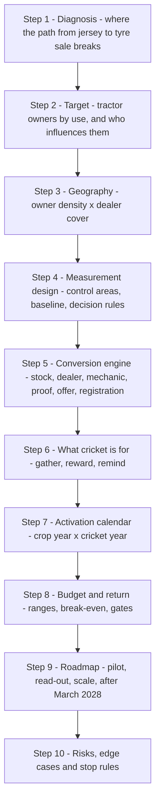

# 10. Review of the seven solution guidelines in the case brief

Prepared 6 November 2026.

**Purpose.** The case brief lists seven points a solution must cover and calls them "necessary but not exhaustive". This file tests each point against the research, says what it leaves out, and sets the framework the rest of the proposal follows.

**How to read this file.** Labels in square brackets show how firm a statement is.

| Label | Meaning |
|---|---|
| [Verified fact] | Primary source, or two independent credible sources. Sources are in the research files named beside each fact. |
| [Interpretation] | Our reading of the evidence. |
| [Strategic hypothesis] | A belief the pilot is designed to test. |
| [Planning assumption] | A working figure we chose because no data exists. |

Full source list: `17_Source_Register_and_Verification.md`.

---

## 1. The short answer

The seven points are a sound outline for a marketing plan. They are not enough for a plan that sells tyres, for three reasons.

1. **They assume the problem is recall.** Point 1 asks us to "explain why Apollo's recall is weak". The research suggests recall is only the first of several breaks between the jersey and a tyre sale (see `09_Problem_Diagnosis.md`). [Interpretation]
2. **They say nothing about supply.** Apollo's own managing director said in February 2026 that farm tyres were short of capacity (`01_Apollo_Tyres_Company_Research.md`). A plan that creates demand Apollo cannot fill fails on its own terms. [Verified fact for the shortage; Interpretation for the consequence]
3. **They treat the sponsorship rights as known.** Only the jersey logo is confirmed in public sources. What else Apollo may do with the BCCI is not public (`02_Cricket_Assets_and_Sponsorships.md`). [Verified fact]

Our verdict on each point:

| # | Guideline in the brief | Verdict | Main change |
|---|---|---|---|
| 1 | Diagnosis and target | Modify | Diagnose the whole path to purchase, and define the target as tractor owners, not farmers in general |
| 2 | Formats and properties | Modify | Start from what the rights allow and what farmers do, then choose properties |
| 3 | On-ground activation plan | Retain and extend | Add supply, dealer stocking and a season calendar |
| 4 | From recall to sales | Retain, make it the centre | Build the conversion steps before the cricket activity, not after |
| 5 | Measurement framework | Modify | Design the measurement first, with control areas, because it decides the pilot's shape |
| 6 | Financial plan | Modify | Size the budget against the farm business, show ranges, and tie scale-up money to results |
| 7 | Roll-out roadmap | Retain and extend | Add decision gates and a plan for after March 2028 |

---

## 2. Facts in the brief that need correcting before they go on a slide

The brief is the starting point, so its numbers will be quoted back to the judges. Four of them need care.

| Statement in the brief | What the research found | Label | Where |
|---|---|---|---|
| "Farm tyres were roughly 8 to 10% of Apollo's Indian revenue as of 2019" | True for 2019 (Apollo press release, 31 May 2019). Apollo's investor presentations give farm as 5% of Indian-entity revenue in FY24 and FY25 and 6% in FY26. | [Verified fact] | File 01 |
| "for about Rs 579 crore" | The figure is a press report. The BCCI has not disclosed the amount. | [Verified fact that it is undisclosed] | File 02 |
| "It also allows Apollo to work with the BCCI on activations and fan engagement" | Apollo's release promises "fan engagement" and "activations". The itemised rights (player access, team imagery, tickets, training kit) are not public. | [Verified fact that they are not public] | File 02 |
| "Recall among urban cricket fans is high" | No independent recall figure has been published. Apollo cites brand-strength gains from its own release. | [Interpretation] | File 03 |

The FY26 revenue figure (Rs 28,471 crore, up 9%) is correct. [Verified fact, File 01]

The brief also says Apollo "has decided that cricket ... should be the way in". We take that as a fixed constraint. The research question then becomes what job cricket can do for a tractor owner, and what it cannot do.

---

## 3. Point-by-point review

### Point 1: Diagnosis and target

**What the brief asks.** Explain why recall is weak among farmers and landowners. Define the target customer and focus geographies.

**Is it detailed enough?** No. It names one cause to explain (recall) and leaves "target customer" open.

**What is missing.**
- *The buyer is not "the farmer".* In 2009, 38% of farmers with more than 10 hectares owned a tractor, 18% of those with 2 to 10 hectares, and under 1% of those with less than 2 hectares (`04_Farmer_Consumer_Behaviour.md`). Most farmers hire a tractor. The buyer of a tractor tyre is a tractor owner. [Fact, single source, dated]
- *Recall of what?* "Apollo" on a jersey and "Apollo for my tractor" are different memories. The brief's own goal is the second: the first brand named "when asked" about tractor tyres. [Interpretation]
- *Other breaks in the path.* Trust in durability, the dealer's and mechanic's recommendation, stock at the nearest dealer, and credit all sit between knowing a name and buying (`09_Problem_Diagnosis.md`). [Interpretation]
- *No baseline.* No published study covers how Indian farmers choose tractor tyres or which brands they recall (`04_Farmer_Consumer_Behaviour.md`). The diagnosis is therefore a set of hypotheses until a baseline survey is run. [Verified fact that no study was found]

**Implementation challenges.** Segment data is old (2009 ownership by farm size) or absent. District-level tractor and dealer data are patchy (`06_Rural_Distribution_and_Geography.md`).

**Risks.** Aiming at "farmers" spreads money across people who never buy a tractor tyre. Choosing geographies by farmer numbers alone could launch marketing where Apollo has no dealer.

**How to improve.** Diagnose the full path to purchase. Define the target by ownership and use (owner who rents the tractor out and hauls; owner who farms only his own land; fleet-type buyers) plus the people who influence him (dealer, mechanic, tractor driver, other owners). Choose geographies on two tests together: tractor-owner density and Apollo dealer cover.

**Verdict: Modify.**

### Point 2: Formats and properties

**What the brief asks.** Recommend which cricket formats, properties or events to back, and show how the Team India sponsorship fits.

**Is it detailed enough?** Partly. It asks "which", not "for what job".

**What is missing.**
- *The rights position.* Only the jersey logo is confirmed. The BCCI named Muthoot FinCorp title sponsor of India's home series to March 2028 by official release on 26 September 2026 (reported by Business Today; [Fact - single source; BCCI release reported by press]), although Apollo's own web page still lists home-series title rights for "three years" (File 02). The plan must separate confirmed rights, likely rights and things Apollo would have to buy. [Verified fact]
- *Rules at ICC events.* The jersey deal covers 21 ICC matches, but ICC events have their own sponsor rules. What Apollo may do around the 2027 World Cup is unconfirmed (File 02). [Verified fact that it is unconfirmed]
- *Audience evidence.* No current data shows how many farming households watch India matches; the only rural audience splits found are from 2017 (File 02). [Verified fact]
- *Rivals.* CEAT is an official IPL partner and BKT is tyre partner to eight IPL teams (`07_Competitor_Analysis.md`). [Verified fact]
- *Timing.* Formats differ in when they happen. The farm year decides when owners have cash and when tractors work hardest.

**Implementation challenges.** Any use of team marks or player images needs BCCI approval. State leagues and village tournaments have no single owner or price list.

**Risks.** Buying more cricket inventory because it is cricket. Presenting hoped-for rights as held rights. Using a player's name or image without an individual contract.

**How to improve.** Give each property a job on the path to purchase (reach, gathering people, reward, proof) and a cost. Keep a register that marks every asset as held, obtainable or new.

**Verdict: Modify.**

### Point 3: On-ground activation plan

**What the brief asks.** What happens in villages and towns, who runs it, when; the partners; digital and media support.

**Is it detailed enough?** Yes on format. It is the most concrete of the seven.

**What is missing.**
- *Product on the shelf.* The plan must say which dealers stock which farm tyres before any event runs.
- *Supply.* Farm capacity was short in February 2026 (File 01). [Verified fact]
- *Season.* The 2026 monsoon ended about 13% below normal and Apollo is raising prices by 15 to 16% (`03_Latest_Developments_and_News.md`). Timing and affordability matter. [Verified fact]
- *Who owns it inside Apollo.* A national Head of Rural Sales was appointed in December 2025 (File 01). [Fact, single source]
- *Language and region.* Bareilly and Bathinda, the brief's two examples, differ in crops, farm size and language.

**Implementation challenges.** Running the same event to the same standard in many tehsils. Dealer willingness to host and to share sales data.

**Risks.** Good attendance, no sales. Events in places with no nearby dealer. Dealers treating it as head office's show.

**How to improve.** Make the dealer the host of every activity. Put a named mechanic and a demonstration tractor at each one. Publish a calendar that follows the crop year as well as the cricket year.

**Verdict: Retain and extend.**

### Point 4: From recall to sales

**What the brief asks.** Show how the activity moves a farmer from knowing the name to buying the tyre.

**Is it detailed enough?** No. It is one line, and it is the hardest part.

**What is missing.**
- The moment of purchase. A tractor tyre is bought when the old one fails or the season is about to start, often at short notice.
- The people present at that moment: dealer and mechanic. A small study of tractor lubricants found farmers trust mechanics and other owners more than shops or advertisements (File 04). [Proxy evidence]
- Proof of tyre life. Tyre wear was the most common and most bothersome problem for tractor owners in three J.D. Power surveys, and durability was the most important factor in tyre satisfaction (File 04). [Fact, syndicated survey]
- A way to capture each buyer so he can be counted, followed up and asked for referrals.
- Credit, exchange and price.

**Implementation challenges.** Dealer margins, credit terms and the dealer's influence on brand choice are not measured in any public source (File 07). Incentives cannot be designed until a dealer survey is done.

**Risks.** Incentives that buy sales which would have happened anyway. Rival dealers matching offers. Lucky-draw schemes that fall foul of state prize rules (`13_Budget_and_Commercial_Model.md`).

**How to improve.** Treat this as the core of the proposal. Design the steps backward from the sale: stock, recommendation, proof, offer, registration.

**Verdict: Retain, and make it the centre.**

### Point 5: Measurement framework

**What the brief asks.** KPIs for recall and sales, the baseline, and how impact is attributed.

**Is it detailed enough?** It names the right three things. It does not say that attribution needs a comparison group.

**What is missing.**
- *Control areas.* FY26 farm demand rose for every brand because GST on tractor tyres fell from 18% to 5% and the 2025 monsoon was good (File 03). A before-and-after comparison would credit the programme with growth it did not cause. [Interpretation]
- *A sales data source.* Apollo's chief financial officer said official market-share data is unavailable or arrives late (File 01). Dealer sell-out and warranty registration have to supply the numbers. [Verified fact for the statement]
- *Sample sizes and cost.*
- *Decision rules* agreed before the pilot starts.
- *A test of cricket itself.* The brief assumes cricket works. The design should be able to show whether the cricket layer adds anything beyond the dealer and mechanic work.

**Implementation challenges.** Cricket broadcasts reach every area, so only the on-ground and targeted parts can be switched on and off by area. Farm sales are seasonal and lumpy. Dealers may under-report.

**Risks.** Counting attendance, views or impressions as results. Contaminated controls when an activity spills into a neighbouring area.

**How to improve.** Fix the measurement design before the activity plan, because it decides how many areas the pilot needs and where (`14_KPI_and_Impact_Measurement.md`).

**Verdict: Modify.**

### Point 6: Financial plan

**What the brief asks.** A budget and a cost-benefit analysis with expected uplift.

**Is it detailed enough?** No budget ceiling is given.

**What is missing.**
- *A sense of scale.* Farm is about 6% of Apollo's Indian revenue, about Rs 1,200 crore by our arithmetic (File 01). The budget should be judged against that, not against the jersey fee. [Verified fact for the 6%; Interpretation for the rupee figure]
- *Margin per tyre,* so that uplift can be turned into profit.
- *Ranges.* Most rural cost figures are vendor estimates, not rate cards (File 13).
- *Spill-over.* The same rural dealers sell two-wheeler, car and pick-up tyres, which management names with farm as its rural growth categories (File 01). That is upside, and it should be measured but not counted in the base case.
- *The sunk fee.* The jersey fee is already spent. Only the extra money is at stake in this decision.

**Implementation challenges.** No published benchmark exists for what a farmer programme does to tyre sales (File 07).

**Risks.** A single-point uplift figure that looks precise and is invented. A budget that cannot be defended against Apollo's normal advertising spend of about 2.5% of sales.

**How to improve.** State the budget as a planning assumption with low, base and high cases. Show break-even uplift, not just expected uplift. Release scale-up money only when the pilot passes agreed thresholds.

**Verdict: Modify.**

### Point 7: Roll-out roadmap

**What the brief asks.** How the plan moves from pilot to scale before March 2028.

**Is it detailed enough?** It gives the end date only.

**What is missing.**
- *How little time there is.* From November 2026 to March 2028 is about 16 months, which holds two crop cycles and one World Cup.
- *Decision gates* with dates.
- *What happens after March 2028.* The brief's third goal asks what else in cricket is worth backing. A property Apollo owns can outlast the jersey; a rented one cannot.
- *Capability.* People, an agency, a data system and dealer onboarding all take time.

**Implementation challenges.** A pilot long enough to see sales leaves a short scale window. Cricket schedules move (File 02).

**Risks.** Scaling on recall results before sales results are in. Losing the 2027 World Cup window, which falls at harvest.

**How to improve.** Plan backward from the two fixed points, the October to November 2027 World Cup and March 2028, and put the pilot read-out before the first of them.

**Verdict: Retain and extend.**

---

## 4. What the seven points leave out

| # | Missing dimension | Why it matters | Where we cover it |
|---|---|---|---|
| A | Supply and availability | Farm capacity was short in early 2026; marketing without stock wastes money and goodwill | Files 06, 12, 16 |
| B | Product and proof | Durability decides satisfaction; a claim needs proof a farmer can see | Files 04, 11 |
| C | Trade economics | The dealer and mechanic are present at the sale; their incentives are unknown | Files 07, 13 |
| D | Rights and law | BCCI approvals, ICC event rules, players' personal rights, prize-scheme rules | Files 02, 12 |
| E | Affordability and credit | Weak monsoon and 15 to 16% price rises in 2026 | Files 03, 11 |
| F | Ownership inside Apollo | Someone must own targets, budget and data | File 16 |
| G | Primary research | No published study of tractor-tyre buying exists | Files 04, 14 |
| H | Life after March 2028 | Renew, replace or exit, and what Apollo keeps | File 16 |
| I | Spill-over to other rural tyres | Same dealers, same households; larger revenue pool | Files 13, 14 |
| J | Stop rules | When to change or end the programme | Files 12, 14 |

---

## 5. The framework this proposal uses

We keep all seven points and reorder them so that the questions that constrain the others come first.

How the brief's points map onto it:

| Brief's point | Our step(s) | Main file |
|---|---|---|
| 1 Diagnosis and target | 1, 2, 3 | 09, 04, 06 |
| 2 Formats and properties | 6 | 02, 11 |
| 3 On-ground activation plan | 5, 7 | 11, 16 |
| 4 From recall to sales | 5 | 11, 16 |
| 5 Measurement framework | 4 | 14 |
| 6 Financial plan | 8 | 13 |
| 7 Roll-out roadmap | 9, 10 | 16, 12 |

The order matters for the final deck as well. The brief allows 12 slides. A deck that opens with a cricket idea will look like every other team's. A deck that opens with who actually buys a tractor tyre and where the sale is lost, and then shows what cricket is for, answers the same seven points with a stronger argument. [Interpretation]
