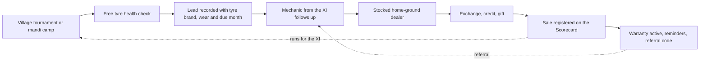

# 11. Strategic alternatives

Prepared 6 November 2026.

**Purpose.** This file sets out eight different ways Apollo could act on the diagnosis in `09_Problem_Diagnosis.md`. They are meant to be real alternatives, not versions of one idea. `12_Strategy_Evaluation_and_Stress_Testing.md` scores them and tests the preferred one.

Full source list: `17_Source_Register_and_Verification.md`.

**How to read this file.** Facts are cited by the research file that holds them and their sources. Everything about how an alternative would work is design, tagged as follows.

| Label | Meaning |
|---|---|
| [Verified fact] / [Fact - single source] / [Proxy evidence] | Evidence, as defined in File 04 |
| [Interpretation] | Our reading of the evidence |
| [Strategic hypothesis] | A belief the pilot must test |
| [Planning assumption] | A working figure or name we chose; not a finding |

All programme names in this file are working titles [Planning assumption]. None has been checked for trademark or with the BCCI.

---

## 1. The test each alternative has to pass

The diagnosis found five links between the jersey and a tyre sale. An alternative is only as good as the links it builds.

| Link | Question for the tractor owner |
|---|---|
| 1. Link | Does "Apollo" mean a tractor tyre to me? |
| 2. Proof | Do I believe it lasts? |
| 3. People | Do the people I trust recommend it? |
| 4. Presence | Can I get it today, near me, on terms I can manage? |
| 5. Record | Does Apollo know I bought, and can it show what worked? |

## 2. The alternatives at a glance

| # | Alternative | Led by | Links it builds | Main weakness |
|---|---|---|---|---|
| A | Air cover | Paid media in and around India matches | 1 | Reaches mostly people who never buy a tractor tyre; no route to a sale |
| B | Star power | A cricketer as the face of Apollo farm tyres | 1 | Costly; tractor makers who tried it published no results |
| C | Regional league | State T20 league sponsorship | 1 (weakly) | City stadiums, August timing, undisclosed prices |
| D | Village cricket circuit | Apollo-run tournaments | 1, part of 3 | Events are the costliest item per area; players are young |
| E | Dealer and mechanic engine | Trade programme without cricket | 2, 3, 4, 5 | Does not use the sponsorship; low reach |
| F | Digital farmer community | WhatsApp, YouTube, voice | 1, part of 3, 5 | Few farmers prefer digital at every step of a purchase |
| G | Institutions and tractor makers | Fitment and fleet deals | 2, 4 | Slow; Apollo is short of farm capacity |
| H | Apollo XI | The engine, run in a cricket format | 1, 2, 3, 4, 5 | The most parts to run |

---

## 3. The alternatives in detail

### A. Air cover: advertise farm tyres in and around India matches

| Element | Description |
|---|---|
| Underlying insight | Cricket is the largest shared audience in India: 612 million people watched cricket in a year (Ormax 2024). [Fact - single source, File 02] |
| Target audience | Rural cricket viewers in tractor states |
| Geography | State-level buys in Uttar Pradesh, Punjab, Haryana, Rajasthan, Madhya Pradesh, Maharashtra, Gujarat |
| Journey stage | Awareness |
| How it works | A farm-tyre film in regional languages runs in India match breaks on television and streaming, backed by wall paintings and mandi hoardings showing the Team India sponsor line |
| Apollo assets used | The jersey as a credential; Sachin Tendulkar and the existing film team |
| Extra resources | Advertising inventory, which the jersey deal does not include (File 02); BCCI approval for any team imagery |
| Why farmers would take part | They would not need to; it is passive |
| How it influences a purchase | By making the name familiar in a tractor context |
| How awareness becomes a sale | It does not, on its own. There is no dealer, offer or record in the design. |

**Evidence against.** No 2022-26 data shows how many farming households watch India matches. Whether streaming advertising can be aimed at a state or pin code is unconfirmed; resellers contradict each other (`13_Budget_and_Commercial_Model.md`). Reseller prices for streaming on connected television run at about Rs 340 to 750 per thousand impressions, paid for every viewer whether or not he owns a tractor. [Vendor estimate]

### B. Star power: a cricketer as the face of Apollo farm tyres

| Element | Description |
|---|---|
| Underlying insight | Rural audiences respond to cricketers they admire; tractor makers believe so (Swaraj with MS Dhoni, New Holland with Yuvraj Singh). [Fact - single source, File 02] |
| Target audience | Tractor owners and their families |
| Geography | National, with regional edits |
| Journey stage | Awareness, interest |
| How it works | Apollo signs a current or former India player with rural roots for the farm range, or extends Sachin Tendulkar's role to it |
| Apollo assets used | Tendulkar's existing contract (scope not public) |
| Extra resources | An individual endorsement contract; fees are not published and old reports conflict |
| Why farmers would take part | Passive |
| How it influences a purchase | Borrowed trust |
| How awareness becomes a sale | No built-in route |

**Evidence against.** None of the tractor makers using cricketers has published a result (File 02). Players' personal endorsement rights are separate from the team sponsorship, so the jersey does not help here. Apollo's tractor tyre is called Virat; implying an endorsement by Virat Kohli without a contract would risk a personality-rights claim. [Interpretation, File 02]

### C. Regional league: back state T20 leagues in tractor states

| Element | Description |
|---|---|
| Underlying insight | State leagues carry local pride and local players |
| Target audience | Cricket fans in one state at a time |
| Geography | Uttar Pradesh, Madhya Pradesh, Maharashtra, Punjab, Rajasthan |
| Journey stage | Awareness |
| How it works | Title or team sponsorship of leagues such as the UP T20 League, with dealer hospitality at matches |
| Apollo assets used | None of the existing ones; this is a new purchase |
| Extra resources | Sponsorship fees (not disclosed for any league found); activation at venues |
| Why farmers would take part | Dealers and a few invited customers attend |
| How it influences a purchase | Weakly, through local presence |
| How awareness becomes a sale | Only through dealer hospitality |

**Evidence against.** The leagues play in city stadiums (Lucknow and Kanpur for Uttar Pradesh) and mostly in August, in the middle of the kharif crop season. Several already have title sponsors. One league's second season was reported to have empty stands. [Fact - single source, File 02]

### D. Village cricket circuit: Apollo runs its own tournaments

| Element | Description |
|---|---|
| Underlying insight | Village tournaments are real community events. In Haryana they run for days, draw teams from three states and are funded by panchayats and local patrons. [Fact - single source, File 02] |
| Target audience | Village men; landowners as patrons |
| Geography | Tehsils (sub-districts) in the pilot belts (`06_Rural_Distribution_and_Geography.md`) |
| Journey stage | Awareness, interest |
| How it works | Apollo organises a tennis-ball knockout in each tehsil, with district and state finals, live scoring and streaming, and Team India match tickets as the top prize |
| Apollo assets used | The Team India sponsor's standing; tickets if the contract provides them |
| Extra resources | Event staff, grounds, prizes, an agency |
| Why farmers would take part | Local pride, prizes, a day out |
| How it influences a purchase | By gathering the village under Apollo's name |
| How awareness becomes a sale | Only if a dealer, a demonstration and lead capture are added at the ground |

**Evidence against.** On the one large scoring app, players aged 40 and over are about 1.5% of active players (File 02), so the tractor owner is more likely to be watching than playing [Strategic hypothesis]. Running events is the most expensive item per tehsil in our budget (File 13). Without the trade behind it, a tournament creates goodwill and no sale.

### E. Dealer and mechanic engine: build the last mile, without cricket

| Element | Description |
|---|---|
| Underlying insight | The sale is decided by the dealer, the mechanic and other owners, on tyre life. Mechanics and peers are trusted over shops and advertisements. [Proxy evidence, File 04] |
| Target audience | Tractor owners who rent out and haul; mechanics; farm-tyre dealers |
| Geography | Tehsils that pass the stock test (File 06) |
| Journey stage | Information search through repeat purchase |
| How it works | (1) A named, stocked farm-tyre dealer in each tehsil. (2) A paid referral programme for mechanics and puncture-shop owners. (3) "Proof tractors": heavy-use owners fitted with Apollo rears, with hours logged and shown. (4) Free tyre health camps that record each tractor's tyre brand and wear. (5) Exchange value, harvest-timed credit and a guaranteed gift. (6) Registration of every sale by missed call or WhatsApp, which activates the warranty. |
| Apollo assets used | Dealer network, rural sales team, dealer platform with sub-dealer warranty registration, the 7-year warranty, the Virat range |
| Extra resources | Field coordinators, a registration system, a finance partner |
| Why farmers would take part | A free check on their most common tractor problem; a better deal on an unavoidable purchase |
| How it influences a purchase | Through the people present at the purchase and through visible proof |
| How awareness becomes a sale | Health check → lead with an expected replacement date → mechanic follow-up → stocked dealer → offer → registration |

**Evidence for.** Trade-influencer programmes run at scale in neighbouring categories: Castrol with mechanics, Ambuja with contractors, Pidilite with carpenters (`15_Consulting_Benchmarks.md`). Their sales effect is not published. [Fact - single source each]

**Weakness.** It ignores the brief's requirement to use cricket, and it reaches few people per rupee.

### F. Digital farmer community

| Element | Description |
|---|---|
| Underlying insight | Rural India had 488 million internet users in 2024; farm YouTube channels reach millions; young farmers keep several farming WhatsApp groups. [Verified fact / Fact - single source, File 04] |
| Target audience | Owners and, more often, their sons |
| Geography | By language, not district |
| Journey stage | Awareness, information search, repeat |
| How it works | Tyre-care and tyre-choice videos through farm creators; a WhatsApp and voice line for advice; cricket prediction contests on match days; leads passed to the nearest dealer |
| Apollo assets used | The film team; the dealer platform |
| Extra resources | Creators, a messaging platform, content in each language |
| Why farmers would take part | Useful advice; entertainment |
| How it influences a purchase | Through advice forwarded by people they know |
| How awareness becomes a sale | Lead passed to a dealer; weak unless the dealer acts |

**Evidence against.** The one consulting survey of Indian farmers found only about one in ten prefer digital channels at every stage of a purchase (File 15). Rural internet subscriptions are far thinner than urban ones and devices are often shared (`08_2028_Market_Trends.md`). Message cost is low, about Rs 1 each, so the limit is the opt-in list, not the price. [Vendor estimate]

### G. Institutions and tractor makers

| Element | Description |
|---|---|
| Underlying insight | Goodyear's hold on farm tyres comes from supplying six tractor makers. The tyre on a new tractor is the owner's first experience. [Fact - single source, File 07] |
| Target audience | Tractor makers and dealers; Custom Hiring Centres; farmer producer organisations; contractors |
| Geography | National accounts; states with many hiring centres (Punjab leads) |
| Journey stage | Purchase, product experience |
| How it works | Win more factory fitment; offer a choice of Apollo tyres at the tractor dealership; sell to fleets with service contracts and finance |
| Apollo assets used | Existing supply to Mahindra; key-account team |
| Extra resources | Capacity; approvals from tractor makers; fleet service |
| Why farmers would take part | The tyre arrives on the tractor |
| How it influences a purchase | First-hand experience from day one |
| How awareness becomes a sale | The sale is the fitment; replacement follows years later |

**Evidence against.** Farm tyres were short of capacity in early 2026 and growth capex is for other categories (File 01). Fitment approvals and the first replacement cycle run beyond March 2028. It makes no use of cricket.

### H. Apollo XI: the engine, run in a cricket format

This combines E with a lean form of D, the record-keeping of F, and the jersey as credential.

| Element | Description |
|---|---|
| Underlying insight | The purchase is decided locally by a few trusted people (File 04). No channel today joins those people, a stocked shop, a record and cricket (`05_Farmer_Influence_Venn_Diagram.md`). Cricket's most useful property in a village is that it organises people into teams and seasons and gives them something to win. |
| Target audience | Primary: owners who rent out and haul. Secondary: larger landowners. Through: dealers and mechanics. |
| Geography | Two contrasting pilot belts, then the high-registration districts (File 06) |
| Journey stage | All eight |
| Apollo assets used | Jersey and sponsor standing; dealer network; rural sales team and "One District, One ARD"; dealer platform; 7-year warranty; Virat range; mobile stores; Tendulkar if his contract allows |
| Extra resources | Field coordinators, registration system, finance partner, research agency, BCCI approvals |

**How it works.**

| Part | What happens | Link built |
|---|---|---|
| **Home ground** | One named Apollo farm-tyre dealer per tehsil passes the stock test (File 06) and becomes the team's captain | 4 |
| **The XI** | The dealer recruits eleven mechanics and puncture-shop owners in his catchment. Each gets a gauge kit, a signboard and training on the right tyre for the soil | 3 |
| **Runs** | Every registered farm tyre sale scores for the XI and credits the mechanic who referred it. A table ranks XIs by tehsil, district and state through each season | 3, 5 |
| **Scorecard** | The buyer registers by missed call or WhatsApp at the counter. The warranty is activated at once, and reminders and a referral code follow | 5 |
| **Lambi Paari tractors** ("the long innings") | Five or six heavy-use owners per tehsil fit Apollo rears at a trial price. Their hours are read each quarter and posted at the dealer and on WhatsApp | 2 |
| **Tyre health camps** | Free pressure and wear checks at mandis, tournaments and the dealer. Each tractor checked becomes a lead with its tyre brand, wear and likely replacement month | 2, 5 |
| **The offer** | Exchange value for old tyres of any brand, payment timed to harvest through a finance partner, a guaranteed gift with a pair. No price cut and no lucky draw | 4 |
| **Apollo Kisan Cup** | Each XI backs three or four existing village tournaments (balls, trophies, prize top-up) and brings the proof tractor and the health camp. Village winners meet at a tehsil final hosted by the dealer, with local landowners as patrons. District and season finals follow | 1, 3 |
| **Match days** | India match days are open days at the dealer. The World Cup weeks in October and November 2027 carry the main exchange offer | 1 |
| **Sponsor's rewards** | The best XIs, mechanics and referring owners win trips to an India match and Team India sponsor merchandise | 3 |
| **Sponsor's line** | "Team India's sponsor, on your tractor" on dealer boards, tyre stickers and mandi walls, in wording the BCCI approves | 1 |

**Why each group would take part.**

| Group | Reason |
|---|---|
| Owner | A free check on his most common tractor problem; money for his old tyres; credit; a tournament his village already cares about |
| Mechanic | Income for each referral; tools and training; standing as part of a named team; a prize he could not buy |
| Dealer | Footfall, a growth scheme, and a role as host in his area. Management says the jersey has already lifted dealer morale. [Verified fact, File 01] |
| Village patrons | Recognition at an event the Team India sponsor backs |

**How it influences a purchase.** The mechanic names Apollo when a tyre fails. The dealer has it in stock and gains by selling it. A neighbour's tractor shows the hours. The owner has been checked, so he knows his tyres are due.

**How awareness becomes a sale.**

**What is cricket and what is not.** The engine (home ground, XI, proof tractors, camps, offer, registration) would work without cricket; that is alternative E. Cricket supplies the team format, the season, the gathering and the prizes. This split is deliberate. It lets the pilot run the engine with and without the cricket layer and measure what cricket adds (`14_KPI_and_Impact_Measurement.md`).

**Weaknesses.** It has many parts and depends on dealer effort. Several pieces need BCCI approval. Its cost per tehsil is higher than E's (File 13).

---

## 4. Other ideas considered and set aside

| Idea | Why set aside |
|---|---|
| IPL team or league sponsorship | CEAT and BKT already hold tyre positions; it cannot be aimed at tractor owners; it is not the asset Apollo has paid for (File 02) |
| Public screenings of India matches in villages | Needs the broadcaster's permission; legal position for sponsored village screenings is unclear (File 13). Kept only as an option if cleared |
| Price cuts or a rural discount brand | Farm tyres are short of supply and input costs are forcing price rises (File 03) |
| Lucky draws | Banned in Tamil Nadu; disclosure rules apply elsewhere; a legal opinion would be needed (File 13) |
| Selling farm tyres through agri-commerce apps | No such app was found selling tractor tyres (File 08) |
| Partnering with government or politician-run sports festivals | Large registrations, but they tie the brand to a party or office-holder. Possible later, state by state |
| Women's cricket as the rural route | The women's team is in the jersey deal and won the 2025 World Cup, but tractor-tyre buyers are overwhelmingly men. Worth using for goodwill, not as the sales route. [Interpretation] |

---

## 5. How the alternatives relate

- A, B and C buy reach. They build the first link only.
- D builds the first link locally and can host the others.
- E builds links 2 to 5 and none of the first.
- F supports and records.
- G is a slower route to the same end and should run in parallel through the key-account team.
- H is E carried by D, with F as its record.

The scoring, the comparison of H with its parts, and the stress tests are in File 12.
