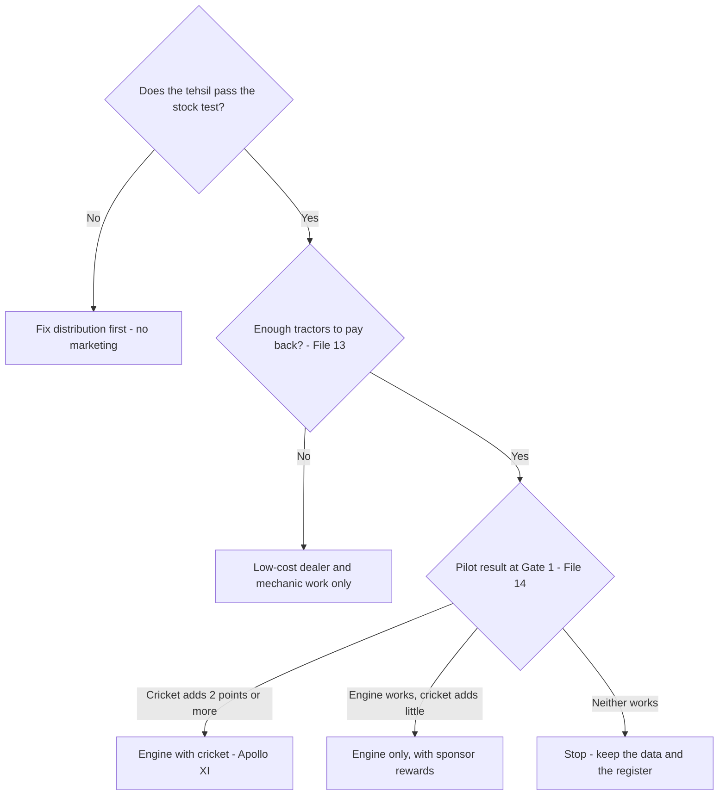

# 12. Strategy evaluation and stress testing

Prepared 6 November 2026.

**Purpose.** This file scores the eight alternatives in `11_Strategic_Alternatives.md` against twelve criteria, names the best option for each need, and then tests the preferred strategy against the situations most likely to break it.

Full source list: `17_Source_Register_and_Verification.md`.

**How to read this file.** Scores are judgements [Interpretation]. Each rests on a stated rule and a one-line reason that points to evidence or to a labelled assumption. They rank options; they do not measure them.

---

## 1. What matters most

1. **The dealer and mechanic engine scores highest of the single alternatives.** It acts on the people and the proof that decide a tyre purchase, and it can be measured.
2. **The engine run in a cricket format (Apollo XI) scores a little higher still**, because it also uses the sponsorship and builds recall. The margin is small. Whether cricket adds enough is the question the pilot answers.
3. **The three options that buy reach (media, a star, a state league) score lowest.** They build only the first of the five links in `09_Problem_Diagnosis.md`.
4. **The combination beats any single option**, as long as the cricket layer is kept lean.
5. **The plan's weakest points are supply, dealer effort and unconfirmed rights.** Each has a mitigation and an early warning.

---

## 2. Scoring rules

Each criterion is scored 1 to 5. Five is best. For cost and complexity, five means cheapest and simplest.

| # | Criterion | 5 means | 3 means | 1 means |
|---|---|---|---|---|
| 1 | Strategic fit | Uses the Team India deal in a way only Apollo can, and serves all four goals in the brief | Uses cricket in general, or serves two goals | Ignores the sponsorship, or serves one goal |
| 2 | Farmer relevance | Reaches mainly tractor owners and their advisers | Mixed audience | Mostly people who never buy a tractor tyre |
| 3 | Brand recall potential | Repeated contact that ties Apollo to tractor tyres | Either repeated or tied to tractor tyres, not both | Neither |
| 4 | Purchase influence | Works through dealer, mechanic, other owners and proof | Works through one of them | Works through none |
| 5 | Sales conversion potential | Built-in lead, offer and registered sale | Lead or offer only | No step toward a sale |
| 6 | Geographical scalability | Repeats tehsil by tehsil with a standard kit | Needs heavy local set-up each time | Tied to a few places |
| 7 | Distribution feasibility | Starts from stocked dealers | Neutral | Creates demand whether or not stock exists |
| 8 | Implementation complexity | One contract, one team | Many local partners, standard process | Many partners, approvals and one-off events |
| 9 | Cost | Low cost per tractor owner influenced | Moderate | High, or mostly spent on non-buyers |
| 10 | Time to impact | Sales effect plausible within one season | Two seasons | Beyond March 2028 |
| 11 | Measurability | Can be switched on and off by area and tied to registered sales | Measurable by survey only | National; no control possible |
| 12 | Long-term sustainability | Leaves an asset Apollo owns after March 2028 | Partly | Ends when the spending ends |

---

## 3. Scores

| Criterion | A Air cover | B Star power | C Regional league | D Village circuit | E Engine | F Digital | G Institutions | H Apollo XI |
|---|:-:|:-:|:-:|:-:|:-:|:-:|:-:|:-:|
| 1 Strategic fit | 3 | 3 | 2 | 4 | 2 | 2 | 1 | 5 |
| 2 Farmer relevance | 2 | 2 | 2 | 3 | 5 | 3 | 4 | 5 |
| 3 Brand recall | 3 | 3 | 2 | 4 | 3 | 3 | 2 | 4 |
| 4 Purchase influence | 1 | 1 | 1 | 2 | 5 | 2 | 4 | 5 |
| 5 Sales conversion | 1 | 1 | 1 | 2 | 5 | 3 | 4 | 5 |
| 6 Scalability | 5 | 5 | 3 | 4 | 4 | 5 | 3 | 4 |
| 7 Distribution feasibility | 1 | 1 | 2 | 3 | 5 | 3 | 3 | 5 |
| 8 Complexity | 5 | 4 | 3 | 2 | 3 | 4 | 2 | 2 |
| 9 Cost | 2 | 1 | 2 | 2 | 4 | 5 | 3 | 3 |
| 10 Time to impact | 3 | 3 | 2 | 3 | 4 | 3 | 1 | 4 |
| 11 Measurability | 2 | 1 | 3 | 5 | 5 | 4 | 3 | 5 |
| 12 Sustainability | 1 | 2 | 2 | 4 | 5 | 4 | 5 | 5 |
| **Total (of 60)** | **29** | **27** | **25** | **38** | **50** | **41** | **35** | **52** |
| **Weighted total (of 80)** | **36** | **33** | **32** | **51** | **67** | **52** | **47** | **72** |

The weighted total counts four criteria twice: strategic fit, purchase influence, sales conversion and measurability. These map to the brief's four goals (make the sponsorship work harder, build recall that leads somewhere, turn recall into sales, prove it). The choice of weights is ours. [Interpretation]

Ranking: H, E, F, D, G, A, B, C on both counts.

---

## 4. Reasons for each score

### A. Air cover

| Criterion | Score | Reason |
|---|:-:|---|
| Strategic fit | 3 | Uses the jersey as a credential but buys inventory any brand could buy; serves recall only |
| Farmer relevance | 2 | Mass audience; no data on farming households' viewing (File 02) |
| Brand recall | 3 | Frequent on match days and can show a tractor tyre |
| Purchase influence | 1 | Advertisements played "a much smaller role" than peers and mechanics in the one study found (File 04) [Proxy evidence] |
| Sales conversion | 1 | No dealer, offer or record |
| Scalability | 5 | One media plan |
| Distribution feasibility | 1 | Runs whether or not stock exists |
| Complexity | 5 | One agency |
| Cost | 2 | Pays for every viewer; streaming at about Rs 340 to 750 per thousand impressions (File 13) [Vendor estimate] |
| Time to impact | 3 | Recall may move in a season; sales unproven |
| Measurability | 2 | Targeting by state or pin code is unconfirmed (File 13) |
| Sustainability | 1 | Stops when the spending stops |

### B. Star power

| Criterion | Score | Reason |
|---|:-:|---|
| Strategic fit | 3 | Cricket-led, but individual endorsements sit outside the jersey deal (File 02) |
| Farmer relevance | 2 | Mass audience |
| Brand recall | 3 | A face helps memory; category link depends on the film |
| Purchase influence | 1 | Tractor makers using cricketers have published no results (File 02) |
| Sales conversion | 1 | None built in |
| Scalability | 5 | National at once |
| Distribution feasibility | 1 | Independent of stock |
| Complexity | 4 | One contract, plus approvals |
| Cost | 1 | Fees unpublished; old reports run to crores [Unverified] |
| Time to impact | 3 | As for A |
| Measurability | 1 | National; no control |
| Sustainability | 2 | Ends with the contract |

### C. Regional league

| Criterion | Score | Reason |
|---|:-:|---|
| Strategic fit | 2 | Not the asset Apollo holds |
| Farmer relevance | 2 | City stadiums; August, in the kharif season (File 02) |
| Brand recall | 2 | Little category link |
| Purchase influence | 1 | None |
| Sales conversion | 1 | Dealer hospitality only |
| Scalability | 3 | One league per state, each with its own owner |
| Distribution feasibility | 2 | Some dealer involvement |
| Complexity | 3 | One contract per state |
| Cost | 2 | Prices undisclosed; UP franchises were sold at Rs 5.5 to 6.5 crore each (File 13) [Press quote] |
| Time to impact | 2 | One short season a year |
| Measurability | 3 | State by state |
| Sustainability | 2 | Rented, not owned |

### D. Village cricket circuit

| Criterion | Score | Reason |
|---|:-:|---|
| Strategic fit | 4 | Cricket-led and tied to the sponsor's standing; serves recall and part of proof |
| Farmer relevance | 3 | Players are young; owners as patrons is a hypothesis (File 02) |
| Brand recall | 4 | Repeated local presence with the tractor tyre on show |
| Purchase influence | 2 | Gathers other owners; no dealer or mechanic mechanism |
| Sales conversion | 2 | Leads possible at the ground |
| Scalability | 4 | Repeats by tehsil |
| Distribution feasibility | 3 | Neutral unless tied to dealers |
| Complexity | 2 | Many events |
| Cost | 2 | Events are the largest cost per tehsil (File 13) |
| Time to impact | 3 | Recall in a season; sales unclear |
| Measurability | 5 | On and off by tehsil |
| Sustainability | 4 | A property Apollo owns |

### E. Dealer and mechanic engine

| Criterion | Score | Reason |
|---|:-:|---|
| Strategic fit | 2 | Serves sales and proof; ignores cricket, which the brief requires |
| Farmer relevance | 5 | Only owners and their advisers |
| Brand recall | 3 | Tied to the tractor tyre, but reaches few |
| Purchase influence | 5 | Dealer, mechanic, proof tractors (File 04) |
| Sales conversion | 5 | Lead, offer, registration |
| Scalability | 4 | Standard kit; needs coordinators |
| Distribution feasibility | 5 | Starts from the stock test |
| Complexity | 3 | Many local partners |
| Cost | 4 | About Rs 2.9 lakh a tehsil at scale (File 13) [Planning assumption] |
| Time to impact | 4 | Acts at the point of purchase |
| Measurability | 5 | By tehsil; registered sales |
| Sustainability | 5 | Network and customer record remain |

### F. Digital farmer community

| Criterion | Score | Reason |
|---|:-:|---|
| Strategic fit | 2 | Cricket only as content |
| Farmer relevance | 3 | Reaches sons more than owners; devices often shared (File 08) |
| Brand recall | 3 | Repeated, if opted in |
| Purchase influence | 2 | About one in ten Indian farmers prefer digital at every purchase stage (File 15) |
| Sales conversion | 3 | Lead passed to a dealer |
| Scalability | 5 | By language |
| Distribution feasibility | 3 | Neutral |
| Complexity | 4 | One platform |
| Cost | 5 | About Rs 1 a message (File 13) [Vendor estimate] |
| Time to impact | 3 | List has to be built first |
| Measurability | 4 | Trackable; control harder |
| Sustainability | 4 | The list remains |

### G. Institutions and tractor makers

| Criterion | Score | Reason |
|---|:-:|---|
| Strategic fit | 1 | No use of cricket |
| Farmer relevance | 4 | New-tractor and fleet buyers |
| Brand recall | 2 | Seen on the tractor, slowly |
| Purchase influence | 4 | Factory fitment is how Goodyear holds the market (File 07) |
| Sales conversion | 4 | The fitment is the sale |
| Scalability | 3 | Limited by contracts and capacity |
| Distribution feasibility | 3 | Needs supply Apollo is short of (File 01) |
| Complexity | 2 | Long negotiations |
| Cost | 3 | Paid in price terms more than marketing |
| Time to impact | 1 | Beyond March 2028 |
| Measurability | 3 | Contract volumes |
| Sustainability | 5 | Lasting |

### H. Apollo XI

| Criterion | Score | Reason |
|---|:-:|---|
| Strategic fit | 5 | Uses the sponsor's standing and rewards, which no rival can buy; serves all four goals |
| Farmer relevance | 5 | Same audience as E |
| Brand recall | 4 | E's category link plus village-level repetition |
| Purchase influence | 5 | As E |
| Sales conversion | 5 | As E |
| Scalability | 4 | Standard kit; events add effort |
| Distribution feasibility | 5 | Stock test first |
| Complexity | 2 | The most parts; BCCI approvals |
| Cost | 3 | About Rs 5.4 lakh a tehsil at scale (File 13) [Planning assumption] |
| Time to impact | 4 | As E |
| Measurability | 5 | Three-arm design (File 14) |
| Sustainability | 5 | Network, record and an owned cricket property |

---

## 5. Best option for each need

| Need | Best option | Why |
|---|---|---|
| Best immediate intervention | The stock test and sale registration from E | Needs no approvals; can start in weeks; nothing else works without them |
| Best long-term intervention | G, run in parallel by the key-account team | Factory fitment and fleet buyers shape the market after 2028 |
| Best low-budget intervention | Mechanic programme with registration (E and F together) | Highest influence for the least money |
| Best scalable intervention | E | Standard kit; pays back at the lowest share gain |
| Best cricket-led intervention | Dealer-backed village cricket with Team India rewards (the lean form of D inside H) | The only cricket format that reaches the purchase circle |
| Best non-cricket intervention | E | Top-scoring single alternative |
| Best integrated strategy | H | Top score overall; builds all five links |

---

## 6. Does a combination beat any single option?

Yes, on three grounds. [Interpretation]

1. **No single option builds all five links.** E builds four and leaves the first. D builds the first and little else. Together they cover all five.
2. **The parts make each other cheaper.** The dealer already has the XI, the proof tractor and the health camp; taking them to a village tournament that already exists costs little. A tournament run alone needs all of that brought in.
3. **Cricket gives the trade programme something rivals cannot copy quickly.** Any tyre maker can pay mechanics. Only Apollo can send the best of them to watch India as the team's sponsor.

Two cautions keep the combination honest.

- **The margin over E is small** (52 against 50; 72 against 67 weighted). The cricket layer adds cost and complexity. On the planning inputs in File 13 it must add two to three points of local market share to pay for itself.
- **Media, a star and a state league do not improve the combination.** They add cost without adding a link. A, B and C stay out.

The recommended strategy is therefore H, piloted beside E, with G as a slower parallel track and F as its record-keeping. The detail is in `16_Final_Strategic_Recommendation.md`.

---

## 7. Edge cases

| # | Situation | What goes wrong | Mitigation | Early warning |
|---|---|---|---|---|
| 1 | Villages with no Apollo dealer nearby | Interest with nowhere to buy | Not in the programme until the stock test is passed. Appoint a sub-dealer or route the rural mobile store there first (File 06) | Leads logged from villages beyond the dealer's normal reach |
| 2 | Rivals dominate local distribution | Multi-brand dealer earns more on a rival and steers buyers | Choose the home-ground dealer on willingness, not size; growth bonus above his own baseline; mechanics paid directly, so the recommendation does not depend on one shop | Mystery visits show Apollo not offered |
| 3 | Farmers who do not watch cricket | Cricket layer misses them | The engine does not depend on cricket. Health camps run at mandis as well as tournaments | Baseline shows low match viewing among owners |
| 4 | Farmers without smartphones | Cannot use WhatsApp | Registration by missed call from any phone; the dealer or mechanic can do it at the counter; reminders by voice call | Registered share of billed sales stays low |
| 5 | Farmers who rely entirely on mechanics | Apollo absent from the decision | This is the case the XI is built for | Mechanic survey: Apollo not named first |
| 6 | Farmers who cannot afford premium tyres | Trade down to cheap brands or retreads | Lead with Krishak where the budget is tight; exchange value; harvest-timed credit; argue cost per hour of tyre life, using proof tractors. No price cut | Exchange and credit take-up; share of sales in the lowest price band |
| 7 | Seasonal swings | Activity lands when owners have no cash or no time | Calendar follows the crop year: main pushes after wheat (April to May) and after paddy (October to November) (File 06) | Leads rise but conversions lag by more than a season |
| 8 | Low turnout at cricket events | Money spent, few owners reached | Back tournaments that already draw crowds; do not start new ones. Invite landowning patrons by name. Move the camp to the mandi if turnout is poor | Health checks per event below target |
| 9 | Recall rises, sales do not | Link built, the others not | Gate 1 rule: fix stock, offer or dealer effort and re-run; do not scale (File 14) | Recall up, enquiries flat |
| 10 | Dealer resistance | Dealers see extra work, or fear being measured | Start with volunteers; pay for registration; show each dealer his own dashboard; let the best host the final | Registered share of billed sales by dealer |
| 11 | Language differences | Hindi material fails in Punjab, and later in Maharashtra or Gujarat | Pilot in Hindi and Punjabi only; add one language per scale wave; local commentators and creators | Complaints from coordinators; low content completion |
| 12 | Different soils and work | Wrong tyre recommended; early failure | Each tehsil's stock list and mechanic training name the right pattern for local soil: FX 222 for puddling, Virat 23 for hard soil, Virat for mixed work (File 01) | Complaints and claims by pattern |
| 13 | A limited budget | Cannot fund the base case | Low case of Rs 4.7 crore: fewer districts in each belt, no season final, leaner content. The three arms stay; they are the point | – |
| 14 | Sponsorship restrictions | BCCI does not approve the line, imagery, tickets or merchandise | Plan works with the jersey alone: Apollo-branded kit, bought tickets, the plain statement that Apollo sponsors the team if permitted. Clear everything in set-up (File 02) | Approvals not received by end of January 2027 |
| 15 | Cricket schedule changes | A fixture moves or is cancelled | Seasons are tied to crop months, with cricket fixtures as occasions inside them. No activity depends on one match | BCCI or ICC announcement |
| 16 | Poor product availability during the campaign | Demand created, tyres not there | Supply ring-fenced for pilot tehsils before launch; weekly stock report; pause promotion in a tehsil after seven stock-out days | Stock-out days per dealer |

---

## 8. Other risks

| Risk | Likelihood | Effect | Mitigation |
|---|---|---|---|
| Farm capacity stays short and extra sales here are lost sales elsewhere | Medium | High | Agree an allocation with supply chain before launch; aim for price and mix as well as volume; hold the pilot to a size supply can serve |
| Rivals copy the mechanic programme or match the offer | Medium | Medium | Team India rewards cannot be copied; the customer record gives a head start; expect a response and keep the control group to see it |
| Rewards claimed on false registrations | Medium | Medium | Tyre serial number required; call-back to a sample of buyers; growth bonus only above baseline |
| A weak rabi season after the poor 2026 monsoon | Medium | Medium | Control areas absorb it in the measurement; lean on credit and exchange in the offer |
| Betting or disorder at a sponsored village tournament | Low | High | Back only tournaments run by a panchayat or registered club; a code of conduct; the right to withdraw |
| Appearing to imply a player's personal endorsement | Low | High | No use of any player's name or image without BCCI or personal clearance; no play on the Virat name |
| A prize scheme breaches state law | Low | Medium | Guaranteed gifts, not draws; legal opinion budgeted |
| Political colour from local patrons | Medium | Low | Invite patrons as individuals; no party symbols; avoid election periods |
| The pilot result is unclear | Medium | Medium | Rules agreed in advance; run a second season before spending scale money |
| The sponsorship is not renewed in 2028 | Unknown | Low for this plan | The engine, the record and the village property are Apollo's own and do not need the jersey |

---

## 9. What would change the recommendation

| If the baseline or pilot shows | Then |
|---|---|
| Owners decide alone, without mechanic or dealer | Move money from the XI to proof tractors and direct contact |
| Few owner households watch India play | Shrink the cricket layer to rewards for the trade |
| Availability is not a problem | Drop the stock test as a gate and widen the geography |
| Price is the first reason for choice | Rebuild the offer around credit and exchange before spending on recall |
| The engine works and cricket adds nothing | Scale the engine; keep the jersey for the consumer brand |
