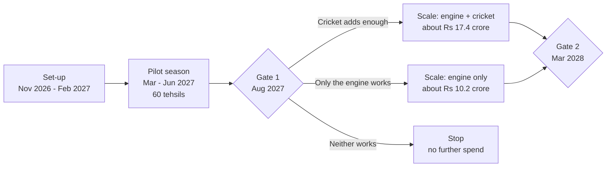

# 13. Budget and commercial model

Prepared 6 November 2026.

**Note added 6 November 2026.** The commercial model in section 7 is superseded by `McKinsey_Lens\M07_Economics.md`. Later research shows the local market is about Rs 1.95 crore a tehsil, not Rs 4.26 crore, and the break-evens here (2.3 and 4.2 points) are too low. The unit costs in sections 4 to 6 are still used.

**Purpose.** This file proposes a budget for the recommended strategy (Apollo XI, described in `11_Strategic_Alternatives.md`), shows where every figure comes from, and tests whether the spend can pay back on farm tyres.

Full source list: `17_Source_Register_and_Verification.md`. Cost sources are in section 5.

**How to read this file.** The case brief gives no budget. Every rupee figure for the programme is therefore a **proposed planning assumption**, not a quotation. Each line carries one of these source types:

| Tag | Meaning |
|---|---|
| [Published rate] | An official rate card or policy page |
| [Press quote] | A figure reported in the press |
| [Vendor estimate] | An asking price on a vendor or agency page; low reliability |
| [Planning assumption] | Our working figure; no reliable source exists |
| [Verified fact] | Company filing or two independent sources (for Apollo's financials) |

Rs 1 crore = Rs 100 lakh = Rs 10 million.

---

## 1. What matters most

1. **The proposal is staged.** A pilot of about Rs 7.4 crore (range Rs 4.7 to 11.8 crore) comes first. Scale-up money, Rs 10 to 17 crore, is released only if the pilot passes agreed tests. [Planning assumption]
2. **The whole programme to March 2028 would cost about Rs 18 to 25 crore** on the two scale paths. That is 1.5 to 2% of one year's Indian farm tyre revenue, spread over 16 months, against Apollo's stated advertising norm of 2 to 2.5% of sales a year. It is 3 to 4% of the reported jersey fee. [Planning assumption against verified company figures]
3. **Almost every rural cost figure in India is a vendor's asking price.** Only kisan mela stall fees and a few policy pages are published rates. The ranges are wide for that reason. [Verified fact about the evidence]
4. **On farm tyres alone, the dealer and mechanic work pays for itself sooner than the cricket layer.** With our base inputs, the engine covers its field cost if it wins about 2.3 points of the local replacement market in a year. The cricket layer has to win about 2 points more to cover its own cost. [Planning assumption]
5. **That is why the pilot runs the engine with and without cricket.** The budget for cricket at scale depends on what the comparison shows. [Interpretation]
6. **The pilot will not pay for itself.** It is the price of finding out. [Interpretation]
7. **Three sources of value are left out of the base case:** the same rural dealers' sales of two-wheeler, car and pick-up tyres; better prices and product mix; and repeat purchases in later years. [Interpretation]

---

## 2. What "a sensible budget" means here

| Yardstick | Figure | Label | Source |
|---|---|---|---|
| Apollo's Indian-entity advertising and sales promotion, FY26 | Rs 524 crore (INR 5,243.95 million), up from Rs 380 crore | [Verified fact] | FY26 annual report (`01_Apollo_Tyres_Company_Research.md`) |
| Normal advertising level, per the chief financial officer | About 2% of sales historically; "around 2.5% plus" from FY27 | [Verified fact] | Q3 and Q4 FY26 calls (File 01) |
| Farm share of Indian-entity revenue, FY26 | 6% | [Verified fact] | Investor presentation; CRISIL (File 01) |
| Indian farm revenue, FY26 | About Rs 1,200 crore (6% of Rs 19,816 crore is Rs 1,189 crore; the 6% is a rounded figure) | [Interpretation - arithmetic on rounded shares] | File 01 |
| Farm's pro-rata share of advertising at 2.5% of farm revenue | About Rs 30 crore a year | [Interpretation - arithmetic] | – |
| Reported jersey fee, September 2025 to March 2028 | About Rs 579 crore | [Press quote; not disclosed by the BCCI] | `02_Cricket_Assets_and_Sponsorships.md` |
| Activation spending by sponsors | USD 0.50 to 1.60 for each dollar of rights (McKinsey, 2014, United States, read through a copy of the article) | [Fact - single source; read through a copy of the article; old] | `15_Consulting_Benchmarks.md` |

Two conclusions follow. [Interpretation]

- A farm programme should be judged against a business of about Rs 1,200 crore. On that basis about Rs 30 crore a year is the upper bound of normal. We propose less than that over 16 months.
- The jersey fee is already committed. The only money at stake in this decision is the extra spend.

Constraints to respect: advertising is returning to about 2.5% of sales after a 4% quarter, and CRISIL expects Apollo's operating margin to fall to about 10 to 11% in FY27 (Files 01, 03). A large new budget would not be credible. In the September 2026 quarter revenue rose 16.7% but the operating margin fell to about 11% from 15.3% a year earlier. [Fact - single source]

---

## 3. Shape of the spend

| Path | Pilot | Scale | Total to March 2028 | Share of FY26 Indian advertising | Share of reported jersey fee |
|---|---|---|---|---|---|
| Stop after pilot | Rs 7.4 crore | – | Rs 7.4 crore | 1.4% | 1.3% |
| Engine only at scale | Rs 7.4 crore | Rs 10.2 crore | Rs 17.6 crore | 3.4% | 3.0% |
| Engine and cricket at scale | Rs 7.4 crore | Rs 17.4 crore | Rs 24.8 crore | 4.7% | 4.3% |

All figures are base-case planning assumptions. The pilot's low and high cases are Rs 4.7 crore and Rs 11.8 crore. The tests at each gate are in `14_KPI_and_Impact_Measurement.md`.

---

## 4. Pilot budget

**Scope.** Twelve districts in two belts (`06_Rural_Distribution_and_Geography.md`), 60 tehsils in three groups of 20: engine with cricket, engine only, and control. Set-up from November 2026; one activity season from March to June 2027; read-out by August 2027.

All amounts in Rs lakh.

| # | Item | Basis | Low | Base | High | Source type |
|---|---|---|---|---|---|---|
| **A** | **Research and measurement** | | **46.6** | **70.2** | **115.6** | |
| A1 | Owner surveys, before and after | 60 tehsils x 30 owners x 2 rounds = 3,600 interviews at Rs 800 / 1,200 / 2,000 | 28.8 | 43.2 | 72.0 | [Planning assumption]. No Indian rate card was found. An academic rural household survey cost USD 22 to 27 per household. |
| A2 | Dealer and mechanic surveys | 600 interviews at Rs 700 / 1,000 / 1,500 | 4.2 | 6.0 | 9.0 | [Planning assumption] |
| A3 | Stock audits and mystery visits | 60 dealers x 4 visits = 240 at Rs 1,500 / 2,500 / 4,000 | 3.6 | 6.0 | 9.6 | [Planning assumption]. Global mystery-shop rates USD 25 to 75 per visit. |
| A4 | Analysis, dashboard, independent review | Lump sum | 10.0 | 15.0 | 25.0 | [Planning assumption] |
| **B** | **Planning and set-up** | | **34.0** | **55.0** | **93.0** | |
| B1 | Rights and legal clearance | BCCI approvals, promotions-law opinion, screening permission | 5.0 | 8.0 | 15.0 | [Planning assumption] |
| B2 | Dealer onboarding workshops | 12 districts at Rs 0.75 / 1.0 / 1.5 lakh | 9.0 | 12.0 | 18.0 | [Planning assumption]. One Punjab farmer event at a hired venue was reported at Rs 1.5 to 2 lakh. |
| B3 | Creative platform and toolkit in Hindi and Punjabi | Identity, dealer kit, short films, print | 20.0 | 35.0 | 60.0 | [Planning assumption] |
| **C** | **Conversion engine (40 tehsils)** | | **118.9** | **191.3** | **303.6** | |
| C1 | Dealer farm corner and signage | 40 at Rs 0.4 / 0.6 / 1.0 lakh | 16.0 | 24.0 | 40.0 | [Planning assumption]. No signage rate found. |
| C2 | Mechanic kits | 440 mechanics (40 x 11) at Rs 1,200 / 1,800 / 2,500 | 5.3 | 7.9 | 11.0 | [Planning assumption] |
| C3 | Mechanic meets and training | 40 tehsils x 2 at Rs 0.25 / 0.35 / 0.5 lakh | 20.0 | 28.0 | 40.0 | [Planning assumption] |
| C4 | Proof tractors | 240 owners (40 x 6) at Rs 4,000 / 6,000 / 9,000 for trial support, hour meter and board | 9.6 | 14.4 | 21.6 | [Planning assumption] |
| C5 | Tyre health camps | 40 tehsils x 4 at Rs 0.15 / 0.2 / 0.3 lakh | 24.0 | 32.0 | 48.0 | [Vendor estimate]: haat or mandi activation Rs 15,000 to 30,000 a day |
| C6 | Registration and customer-record system | Missed call, WhatsApp, voice, dashboard | 12.0 | 20.0 | 35.0 | [Planning assumption] |
| C7 | Messaging | WhatsApp and SMS | 2.0 | 5.0 | 8.0 | [Vendor estimate]: about Rs 0.86 to 1.09 per WhatsApp marketing message; SMS Rs 0.08 to 0.25 |
| C8 | Rewards tied to registered sales | Mechanic referral, dealer growth bonus, buyer gift | 30.0 | 60.0 | 100.0 | [Planning assumption]; varies with sales |
| **D** | **Cricket layer (20 tehsils)** | | **140.2** | **232.0** | **373.0** | |
| D1 | Backing existing village tournaments | 20 tehsils x 4 at Rs 0.4 / 0.6 / 0.9 lakh | 32.0 | 48.0 | 72.0 | [Planning assumption]. Village winners' prizes of Rs 1.2 to 1.7 lakh are reported in Haryana; team entry fees of Rs 5,000 to 10,000 are reported elsewhere. |
| D2 | Tehsil finals day | 20 at Rs 1.2 / 2.0 / 3.0 lakh | 24.0 | 40.0 | 60.0 | [Planning assumption] |
| D3 | District finals | 6 at Rs 2.5 / 4.0 / 6.0 lakh | 15.0 | 24.0 | 36.0 | [Planning assumption] |
| D4 | Season final with a guest cricketer | Lump sum | 10.0 | 20.0 | 35.0 | [Planning assumption]. No current day rate is published; old reports conflict. |
| D5 | Match-day events at dealers | 20 tehsils x 6 at Rs 0.1 / 0.15 / 0.25 lakh | 12.0 | 18.0 | 30.0 | [Planning assumption]; any screening needs the broadcaster's permission |
| D6 | Rewards only a sponsor can give | About 100 match trips at Rs 10,000 / 15,000 / 25,000; 10,000 merchandise pieces at Rs 100 / 150 / 250 | 20.0 | 30.0 | 50.0 | [Planning assumption]; ticket access under the contract is unconfirmed |
| D7 | Mandi and wall branding | 20 tehsils x 2,000 sq ft at Rs 8 / 15 / 25 | 3.2 | 6.0 | 10.0 | [Vendor estimate]: Rs 6 to 36 per sq ft |
| D8 | Regional-language content and farm creators | Lump sum | 20.0 | 40.0 | 70.0 | [Planning assumption]. Modelled creator rates of about USD 195 to 3,000 a video. |
| D9 | Live scoring and streaming | 20 at Rs 0.2 / 0.3 / 0.5 lakh | 4.0 | 6.0 | 10.0 | [Published rate] for the scoring app's add-ons (a few dollars a match); production is a [Planning assumption] |
| **E** | **People and management** | | **71.7** | **104.7** | **155.5** | |
| E1 | District coordinators | 12 x 8 months at Rs 0.3 / 0.4 / 0.55 lakh | 28.8 | 38.4 | 52.8 | [Planning assumption] |
| E2 | Programme lead and two belt managers | 8 months | 20.0 | 30.0 | 45.0 | [Planning assumption] |
| E3 | Agency management fee | About 10% of C1 to C7 and D | 22.9 | 36.3 | 57.7 | [Planning assumption] |
| **F** | **Logistics and travel** | | **12.0** | **20.0** | **32.0** | [Planning assumption] |
| | **Subtotal A to F** | | **423.4** | **673.2** | **1,072.7** | |
| **G** | **Contingency** | 10% | 42.3 | 67.3 | 107.3 | |
| | **Total pilot** | | **465.7** | **740.5** | **1,180.0** | |
| | **In Rs crore** | | **4.7** | **7.4** | **11.8** | |

Where the base-case money goes: research and measurement 9%, set-up 7%, conversion engine 26%, cricket layer 31%, people 14%, logistics 3%, contingency 9%.

In the pilot the engine costs about Rs 4.8 lakh a tehsil (Rs 191.3 lakh over 40) and the cricket layer about Rs 11.6 lakh a tehsil (Rs 232.0 lakh over 20). Cricket is the larger cost per area, because finals, content and rewards are spread over only 20 tehsils.

**Farmer incentives.** The budget uses a guaranteed gift and exchange value, not a prize draw. Tamil Nadu bans lucky draws, and consumer-protection rules on disclosure apply elsewhere. A legal opinion is budgeted in B1. [Press quote / law commentary]

**Not in the budget.** The tyres themselves, trade margin, finance-partner interest costs, and Apollo staff time.

---

## 5. Where the unit costs come from

| Item | Figure found | Source type | Source |
|---|---|---|---|
| Rural roadshow, van and four crew, 30 days, 100 villages | Rs 8 to 15 lakh | [Vendor estimate] | [IRPR agency](https://irpr.agency/services/btl-events/pune/rural-bharat-activations) |
| Haat or mandi activation | Rs 15,000 to 30,000 a market day | [Vendor estimate] | Same |
| Street theatre, 50 villages | Rs 5 to 10 lakh | [Vendor estimate] | Same |
| LED van hire | Rs 5,000 to 18,000 a day | [Vendor estimate] | [IndiaMART](https://dir.indiamart.com/lucknow/led-vam-rental-services.html), [The Media Ant](https://themediaant.com/nontraditional/mobile-van-hyderabad-advertising) |
| Wall painting | Rs 6 to 36 per sq ft | [Vendor estimate] | [IndiaMART](https://m.indiamart.com/trimurti-advertising), [SmartAds](https://smartads.in/services/outdoor/wall-painting-advertising-in-arunachal-pradesh) |
| Kisan mela stall, PAU Ludhiana | Rs 34,000 to 75,000, excluding 18% GST | [Published rate] | [PAU](https://stallbooking.pau.edu/download_Stall_Rates) |
| Kisan mela ground, GBPUAT Pantnagar, 2026 | Rs 26,000 | [Published rate] | [GBPUAT](https://www.gbpuat.ac.in/mela/29-1-2026-Kisan%20Mela%20Brochure.pdf) |
| Farmer event at a hired venue, Punjab | Rs 1.5 to 2 lakh a day | [Press quote] | [Hindustan Times, 2022](https://www.pressreader.com/india/hindustan-times-amritsar/20220413/281797107531872) |
| Umpire; tennis balls, per match | Rs 500 to 1,500; Rs 200 to 500 | [Vendor estimate] | [CricSmart](https://cricsmart.in/blog/corporate-cricket-league-playbook-2026) |
| Village tournament winner's prize, Haryana | Rs 1.2 to 1.7 lakh | [Press quote] | [Tribune](https://www.tribuneindia.com/news/haryana/cricket-craze-strengthens-community-bond-in-sirsa-fatehabad-villages/) |
| WhatsApp marketing message, India | About Rs 0.86 to 1.09 | [Vendor estimate]; Meta's page confirms per-message billing | [Meta](https://developers.facebook.com/documentation/business-messaging/whatsapp/pricing.md), [Message Central](https://www.messagecentral.com/blog/whatsapp-business-api-pricing-2026) |
| Bulk SMS | Rs 0.08 to 0.25 | [Vendor estimate] | [Fast2SMS](https://www.fast2sms.com/help/?p=16670) |
| Streaming on connected television | Rs 0.34 to 0.60 per impression | [Vendor estimate]; targeting by state or pin code unconfirmed | [The Media Ant](https://www.themediaant.com/ctv/jiohotstar-ctv-advertising) |
| Rural household survey, in person | USD 22 to 27 per household | Academic | [CGIAR / MSU](https://iaes.cgiar.org/sites/default/files/docs/Session-8_Root_Local-Enumerator-Approach-MSU.pdf) |

Could not be found, and so set as planning assumptions: rural survey rates per interview in India, brand-tracking costs, dealer signage, promoter day rates, ex-cricketers' appearance fees, state-league sponsorship prices, missed-call and voice-call rates. For each: Data unavailable – requires primary research or company confirmation. Agency and vendor quotations should replace these before the budget is approved.

---

## 6. Scale budget

The pilot is deliberately rich, because it is testing. At scale the cost per tehsil has to fall. It does so in four ways: dealers and local sponsors share the cost of events; one coordinator covers ten tehsils, not three or four; the kit and the films already exist; and research is a tracking sample, not a full survey.

Cost per tehsil for one programme year, in Rs lakh [Planning assumption]:

| Item | Engine | Cricket layer |
|---|---|---|
| Dealer farm corner upkeep | 0.15 | |
| Mechanic meets, two a year | 0.50 | |
| Tyre health camps, four a year | 0.60 | |
| Proof tractors, four | 0.24 | |
| Coordinator, one-tenth share | 0.48 | |
| Messaging and system | 0.13 | |
| Rewards on registered sales | 0.80 | |
| Backing two village tournaments | | 1.00 |
| Tehsil final, Apollo's share | | 0.90 |
| Sponsor rewards and merchandise | | 0.40 |
| Match-day events | | 0.20 |
| **Total** | **2.90** | **2.50** |

A tehsil with both costs Rs 5.4 lakh.

Scale phase, 200 tehsils, September 2027 to March 2028, costed as a full programme year:

| Rs crore | Engine only | Engine and cricket |
|---|---|---|
| Field cost (200 x Rs 2.9 lakh or Rs 5.4 lakh) | 5.8 | 10.8 |
| Content in more languages | 1.0 | 1.5 |
| Regional media in the World Cup weeks | 0.5 | 1.5 |
| Measurement | 1.0 | 1.0 |
| Programme team | 1.0 | 1.0 |
| Contingency, 10% | 0.9 | 1.6 |
| **Total** | **10.2** | **17.4** |

Two hundred tehsils is a planning figure. The right number depends on how many pass the stock test and on what supply can support.

---

## 7. Commercial model

### 7.1 Why the model is built on the local market, not on Apollo's current sales

Apollo's share of farm tyre replacement sales is not public. One broker's note of a meeting with Apollo management (27 December 2025) says "only approximately 25% of the farm category is replacement-driven", without saying whether that describes Apollo or the industry (`01_Apollo_Tyres_Company_Research.md`). [Unverified as to scope]

So the model does not start from Apollo's sales. It starts from the size of the local replacement market and asks how many points of that market the programme must win. That answer does not depend on where Apollo starts.

### 7.2 Inputs

None of these is known from public sources. All must be replaced with Apollo's own figures.

| Input | Low | Base | High | Basis |
|---|---|---|---|---|
| Tractors in use per programme tehsil | 5,000 | 8,000 | 12,000 | [Planning assumption]. Anchors: Bathinda district had 22,500 tractors around 2008-09; the top districts registered 4,000 to 10,000 new tractors in FY25 (File 06). |
| Rear tyres replaced per tractor per year | – | 0.3 | – | [Planning assumption]: a pair about every seven years on average, sooner for heavy users. Makers and portals quote tyre life at 1,500 to 4,000 hours. |
| Front tyres replaced per tractor per year | – | 0.4 | – | [Planning assumption] |
| Apollo's realisation per tyre | – | Rs 14,000 rear; Rs 2,800 front | – | [Planning assumption] from portal prices of about Rs 16,000 to 17,000 and Rs 3,000 to 3,500, less 5% GST and an assumed 10% trade margin. One vendor page claims Apollo dealer margins of 8 to 20%. |
| Tyre spend per tractor per year | – | Rs 5,320 | – | 0.3 x 14,000 + 0.4 x 2,800 |
| **Local replacement market per tehsil per year** | **Rs 2.66 crore** | **Rs 4.26 crore** | **Rs 6.38 crore** | Tractors x Rs 5,320 |
| Contribution margin on extra sales | 25% | 30% | 35% | [Planning assumption]. Raw materials were about 46.5% of revenue in Q3 FY25 and are reported at 55.3% in Q1 FY27 (unverified). |
| Points of the local market won | 1.5 | 4 | 7 | [Planning assumption]. A target range, not a forecast. No benchmark exists (File 07). |

What four points means on the ground. A tehsil with 8,000 tractors sees about 2,800 tyre purchases a year (a pair of rears or a pair of fronts each). Four points is about 112 of them: roughly two extra purchases a week in each tehsil.

What four points means for Apollo's own sales depends on where it starts: a rise of about 40% from a 10% share, 22% from an 18% share, 16% from a 25% share.

### 7.3 One tehsil, one year

| | Low | Base | High |
|---|---|---|---|
| Local replacement market (Rs crore) | 2.66 | 4.26 | 6.38 |
| Points of the market won | 1.5 | 4 | 7 |
| Extra revenue (Rs lakh) | 4.0 | 17.0 | 44.7 |
| Contribution margin | 25% | 30% | 35% |
| **Extra contribution (Rs lakh)** | **1.0** | **5.1** | **15.6** |
| Field cost, engine only (Rs lakh) | 2.9 | 2.9 | 2.9 |
| Field cost, engine and cricket (Rs lakh) | 5.4 | 5.4 | 5.4 |
| Return per rupee, engine only | 0.34 | 1.76 | 5.39 |
| Return per rupee, engine and cricket | 0.18 | 0.95 | 2.90 |

These rows assume the same gain for both versions. Whether cricket raises the gain is what the pilot measures.

### 7.4 Break-even

In the base case, one point of the local market is worth Rs 1.28 lakh of contribution a year (Rs 4.26 crore x 1% x 30%).

| What has to pay back in one year | Cost per tehsil | Points of the local market needed |
|---|---|---|
| Engine only, field cost | Rs 2.9 lakh | 2.3 |
| Engine and cricket, field cost | Rs 5.4 lakh | 4.2 |
| The cricket layer on its own | Rs 2.5 lakh | 2.0 more than the engine achieves |
| Engine only, with central costs (Rs 10.2 crore over 200 tehsils) | Rs 5.1 lakh | 4.0 |
| Engine and cricket, with central costs (Rs 17.4 crore) | Rs 8.7 lakh | 6.8 |

Sensitivity of the break-even for the engine with cricket (field cost Rs 5.4 lakh), in points of the local market:

| Tractors in the tehsil | Margin 25% | Margin 30% | Margin 35% |
|---|---|---|---|
| 5,000 | 8.1 | 6.8 | 5.8 |
| 8,000 | 5.1 | 4.2 | 3.6 |
| 12,000 | 3.4 | 2.8 | 2.4 |

The table carries the main commercial lesson: **the programme pays where tractors are dense.** A tehsil with 5,000 tractors needs more than twice the share gain of one with 12,000. Tractor density, with stock, should decide where the programme goes. [Interpretation]

### 7.5 Two hundred tehsils, two years

Base market and margin. Each point won across 200 tehsils is worth about Rs 2.55 crore of contribution a year. Year-two costs assume the same field cost and lower central costs (Rs 2.0 crore for the engine path, Rs 2.5 crore with cricket, plus 10% contingency). [Planning assumption]

| Rs crore | Engine only, wins 4 points | Engine and cricket, wins 4 points | Engine and cricket, wins 7 points |
|---|---|---|---|
| Extra contribution, each year | 10.2 | 10.2 | 17.9 |
| Cost, year one | 10.2 | 17.4 | 17.4 |
| Cost, year two | 8.6 | 14.6 | 14.6 |
| Return per rupee, year one | 1.00 | 0.59 | 1.03 |
| Return per rupee, two years | 1.09 | 0.64 | 1.12 |

Reading the table:

- If the engine wins four points, it covers its cost, central costs included, in the first full year.
- If cricket adds nothing to that gain, the cricket layer loses money on farm tyres.
- If the engine with cricket wins seven points where the engine alone wins four, the cricket version also covers its cost, and leaves Apollo with higher recall and a property it owns.

Over two years the engine breaks even at about 3.7 points and the engine with cricket at about 6.3. So the cricket layer earns its place at scale only if it adds two to three points of local share over the engine, or if the value in section 7.7 is counted. That becomes a gate test in File 14. [Interpretation]

### 7.6 The pilot's own return

Forty treated tehsils, half a year, base inputs: 40 x 0.5 x 4 points x Rs 1.28 lakh = about Rs 1 crore of extra contribution, against a pilot cost of Rs 7.4 crore.

The pilot does not pay back, and is not meant to. It buys three things: the first measurement of what the jersey is worth among tractor owners; proof of whether cricket adds to a trade programme; and a tested kit that can be rolled out at about a third of the cost per tehsil.

### 7.7 Value left out of the base case

| Source of value | Why it could matter | Why it is left out |
|---|---|---|
| Other tyres sold by the same rural dealers | Management names car, two-wheeler and farm tyres together as its rural growth categories. Farm is 6% of Indian revenue; passenger vehicle tyres are 22% (File 01). | No data on rural dealers' category mix. Measured in the pilot, not assumed. |
| Price and product mix | Farm tyres are short of supply, so extra volume may be limited. A stronger brand can hold price rises and sell more Virat and steel-breaker tyres. | Premium farm tyre prices are not published. |
| Repeat purchases | A tractor needs tyres for its whole life. | Loyalty and switching rates are unknown. |
| Dealer network strength | New and more committed rural dealers serve every category. | Not quantifiable from public data. |
| Evidence for the renewal decision in 2028 | The jersey costs about Rs 230 crore a year on the reported figure. | Not a cash return. |

### 7.8 Value of a won customer

Illustrative arithmetic on the planning inputs above.

| | Value |
|---|---|
| Average tyre spend per tractor per year, at Apollo's realisation | Rs 5,320 |
| Average purchase (a pair of rears or a pair of fronts) | About Rs 15,200 |
| Contribution on the first purchase, at 30% | About Rs 4,600 |
| Contribution over ten years if every purchase stays with Apollo | About Rs 16,000 |
| Contribution over ten years if half the later purchases stay | About Rs 10,300 |
| Extra purchases a year in a base-case tehsil at four points | About 112 |
| Cost per extra purchase, engine only (Rs 2.9 lakh / 112) | About Rs 2,600 |
| Cost per extra purchase, engine and cricket (Rs 5.4 lakh / 112) | About Rs 4,800 |

On the first purchase alone, the engine pays and the engine with cricket roughly breaks even. Over the customer's life both pay, if a fair share of later purchases stay with Apollo. Owners who rent out and haul are worth more, because they buy more often. [Interpretation on planning assumptions]

### 7.9 Costs the model does not capture

- **Supply.** If farm tyres stay short, tyres sold in programme tehsils may be tyres not sold elsewhere. The supply plan in `16_Final_Strategic_Recommendation.md` addresses this.
- **Leakage.** Rewards paid on sales that would have happened anyway. The design pays growth bonuses only above each dealer's own baseline.
- **Rivals' response.** Matching schemes would cut the gain (`12_Strategy_Evaluation_and_Stress_Testing.md`).

---

## 8. Can it be done within the brief's constraints?

| Test | Result |
|---|---|
| Is the budget stated in the brief? | No. Everything above is a proposed planning assumption. |
| Is it sensible against Apollo's own norms? | Yes: 1.5 to 2% of one year's farm revenue, spread over 16 months, against an advertising norm of 2 to 2.5% of sales a year. |
| Is the downside limited? | Yes: Rs 7.4 crore in the base case if the pilot fails. |
| Does it pay back on farm tyres alone? | The engine does if it wins about four points of the local replacement market. The cricket layer does only if it adds two to three points more. |
| What must Apollo supply before approval? | Farm sales by dealer and pin code, its share of replacement sales, realisation and contribution per tyre, dealer margins, farm tyre supply by depot, and the sponsorship contract's terms on tickets, imagery and designation. |
