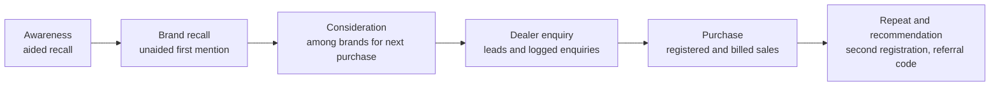

# 14. KPIs and proof of impact

Prepared 6 November 2026.

**Note added 6 November 2026.** The test design in section 3 and the gates in section 6 are superseded by `McKinsey_Lens\M08_Delivery.md`: four arms in 30 districts, launched 21 January 2027, with gates of 2, 5 and 3 points set at full-cost break-even. The measurement method here is kept.

**Purpose.** This file sets out how Apollo can tell whether the programme worked: what to measure, how to separate the programme's effect from everything else that moves farm tyre sales, and the results that should trigger scaling, changing or stopping.

Full source list: `17_Source_Register_and_Verification.md`. Method references are in `15_Consulting_Benchmarks.md`.

**How to read this file.** The design is ours [Planning assumption]. Every number in a worked example is **hypothetical** and marked so. No baseline exists yet; the first wave of the survey supplies it.

---

## 1. What matters most

1. **The measurement is designed before the activity**, because it decides where the pilot runs and how many areas it needs.
2. **Three groups of tehsils, not two.** One gets the dealer and mechanic engine with cricket. One gets the engine without cricket. One gets nothing new. The comparison shows what the programme does and what cricket adds.
3. **Two headline results, measured in the same places.** First mention of Apollo for tractor tyres among tractor owners, from surveys. Apollo farm tyre sales, from dealer billing and registrations.
4. **Before-and-after is not enough.** In FY26 farm tyre demand rose for every brand on a tax cut and a good monsoon (`03_Latest_Developments_and_News.md`). Only a comparison with control areas removes that.
5. **Attendance, views and impressions are tracked as diagnostics only.** They are never reported as results.
6. **Decision rules are agreed before the pilot starts**, so that the result cannot be argued into a success afterwards.

---

## 2. The funnel and what is measured at each step

### 2.1 Brand outcomes (survey of tractor owners)

| KPI | Definition | Question | Pilot target, against control [Planning assumption] |
|---|---|---|---|
| Unaided first mention | Share of owners who name Apollo first | "Which tractor tyre brand comes to mind first?" | +8 points |
| Unaided recall | Share who name Apollo at all, unprompted | "Which others?" | +10 points |
| Aided recall | Share who know Apollo makes tractor tyres when prompted | Read list of brands | +10 points |
| Brand recognition | Share who match "Virat" or "Krishak" to Apollo | Show names | +10 points |
| Jersey link | Share who say the Team India sponsor makes tractor tyres | "Who sponsors the India team? What do they make?" | +10 points |
| Consideration | Share who would consider Apollo for the next purchase | "Which brands would you consider?" | +8 points |
| Preference | Share who name Apollo as first choice | "Which would you buy if you bought today?" | +5 points |

The primary brand KPI is unaided first mention. It is the brief's own definition of success: "the first tyre brand a farmer or landowner names when asked".

### 2.2 Behavioural outcomes (programme records, checked by audit)

| KPI | Definition | Source |
|---|---|---|
| Tyre health checks | Tractors checked, with tyre brand, wear and due month recorded | Camp records |
| Dealer enquiries | Farm tyre enquiries logged at the dealer | Dealer log; mystery visits |
| Proof tractors | Tractors enrolled and hours logged each quarter | Hour-meter readings |
| Trial participation | Owners who take the trial offer | Dealer records |
| Purchase intent | Share of owners due within six months who intend to buy Apollo | Survey |
| Conversion | Registered Apollo purchases divided by leads due in the period | Registration system |
| Mechanic recommendation | Share of mechanics who name Apollo first for a tractor tyre | Mechanic survey; mystery visits |

### 2.3 Commercial outcomes (Apollo billing and registrations)

| KPI | Definition |
|---|---|
| Incremental units | Units sold in programme tehsils, less what control tehsils imply they would have sold |
| Incremental revenue | Incremental units x realisation per tyre |
| Gross contribution | Incremental revenue x contribution margin |
| Points of local market won | Rise in Apollo's sales against control x Apollo's local share of purchases |
| Customer acquisition cost | Programme field cost / incremental purchases |
| Marketing return | Gross contribution / programme cost |
| Dealer-level uplift | Each dealer's growth against his own previous year and against matched control dealers |
| Price and mix | Average realisation; share of Virat and steel-breaker tyres in rear sales |
| Repeat purchase | Registered buyers who register again within 24 months |
| Referral | Registrations that carry another buyer's or a mechanic's code |
| Stock-out days | Days a home-ground dealer lacked a core farm size |

### 2.4 Diagnostics (never reported as results)

Mechanics enrolled, tournament attendance, stream views, message delivery, content views, share of billed sales that are registered. These show whether the programme ran as designed. They do not show that it worked.

---

## 3. The design

### 3.1 Three arms

| Arm | Tehsils | What it gets | What it answers |
|---|---|---|---|
| **Full** | 20 | Engine in the Apollo XI format: teams, seasons, village cricket, Team India rewards | Does the whole programme work? |
| **Engine only** | 20 | The same dealer, mechanic, proof, camp, offer and registration work, with the same rupee value of rewards, and no cricket format, events or sponsor rewards | What does the trade work do by itself? |
| **Control** | 20 | Business as usual | What would have happened anyway? |

- Full less Control = effect of the programme.
- Engine only less Control = effect of the engine.
- Full less Engine only = what cricket adds.

All three arms see the jersey and national advertising equally, so those cancel out. The design cannot measure the jersey's own national effect; the baseline can only describe it (how many owners can name the sponsor and what it makes).

### 3.2 Choosing and assigning the areas

1. **Unit.** The tehsil (sub-district), because that is roughly one farm-tyre dealer's catchment and one tournament's draw.
2. **Eligible tehsils.** Those in the twelve pilot districts that pass the stock test (`06_Rural_Distribution_and_Geography.md`).
3. **Matching.** Within each of the two belts, tehsils are sorted into groups of three that are alike on Apollo's farm sales over the past 24 months, tractor registrations, and distance to the depot.
4. **Assignment.** Within each group of three, one tehsil is assigned to each arm at random. Each belt ends with 10 tehsils per arm.
5. **Why within belts.** Rainfall, crop prices, tractor sales and rivals' schemes vary by district and belt. Matching inside the belt means they hit all three arms alike.

### 3.3 Keeping the arms apart

| Risk | Safeguard |
|---|---|
| A tournament draws villages from a control tehsil | Survey villages within about 5 km of another arm's border are excluded; buyers' village pin codes are recorded at registration |
| One dealer serves two arms | Assign by the buyer's village, not the dealer's shop |
| Rewards differ in value between Full and Engine only | Same rupee budget per tehsil for rewards in both; only the form differs |
| Treated dealers get better supply than controls | Stock-out days are recorded in all arms; results are reported with and without adjusting for them. Assured stock is part of the engine, so some of its effect is intended. |
| Field staff favour one arm | Same coordinators cover Full and Engine only tehsils |

### 3.4 Data sources

| Data | Source | Frequency |
|---|---|---|
| Recall, consideration, preference, cricket viewing | Survey of tractor owners by an independent agency | Baseline, endline, one follow-up |
| Mechanic and dealer recommendation, margins, stock | Survey and mystery visits | Baseline and endline |
| Sell-out by dealer and sub-dealer | Apollo billing and the dealer platform's warranty registration | Monthly; 24 months of history first |
| Buyer-level purchases | Scorecard registration by missed call or WhatsApp, with tyre serial, dealer, mechanic code and village | Continuous |
| Leads | Health-camp records | Continuous |
| Rainfall, mandi prices, tractor registrations | Public data by district | Monthly |
| Rivals' activity | Short monthly dealer survey | Monthly |

How Apollo records farm tyre buyers today is not stated on its farm warranty page. Its dealer platform added warranty registration for sub-dealers in FY26 (`01_Apollo_Tyres_Company_Research.md`). The Scorecard builds on that.

### 3.5 Survey sample

| Item | Value | Basis |
|---|---|---|
| Owners per tehsil per wave | 30 (6 villages x 5 owners) | [Planning assumption] |
| Owners per arm per wave | 600 | 20 tehsils x 30 |
| Waves | Baseline (January to February 2027), endline (July 2027), follow-up (February 2028) | |
| Sample type | Fresh sample each wave, so that asking about recall does not teach it | |
| Mechanics and dealers | About 600 interviews across both waves | |

**What this sample can detect.** Standard formula for comparing two proportions, 5% significance, 80% power:

- Detecting a move from 15% to 25% needs about 250 owners per arm under simple random sampling. [Hypothetical baseline of 15%]
- Owners in the same tehsil resemble each other, so the sample is worth less than its size. Design effect = 1 + (owners per tehsil − 1) x intra-cluster correlation = 1 + 29 x 0.05 = 2.45. [Planning assumption for the 0.05; no value for brand recall was found. A farm-advisory trial in Uttar Pradesh assumed 0.15 for crop yield.]
- 250 x 2.45 = about 610 owners per arm. The design has 600.

So the survey can detect a difference of about 10 points between arms. If the correlation turns out to be 0.10, it can detect about 13 points. The baseline wave will show the true value, and the endline sample can be enlarged if needed.

**Sales.** With 20 tehsils per arm, sales comparisons are less precise than the survey. How small a difference can be detected depends on how much farm sales vary between tehsils, which only Apollo's billing data can show. Data unavailable – requires primary research or company confirmation. We expect the pilot to detect differences of 15 to 20% in sales growth and to miss smaller ones [Planning assumption]. The scale phase, with ten times as many tehsils entering in two waves, tightens this.

---

## 4. Separating the programme from everything else

### 4.1 Difference-in-differences

For any outcome:

> Effect = (programme areas after − programme areas before) − (control areas after − control areas before)

The second bracket is what happened anyway. Subtracting it removes anything that hit both groups: the season, the monsoon, prices, the jersey, national advertising.

The method assumes the two groups would have moved together without the programme. That is checked on the 24 months of dealer billing before the pilot. If they did not move together, the control group is re-weighted to match (the synthetic-control methods documented by Google and Meta; File 15).

### 4.2 Other factors and how each is handled

| Factor | How it could mislead | How it is handled |
|---|---|---|
| Rainfall | A dry district buys fewer tyres | Arms are matched within belts; district rainfall is a covariate |
| Harvest cycle | Sales peak after harvest | Same calendar months compared year on year |
| Crop prices and procurement payments | Cash in hand | Matched within belts; mandi prices as covariate |
| Tractor sales | New tractors need no tyres for years; old ones do | Registrations by RTO as covariate |
| Rivals' schemes | A rival's offer in one tehsil | Monthly dealer survey logs them; flagged tehsils analysed separately |
| Tax or price changes | A price rise depresses all sales | Common to all arms; cancels out |
| Supply | Stock-outs depress sales | Stock-out days recorded; results shown with and without adjustment |
| The 2027 World Cup | Raises interest everywhere | Common to all arms at scale; staggered entry gives a comparison |

### 4.3 Attribution inside the programme

Every registered sale carries the dealer, the referring mechanic's code, any referral code, the buyer's village, and whether the buyer was a health-camp lead. That shows which parts of the programme a buyer touched. It describes the route; it does not prove cause. Cause comes from the comparison between arms.

---

## 5. Worked examples

**Every number in this section is hypothetical.** They show the arithmetic only.

### 5.1 Recall

Unaided first mention of Apollo among tractor owners:

| Arm | Baseline | Endline | Change |
|---|---|---|---|
| Full | 14% | 27% | +13 |
| Engine only | 15% | 22% | +7 |
| Control | 15% | 18% | +3 |

- Programme effect = 13 − 3 = **+10 points**
- Engine effect = 7 − 3 = +4 points
- What cricket added = 13 − 7 = **+6 points**

### 5.2 Sales

Apollo farm tyres sold, March to June, 20 tehsils per arm:

| Arm | 2026 | 2027 | Growth |
|---|---|---|---|
| Full | 4,000 | 5,640 | +41% |
| Engine only | 4,100 | 5,125 | +25% |
| Control | 3,900 | 4,134 | +6% |

- Programme effect = 41 − 6 = **+35 points of growth**
- Engine effect = 25 − 6 = +19 points
- What cricket added = 41 − 25 = **+16 points**

Incremental units in the Full arm = 5,640 − (4,000 x 1.06) = **1,400 tyres**.

### 5.3 Points of the local market

If the baseline shows Apollo with 15% of recent farm tyre purchases in these tehsils:

- Full: 35% x 15% = **5.3 points**
- Engine only: 19% x 15% = 2.9 points
- Cricket added: 16% x 15% = **2.4 points**

### 5.4 Money

Using the planning inputs in `13_Budget_and_Commercial_Model.md` (average realisation Rs 7,600 a tyre, contribution margin 30%):

| Step | Calculation | Result |
|---|---|---|
| Incremental revenue | 1,400 x Rs 7,600 | Rs 1.06 crore |
| Gross contribution | Rs 1.06 crore x 30% | Rs 31.9 lakh |
| Incremental purchases (pairs) | 1,400 / 2 | 700 |
| Contribution per purchase | Rs 31.9 lakh / 700 | About Rs 4,560 |

For a tehsil at scale, over a year (File 13, base case): 112 extra purchases; field cost Rs 5.4 lakh with cricket.

| KPI | Calculation | Result |
|---|---|---|
| Customer acquisition cost | Rs 5.4 lakh / 112 | About Rs 4,800 |
| Marketing return, year one | (112 x Rs 4,560) / Rs 5.4 lakh | 0.95 |
| Payback | Rs 5.4 lakh / (Rs 5.1 lakh a year) | About 13 months |

The pilot season's own return will be well below 1, because it carries one-off research, set-up and creative costs (File 13, section 7.6). The return that matters is the one projected at scale cost.

### 5.5 What the example would lead to

Programme effect of 5.3 points and a cricket contribution of 2.4 points pass the tests in section 6. The decision would be to scale the engine with cricket.

---

## 6. Decision rules

Thresholds come from the break-even points in File 13. Sales thresholds are in points of the local replacement market, converted from sales growth using Apollo's local share from the baseline.

### Gate 1: August 2027, after one pilot season

| Result | Decision |
|---|---|
| Full v Control: first mention up 8 points or more **and** 4 points or more of local market; **and** Full v Engine only: 2 points or more of local market, in the same direction in both belts | **Scale the engine with cricket** |
| Engine only v Control: 2.3 points or more of local market; Full adds less than 2 points over it | **Scale the engine only.** Keep the cricket layer to rewards and the sponsor's line, which cost little |
| Recall up 8 points or more, sales below threshold | **Modify.** Recall without sales points to stock, offer or dealer effort. Fix and run a second season in the same areas |
| Works in one belt only | **Scale in that kind of market only**, and say why |
| Engine only v Control under 1 point **and** recall under 3 points | **Stop** the programme. Keep the registration system and the baseline data |

### Gate 2: March 2028, as the sponsorship ends

| Question | Evidence |
|---|---|
| Did the gains hold through a second season? | Follow-up survey; 12 months of sales |
| Did other tyre categories rise at the same rural dealers? | Dealer billing by category, programme v control |
| Did realisation and mix improve? | Average realisation; Virat share |
| What did a point of farm share cost at scale? | Programme cost / points won |
| Is the property worth keeping without the jersey? | Cost per tehsil; dealer and local co-funding |

These feed the decision on what to back in cricket after March 2028 (`16_Final_Strategic_Recommendation.md`).

---

## 7. Measurement at scale

From September 2027 the programme enters about 200 tehsils. They should not all start at once.

- **Wave A** starts in September 2027, before the World Cup.
- **Wave B** starts in December 2027.

Until Wave B starts, its tehsils are controls for Wave A. Which tehsils go first is decided at random within matched pairs. This keeps a clean comparison through the World Cup weeks without leaving any area out for good.

A tracking survey of about 1,500 owners in February 2028 covers both waves and a small set of areas held back.

---

## 8. Calendar

| When | What |
|---|---|
| November to December 2026 | Agency appointed; questionnaire; 24 months of dealer billing pulled; tehsils matched and assigned |
| January to February 2027 | Baseline survey of owners, mechanics and dealers; stock audit |
| March to June 2027 | Pilot season; monthly dashboard of leads, registrations, stock-outs |
| July 2027 | Endline survey |
| August 2027 | Analysis; independent review; Gate 1 |
| September 2027 to February 2028 | Scale in two waves; monthly dashboard |
| February 2028 | Tracking survey |
| March 2028 | Gate 2 |

## 9. Who does what

| Task | Owner |
|---|---|
| Surveys and analysis | Independent research agency; not the activation agency |
| Sales data | Apollo sales operations |
| Registration system | Apollo digital team with a messaging vendor |
| Sign-off on arm assignment and decision rules, before launch | Head of Rural Sales, marketing head and finance, together |
| Review of results | Finance, with one outside reviewer |

Keeping measurement apart from the people who run the events is the simplest protection against flattering results.

## 10. Limits of this design

- It measures the programme, not the jersey. A national sponsorship has no control group.
- One season is short. Tyres are bought every few years, so repeat and recommendation need the follow-up.
- Sales power is modest in the pilot. A true effect under about 15% could be missed.
- Registration will not capture every sale. Billing data is the base; registration adds the detail.
- Costs for surveys are planning assumptions until an agency quotes (File 13).
