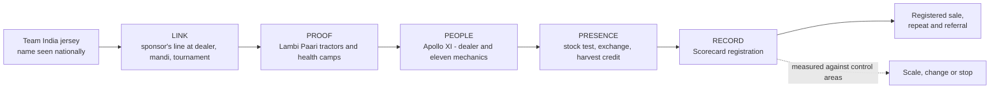
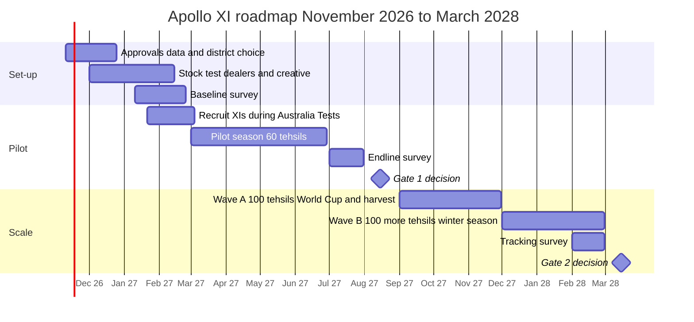

# 16. Final strategic recommendation

Prepared 6 November 2026.

**Note added 6 November 2026.** A re-analysis from a strategy consultant's angle changes this recommendation: a national offer with a tyre-life guarantee comes first, and field teams and cricket events are added only where a test shows they pay. See `McKinsey_Lens\M00_Answer_First_Summary.md`; the twelve-slide storyline in `McKinsey_Lens\M09_Storyline_and_Ghost_Deck.md` replaces the slide map here if the team adopts it.

**Purpose.** This file brings the research and analysis into one recommendation that Apollo's management could fund, pilot, measure and then scale or stop. Each section points to the file that holds the evidence.

Full source list: `17_Source_Register_and_Verification.md`.

**How to read this file.** Facts are labelled and traced to a research file. The programme design, names, budget and targets are proposals: [Planning assumption] or [Strategic hypothesis]. Programme names are working titles and have not been cleared with the BCCI or checked for trademark.

---

## The recommendation in one page

**The problem.** Apollo has paid for national attention. A tractor tyre is bought locally, at short notice, on tyre life, on the word of a dealer, a mechanic and other owners. Apollo has little working for it at that moment, and no record of who buys.

**The answer.** Build the last mile first, and run it as a cricket team.

- **Apollo XI.** In each chosen tehsil, one stocked Apollo farm-tyre dealer captains a team of eleven mechanics. Every registered farm tyre sale scores for the team. The best teams go to watch India play, as guests of the team's sponsor.
- **Lambi Paari** ("the long innings"). Tyre life is the message, shown on local tractors whose hours are logged, and at free tyre health camps.
- **Apollo Kisan Cup.** The teams back village tournaments that already exist and bring the proof tractor and the health camp to the ground.
- **Scorecard.** Every buyer is registered by missed call or WhatsApp. That activates the warranty and gives Apollo its first record of farm customers.

**The test.** Sixty tehsils in two contrasting belts, around Bathinda and around Bareilly. Twenty get the full programme, twenty get the same trade work without cricket, twenty get nothing new. After one season Apollo knows what the programme does and what cricket adds.

**The money.** About Rs 7.4 crore for the pilot (range Rs 4.7 to 11.8 crore). Scale-up of Rs 10 to 17 crore is released only if the pilot passes agreed tests. The whole programme to March 2028 costs 3 to 4% of the reported jersey fee.

**The decision rule.** Scale the cricket version only if it wins at least two more points of the local market than the trade work alone. Otherwise scale the trade work and keep the jersey for the consumer brand.

---

## 1. The actual business problem

Tractor owners do not name Apollo first for tractor tyres, and the cricket sponsorship is not yet turning into farm tyre sales that anyone can measure.

The cause is not that owners have not seen the name. Five links between the jersey and a sale are missing (`09_Problem_Diagnosis.md`):

| Link | Missing because |
|---|---|
| Link | The jersey says "Apollo Tyres"; the farm tyre is sold as Virat or Krishak; no farm message has run since May 2024 |
| Proof | Rivals arrive on new tractors and hold the durability reputation |
| People | Mechanics and multi-brand dealers have no reason to name Apollo |
| Presence | Farm tyres were short of supply in 2026; farm-tyre dealer cover is uncounted |
| Record | Apollo has no market-share data and no farmer-level record |

## 2. The most important research findings

| # | Finding | Label | File |
|---|---|---|---|
| 1 | Farm is 6% of Apollo's Indian revenue (about Rs 1,200 crore), not the 8 to 10% in the brief | [Verified fact] | 01 |
| 2 | Management says the cricket deal is bringing rural traction in car, two-wheeler and farm tyres; no measurement has been published | [Verified fact] | 01, 03 |
| 3 | Management named farm tyres as short of capacity in February 2026 | [Verified fact] | 01 |
| 4 | Only the jersey logo is a confirmed right. The BCCI named Muthoot FinCorp as title sponsor of home series in September 2026 | [Verified fact] for the jersey logo; [Fact - single source; BCCI release reported by press] for Muthoot | 02 |
| 5 | No published study covers how Indian farmers choose tractor tyres | [Verified fact that none was found] | 04 |
| 6 | Tractor owners are a minority of farmers: 38% of those with over 10 ha owned one in 2009, under 1% of those with under 2 ha | [Fact - single source, dated] | 04 |
| 7 | Tyre wear is the tractor owner's most common and most bothersome problem; durability drives tyre satisfaction | [Fact - single source, syndicated] | 04 |
| 8 | Owners who rent out and haul work their tractors about 800 hours a year and replace tyres soonest | [Fact - single source each; small, older studies] | 04 |
| 9 | Peers and mechanics are trusted over shops and advertisements for tractor upkeep | [Proxy evidence] | 04 |
| 10 | No data shows how many tractor owners watch India's matches | [Verified fact that none was found] | 02 |
| 11 | No neutral market-share figure exists for farm tyres; rivals' farmer programmes have published no results | [Verified fact that none was found] | 07 |
| 12 | The 2026 monsoon was about 13% below normal and tyre prices are rising 15 to 16% | [Verified fact] | 03 |

## 3. Target segments

| Priority | Segment | Why |
|---|---|---|
| 1 | Owners who rent the tractor out and haul with it | Most hours, earliest replacement, seen by many villages |
| 2 | Larger landowners using the tractor on their own land | Standing in the village; patrons of local cricket |
| 2 | Haulage and non-farm users | Fastest wear; also buy trailer tyres |
| 3 | Fleet-type buyers and new-tractor buyers | Served through the key-account team, not this programme |
| Not a sales target | Farmers who hire a tractor | They buy no tractor tyres |
| Through | Farm-tyre dealers, mechanics and puncture-shop owners | Present at the purchase |

Detail and evidence: `04_Farmer_Consumer_Behaviour.md`.

## 4. The purchase journey and where the programme acts

| Stage | Where the sale is lost today | What the programme does |
|---|---|---|
| Awareness | Name not tied to the tractor tyre | Sponsor's line where tyres are bought and tractors gather |
| Interest | No visible proof of tyre life | Lambi Paari tractors with logged hours |
| Information search | Mechanic has no reason to name Apollo | Apollo XI |
| Consideration | Rivals hold durability | Health check shows the owner his own wear; proof tractors |
| Dealer interaction | Stock and dealer effort uncertain | Stock test; growth bonus above baseline |
| Purchase | Cash is tight in 2027 | Exchange value, harvest-timed credit, guaranteed gift |
| Product experience | Wrong tyre for the soil; poor inflation | Right-tyre training; pressure checks |
| Repeat and referral | No record | Scorecard; reminders; referral code |

## 5. Apollo's existing assets that the plan uses

| Asset | Status | Use in the plan |
|---|---|---|
| Team India jersey | Held | Sponsor's standing; calendar; rewards if the contract allows |
| About 6,500 dealerships; over 20,000 touchpoints | Held | Home-ground dealers chosen from these |
| Head of Rural Sales; "One District, One ARD" | In place since December 2025 | Programme owner and structure |
| Rural mobile stores (25 planned) | First launched May 2026 | Reach tehsils that fail the stock test |
| Dealer platform with sub-dealer warranty registration | In place | Base for the Scorecard |
| Virat, Virat 23, FX 222, Krishak, Dhruv | In range | Stock list by soil |
| 7-year farm warranty | In place | Part of the proof story; covers defects only |
| Sachin Tendulkar | Brand ambassador | Messages to dealers and mechanics, if his contract allows |

Not held, and not assumed: home-series title rights, broadcast advertising, IPL rights, ICC event marks, any player's personal endorsement (`02_Cricket_Assets_and_Sponsorships.md`).

## 6. The competitive landscape in brief

| Rival | How it reaches the owner | What it means |
|---|---|---|
| Goodyear India | Supplies six tractor makers; claims farm leadership | The owner's first tyres are often Goodyear's |
| MRF | Ranked first for satisfaction in 2018, led on durability | Holds the attribute that matters most |
| CEAT, JK Tyre | Small-town outlet formats; expo launches | Building presence |
| BKT | Rural sport since 2018; tyre partner to eight IPL teams in 2026 | A farm-tyre maker already in cricket |

No rival has published the results of a farmer programme. Prices for the common rear size sit within 6 to 10% of each other. Detail: `07_Competitor_Analysis.md`.

## 7. The recommended approach

**Apollo XI**: the dealer and mechanic engine, run in a cricket format, piloted beside the same engine without cricket.

| Part | What happens | Cricket or engine |
|---|---|---|
| Home ground | One stocked farm-tyre dealer per tehsil | Engine |
| The XI | Dealer recruits eleven mechanics and puncture-shop owners; kit and training | Engine, in cricket form |
| Runs and the table | Registered sales score for the XI; tables by tehsil, district, state | Cricket |
| Scorecard | Buyer registers by missed call or WhatsApp; warranty active at once | Engine |
| Lambi Paari tractors | Five or six heavy-use owners per tehsil; hours logged and shown | Engine |
| Tyre health camps | Free pressure and wear checks; each tractor becomes a dated lead | Engine |
| The offer | Exchange value, harvest-timed credit, guaranteed gift | Engine |
| Apollo Kisan Cup | XIs back existing village tournaments; tehsil, district and season finals | Cricket |
| Match days | Open days at the dealer on India match days | Cricket |
| Sponsor's rewards | Match trips and merchandise for the best XIs, mechanics and referrers | Cricket |
| Sponsor's line | "Team India's sponsor, on your tractor", in wording the BCCI approves | Cricket |

How each part works, and why owners, mechanics and dealers would take part: `11_Strategic_Alternatives.md`, section H.

**Why this is better than the alternatives** (`12_Strategy_Evaluation_and_Stress_Testing.md`):

- It is the only option that builds all five links.
- It scores highest on the twelve criteria (52 of 60), just ahead of the engine alone (50). Media, a star and a state league score 25 to 29.
- It uses what only Apollo has: the standing and rewards of the Team India sponsor.
- It can be switched on and off by tehsil, so it can be proved.

## 8. The role of cricket

Cricket has three jobs: to tie the name to the tractor tyre, to give the trade a team and a prize, and to gather owners. It does not supply proof, stock or the record.

| Property | Decision | Job in the plan |
|---|---|---|
| Team India jersey | Use | Credential on every rural touchpoint; source of rewards |
| India v Australia Tests, 21 January to 3 March 2027 | Use | Occasion for recruiting XIs and briefing dealers |
| ODI World Cup, October to November 2027 | Use as the main sales window | Falls at paddy procurement, kharif harvest and rabi sowing. The offer is tied to India's matches and the harvest; no ICC marks are used |
| Existing village tennis-ball tournaments | Back | The gathering point; cheap; already trusted |
| Apollo Kisan Cup finals (tehsil, district, season) | Build and own | A property that outlasts the jersey |
| India women's team | Use for goodwill | Recognition of women farmers and players at finals |
| Sachin Tendulkar | Use if the contract allows | Recognition of top dealers and mechanics |
| State T20 leagues | Do not buy now | City stadiums, August timing, prices unknown |
| IPL teams or league | Do not buy | Rivals hold tyre positions; cannot be aimed at owners |
| A new cricketer for farm tyres | Do not sign | No evidence it sells farm equipment |

**How the Team India deal fits.** The deal is the reason the dealer, the mechanic and the village committee want to be part of this. It costs nothing more to use in this way, apart from approvals.

**After March 2028.** Keep the XI, the Scorecard and the Kisan Cup whether or not the jersey is renewed; they are Apollo's own. Whether to renew is mainly a decision for car and truck tyres. This programme adds evidence that decision has lacked: what the sponsorship is worth among rural buyers.

## 9. The role of non-cricket channels

| Channel | Role |
|---|---|
| Farm-tyre dealers | Point of sale; captains |
| Mechanics and puncture shops | Recommendation at the moment of failure |
| Other owners | Proof, through the Lambi Paari tractors |
| Mandis | Second site for health camps, in the cash weeks |
| WhatsApp, voice calls, SMS | Registration, reminders, referral codes |
| Farm video creators | Tyre-care and tyre-life stories in local language |
| Finance partner | Harvest-timed payment |
| Tractor dealers and fleet buyers | A parallel, slower track for the key-account team |
| Agricultural fairs | One stall per belt, for dealers and proof tractors; published rates of Rs 34,000 to 75,000 at PAU |

Not used: government extension (reaches under 10% of households and is not a commercial channel), agri-commerce apps (none sells tractor tyres).

## 10. Geographical prioritisation

Two tests decide where the programme goes: how many tractor owners a dealer's catchment holds, and whether an Apollo farm tyre is in stock there (`06_Rural_Distribution_and_Geography.md`).

| Category | Rule |
|---|---|
| A: many owners, strong dealer cover | Full programme |
| B: many owners, weak dealer cover | Fix distribution first; no marketing until stock is in place |
| C: fewer owners, strong dealer cover | Low-cost dealer and mechanic work; no events |
| D: fewer owners, weak dealer cover | No programme |

**Pilot** [Planning assumption, to be confirmed against Apollo's dealer data]:

| Belt | Example districts | Kind of market |
|---|---|---|
| Bathinda belt | Bathinda, Mansa, Sirsa, Fatehabad, Hanumangarh, Sri Ganganagar | Large, irrigated, high-horsepower farms; cotton, paddy and wheat; village cricket documented in Sirsa and Fatehabad |
| Bareilly belt | Bareilly, Badaun, Pilibhit, Shahjahanpur, Rampur, Moradabad | Very small holdings; wheat, paddy and sugarcane; owners who rent out |

Neither Bareilly nor Bathinda is among the top districts for new tractor registrations. They are chosen as two contrasting kinds of market, as the brief suggests, not as the largest.

**Scale**, from the registration lists: Rajasthan (Bikaner, Nagaur, Alwar, Jodhpur), Madhya Pradesh (Shivpuri, Vidisha, Raisen), Gujarat (Banaskantha, Surendranagar, Rajkot), Maharashtra (Nashik, Ahmednagar), adding one language per wave.

The commercial model adds a third test: the programme pays where tractors are dense. A tehsil with 5,000 tractors needs more than twice the share gain of one with 12,000 (`13_Budget_and_Commercial_Model.md`).

## 11. Distribution and dealer integration

1. **Stock test before anything else.** A named farm-tyre dealer, the four to six sizes that suit local soil, and a replenishment promise from the depot.
2. **Supply set aside.** Farm tyres for pilot tehsils are agreed with supply chain before launch. Promotion pauses in any tehsil after seven stock-out days.
3. **Run on Apollo's rural structure.** The Head of Rural Sales owns the programme. The home-ground dealer is the district's rural partner or one of its sub-dealers.
4. **Mobile stores for category B.** The vans go to dense tehsils with no dealer, to prepare them for a later wave.
5. **Dealer economics first.** The baseline surveys dealers and mechanics on margins, credit and rivals' schemes before any reward is set.
6. **Rewards on growth.** Registration is paid for on every sale, because the record is worth having. Bonuses are paid only above each dealer's own baseline.

## 12. Implementation roadmap

### Activation calendar: crop year against cricket year

| Months | On the farm | In cricket | Programme |
|---|---|---|---|
| Nov to Dec 2026 | Rabi sowing | Sri Lanka in India (December) | Approvals, data, district choice, stock test |
| Jan to Feb 2027 | Rabi crop growing | Zimbabwe ODIs; five Tests v Australia from 21 January | Baseline survey; recruit XIs; fit proof tractors |
| Mar 2027 | Harvest nears | Australia series ends 3 March | Launch at dealers; first health camps |
| Apr to May 2027 | Wheat harvest and procurement: cash arrives | – | Village tournaments; tehsil finals; after-harvest exchange offer |
| Jun 2027 | Fields prepared for kharif; paddy puddling | World Test Championship final, 9 to 13 June | District and season finals; pre-kharif push |
| Jul to Aug 2027 | Kharif crop growing | – | Endline survey; Gate 1 |
| Sep 2027 | Paddy procurement starts late in the month | – | Wave A starts in 100 tehsils |
| Oct to Nov 2027 | Kharif harvest; paddy payments; rabi sowing | ODI World Cup, 2 October to 21 November | Main exchange offer; match days at dealers |
| Dec 2027 to Feb 2028 | Rabi crop growing; cane crushing | Fixtures not yet announced | Wave B starts; winter village tournaments; tracking survey |
| Mar 2028 | Harvest nears | Sponsorship ends | Season finals; Gate 2 |

Cricket dates are from the BCCI and press reports and may move (File 02). The seasons are tied to crop months so that no activity depends on one fixture. India's fixtures after March 2027 are not yet published.

### Who runs it

| Role | Who |
|---|---|
| Programme owner | Head of Rural Sales |
| Programme lead and two belt managers | Apollo rural sales, full time |
| Approvals, content, rewards | Sponsorship and brand marketing team |
| Stock | Supply chain and depots |
| Training on tyre choice | Farm product team |
| Field work | Activation agency with one coordinator per district |
| Measurement | Independent research agency; finance reviews |
| On the ground | Home-ground dealers and their XIs |

### Partners

| Partner | Role | Status |
|---|---|---|
| Apollo farm-tyre dealers and sub-dealers | Captains and hosts | Existing |
| Mechanics and puncture-shop owners | The XI | To recruit |
| Village tournament committees and panchayats | Hosts of the tournaments Apollo backs | To approach |
| BCCI | Approvals; tickets if the contract provides | Existing relationship |
| A cricket scoring and streaming platform | Scores, tables, streams | Potential |
| Farm video creators | Regional content | Potential |
| A finance company with a tyre-finance product | Harvest-timed credit | Potential |
| Tractor dealers | Later, for the parallel track | Potential |

## 13. Budget

All figures are proposed planning assumptions; the brief gives no budget (`13_Budget_and_Commercial_Model.md`).

| Rs crore | Low | Base | High |
|---|---|---|---|
| Research and measurement | 0.5 | 0.7 | 1.2 |
| Planning and set-up | 0.3 | 0.6 | 0.9 |
| Conversion engine, 40 tehsils | 1.2 | 1.9 | 3.0 |
| Cricket layer, 20 tehsils | 1.4 | 2.3 | 3.7 |
| People and management | 0.7 | 1.0 | 1.6 |
| Logistics | 0.1 | 0.2 | 0.3 |
| Contingency, 10% | 0.4 | 0.7 | 1.1 |
| **Pilot total** | **4.7** | **7.4** | **11.8** |

| Path after Gate 1 | Scale cost | Total to March 2028 |
|---|---|---|
| Stop | – | Rs 7.4 crore |
| Engine only, 200 tehsils | Rs 10.2 crore | Rs 17.6 crore |
| Engine with cricket, 200 tehsils | Rs 17.4 crore | Rs 24.8 crore |

For scale: Apollo's Indian-entity advertising and sales promotion was Rs 524 crore in FY26, and farm's share of that at 6% would be about Rs 31 crore a year.

## 14. Expected outcomes

These are targets [Planning assumption]. No benchmark exists to forecast from.

| Outcome | Pilot, by August 2027 | Scale, by March 2028 |
|---|---|---|
| Unaided first mention among tractor owners, against control | +8 to +10 points | Held or higher |
| Points of the local replacement market won, against control | 4 or more with cricket; 2.3 or more for the engine alone | 4 to 7 |
| Extra purchases a year per tehsil | About 112 at 4 points | About 22,400 across 200 tehsils |
| Extra revenue a year | – | About Rs 34 crore at 4 points; about Rs 60 crore at 7 |
| Extra contribution a year | About Rs 1 crore in the pilot season | About Rs 10 to 18 crore |
| Mechanics enrolled | 440 | About 2,200 |
| Share of billed farm sales registered | 60% or more | 75% or more |
| Return per rupee, year one at scale | – | About 1.0 for the engine at 4 points; about 1.0 with cricket at 7 points |

What must be true for the cricket version to pay on farm tyres alone: it wins two to three more points of the local market than the engine does. Value from other tyre categories at the same dealers, from price and mix, and from repeat purchases is left out of these figures.

## 15. Measurement

- Three arms of 20 tehsils: engine with cricket, engine only, control.
- A survey of 600 tractor owners per arm before and after, by an independent agency.
- Sales from Apollo billing and registrations, compared with control areas over the same months.
- Decision rules fixed before launch (`14_KPI_and_Impact_Measurement.md`).

| Gate | Date | Scale with cricket if | Scale engine only if | Stop if |
|---|---|---|---|---|
| 1 | August 2027 | First mention up 8 points and 4 points of local market, with cricket adding 2 points or more | Engine wins 2.3 points or more and cricket adds under 2 | Engine wins under 1 point and recall moves under 3 |
| 2 | March 2028 | Gains held through a second season | – | – |

## 16. Main risks

| Risk | Mitigation |
|---|---|
| Farm tyre supply stays short | Allocation agreed before launch; pause promotion after seven stock-out days; aim at price and mix as well as volume |
| BCCI does not approve wording, imagery or tickets | The plan works with the jersey alone; approvals sought in set-up |
| Dealers do not put in the effort | Volunteers first; pay for registration; each dealer sees his own dashboard |
| Recall rises but sales do not | Fix stock, offer or dealer effort and re-run; do not scale |
| Rivals match the mechanic scheme | Team India rewards cannot be copied; the customer record gives a head start |
| A weak 2026-27 farm season | Control areas absorb it in the measurement; credit and exchange in the offer |
| False registrations | Tyre serial number; call-backs; bonus only above baseline |
| Trouble at a sponsored tournament | Back only panchayat or club-run events; code of conduct |

Sixteen edge cases and their mitigations are in File 12.

## 17. Scalability

| Step | What it needs |
|---|---|
| From 60 to 260 tehsils by March 2028 | A kit that already exists; one coordinator per ten tehsils; dealers and local sponsors sharing event costs |
| Cost per tehsil | From about Rs 16 lakh in the pilot's full arm to about Rs 5.4 lakh at scale |
| New states | One language added per wave: Hindi and Punjabi first, then Marathi, Gujarati, and the southern languages |
| Category B tehsils | Mobile stores and new sub-dealers first; programme a season later |
| Other tyre categories | The same dealers and the same register serve two-wheeler, car and pick-up tyres |
| After 2028 | The XI, the Scorecard and the Kisan Cup continue without the jersey |

## 18. Why Apollo should invest

1. **It answers a question management has raised itself.** Management has told investors twice that cricket is lifting rural demand. This would be the first evidence either way.
2. **The risk is capped.** About Rs 7.4 crore buys the answer. That is about 1.4% of one year's Indian advertising budget.
3. **It builds things Apollo keeps.** A count of farm-tyre dealers, a network of mechanics, a record of farm customers, and a village cricket property.
4. **It uses the one cricket asset no rival can buy**, in a way that costs little beyond approvals.
5. **The timing will not come again in this contract.** The 2027 World Cup falls at harvest, five months before the sponsorship ends.
6. **Rivals are moving.** BKT is in the IPL, Goodyear has a new tractor tyre, JK is opening rural outlets.
7. **It is honest about return.** The trade work pays if it wins about four points of the local market. The cricket layer has to earn its place, and the design shows whether it does.

---

## What Apollo should deliberately not spend money on

| Do not spend on | Why |
|---|---|
| IPL team or league sponsorship | CEAT and BKT hold tyre positions; cannot be aimed at tractor owners |
| A state T20 league title | City stadiums, August timing, undisclosed prices; no link to the purchase |
| A new cricketer as the face of farm tyres | No tractor or tyre brand has published a result from one; outside the jersey deal |
| A national farm-tyre television campaign | Pays for every viewer; most farmers do not own a tractor; no route to a dealer |
| New tournaments built from nothing | Villages already run them; backing those costs a fraction |
| Any marketing in a tehsil that fails the stock test | Demand without tyres wastes money and goodwill |
| Price cuts | Farm tyres are short of supply and input costs are rising |
| Lucky draws | Banned in one state and regulated elsewhere; guaranteed gifts are safer |
| Events for farmers in general | Most do not buy tractor tyres |
| Scale-up before Gate 1 | The pilot exists to prevent exactly that |

---

## What Apollo needs to supply before launch

| Item | Why |
|---|---|
| Farm tyre sales by dealer and pin code, 24 months | To choose and match tehsils; to measure |
| Its share of farm replacement sales, if known | To convert sales growth into points of the market |
| Realisation and contribution per farm tyre | To replace the planning inputs in the commercial model |
| Dealer margins and current schemes | To set rewards |
| Farm tyre supply by depot | To set the pilot's size |
| The sponsorship contract's terms on designation, imagery, tickets and merchandise | To know what the cricket layer can use |
| The scope of Sachin Tendulkar's contract | To know whether he can address the trade |

---

## How this maps to the 12-slide deck

| Slide | Content | Source file |
|---|---|---|
| 1 | The problem restated: five missing links | 09 |
| 2 | Who actually buys a tractor tyre | 04 |
| 3 | The purchase journey and where the sale is lost | 04 |
| 4 | Focus districts: two pilot belts and the scale map | 06 |
| 5 | What cricket is for: properties to use, build and avoid | 02, 16 |
| 6 | Apollo XI: how it works | 11 |
| 7 | Activation calendar: crop year against cricket year | 16 |
| 8 | From recall to registered sale | 11 |
| 9 | Measurement: three arms, KPIs, gates | 14 |
| 10 | Budget and cost-benefit | 13 |
| 11 | Roadmap from pilot to scale to after March 2028 | 16 |
| 12 | Risks, what not to spend on, and what Apollo must supply | 12, 16 |
