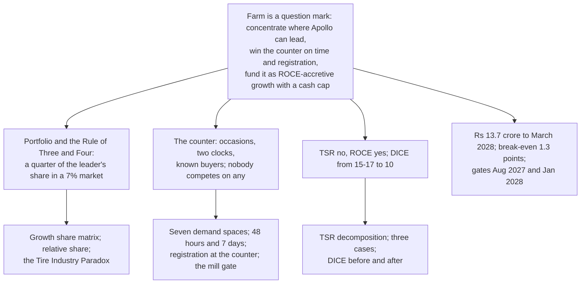

# C09. The storyline, in twelve slides

Prepared 7 November 2026. Part of the BCG-lens re-analysis of the Apollo Round 3 case.

**What this file is.** Our own twelve-slide storyline. BCG publishes no deck template: its careers page asks candidates to "structure your approach" and "Think Structurally", and "The So What" is the name of its podcast, not a described method (`..\research_notes\S1_bcg_method_sources.md` rows 1.5, 1.6). The conventions below (one finding per slide, the finding in the title, one exhibit that proves it, a one-line "so what") are the ones all three lenses use and are not attributed to BCG. It is not BCG's work. It is a specification in Markdown; no slides have been made. The McKinsey-lens storyline is `..\McKinsey_Lens\M09_Storyline_and_Ghost_Deck.md`, the Bain-lens one `..\Bain_Lens\B09_Storyline_Bain_Style.md`; `C10_BCG_vs_Bain_vs_McKinsey.md` says which slides would change if the lenses were merged.

**How to use it.** Read the twelve titles in order; they should make the whole case. Figures marked * rest on planning assumptions and must be said so on the slide. Every figure's label is in the file named in the Source column.

---

## 1. The argument on one page

**The answer.** Farm is a question mark Apollo has been harvesting by omission. Invest, but only where Apollo can lead: its own first replacements and the haulier. Win the counter on time and registration, which nobody competes on; build the promise per occasion; run the counter as a plan and the jersey's moments as experiments; fund it as capex-free, ROCE-accretive growth, about Rs 14 crore to March 2028, mostly reallocated, breaking even at 1.3 points.

**Three reasons.**

1. The portfolio and BCG's rule: a question mark growing at 7% a year in which Apollo holds a quarter of the leader's share; concentrate where it can lead or cash out.
2. The counter: owners buy for occasions, nobody segments the promise, no maker has a clock, and Apollo has no known buyers.
3. The money and the odds: farm cannot move the share price, it is the cheapest ROCE-accretive growth Apollo has, and three free changes take the programme's DICE score from "touch and go" to "set up for success".

**The ask.** Decide to invest with a cash cap; reallocate about Rs 8 to 9 crore inside the trade pool and approve about Rs 3 crore new; name the office; lock the gates and the prior with finance; start 1 December 2026.

---

## 2. Twelve slides

| # | Action title (the finding) | The one exhibit | Source | Brief guideline it answers |
|---|---|---|---|---|
| 1 | **Farm is a question mark Apollo has been harvesting by omission: invest where it can lead, win the counter on time and registration, test the jersey's moments, and fund it as capex-free growth for about Rs 14 crore to March 2028, breaking even at 1.3 points of share** | The answer, three reasons, the ask | C00 | All |
| 2 | **Indian farm replacement is the one Apollo business where it is a small follower in a growing market, and management has answered "invest or harvest" by omission: no farm in the FY2026 targets, no farm capex, a closed European line, off-take as the plan** | The growth share matrix of Apollo's Indian businesses*: truck and car replacement as cash cows, farm replacement as the question mark (units +6.9% a year; relative share 0.25 to 0.3*), farm fitment and European farm as pets; a strip of management's own statements with dates | C02 sections 2, 6 | 1. Diagnosis |
| 3 | **At about a quarter of the leader's share Apollo "cannot be an effective competitor" across the whole farm market (Henderson, 1976), so it concentrates on the two sectors it already leads: the first replacement on its own fitted tractors, and the haulier whose failure every rival's warranty excludes** | Relative-share bars (whole farm about 0.5*; replacement about 0.3*); the rule's three sentences; the two sectors with their evidence (Mahindra's 43.6% share and two decades of fitment; Goodyear's written exclusion) | C02 section 3 | 1. Target customer |
| 4 | **Tyre makers' returns reward sales growth and discipline, not premium brands, and the one farm-led Indian maker has a negative five-year return; farm cannot move Apollo's TSR, but it is the cheapest ROCE-accretive growth Apollo has** | Left: BCG's industry TSR (about 7% against a 10% cross-sector average; budget players double-digit) and the six makers' five-year TSR (CEAT 23.6%, JK 20.5%, Apollo 14.6%, MRF 10.0%, BKT 0.5%, Goodyear India -3.7%). Right: Apollo's TSR legs and what six points of farm share does to them (0.17 points a year)* | C02 section 5 | 6. Financial plan |
| 5 | **The counter is a classical environment and the jersey an adaptive one, so the programme is run two ways on purpose: the counter planned and scaled, the cricket moments tested with controls** | The three-part environment test (predictable? shapeable? harsh?); the de-averaged map of the three belts with their lead occasion, channel and cricket reach | C03 sections 2, 4 | 2. Formats; 3. Activation |
| 6 | **Owners buy tyres for occasions, not by farm size; makers already segment the product by occasion and nobody segments the promise: in 2026 no Indian maker offers any hours or occasion-specific guarantee** | Left: the seven demand spaces with what fails in each. Right: the makers' occasion-specific products against their promises (none); the haulage evidence (10 to 12 tonnes on a 4-tonne trolley; the Gurugram judgment; Goodyear's exclusion) | C04 sections 3, 4 | 1. Diagnosis; 4. Recall to sales |
| 7 | **Promise hours everywhere and cover cuts, bursts and trolley wear only where hauliers are, registered with the load: Rs 1,305 a rear tyre in the field spaces and Rs 1,525 in the haulage spaces, leaving Rs 2,955 and Rs 2,735** | The guarantee card in the owner's words ("Mera khet", "Trolley se mill", "Kaddu"); the waterfall from Rs 16,400 retail to net contribution by space*; the cover's reserve at a third of covered tyres (Rs 0.6 crore a year) against a blanket cover (Rs 1.9 crore) | C04 section 4; C07 section 2 | 4. Recall to sales; 6. Financial |
| 8 | **No farm-tyre maker in India publishes any clock; the only one a tractor owner lives with is Mahindra's 48 hours; so Apollo competes on time: the tyre in the shop within 48 hours, the claim settled at the dealer within seven days** | The clocks in the market today (Mahindra 48 hours and 200,000 doorstep customers; MRF "intimation" in 7 days; a two-month claim; CEAT "within minutes" for cars) against Apollo's two, with how each is kept and measured | C05 section 4 | 3. Activation; 4. Recall to sales |
| 9 | **The jersey's farm job is to make every counter a registration point: BCG's sport work says value comes from "known and contactable" people, not reach, and Apollo's farm business has none; half of buyers registered in the test, three in five at scale; the moments tested against controls** | Left: how a buyer becomes known today (Apollo by phone or dealer app, no count; CEAT pays six months; Hero's 45 million dealer-enrolled). Right: the always-on uses against the moments, with the control for each | C06 sections 3, 4 | 2. Formats and properties; 5. Measurement |
| 10 | **The haulier stands still at the mill gate and the custom-hiring centre, and the first replacement is seen at the tractor dealer's service visit, where no maker sells a tyre** | The cane study's figures (more than two-thirds by trolley; nearly 700 purchase centres set up by the mills in five states; loads fixed by state); 44,573 custom-hiring centres by state; the tractor makers' networks and promises, and the absence of any replacement-tyre offer | C05 sections 5, 6 | 3. Activation; 1. Target |
| 11 | **Measured on BCG's four legs over a four-arm test, with the prior stated ("20% to 40%" of programmes deliver no lift): Rs 13.7 crore to March 2028, break-even 1.3 points, and a base case Rs 6.9 crore negative at March 2029 unless the additions add four-fifths of a point** | The three cases against the McKinsey and Bain lenses on the same share assumptions*; the four legs mapped to the test; the 25% contribution case; the funding split (trade pool against new money) | C06 section 5; C07 sections 4 to 7 | 5. Measurement; 6. Financial plan |
| 12 | **The programme scores 15 to 17 on BCG's DICE scale, "touch and go"; four-week learning milestones, the business head's visible commitment and a one-scan counter take it to 10; the ask: a written decision to invest with a cash cap, a reallocation of Rs 8 to 9 crore, Rs 3 crore new, and a start on 1 December** | DICE before and after; the tranche table; the first 100 days with the milestones | C08 sections 3, 7; C07 section 8 | 7. Roll-out; 6. Financial |

---

## 3. Notes on each slide

**Slide 1.** Say on the slide that the analysis uses BCG's published frameworks and findings, cited by date, and is not BCG's work. Do not use the words "BCG matrix"; Henderson's essay is "The Product Portfolio" and his word is "pets".

**Slide 2.** The quadrant placements are our own on planning assumptions; show the bands. The 6.9% is from CRISIL's FY19 to FY24 table; no FY25 or FY26 units exist. Management's statements are verbatim and dated (the Vision FY2026 deck; the Q4 and Q1 FY27 calls); quote them, do not paraphrase.

**Slide 3.** The 9% rests on one broker note; say so, as the earlier lenses do. Henderson's rule assumes a stable market and the 2012 revisit says turbulent sectors call for adaptive strategies; the slide should carry both, or a judge who knows the literature will raise it.

**Slide 4.** BCG's study names no company; the six-maker TSR table is our own from a financial-data site, dividends added without reinvestment; the 2021 net debt in Apollo's decomposition is a planning assumption. The point of the slide is to refuse a TSR argument before a judge makes it, then make the ROCE one.

**Slide 5.** The environment test is our application of BCG's three dimensions; BCG has not applied it to tyres. The de-averaged map's "Apollo's position" column is empty until Apollo supplies billing and stocking by district.

**Slide 6.** The hours studies are tractor hours, not tyre purchases, from small single-state samples; the commercial share of tractors is "by various estimates". The product lines are from the makers' own pages; the "no guarantee" finding is a search result, stated as such.

**Slide 7.** The one-third haulier share is a planning assumption; the claim rate by space is what the test measures. The waterfall is M07's with the registration bonus raised to Rs 100 and the cover added only in the haulage spaces.

**Slide 8.** Mahindra's promises are for tractors and parts, not tyres; MRF's seven days is an intimation of inspection, not a settlement; CEAT's "within minutes" is for cars. The slide should say that no farm-tyre clock exists, which is the point. The stock promise is working capital, not expense.

**Slide 9.** BCG's "1% to more than 60%" is a team's fan conversion, used as a yardstick, not a registration rate; BCG's sport work addresses rights holders and gives sponsors no method. Hero's 45 million is cumulative members, not a rate. The targets are ours.

**Slide 10.** The cane study is 2018-19 data in eight states; the Maharashtra fleet count is an NGO's; the custom-hiring counts disagree between sources (44,573 to 2023-24 is the annexure figure). Whether a tractor dealer may sell a replacement tyre is a question for the key-account head, not a finding.

**Slide 11.** Show all three programmes on the same share assumptions, including that this one is Rs 5.8 crore worse than the leanest at March 2029 unless its additions add the share they are designed to add. Show the 25% contribution case; raw materials have moved since the 30% was set. The prior is BCG's finding about CRM programmes, transferred.

**Slide 12.** The DICE scores are our scoring on BCG's patent scale read against BCG's 2021 bands; say that the workshop in week 2 re-scores it with the people who run it. The business head's commitment is the ask that costs nothing.

---

## 4. Questions to expect, and where the answers are

| Question | Short answer | File |
|---|---|---|
| The brief asks for a cricket-led plan. Where is the cricket? | At the counter, on the card and in the registered owner's SMS, 52 weeks a year; and in the moments (hospitality, match days) as experiments with controls. BCG's own sport work says the asset is known people, not reach; impressions cannot be counted for a rural audience | C06 |
| Why is this "BCG" and not just another consultant's view? | Each step uses a tool or finding BCG has published, cited by page and date: the growth share matrix and its revisit, the Rule of Three and Four, the experience curve, the February 2026 tyre study, the strategy palette, demand spaces, the Brand Advocacy Index, the go-to-market rules, time-based competition, the known-fans paper, the measurement legs, DICE, Smart Simplicity | C01; S1; S2; C11 |
| Should Apollo even be in farm? | Yes, as a question mark with a cash cap, in the two sectors where it can lead; not across the whole market, and not with a plant | C02 section 6 |
| Why occasions and not heavy users? | The same owner moves between occasions in a year and the tyre is judged by the harshest; the loads, not the farm size, wear it out; BCG's Indian vehicle work says needs beat demographics | C04 section 3.2 |
| Why is the cover cheaper here than in the Bain lens? | It is paid only on tyres registered with the load at a camp, about a third of covered tyres, so the reserve on existing sales is Rs 0.6 crore a year, not Rs 1.9 crore | C04 section 4; C07 section 3 |
| How do you keep a 48-hour promise when farm tyres are short? | Depot stock for the 30 districts ring-fenced with the test's 300 tonnes; the replacement dealer gets first call; it is a working-capital decision, not a plant | C05 section 4.3; M08 section 2 |
| Why does a CFO fund something that cannot move TSR? | Because it is ROCE-accretive from the first point, needs no plant, and leaves a counter, a clock and a registered base that car and two-wheeler replacement can reuse; and because the loss is capped at about Rs 15 crore by the gates | C07 section 6 |
| Where does the money come from? | Mostly from the Rs 632 crore of accrued incentives, discounts and warranty, of which farm's pro-rata share is about Rs 38 crore a year; about Rs 3 crore is new | C07 section 7 |
| What is the DICE score and why does it matter? | 15 to 17 as designed; 10 with three changes; BCG's own research base says the score predicts whether a change programme lands | C08 section 3 |
| What if the engineers will not give up the claim decision? | They do not give it up; they review the sample and decide the large claims and the pattern; their measure becomes settlement days and accuracy | C08 section 4 |
| What is still unknown? | Sixteen things, each with what settles it | C10 section 5 |

---

## 5. Backup exhibits

| Exhibit | File |
|---|---|
| The growth share matrix with its bands; Henderson's and the 2014 revisit's words | C02 section 2 |
| The Rule of Three and Four applied; the stability test | C02 section 3 |
| The cost position per kilogram; BKT against Apollo | C02 section 4 |
| BCG's five tyre archetypes and our mapping of the six Indian makers | C02 section 5 |
| Apollo's TSR decomposition and the six makers' five-year TSR | S3 section 5 |
| The environment test; the de-averaged map | C03 sections 2, 4 |
| The seven demand spaces; products against promises; the Brand Advocacy Index design | C04 |
| BCG's go-to-market rules and the channel as it is; the two clocks; the mill gate | C05 |
| The known-buyer base; the four measurement legs; BCG's guardrails | C06 |
| Spending reconciled to M07; the three cases against M07 and B07; sensitivities; the CFO's three questions | C07 |
| DICE at source and the programme scored; the six rules applied; the office; the first 100 days | C08 |
| BCG sources, verified quotes and dates | S1; S2; S2b; S6; S7; C11 |
