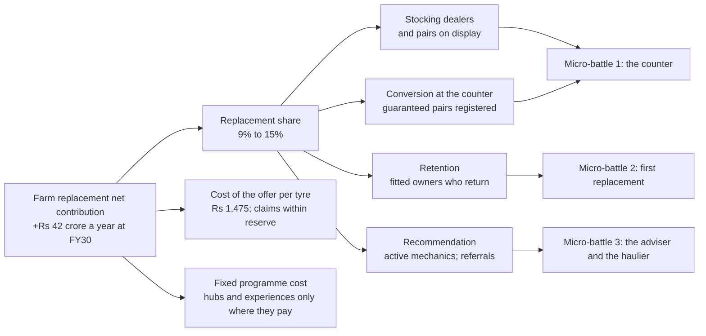

# B07. Full potential, funding and the value-creation plan

Prepared 7 November 2026. Part of the Bain-lens re-analysis of the Apollo Round 3 case.

**What this file is.** Our own analysis in the form Bain uses for a full-potential plan and a private-equity value-creation plan: an ambition, a money map of where the value comes from, a zero-based view of funding, initiatives tied to value with one owner and one number each, and cases with what management must believe. It is not Bain's work. Every figure reuses the market and cost arithmetic of `..\McKinsey_Lens\M02_Value_at_Stake.md` and `M07_Economics.md` unless a change is shown, and section 6 reconciles the two line by line.

**Purpose.** To show what farm replacement could be worth, where the points come from, how the programme is paid for without new money, and what each layer must earn.

**Labels.** [Verified fact], [Fact - single source], [Computed], [Planning assumption], [Interpretation], [Strategic hypothesis], [Bain-published]. Almost every figure here is [Computed] on [Planning assumption] inputs; none is a forecast.

---

## 1. The answer in seven lines

1. **The full potential of farm replacement by FY30 is about 15% of the market: about Rs 500 crore of revenue against about Rs 300 crore today, Rs 200 crore more a year.** That is the McKinsey lens's aspiration (M02 section 7), kept. [Computed on planning assumptions]
2. **The money map says where the six points come from:** about two from the first replacement on Apollo-fitted tractors, about two from hauliers of every brand, about one and a half from being stocked where Apollo was not, and half a point from the cheap tier through credit. [Planning assumption]
3. **The programme funds itself from money Apollo already spends.** Advertising and promotion run at about 2.5% of sales, about Rs 490 crore a year; farm's share pro rata is about Rs 30 crore a year; the programme needs about Rs 17 crore over seventeen months to March 2028, about 3.5% of one year's spend. The ask is a reallocation and a ring-fence, not a budget increase. [Verified fact; Computed; Strategic hypothesis]
4. **The Bain-lens programme costs about Rs 6 crore more than the McKinsey lens to March 2028:** Rs 1 crore is timing (dealer boards brought forward), Rs 2.2 crore buys experiences with a control in place of a Rs 0.4 crore cricket test arm, Rs 1.5 crore buys the cut-and-burst cover and the adviser programme, Rs 1 crore buys the counter and the measurement. [Computed]
5. **The national offer therefore breaks even at about 1.5 points of share, not 1.0;** the field hubs still need about five points in a dense tehsil, and the experiences must show lift against their controls to be scaled. [Computed]
6. **On the same share assumptions as M07, the Bain programme pays back later: the base case is cumulatively negative by about Rs 11 crore at March 2029 against Rs 1 crore.** It is worth the difference only if its additions (the counter, the cover, the adviser, the referral) add about three-quarters of a point beyond the McKinsey base case. That is what the test measures, and it is stated here rather than assumed. [Computed; Interpretation]
7. **Lock the scorecard with finance before the first rupee is released,** and release the money in tranches at the gates. [Bain-published; Strategic hypothesis]

---

## 2. Full potential

Bain's definition of a full-potential effort is "a cross-functional effort to alter the financial, operational and strategic trajectory of the business", with a separate organisation to run it (2014). [Bain-published] For a Rs 300 crore business inside a Rs 28,000 crore company, "separate organisation" means the three micro-battle teams in `B08`, not a transformation office. [Interpretation]

| Horizon | Replacement share | Revenue a year | Net contribution a year, after the offer's cost | Label |
|---|---|---|---|---|
| Today (FY26) | About 9% | About Rs 300 crore | – | [Computed; one broker note] |
| March 2028, run-rate | About 10.5% (9.5 to 11.5) | About Rs 350 crore | – | M07's cases |
| March 2029 | About 12.5% (10.5 to 14.5) | About Rs 410 crore | – | M07's cases |
| **FY30 full potential** | **About 15%** | **About Rs 500 crore** | **About Rs 42 crore more than today** | [Planning assumption] |
| The car-tyre benchmark | About 20% | About Rs 660 crore | – | M02 |

One point of share is worth about Rs 33 crore of revenue (M02). After the Bain-lens offer cost of Rs 1,475 a rear tyre (B04 section 3.2) net contribution on an extra rear tyre is about Rs 2,785, and a point of share is worth about **Rs 7.0 crore** of net contribution a year, against Rs 7.4 crore in M07. [Computed]

---

## 3. The money map

Where would six points come from, and what each lever has to do. [Planning assumption throughout; the sources of share are argued in `B02` section 5]

| Source of share | Points by FY30 | Mechanism | Lever | What you would need to believe |
|---|---|---|---|---|
| The first replacement on Apollo-fitted tractors | About 2 | Of the owners whose tractor came on Apollo tyres, more replace with Apollo at years three to five | Play 2 (B05); the returning-owner card; the guarantee | Apollo is fitted on a quarter or more of new tractors, and retention rises from the industry's 38% toward 55% |
| Hauliers, all brands | About 2 | Owners whose trolley wear is excluded by rivals buy the covered tyre | Play 4; the trolley clause; the hub camps | Hauliers are a third of hours and a third of rear-tyre purchases; a quarter of them switch over three years |
| Numeric distribution | About 1.5 | Dealers who did not stock Apollo farm tyres now do; the shop sells what it shows | Play 1 | 1,500 more stocking dealers at about 35 extra rear pairs a year each |
| The cheap tier, through credit | About 0.5 | Owners who would have bought a market-channel pair take the entry tyre on harvest credit | Krishak Gold with credit (M05) | One buyer in forty at the margin |
| **Total** | **About 6** | | | |

In tyres: six points is about 250,000 tyres a year, about 9,300 tonnes, 1.3% of Apollo's production, to be found from allocation and the off-take model, not from a new line (M02 section 5; Q4 section 4). [Computed]

---

## 4. Zero-based funding

Bain's zero-based tools start from a blank sheet and fund what earns its place. [Bain-published] Applied to farm's marketing and trade money:

| Line | Figure | Label |
|---|---|---|
| Apollo's advertising and promotion, normal year | About 2% of sales; guided to "around 2.5% plus" for FY27 | [Verified fact: Q4 FY26 call] |
| On FY26 standalone product sales of Rs 19,579 crore, 2.5% | About Rs 490 crore a year | [Computed] |
| Of which farm, pro rata at 6% of domestic revenue | About Rs 30 crore a year; the actual allocation is not public | [Computed; Planning assumption] |
| The jersey's first full quarter | Advertising and promotion at 4% of sales, "more than Rs 100 crore" above usual, then cut by half; spent on the brand film and consumer-tyre activation; nothing reported for farm | [Verified fact; Not found] |
| Farm's pro-rata share of the jersey fee | About Rs 14 crore a year, sunk | [Computed; M06] |
| The Bain-lens programme to March 2028 | About Rs 17 crore over seventeen months: about Rs 12 crore a year | [Computed; section 6] |
| As a share of advertising and promotion | About 3.5% of one year's spend; about 2.4% a year | [Computed] |
| As a share of farm's pro-rata allocation over seventeen months (about Rs 42 crore) | About 40% | [Computed] |

What a zero-based review would do [Strategic hypothesis]:

1. Freeze the farm share of advertising and promotion and list what it buys today (not public; the first data request).
2. Fund the programme from that share first: the counter, the cover, the adviser and the experiences earn their place because each is tied to a registered sale or a controlled test; a farm cut-down of the brand film on television does not, because its rural reach cannot be measured.
3. Ask the board for no new money: a ring-fenced Rs 17 crore inside the existing farm allocation, released in tranches at the gates.
4. If the farm allocation is in fact much smaller than Rs 30 crore a year, the ask becomes incremental, and the programme is still about 2% of the company's advertising spend.

**Status of H5.** Supported as a funding route (the money exists inside advertising and promotion at a scale thirty times the programme) and open as to farm's actual share, which is not public. Data unavailable – requires primary research or company confirmation.

---

## 5. The value-creation plan

Bain's private-equity practice builds "a robust value-creation plan that covers critical decisions for the portfolio company" and aligns leadership on "a future-proof full potential strategy". [Bain-published] Here, five initiatives, each with one owner and one number.

### 5.1 Initiatives tied to value

| # | Initiative | Value driver | Owner (role) | The one number | FY28 target | FY29 target | Label |
|---|---|---|---|---|---|---|---|
| 1 | The counter: stock and show, the sponsor's mark, QR registration, dealer settlement | Numeric distribution; conversion at the shop | Head of rural sales | Farm-stocking dealers | 2,000 in 30 districts and the dense tehsils | 3,500 | [Planning assumption] |
| 2 | The promise: the hours guarantee, the first-season cut-and-burst cover, trolley wear covered, settled in seven days | Conversion; retention; NPS | Head of farm product | Guaranteed rear pairs registered; claims within reserve | 20,000 pairs; claims under 3.5% of covered tyres | 50,000 pairs | [Planning assumption] |
| 3 | First replacement with Mahindra | Retention of fitted owners | Key-account head | Share of Apollo-fitted tractors replaced on Apollo | Baseline known; 45% in the ten pilot dealers | 50% in 100 dealers | [Planning assumption] |
| 4 | The adviser and the referrer: mechanic programme, owner referral | Recommendation at the point of decision; earned growth | District ARDs; head of farm marketing | Active mechanics; share of revenue from repeat and referred buyers | 2,200 enrolled, 30% active; earned growth measured | 10,000 enrolled, 30% active; earned growth above 25% of registered revenue | [Planning assumption] |
| 5 | The jersey, used as experiences with controls | Trade motivation; standing at the counter | Head of brand and sponsorship | Sell-out of hospitality dealers against matched set; tournament tehsils against pairs | Two hospitality windows; 30 tournaments; results at Gate 2 | Scale only what showed lift | [Planning assumption] |

### 5.2 The KPI tree

---

## 6. Spending and cases, reconciled to M07

### 6.1 Spending to March 2028

All lines [Planning assumption]; M07's lines are reproduced for comparison.

| Rs crore | M07, FY27 | Bain, FY27 | M07, FY28 | Bain, FY28 | What changed |
|---|---|---|---|---|---|
| Set-up: rights and legal (now including competition-law review), guarantee and cover design, system, dealer onboarding in 30 districts | 1.30 | 1.30 | – | – | Same |
| Dealer boards with the sponsor's mark, and display stands | – (Rs 1.0 one-time at scale) | 1.40 | – | – | Brought forward: Rs 1.0 crore of boards plus Rs 0.4 crore of stands for 2,000 dealers; the counter is first |
| First stock on 90 days' credit, 2,000 dealers | – | 0.20 | – | – | New: Play 1 |
| Owner surveys (three waves; now with NPS and "who do you ask") and a dealer NPS wave | 0.56 | 0.60 | 1.11 | 1.11 | Two questions added |
| Independent review | – | – | 0.50 | 0.50 | Same |
| Test field costs: hubs in 30 districts, camps, offer costs on existing sales (M07's four arms become the three micro-battles and the national prototype) | 0.34 | 0.45 | 1.45 | 1.45 | Same money, re-shaped |
| Adviser programme platform, cover, certificates, contests (2,200 mechanics in FY28) | – | 0.30 | – | 0.60 | New: B05 section 6 |
| Team, system, content, the university tyre-life trial | 0.30 | 0.30 | 1.70 | 1.70 | Same |
| Cricket: M07's test arm (30 tehsils at Rs 1.2 lakh) against Bain's experiences (hospitality Rs 0.9 crore, mechanics' contest Rs 0.75 crore, 30 village tournaments Rs 0.9 crore, 60 dealer match days Rs 0.18 crore) | inside the 0.34 | 0.60 | inside the 1.45 (about 0.36) | 1.60 | Experiences with controls replace a cricket arm; about Rs 2.2 crore against Rs 0.4 crore |
| National offer from October 2027 | – | – | 2.75 | 3.75 | Plus about Rs 1.0 crore of reserve for the cut-and-burst cover on covered sales in the half-year |
| Contingency, 10% | 0.25 | 0.30 | 0.75 | 0.80 | |
| **Total** | **2.8** | **5.5** | **8.3** | **11.5** | |
| **To March 2028** | **11.0** | | **17.0** | | **About Rs 6 crore more; about Rs 1 crore of it is timing** |

Rounded, the Bain-lens programme is **about Rs 17 crore to March 2028** (Rs 16.96 crore before rounding). [Computed]

### 6.2 Cost of the national offer at scale, FY29

| Rs crore a year | M07 | Bain | Why |
|---|---|---|---|
| Guarantee reserve on tyres Apollo would have sold anyway (2% of about Rs 125 crore) | 2.5 | 2.5 | Same |
| Cut-and-burst cover reserve on the same sales (1.5%) | – | 1.9 | New (B04 section 3.2) |
| Registering and following up existing buyers | 0.5 | 0.5 | Same |
| Programme team, registration and claims system, content | 2.5 | 2.5 | Same |
| Tracking research (now the NPS cadence) | 1.0 | 1.0 | Same |
| Short videos; upkeep of boards | 0.5 | 0.5 | Same |
| Adviser programme fixed cost at 10,000 mechanics | – | 1.9 | New (B05 section 6) |
| **Total** | **7.0** | **10.8** | |
| **Break-even, at Rs 7.4 and Rs 7.0 crore a point** | **About 1.0 point** | **About 1.5 points** | |

Field hubs in 200 dense tehsils: Rs 2.62 crore plus Rs 1.5 crore of field team and measurement, as M07; break-even about 5 points in a 5,000-tractor tehsil (M07 section 4.4, with the lower net contribution: about 5.0 points). Experiences at scale, if they showed lift: 100 tournaments Rs 3.0 crore, hospitality and the contest Rs 1.0 crore. [Computed]

### 6.3 Three cases, on M07's share assumptions

The share gains are M07's, unchanged, so that the two programmes are compared on the same beliefs. [Planning assumption; Computed]

| | Low | Base | High |
|---|---|---|---|
| What passes its gate | The offer only | The offer and the hubs | The offer, the hubs and the experiences |
| Average share gain, FY28 / FY29 | 0.2 / 1.0 | 0.5 / 2.5 | 1.0 / 4.0 |
| Net contribution FY28 (at Rs 7.0 crore a point) | 1.4 | 3.5 | 7.0 |
| Net contribution FY29 | 7.0 | 17.5 | 28.0 |
| Spending FY27 and FY28 | 17.0 | 17.0 | 17.0 |
| Spending FY29 | 10.8 | 14.9 | 18.9 |
| **Result at March 2028, cumulative** | **-15.6** | **-13.5** | **-10.0** |
| Result in FY29 alone | -3.8 | +2.6 | +9.1 |
| **Result at March 2029, cumulative** | **-19.4** | **-10.9** | **-0.9** |
| M07 for comparison, March 2029 | -9.8 | -1.1 | +10.8 |

### 6.4 What the comparison says, plainly

- **On identical share assumptions the Bain-lens programme is about Rs 10 crore worse at March 2029.** It spends more on the counter, the cover, the adviser and experiences, and it earns less per point because the cover costs money on every covered tyre.
- **The additions must earn the difference.** The gap in the base case (about Rs 10 crore over two years) is about three-quarters of a point of share in FY29 at Rs 7.0 crore a point, or about half a point in each of FY28 and FY29. The Bain lens's claim is that being stocked, covering what detractors suffer, paying the adviser and letting owners refer will add at least that; the money map allows for far more. **It is a claim, and the test decides it.** [Interpretation]
- **The low case is worse than M07's and must be guarded against:** if only the offer passes and it gains one point, the cover's reserve on existing sales (Rs 1.9 crore a year) becomes the largest avoidable cost. The guard is the claims rule in M08: if claims on the cover run above the reserve for two months, the cover narrows to the first season's cuts only, or is withdrawn, before the national launch. [Strategic hypothesis]
- **The upside the comparison hides:** none of the cases counts the referral, retention beyond the first sale (M07 section 7.1 values a won heavy user at two to three times the first sale), the car and two-wheeler tyres the same counter sells, or the jersey's standing. Both lenses leave these out; the Bain lens's levers act on them more directly. [Interpretation]

### 6.5 Sensitivities (base case, FY29 result of +Rs 2.6 crore; each row shows the FY29 result with one input changed) [Computed]

| Change | FY29 result, Rs crore |
|---|---|
| Share gain 1.5 points, not 2.5 | -4.4 |
| Share gain 3.5 points | +9.6 |
| Cover claims at twice the reserve (3% of covered sales, on existing and extra tyres) | About -0.5 |
| Cover withdrawn (offer cost back to Rs 1,255; the Rs 1.9 crore reserve line removed; Rs 7.4 crore a point) | About +5.5 |
| Market Rs 2,500 crore, not Rs 3,300 crore | -1.6 |
| Adviser programme at 20% active, rewards unchanged | +2.6 (no change: the variable cost falls with activity) |
| Rivals match the trade terms and half the gain is lost | -6.2 |

The two inputs that matter most are unchanged from M07: the share gain, and the margin on the extra tyres. The third, new, is the cover's claim rate.

---

## 7. The ask

| Tranche | When | Rs crore | Released on | Source |
|---|---|---|---|---|
| 1 | November 2026 | 5.5 | The plan approved; the scorecard locked with finance; competition-law and contract reviews started; the farm advertising allocation frozen | Reallocated from the farm share of advertising and promotion |
| 2 | April 2027 | 5.0 | The three micro-battles launched; the counter count reported; claims system live; baseline NPS done | Same |
| 3 | August 2027 | 6.5 | Gate 1: the offer added at least two points where it ran alone, claims within reserve, supply confirmed; experiences read against controls | Same |
| 4 | January 2028 | 10.8 to 18.9 for FY29 | Gate 2: hubs funded only at five points; experiences only where they showed lift | FY29 allocation |

No new money is requested from the board; the request is a ring-fenced reallocation, a supply decision and the data (M02 section 8) within two weeks. [Strategic hypothesis]

---

## 8. Costs the model still leaves out

As M07 section 9 (existing trade schemes, sales staff time, working capital, the tax treatment of reserves, market growth), plus: the opportunity cost of three micro-battle teams' time (about 24 people part-time for nine months), and the cost of a competition-law review, both small. Data unavailable – requires primary research or company confirmation, for the trade schemes.
