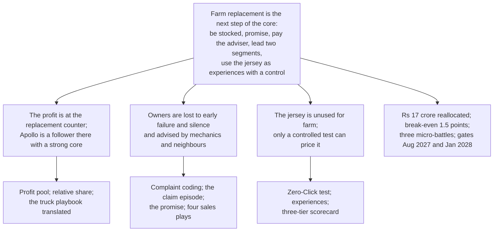

# B09. The storyline, in Bain's form

Prepared 7 November 2026. Part of the Bain-lens re-analysis of the Apollo Round 3 case.

**What this file is.** Our own twelve-slide storyline built answer-first, the way Bain's published training describes its communication ("Answer First"; "presentation development"): the answer and its reasons on the first slide, then one finding per slide with the "so what" in the title and one exhibit that proves it. It is not Bain's work and Bain prescribes no deck template publicly. It is a specification in Markdown; no slides have been made. The McKinsey-lens storyline is `..\McKinsey_Lens\M09_Storyline_and_Ghost_Deck.md`; `B10_Bain_vs_McKinsey.md` says which slides would change if the two were merged.

**How to use it.** Read the twelve titles in order; they should make the whole case. Figures marked * rest on planning assumptions and must be said so on the slide. Every figure's label is in the file named in the Source column.

---

## 1. The argument on one page

**The answer.** Farm replacement is the next step of the replacement business Apollo already wins in. Be stocked where the owner buys, promise what he fears and settle it at the counter, pay the dealer and the mechanic only for extra tyres, lead the two segments Apollo can own, and use the jersey for experiences measured against a control. Fund it by reallocating about Rs 17 crore of the marketing money Apollo already spends; ask for no new money; prove it by August 2027.

**Three reasons.**

1. The profit is at the replacement counter, and Apollo is a follower there with a strong core next door: replacement is 80% of Apollo's business and 25% of its farm business.
2. Owners are lost to early failure and unanswered claims, and advised by the mechanic and the neighbour: a promise, a paid adviser and a referral fix what the evidence shows.
3. The jersey is an unused asset for farm, and only experiences with a control can show what it is worth.

**The ask.** Freeze the farm marketing allocation, pull five data sets, clear competition law and the contract, name three micro-battle leads, and start in December 2026.

---

## 2. Twelve slides

| # | Action title (the "so what") | The one exhibit | Source | Brief guideline it answers |
|---|---|---|---|---|
| 1 | **Farm replacement is the next step of Apollo's replacement core: be stocked, promise what owners fear, pay the adviser, lead two segments, and use the jersey as experiences with a control, for Rs 17 crore reallocated from existing marketing** | The answer, three reasons, the ask | B00 | All |
| 2 | **The profit in farm sits at the replacement counter, not at the tractor factory: the farm leader earns 6% while Apollo earns 15% in the segments it leads** | Left: EBITDA margin by maker with the segment each leads. Right: the value chain of one rear tyre, from Rs 16,400 retail to the dealer's Rs 1,420 and the retreader's second life | B02 sections 2 and 3 | 1. Diagnosis |
| 3 | **Apollo holds about a quarter of the leader's share in farm replacement, and Bain's research says only 5% of weak followers change position; so Apollo should lead two segments: first replacements on its own fitted tractors, and hauliers** | Relative market share bars (whole farm about 0.5*; replacement about 0.3*); a two-row table of the segments with their evidence | B02 section 4 | 1. Target customer |
| 4 | **Apollo's business is 80% replacement and its farm business 25%: farm has never been run with the formula the truck business wins with** | Left: the mix. Right: the truck playbook (Zones, retread network, AVOLVE, matched warranties, awards, welfare) against farm (two Farm Zones in 2019, nothing since) | B03 sections 2 and 3 | 1. Diagnosis |
| 5 | **Be stocked first: a portal lists about 170 Apollo tractor-tyre dealers against about 3,690 for MRF, and no promise, reward or jersey works in a shop without the tyre** | The counts, labelled outside-in; the stock-and-show kit; the number the rural sales head reports weekly | B03 section 7; B05 Play 1 | 3. Activation |
| 6 | **Detractors are made by early failure and silence, not by price: 23 of 39 tractor complaints are cuts and bursts, claims take two months and exclude trolley wear** | Left: the complaint coding by theme. Right: the claim episode today (dealer, engineer, "final and binding", two months) against the target (QR at purchase, settled at the dealer in seven days) | B04 sections 2 and 3 | 1. Diagnosis; 4. Recall to sales |
| 7 | **Promise what owners fear, at today's price: hours guaranteed, cuts and bursts covered in the first season, trolley wear covered, settled at the counter in seven days; it costs Rs 1,475 a rear tyre and leaves Rs 2,785** | The guarantee card in plain words; rivals' terms (CEAT's three-year cover; Goodyear's trolley exclusion); the per-tyre cost build* | B04 section 3; B07 section 2 | 4. Recall to sales; 6. Financial |
| 8 | **Pay the dealer and the mechanic only for extra registered tyres, as paints, cement and lubricants do, and inside the competition-law limits this industry has already been fined for** | The four sales plays in one row each; the ten design rules from the benchmarks; the three things the scheme must never contain | B05 sections 4 to 6 | 3. Activation; 4. Recall to sales |
| 9 | **Use the jersey for experiences measured against a control, not for impressions nobody can count: hospitality for the 300 top farm dealers, a mechanics' final at a Test, a Kisan XI at village tournaments that already run with no sponsor** | Bain's three steps and three tiers; the five experiences with their controls and costs*; the corrected calendar from the Sri Lanka series in December 2026 | B06 sections 4 to 7 | 2. Formats and properties; 5. Measurement |
| 10 | **Rs 17 crore to March 2028, reallocated from about Rs 490 crore of existing marketing; the national offer pays at 1.5 points of share, and the additions must add three-quarters of a point to beat the leaner plan** | The money map (six points by source*); spending by year against the McKinsey lens; the three cases with the cumulative result at March 2029* | B07 sections 3, 4 and 6 | 6. Financial plan |
| 11 | **Three micro-battles from 1 December 2026, the controlled test from 21 January 2027, gates in August 2027 and January 2028, and a named "D" for every decision** | The timeline; the RAPID chart in six rows; the three risks that can stop the programme | B08 sections 2 to 4 | 7. Roll-out; 5. Measurement |
| 12 | **The ask for Monday: freeze the farm marketing allocation, pull five data sets, clear competition law and the contract, name three leads, release Rs 5.5 crore now and the rest at the gates** | The first 100 days; the tranche table; the three-tier scorecard locked with finance | B07 section 7; B08 section 6 | 6. Financial; 7. Roll-out |

---

## 3. Notes on each slide

**Slide 1.** Bain's executive summary is the answer and its reasons, not the agenda. Say on the slide that the analysis uses Bain's published frameworks and is not Bain's work.

**Slide 2.** Goodyear's 30% is a broker's figure for farm as a whole, fitment included; say so. The EBITDA figures are FY26; the H1 FY27 figures are lower for everyone on rubber prices.

**Slide 3.** Both relative shares are built on planning assumptions; show the bands (0.5 to 0.6; 0.25 to 0.3) and name the one broker note the 9% rests on. The "5%" quote is Zook, 2004, on bain.com.

**Slide 4.** The 80% is CRISIL's figure for Apollo's consolidated revenue; the 25% is a broker's note of a management meeting. The Farm Zone evidence is two press releases from 2019 and the absence of anything since.

**Slide 5.** The dealer counts are third-party portal listings, not a census; say "outside-in" on the slide. The point stands on direction, and the first micro-battle produces the real count.

**Slide 6.** The 39 items are one researcher's coding of a complaint board; complaint boards carry no praise. Cite the two consumer-court judgments for the two-month timing and the trolley-wear rejection.

**Slide 7.** CEAT's "Aayushmaan" cover is the reason the cut-and-burst cover is a match, not a lead; Apollo's lead is settlement at the dealer in seven days and the trolley clause. The Rs 1,475 is a planning assumption; the reserve is the number the test measures.

**Slide 8.** The competition-law line is a fact and should be stated precisely: the 2012 order records the makers' own dealer-margin submissions and a dissenting finding of tie-ins and price maintenance; the 2018 order fined Apollo Rs 425.53 crore, the Supreme Court dismissed the appeals in January 2022, and the penalty was remanded for review that December. Judges from industry will know it.

**Slide 9.** Say that no rural split of cricket viewing has been published since 2019, which is why impressions cannot be priced. The village-tournament figures are from one newspaper report on Sirsa and Fatehabad.

**Slide 10.** Show both programmes side by side on the same share assumptions, including that the Bain-lens programme is about Rs 10 crore worse at March 2029 unless its additions add the share they are designed to add. Judges will respect the honesty more than a better-looking table.

**Slide 11.** Name the titles, not people. The micro-battle teams' half-time cost is not in the budget and should be said.

**Slide 12.** The ask is a reallocation; if the farm allocation turns out to be smaller than Rs 30 crore a year, the ask becomes incremental and is still about 3.5% of one year's advertising.

---

## 4. Questions to expect, and where the answers are

| Question | Short answer | File |
|---|---|---|
| The brief asks for a cricket-led plan. Where is the cricket? | In every experience that can be measured: hospitality, the mechanics' final, village tournaments, dealer match days, trade rewards; and on every dealer's board. What is refused is money on impressions that cannot be counted for a rural audience | B06 |
| Why is this "Bain" and not just another consultant's view? | Each step uses a tool Bain has published, cited by page and date: profit pools, leadership economics, the adjacency test, hidden assets, NPS and episodes, Elements of Value, sales plays, trade-spend rules, the Zero-Click playbook, micro-battles, RAPID, Results Delivery | B01; Q1; Q2 |
| How do you know Apollo is thin at the counter? | We do not; two portal counts and the search share point that way. The first micro-battle counts it in the first two weeks | B03 section 7 |
| Why cover cuts and bursts? Is that not expensive? | Because that is what detractors suffer, and CEAT already covers it. The reserve is 1.5% of covered sales and the cover narrows if claims exceed it for two months | B04; B08 |
| Why pay the mechanic? | Because 34% of farm households take advice from the input dealer and 33% from a progressive farmer, and the mechanic is the one who sees the failed tyre; and because every adviser-led category pays its adviser | B04; B05 |
| Is Rs 17 crore affordable? | It is 3.5% of one year's advertising and promotion, and about 40% of farm's pro-rata share over the period; no new money | B07 section 4 |
| Why is your break-even higher than the other plan's? | Because the cover and the adviser cost money on every tyre; the additions must add about three-quarters of a point to pay for themselves, and the test is designed to show whether they do | B07 section 6 |
| What about competition law? | The programme contains no price floor, tie-in or exclusivity, and gets written clearance before any money is spent | B05 section 5; B08 section 4 |
| What if the contract does not allow hospitality or marks at the shop? | The counter, the promise, the adviser and the referral stand without the jersey; only the rewards change | B06 section 8 |
| What is still unknown? | Twelve things, each with what settles it | B10 section 5 |

---

## 5. Backup exhibits

| Exhibit | File |
|---|---|
| The profit pool: industry size, mix, margins by maker, the value chain of a tyre | B02 sections 2 and 3; Q3 |
| Relative market share build and the money map | B02 sections 4 and 5; B07 section 3 |
| The truck playbook and the hidden-asset register | B03 sections 2 and 6; Q4 |
| Complaint coding by brand; the claim episode by brand; the consumer-court cases | B04; Q6 |
| Elements of Value maps for the owner and the dealer | B04 section 4 |
| The four sales plays and the adviser programme's cost | B05 sections 4 and 6 |
| Best demonstrated practice: 31 programmes | Q5 |
| The experiences with their controls; the corrected calendar; other cricket properties | B06 sections 4, 6 and 7; Q7 |
| Spending reconciled to M07; cases; sensitivities | B07 section 6 |
| Micro-battle cycles; the RAPID chart; the risk dialogue; the first 100 days | B08 |
| Bain sources, verified quotes and dates | Q1; Q2; B11 |
