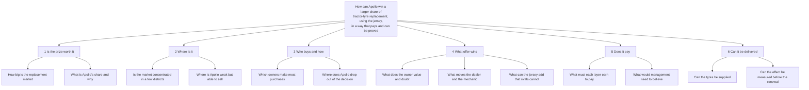

# M01. Framing and issue tree

Prepared 6 November 2026. Part of the McKinsey-lens re-analysis of the Apollo Round 3 case.

**What this file is.** Our own analysis. It frames the case the way strategy consulting teams are publicly known to work: one governing question, an issue tree, a leading hypothesis, and a workplan that sets out to prove or disprove it. It is not McKinsey's work, and it uses only published descriptions of that way of working.

**Purpose.** To show how the problem was re-framed, what was tested, and what each test found.

**How to read this file.** "Status" in the tables means what the round-4 research found: Supported, Not supported, Partly, or Open (cannot be settled from public sources). Evidence is in the file named in each row.

---

## 1. How the first analysis and this one differ in method

| | First analysis (files 00 to 17) | This re-analysis |
|---|---|---|
| Starting point | The brief's twelve research phases | One question about value |
| Direction | From findings up to a recommendation | From a hypothesis down to the tests that could break it |
| First number sought | Facts about Apollo and cricket | The size of the prize and Apollo's share of it |
| Geography | The brief's two example belts | Districts ranked by tractors |
| Role of the pilot | The answer waits for the pilot | The answer stands; the test sizes two optional layers |
| Output | A research set | An answer, a business case and a storyline |

The first analysis is not wrong in its facts. It answered "what do we know?" before asking "what is it worth?".

---

## 2. Problem definition

| Element | Statement |
|---|---|
| **The question** | How can Apollo raise its share of India's tractor-tyre replacement market from about 9% towards 15% by FY30, using the Team India sponsorship it has already paid for, so that the spending pays back within about two years and is proved in time for the sponsorship's renewal in 2028? |
| The brief's wording | Become the first tyre brand farmers and landowners think of, and turn that into tractor and farm tyre sales in rural India, affordably and measurably |
| Why re-word it | "First brand thought of" is a means. The end is replacement sales. Stating the end in numbers lets every idea be judged by what it earns |
| Who decides | Apollo's India leadership: the heads of rural sales, farm product, brand and supply |
| What success looks like | A stated share gain; a cost per point of share below what a point earns; a result management can read by January 2028 |
| In scope | Replacement tractor tyres in India; the sponsorship as it applies to farm; the rural dealer and mechanic |
| Out of scope | Exports; prices to tractor makers; car and truck tyres, except as an uncounted upside; whether Apollo should have bought the jersey |
| Constraints | No price cut; the jersey fee is committed to March 2028; farm tyres are in short supply; a weak farm year in 2026-27 |
| What would change the answer | Apollo's own data showing its replacement share is far from 9%; wear data that cannot support a guarantee; a contract that bars the team's marks at the point of sale |

---

## 3. Issue tree

Each branch has its own file: 1 in `M02_Value_at_Stake.md`, 2 in `M03_Where_to_Play.md`, 3 in `M04_Customer.md`, 4 in `M05_How_to_Win.md` and `M06_Sponsorship.md`, 5 in `M07_Economics.md`, 6 in `M08_Delivery.md`.

---

## 4. The leading hypothesis, and what happened to it

**As written before the research (in the plan):** Apollo should use the jersey to win the tractor owner's replacement purchase in the 30 to 50 districts that hold most working tractors. It does so by owning tyre life with a guarantee, recruiting the dealer and mechanic with rewards only Team India's sponsor can give, and registering every buyer.

Three things had to be true:

| # | Condition | Finding | Status |
|---|---|---|---|
| 1a | The prize is concentrated in 30 to 50 districts | The twenty largest districts take 11.5% of new registrations; forty dense districts hold perhaps a fifth of working tractors | **Not supported** |
| 1b | The prize can be supplied | It needs 1 to 2% of Apollo's tonnage. A new line would cost Rs 430 to 790 crore, so the tyres must come from re-allocation and outsourcing | **Partly** |
| 2 | A guarantee with trade rewards shifts choice at today's price, for less than a won customer is worth | The offer costs about 9% of what Apollo receives for a rear tyre and leaves about Rs 3,000 a tyre. An hours guarantee exists abroad. No Indian result exists | **Open**: the arithmetic works; the response is untested |
| 3a | The rights allow sponsor rewards | Apollo has given match tickets, team shirts and meetings with players to buyers of car and motorcycle tyres | **Supported**, subject to the contract |
| 3b | Sponsor credentials and rewards move the trade more than cash | No evidence either way. Search share has not moved. Rivals have older cricket associations | **Open** |

**The hypothesis as revised:**

> Apollo's tractor tyres are fitted at the factory and lost at the first replacement. Win the replacement with an offer that works everywhere and costs money only when a tyre is sold: a guaranteed tyre life paid at the counter, rewards to the dealer and mechanic for each extra tyre, and the sponsor's mark where the owner buys. Add a field team only in dense tehsils, and cricket events only where a test shows they pay.

What changed is the shape, not the direction. Geography moved from the centre of the answer to its edge, and the jersey moved from the engine to the trust mark.

---

## 5. Sub-hypotheses and findings

| # | Hypothesis | Finding | Status | File |
|---|---|---|---|---|
| 1 | The replacement market is large enough to matter | About 3.9 million tyres a year; about Rs 3,300 crore at manufacturers' prices | Supported | M02 |
| 2 | Apollo is under-weight in replacement | About 9% against about 20% in car tyres; rests on one broker note | Supported, on thin evidence | M02 |
| 3 | Rivals reach the owner on the new tractor | The reverse for Apollo: about three-quarters of its farm sales are fitment and export | Not supported; diagnosis restated | M02 |
| 4 | Tractors buy tyres about every five years | About every eight; the average tractor works about 350 hours a year | Not supported; the local market is under half what was assumed | M02 |
| 5 | A few districts hold most of the prize | No | Not supported | M03 |
| 6 | Heavy users make most purchases | Four in ten owners, about two-thirds of purchases; from one Punjab survey | Supported, on thin evidence | M04 |
| 7 | Owners choose on tyre life and doubt claims | Coded comments under 30 videos; the 2018 owner study ranks durability first | Supported | M04 |
| 8 | Apollo's tyre is cheaper for the same life | 6 to 10% below MRF and Goodyear; no published tread or wear data for any Indian tyre | Partly | M05 |
| 9 | A tyre-life guarantee is feasible | One maker launched one in 2026; Apollo has used unconditional warranties on car tyres; depends on Apollo's wear data | Partly | M05 |
| 10 | Rs 200 a purchase moves a mechanic | Too thin against monthly pay of Rs 8,000 to 27,000; raised to Rs 300 a rear tyre | Not supported; changed | M05 |
| 11 | The jersey has raised interest in Apollo's tractor tyres | Share of search 14.0% to 14.8%; MRF 47% | Not supported | M06 |
| 12 | The jersey is an asset no rival can match | Rivals hold older cricket assets; the jersey's distinct value is standing and rewards | Partly | M06 |
| 13 | The first plan's engine pays at 2.3 points of local share | It needs 4.7 at full cost on the corrected market | Not supported | M07 |
| 14 | The first plan's cricket layer can pay | Not on farm tyres at Rs 2.5 lakh a tehsil; a Rs 1.2 lakh layer needs three points | Not supported; changed | M07 |
| 15 | The pilot can detect its own targets | It could not; the new test can, if tehsil sales vary by less than about 40% a year | Fixed | M08 |
| 16 | Supply rules the programme out | No: small in tonnes; solved by allocation, not building | Not supported | M02, M08 |

---

## 6. Workplan

### 6.1 Done, from public sources

| Question | Analysis | Source | Output |
|---|---|---|---|
| Market size | Units x price; cross-check from makers' disclosures | CRISIL chart in a prospectus; portal prices | M02 section 2 |
| Apollo's share | Share of farm revenue that is replacement | Broker note; annual report | M02 section 3 |
| Tyres per tractor | Replacement units over working tractors | CRISIL; Mahindra; state abstracts; NFHS-5 | M02 section 2.3 |
| Concentration | District counts and registrations | Haryana and Punjab abstracts; registration data | M03 |
| Who buys | Hours of use by farm size | One Punjab survey; the 2018 owner study | M04 |
| What owners say | 486 comments under 30 videos, coded | YouTube | M04 |
| Has the jersey worked | Share of search before and after | Google Trends, eight states | M06 section 4 |
| Rivals' cricket | Asset list with dates | Press, company pages | M06 section 5 |
| Rights in practice | Terms of Apollo's own promotion | Apollo's site | M06 section 6 |
| Economics | Break-even by layer; three cases | Files 13, M02, M05 | M07 |
| Test power | Detectable difference for sales and recall | Standard formulas | M08 section 3.3 |

### 6.2 What a team with access would do in its first two weeks

| Work | With whom | Settles |
|---|---|---|
| Data request (M02 section 8; M03 section 7) | Apollo finance, sales, supply | Hypotheses 2, 3, 5, 16 |
| 40 dealer interviews: margins, credit, schemes, what they recommend and why | Multi-brand and Apollo dealers in six districts | Hypotheses 8, 10 |
| 60 mechanic and puncture-shop interviews | Same districts | Hypothesis 10 |
| 20 tractor-dealer interviews: which tyres are fitted, who returns | Dealers of two tractor makers | Hypothesis 3; the first-replacement programme |
| 100 owner interviews at tyre shops and mandis: last purchase, why, what they would pay for a guarantee | Owners, split by hours of use | Hypotheses 6, 7, 9 |
| Wear-data review | Apollo's technical team | Hypothesis 9: the hours figure |
| Contract review | Apollo legal | Hypothesis 12 |

Until that work is done, every "Open" and "thin evidence" above stays as it is.
