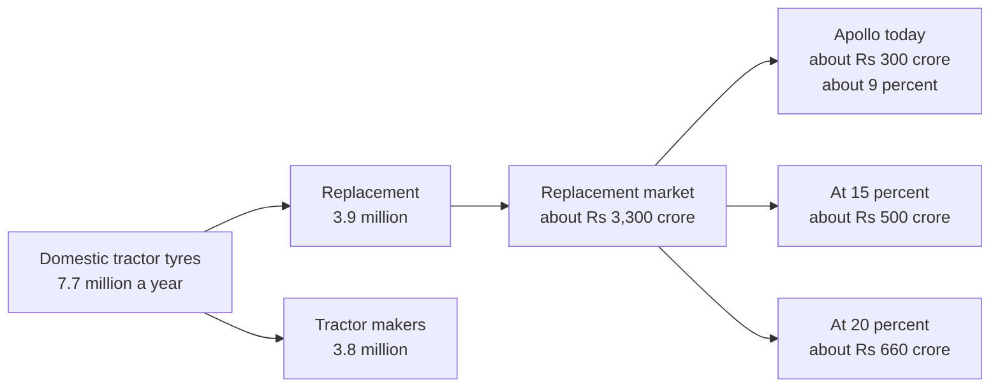

# M02. Value at stake

Prepared 6 November 2026. Part of the McKinsey-lens re-analysis of the Apollo Round 3 case.

**What this file is.** Our own analysis, organised the way a strategy consulting team would organise it: size the prize before designing the programme. It uses published McKinsey frameworks where noted. It is not McKinsey's work.

**Purpose.** To say how big the farm tyre market is, where Apollo stands in it, what a point of share is worth, and what limits the prize.

**How to read this file.**

| Label | Meaning |
|---|---|
| [Verified fact] | Primary source read, or two independent sources |
| [Fact - single source] | One credible source |
| [Computed] | Arithmetic on sourced figures; steps shown |
| [Planning assumption] | A working figure chosen because no data exists |
| [Unverified as to scope] | The wording is confirmed; what it refers to is not |
| [Interpretation] | Our reading |

Sources and the fact-check record: `..\17_Source_Register_and_Verification.md`; raw notes in `..\research_notes\N1_value_at_stake_starting_position.md`.

---

## 1. The answer in six lines

1. **The domestic tractor tyre market is about 7.7 million tyres a year, half of it replacement.** [Fact - single source: CRISIL, in a 2024 prospectus]
2. **The replacement half is worth roughly Rs 3,300 crore a year at manufacturers' prices** (range Rs 2,500 to 4,000 crore). [Computed on planning assumptions]
3. **Apollo is under-weight in it.** About a quarter of Apollo's farm sales are replacement, against half for the industry. That puts Apollo near 9% of the replacement market, against about 20% in car tyres. [Computed; rests on one broker note of a meeting with management]
4. **Each point of replacement share is worth about Rs 33 crore of revenue and about Rs 10 crore of contribution a year.** [Computed on planning assumptions]
5. **Closing half the gap to its car-tyre share (9% to 15%) would add about Rs 200 crore of revenue a year**; closing all of it (to 20%), about Rs 360 crore. [Computed]
6. **The capacity this needs is small in tonnes (about 1 to 2% of Apollo's production) but dear to build: Rs 430 to 790 crore at the cost of the current expansion.** The tyres have to come from outsourcing and from re-allocating existing farm output, not from a new line. [Computed on a low-reliability tyre weight]

---

## 2. Market size and structure

### 2.1 Units

The only segment data found comes from CRISIL's industry chapter in the Tolins Tyres prospectus (report dated August 2024). [Fact - single source] Source: [Tolins Tyres RHP](https://docs.phonepe.com/public/external/sb_cube/ipo/rhp/PXPQJLV)

| Million tyres, domestic | FY19 | FY20 | FY21 | FY22 | FY23 | FY24 |
|---|---|---|---|---|---|---|
| To tractor makers (OEM) | 3.5 | 3.1 | 3.9 | 3.8 | 4.3 | 3.8 |
| Replacement | 2.8 | 2.2 | 2.3 | 3.5 | 3.7 | 3.9 |
| **Total** | **6.3** | **5.2** | **6.2** | **7.4** | **8.0** | **7.7** |
| Replacement share | 44% | 42% | 37% | 47% | 46% | 51% |

- Farm tyre exports were a further 5.6 million units in FY24. They are large tyres for Europe and the United States and are a different business. Imports are negligible (about 5,000 units). [Fact - single source]
- CRISIL's outlook for FY29 is 8.5 to 12 million tyres, of which replacement 4 to 6 million. [Forecast: CRISIL, August 2024]
- The chart covers tractor tyres and does not say whether trailer tyres are counted. No tonnage, no split between front and rear tyres, and no figure for FY25 or FY26 was found. Data unavailable – requires primary research or company confirmation.
- An earlier draft of the same prospectus (June 2024) prints slightly different figures. The figures above are from the final version of August 2024, re-read in the fact-check of 6 November 2026.

**Rolled forward to FY26** [Computed; planning assumptions]:

| | Low | High | Basis |
|---|---|---|---|
| OEM tyres | 4.6 million | 5.3 million | FY26 tractor sales of 11.6 lakh x 4.0 to 4.55 tyres a tractor |
| Replacement tyres | 3.9 million | 4.6 million | FY24 grown two years at 0.5% to 9% a year, the range CRISIL's FY29 outlook implies |

### 2.2 Value

No source gives the market in rupees. Vendor reports conflict fourfold and are not used. We build it from units and prices.

| Input | Value | Label |
|---|---|---|
| Replacement tyres, FY26 | 3.9 to 4.6 million | [Computed] above |
| Retail price, rear 13.6-28 | Rs 16,000 to 17,700 | Portal prices (`..\07_Competitor_Analysis.md`) |
| Retail price, front 6.00-16 | Rs 3,000 to 3,600 | Portal prices |
| Manufacturer's realisation | Rs 14,200 rear; Rs 2,860 front | [Planning assumption]: retail less 5% GST and a 10% trade margin. The only rated tyre distributor found earned a 7% operating margin. |
| Mix | Half front, half rear | [Planning assumption]; no split is published |
| Average realisation per tyre | About Rs 8,500 | [Computed] |

- Replacement market = 3.9 to 4.6 million x Rs 8,500 = **Rs 3,300 to 3,900 crore**. [Computed]
- A large share of replacement tyres sells well below the leading brands' prices. Market channels advertise a rear pair at Rs 16,000, half the price of a branded pair, and second-hand and retreaded tyres are common (`M04_Customer.md`). That pulls the average down. [Interpretation]
- **Working figure: Rs 3,300 crore, range Rs 2,500 to 4,000 crore.** [Planning assumption]

A cross-check from the supply side does not close. Adding up what tyre makers disclose (Apollo's farm revenue, CEAT's, an old share for Goodyear, BKT's claim) gives a whole domestic market of only Rs 3,900 to 4,900 crore before MRF, JK and others. The gap is mostly unknown: how much of Apollo's and CEAT's farm revenue is exported, and what tractor makers pay. The detail is in the N1 notes. We therefore show a wide range and do not claim precision.

### 2.3 How often a tractor buys tyres

How many tractors are working is itself uncertain:

| Estimate | Figure | Label |
|---|---|---|
| Installed base used by Mahindra | About 11 million | [Fact - single source, November 2025]; close to cumulative registrations |
| Registered tractors scaled down by Haryana's ratio | About 7 million | [Computed]: Haryana had 4.53 lakh on the register in 2020 but 3.02 lakh in use, a ratio of 1.5 (`M03_Where_to_Play.md`) |
| Rural households owning a tractor (NFHS-5, 2019-21) | 3.9% of rural households: about 6.6 million on the 2011 household count, more today | [Verified fact]; count [Computed] |
| **Working figure** | **8.5 million (7 to 11 million)** | [Planning assumption] |

| Step | Figure | Label |
|---|---|---|
| Replacement tyres a year | 3.9 to 4.6 million | Above |
| Tyres bought per tractor per year | About 0.5 (0.35 to 0.65 across the range) | [Computed] |
| Implied life of a tyre | About 8 years (6 to 11) | [Computed] |
| Replacement spend per tractor per year, at manufacturers' prices | About Rs 3,900 (Rs 3,000 to 4,700) | [Computed]: Rs 3,300 crore over 8.5 million tractors |

Tractor portals say tyres last four to six years. The figures fit only if the average tractor works few hours. A survey of the Punjab cotton belt found 352 hours a year on average, from 73 hours on marginal farms to 977 on large ones (`M04_Customer.md`). At 350 hours a year, a tyre good for 2,000 to 4,000 hours lasts 6 to 11 years. [Computed]

Two consequences:

- **The first analysis overstated the local market.** It assumed 0.7 tyres per tractor a year and Rs 5,320 of spend. The CRISIL figure implies about 0.5 tyres and Rs 3,900. A district with 30,000 working tractors is a replacement market of about Rs 12 crore a year. [Computed]
- **Purchases are concentrated in heavy users.** A tractor working 900 hours buys tyres about three times as often as one working 300. [Computed]

---

## 3. Apollo's starting position

### 3.1 The mix

| Fact | Label | Source |
|---|---|---|
| Farm is 6% of Apollo's Indian-entity revenue: about Rs 1,200 crore in FY26, exports included | [Verified fact]; rupee figure [Computed] | `..\01_Apollo_Tyres_Company_Research.md` |
| A broker's note of a meeting with Apollo management (27 December 2025) says "only approximately 25% of the farm category is replacement-driven" | [Fact - single source]; wording re-read in the fact-check | [Motilal Oswal](https://bsmedia.business-standard.com/_media/bs/data/market-reports/equity-brokertips/2025-12/17669995660.82069300.pdf) |
| The sentence sits among management's comments on Apollo's own Indian business and explains why weak farm replacement hurt Apollo little. It reads as Apollo's farm business; the note does not say so in terms | [Interpretation] | N1 notes; `..\research_notes\P_factcheck_round4.md` row 4 |
| It cannot describe the industry, where replacement is 51% of domestic units | [Computed] | CRISIL, above |
| Apollo's annual report says farm growth in FY26 came mainly from the domestic replacement market, which recovered in the second half | [Verified fact] | Apollo FY26 annual report |
| Apollo's only confirmed tractor-maker customer is Mahindra (2009 and 2017 evidence). Mahindra held 43.6% of tractor sales in the March 2026 quarter | [Fact - single source each] | Files 01; N5 notes |

**Reading:** Apollo's farm business is fitment-led. About a quarter is replacement; three-quarters is tractor makers and exports. [Interpretation]

### 3.2 Share

| | Calculation | Result | Label |
|---|---|---|---|
| Apollo's farm replacement revenue | 25% x Rs 1,189 crore | About Rs 300 crore | [Computed; rests on the 25%] |
| Share of the replacement market | Rs 300 crore / Rs 3,300 crore | **About 9%** (7 to 12% across the range) | [Computed] |
| For comparison: Apollo in car tyre replacement | | About 20 to 21% | [Fact - single source: broker notes] |
| Apollo in truck-bus radial replacement | | About 29% | [Fact - single source] |
| Apollo's share of tractor-tyre searches among five brands | | About 14% (MRF 47%) | [Outside-in proxy: `..\research_notes\N6_search_interest_google_trends.md`] |

Apollo's replacement share in farm is less than half its share in car tyres. Search interest points the same way.

### 3.3 What this does to the diagnosis

The first analysis said rivals' tyres arrive on new tractors (`..\09_Problem_Diagnosis.md`). The evidence now points the other way for Apollo: **it is on many tractors at the factory and loses the owner at the first replacement.**

Supporting evidence from J.D. Power's 2018 study of 3,768 owners [Verified fact]:

- Only 38% of owners chose the tyre brand on their new tractor.
- Where owners reported uneven wear, only 18% intended to buy that tyre brand again.
- Apollo was not among the three brands whose scores were published (MRF 848, CEAT 830, Goodyear 828; average 834).

What is still unknown, and Apollo can answer from its own books: its share of each tractor maker's fitment, and how many owners of Apollo-fitted tractors come back to Apollo. Data unavailable – requires primary research or company confirmation.

---

## 4. What a point of share is worth

All on the working market of Rs 3,300 crore and a contribution margin of 30%.

**Where the 30% comes from** [Planning assumption]: raw materials were about 46.5% of Apollo's revenue in a normal quarter (Q3 FY25) and are reported at about 55% in mid-2026. Taking 55%, and allowing 12 to 15% for other costs that vary with volume (power, freight, variable labour, royalty), leaves about 30%. At the earlier raw-material level it would be nearer 40%. The first analysis used 30% without showing this.

| Gain in replacement share | Extra revenue a year | Extra contribution a year | Tyres a year |
|---|---|---|---|
| 1 point | Rs 33 crore (25 to 40) | Rs 10 crore | About 42,000 |
| 3 points (9% to 12%) | Rs 100 crore | Rs 30 crore | About 126,000 |
| 6 points (to 15%: half the gap to its car-tyre share) | Rs 200 crore | Rs 60 crore | About 250,000 |
| 11 points (to 20%: its car-tyre share) | Rs 360 crore | Rs 110 crore | About 460,000 |

All [Computed] on planning assumptions.

For scale:

- Rs 200 crore is about 17% of Apollo's farm revenue today and under 1% of group revenue.
- The reported jersey fee is about Rs 230 crore a year. Farm's share of that, at 6% of Indian revenue, is about Rs 14 crore a year. A gain of two points would cover it.
- The first analysis's full-scale programme yielded Rs 10 to 18 crore of contribution a year: one to two points.

---

## 5. What limits the prize

### 5.1 Supply

| Fact | Label |
|---|---|
| Management named farm among categories in shortage (February 2026) | [Verified fact] |
| Indian plants are running above 90%; capacity is expected to stay tight through FY27 | [Fact - single source: broker note on the Q1 FY27 call] |
| The Rs 5,810 crore expansion is for car and truck tyres | [Verified fact] |
| Apollo is moving some farm production from its Dutch plant to India. In that context it is considering outsourcing farm tyres and is not looking to add significant farm capacity in India | [Fact - single source: broker note, December 2025] |

How much capacity the prize needs [Computed on planning assumptions]:

| Step | Figure | Basis |
|---|---|---|
| Weight of a rear 13.6-28 tyre | About 62 kg | One retailer listing; low reliability |
| Weight of a front tyre | About 12 kg | [Planning assumption]; not sourced |
| Average, half and half | About 37 kg | |
| Six points of share | 250,000 tyres = about 9,300 tonnes a year | |
| Eleven points | 460,000 tyres = about 17,000 tonnes a year | |
| Apollo's production, FY26 | 732,097 tonnes | Annual report |
| **Share of Apollo's production** | **1.3% to 2.3%** | |
| Capital cost if built new, at about Rs 4.65 lakh per tonne of yearly capacity | **Rs 430 to 790 crore** | The chief financial officer put the current expansion at about Rs 17 crore a tonne of capacity. The article does not say whether that is a tonne a day or a year; the plant's size implies tonnes per day (Rs 5,810 crore buys about 342 tonnes a day, or 1.25 lakh tonnes a year) [Computed] |
| Extra contribution a year from the same tyres | Rs 60 to 110 crore | Section 4 |

Two things follow [Interpretation]:

- **A new farm line does not pay on this prize alone.** Rs 430 to 790 crore of plant for Rs 60 to 110 crore of contribution a year is a payback of about seven years before any marketing cost.
- **Farm tyres earn less per kilogram than Apollo's average:** about Rs 230 a kilogram for a rear tractor tyre against Rs 389 for the group [Computed; the weight is low-reliability]. That is why new capacity goes to car and truck tyres.

So the tyres have to come from three places: outsourced manufacture (Apollo already buys in its motorcycle tyres), small debottlenecking of the existing farm lines, and giving the replacement dealer priority over lower-priced channels when farm tyres are short.

**Conclusion:** supply is a real constraint in FY27. It is small in tonnes and it should not be solved by building. It has to be settled before the programme starts, not used as a reason to wait. Options are in `M08_Delivery.md`.

### 5.2 The cheap end of the market

A branded rear pair costs Rs 32,000 to 35,000. Market channels advertise new rear pairs at Rs 16,000 to 22,000, and second-hand tyres from a few hundred rupees. Videos on these have 0.3 to 1.6 million views. Retreads are quoted at Rs 6,000 to 8,500, and GST on retreaded tractor tyres fell from 18% to 5% on 1 November 2026 (`M04_Customer.md`, `M05_How_to_Win.md`). Part of the 3.9 million tyres is out of a premium brand's reach. How large a part is not known. Data unavailable – requires primary research or company confirmation.

### 5.3 The weak 2026-27 farm year

The 2026 monsoon ended about 13% below normal and tyre prices are rising 15 to 16% (`..\03_Latest_Developments_and_News.md`). Owners will stretch old tyres and retread. The prize is real over three years; the first of them is the hardest.

---

## 6. The wider rural prize

The same rural dealers sell tyres for motorcycles, cars and pick-ups. Management names car, two-wheeler and farm tyres together as its rural growth categories.

| Category | Rural share of new-vehicle sales, FY26 | Replacement tyres, FY24 (million) | Illustrative rural replacement value, retail |
|---|---|---|---|
| Two-wheelers | 57.8% | 71 | About Rs 8,000 crore |
| Cars and utility vehicles | 39.7% | 34 | About Rs 5,900 crore |
| Tractors | 81.0% | 3.9 | About Rs 3,000 to 3,400 crore |
| Commercial vehicles | 48.9% | 21.8 | Not priced |

- Rural shares: [Verified fact], [FADA, 6 April 2026](https://fada.in/images/press-release/169d329fc83770FADA%20releases%20FY%202026%20and%20March%202026%20Vehicle%20Retail%20Data.pdf). Replacement units: [Fact - single source], CRISIL. Values: [Computed] with one price per category and the assumption that tyres are bought where vehicles are registered.

What it means [Interpretation]:

- Farm is about a fifth of the rural tyre wallet at these dealers. A tractor tyre sale is worth more than twice a car tyre and about five times a motorcycle tyre, but there are far fewer of them.
- Apollo already has about 20% of car tyre replacement, buys in its motorcycle tyres, and is short of capacity in most categories. So the other categories add to the case for a rural dealer programme, but they do not transform it.
- The tractor owner matters beyond his tyres: he is the household in the village most likely to own a car and several motorcycles as well. That link is plausible and unmeasured. Data unavailable – requires primary research or company confirmation.

---

## 7. An aspiration to plan against

| Horizon | Replacement share | Extra revenue against today | What it takes |
|---|---|---|---|
| Today (FY26) | About 9% | – | – |
| March 2028 (end of the sponsorship) | About 10.5% as a run-rate (9.5 to 11.5%) | About Rs 50 crore a year, run-rate (Rs 16 to 82 crore) | The offer tested from January 2027 and national from October 2027 |
| March 2029 | About 12.5% (10.5 to 14.5%) | Rs 82 crore in FY29 (Rs 33 to 132 crore) | The offer everywhere; field teams where they pay |
| FY30 | 15% | About Rs 200 crore a year | The same, sustained, with supply found |

The 2028 and 2029 rows are the three cases of `M07_Economics.md`, with the base case first. The FY30 row is an aspiration beyond the high case. All are [Planning assumption], not forecasts: no analogue found gives a benchmark for a tyre maker's share gain from a farmer programme.

---

## 8. What Apollo can settle in a week from its own data

| Question | Why it matters |
|---|---|
| Farm revenue by channel: tractor makers, replacement, exports | Confirms or overturns the 25% |
| Fitment share at each tractor maker, by model | Shows where Apollo's tyres already are |
| Replacement sales by district | Gives real share points, district by district |
| Farm tyre realisation and contribution per tyre, by channel | Replaces the 30% and the price assumptions |
| Farm capacity, and the outsourcing plan | Sets how fast share can be taken |
