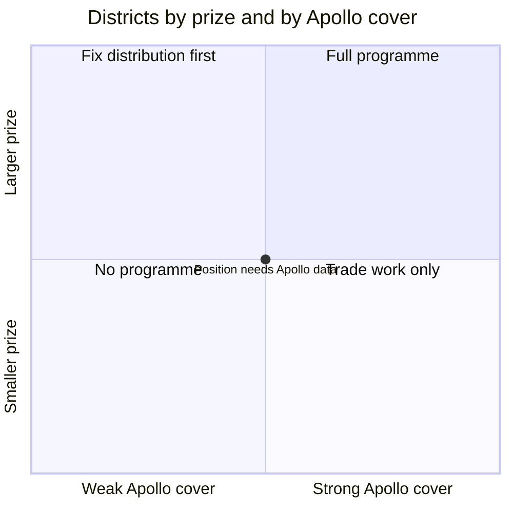

# M03. Where to play

Prepared 6 November 2026. Part of the McKinsey-lens re-analysis of the Apollo Round 3 case.

**What this file is.** Our own analysis. A strategy consulting team chooses geography from data at the finest level available; the first analysis chose two belts by judgement. It is not McKinsey's work.

**Purpose.** To rank states and districts by the size of the replacement prize, to say how concentrated that prize is, and to choose the districts for the first wave.

**How to read this file.**

| Label | Meaning |
|---|---|
| [Verified fact] | Official publication read |
| [Fact - single source] | One credible source; for registrations, a trade site reporting the transport ministry's data |
| [Computed] | Arithmetic on sourced figures |
| [Planning assumption] | A working choice |
| [Interpretation] | Our reading |

Three measures appear and must not be mixed: **tractors in use** (state departments' counts), **tractors on the register** (cumulative, includes scrapped ones) and **registrations in a year** (new sales). Detail: `..\research_notes\N2_where_to_play_districts.md`. Register: `..\17_Source_Register_and_Verification.md`.

No village-level statistic is given, because none is public.

---

## 1. The answer in six lines

1. **The prize is spread out, not concentrated.** The 20 largest districts take about 11% of new tractor registrations. No set of 30 to 50 districts holds "most" of the market. [Fact - single source; Interpretation]
2. **So geography alone cannot deliver the prize.** A field programme in about 40 districts reaches roughly a fifth of working tractors. The rest has to be reached by levers that work everywhere: the guarantee, the dealer and mechanic terms, and the first replacement. [Computed; Interpretation]
3. **By number of owners, Uttar Pradesh, Madhya Pradesh and Rajasthan come first:** about 14 lakh, 8 lakh and 8 lakh rural households with a tractor. By share of households, Punjab (13.9%) and Haryana (9.9%). [Verified fact: NFHS-5; counts Computed]
4. **Registrations overstate working tractors by about half.** Haryana had 4.53 lakh tractors on the register and 3.02 lakh in use. [Verified fact; ratio Computed]
5. **Cricket on television reaches fewest men exactly where owners are most numerous.** In Uttar Pradesh 42% of men watch television weekly and 45% are not regularly exposed to any media. [Verified fact: NFHS-5]
6. **The first wave should be 30 districts in three belts, all Hindi or Punjabi speaking:** the cotton belt where Punjab, Haryana and Rajasthan meet, Rohilkhand and western Uttar Pradesh, and the high-registration districts of Rajasthan and Madhya Pradesh. [Planning assumption]

---

## 2. States

| State | Rural households owning a tractor | Rural tractor-owning households (on 2011 household counts) | Tractors on the register, March 2020 | Registrations, FY26 | Men who watch TV weekly | Men not regularly exposed to any media | Men who have used the internet |
|---|---|---|---|---|---|---|---|
| Uttar Pradesh | 5.6% | About 14.3 lakh | 15.2 lakh | 1,46,811 | 42.0% | 45.4% | 59.1% |
| Madhya Pradesh | 7.6% | About 8.4 lakh | 13.3 lakh | 1,20,956 | 47.7% | 43.6% | 55.7% |
| Rajasthan | 8.3% | About 7.9 lakh | 12.2 lakh | 1,30,540 | 43.6% | 41.3% | 65.2% |
| Punjab | 13.9% | About 4.7 lakh | 4.7 lakh | not found | 54.8% | 36.1% | 78.2% |
| Gujarat | 6.7% | About 4.5 lakh | 8.2 lakh | 92,529 | 55.2% | 33.5% | 52.6% |
| Maharashtra | 3.3% | About 4.4 lakh | 8.3 lakh | 1,46,810 | 64.5% | 22.3% | 52.9% |
| Karnataka | 4.7% | About 3.7 lakh | 5.9 lakh | not found | 67.7% | 13.1% | 56.3% |
| Bihar | 1.8% | About 3.0 lakh | 4.9 lakh | not found | 38.2% | 47.7% | 35.4% |
| Haryana | 9.9% | About 3.0 lakh | 4.5 lakh (3.3 lakh in use, 2022-23) | not found | 52.7% | 36.6% | 72.4% |
| India | 3.9% | About 65.6 lakh | – | 10,30,895 | 55.9% | 31.6% | 51.2% |

- Household shares and media figures: NFHS-5, 2019-21. [Verified fact] Media figures are for all men aged 15 to 49 in the state, not for tractor owners and not rural-only.
- Household counts multiply the share by the 2011 rural household count, so they understate today's number. [Computed]
- Register: Road Transport Year Book figures as printed in the Statistical Abstract of Punjab 2025. [Fact - single source]
- Registrations: a tractor portal's report of transport-ministry data. [Fact - single source]

What it shows [Interpretation]:

- **Three states hold nearly half the owners.** Uttar Pradesh, Madhya Pradesh and Rajasthan have about 30.6 lakh of the 65.6 lakh rural tractor-owning households, or 47%.
- **Punjab and Haryana are dense but small in number:** about 7.7 lakh households together, 12% of the total. Their tractors are larger and more of them are on irrigated land worked twice a year.
- **Broadcast cricket is weakest where owners are most numerous.** In the three largest owner states, fewer than half of men watch television weekly and more than four in ten are not regularly exposed to any media. This is state-wide data for all men, so it is a caution, not a measurement of owners.
- **Internet use is highest in Punjab and Haryana** (78% and 72% of men), which fits the search and video evidence coming mostly from there.

---

## 3. Districts

### 3.1 What exists

| State | What is public | Label |
|---|---|---|
| Haryana | Tractors in use for all 22 districts, 2022-23 | [Verified fact: Statistical Abstract of Haryana] |
| Punjab | Tractors per 1,000 hectares for all 23 districts, June 2024; no counts | [Verified fact: Statistical Abstract of Punjab 2025, read from page images] |
| Rajasthan, Madhya Pradesh, Gujarat, Maharashtra, Uttar Pradesh | Registrations for the districts in the national top 20 only; older counts for a few | [Fact - single source] |
| All other districts | Data unavailable – requires primary research or company confirmation. | – |

### 3.2 Haryana: tractors in use, 2022-23

| District | Tractors | District | Tractors |
|---|---|---|---|
| Sirsa | 32,309 | Karnal | 18,242 |
| Hisar | 28,587 | Kaithal | 15,611 |
| Jhajjar | 26,000 (a round figure; treat with care) | Kurukshetra | 15,567 |
| Bhiwani | 24,373 | Rohtak | 15,140 |
| Sonipat | 19,487 | Yamunanagar | 14,687 |
| Fatehabad | 19,175 | Ambala | 14,654 |
| Jind | 18,587 | State total | 3,30,769 |

The eight largest districts hold 1,86,760 tractors, 56% of the state. [Computed]

### 3.3 Punjab: tractors per 1,000 hectares sown, June 2024

Sri Muktsar Sahib 123; Moga 120; Patiala 118; Rupnagar 115; Fatehgarh Sahib 111; Malerkotla 102; Faridkot 101; Ludhiana 96; S.B.S. Nagar 95; Sangrur 93; Barnala 86; Jalandhar 83; Kapurthala 82; Bathinda 79; Gurdaspur 71; Mansa 56; Firozpur 55; Tarn Taran 55; Hoshiarpur 53; Amritsar 47; Fazilka 45; state 81.

Approximate counts for the districts whose sown area is known [Computed: density x net sown area from district plans]: Sangrur about 28,900; Sri Muktsar Sahib about 27,600; Bathinda about 23,500; Barnala about 10,700; Mansa about 10,600. The density implies about 3.3 lakh tractors for the state, against 4.7 lakh on the register: the same gap as in Haryana.

### 3.4 Other states: new registrations, FY25

| District | State | Registrations | District | State | Registrations |
|---|---|---|---|---|---|
| Banaskantha | Gujarat | 10,620 | Chittorgarh | Rajasthan | 4,506 |
| Bikaner | Rajasthan | 6,634 | Badaun | Uttar Pradesh | 4,340 |
| Ahmednagar | Maharashtra | 5,738 | Srirampur (office in Ahmednagar district) | Maharashtra | 4,134 |
| Nashik | Maharashtra | 5,620 | Rajkot | Gujarat | 4,100 |
| Shivpuri | Madhya Pradesh | 5,273 | Sabarkantha | Gujarat | 4,077 |
| Chh. Sambhajinagar | Maharashtra | 5,223 | Jodhpur | Rajasthan | 4,063 |
| Nagaur | Rajasthan | 5,050 | Raisen | Madhya Pradesh | 3,975 |
| Surendranagar | Gujarat | 4,812 | Aligarh | Uttar Pradesh | 3,953 |
| Alwar | Rajasthan | 4,724 | Vidisha | Madhya Pradesh | 3,928 |
| Barmer | Rajasthan | 4,606 | Malegaon (office in Nashik district) | Maharashtra | 4,539 |

Together 99,915, or 11.5% of the 8,69,874 registered nationally. [Fact - single source] Sri Ganganagar, Solapur, Kheda, Dharashiv, Purnea and Bijapur enter the list for April to August 2025.

### 3.5 How concentrated is the prize?

| Measure | Result | Label |
|---|---|---|
| Top 20 districts' share of national registrations, FY25 | 11.5% | [Fact - single source] |
| Largest district's share (Banaskantha) | 1.2% | [Computed] |
| A district with 30,000 working tractors, as a share of 8.5 million | 0.35% | [Computed] |
| Forty such districts | About 14% of working tractors; perhaps a fifth if the largest are chosen | [Computed; Planning assumption] |

**The hypothesis that 30 to 50 districts hold most working tractors does not hold.** India has more than 700 districts and the tractor is spread across the irrigated plains, the cotton belt and the dry west. A field programme can be a spearhead and a laboratory. It cannot be the whole strategy. [Interpretation]

---

## 4. What a district is worth

Using Rs 3,900 of replacement spend per working tractor a year and a 30% contribution margin (`M02_Value_at_Stake.md`). [Computed on planning assumptions]

| District | Tractors in use | Replacement market a year | One share point: revenue | One share point: contribution |
|---|---|---|---|---|
| Sirsa | 32,309 | Rs 12.6 crore | Rs 12.6 lakh | Rs 3.8 lakh |
| Hisar | 28,587 | Rs 11.1 crore | Rs 11.1 lakh | Rs 3.3 lakh |
| Sangrur | about 28,900 | Rs 11.3 crore | Rs 11.3 lakh | Rs 3.4 lakh |
| Bathinda | about 23,500 | Rs 9.2 crore | Rs 9.2 lakh | Rs 2.7 lakh |
| Fatehabad | 19,175 | Rs 7.5 crore | Rs 7.5 lakh | Rs 2.2 lakh |
| A district with 60,000 (for example a top registration district) | 60,000 | Rs 23.4 crore | Rs 23.4 lakh | Rs 7.0 lakh |

Two things follow:

- **The tehsil is too small a unit to carry fixed costs.** Sirsa's six tehsils average about 5,400 tractors, a replacement market of about Rs 2.1 crore each. The first analysis assumed 8,000 tractors and Rs 4.3 crore. Fixed costs have to be lean and shared across tehsils, and a field team belongs only in the denser tehsils (`M07_Economics.md`).
- **A point of share in a district is worth a few lakh rupees a year.** Whatever is spent in a district has to be measured against that.

---

## 5. Scoring the districts

A full scoring model needs data Apollo holds and the public does not. The model, and what can be filled today:

| Criterion | Weight [Planning assumption] | Measure | Public today? |
|---|---|---|---|
| Size of prize | 35% | Working tractors; registrations as a second-best | Haryana yes; Punjab roughly; top-20 districts by registrations; others no |
| Heavy use | 15% | Share of large tractors; irrigation and cropping intensity; haulage | Irrigation and cropping intensity for about 30 districts |
| Apollo's headroom | 20% | Apollo's replacement share in the district | No: Apollo's billing data |
| Ability to supply and sell | 20% | Dealers stocking farm tyres; distance to depot | No: Apollo's data |
| Ease of proving | 10% | Tehsils that can be separated; language; a matched comparison district | Tehsil counts and borders, with gaps |

Until Apollo's data fills the two middle rows, districts can be sorted only by prize. This is the same limit the first analysis reported; the difference is that the prize column is now populated for 60 or so districts.

The four boxes are the A to D grid of the first analysis (`..\06_Rural_Distribution_and_Geography.md`). Every district's left-to-right position is unknown until Apollo supplies its dealer and billing data.

---

## 6. The first wave: 30 districts

[Planning assumption throughout; to be confirmed against Apollo's data and the official directory of tehsils.]

| Belt | Districts | Why | Evidence |
|---|---|---|---|
| **Cotton belt** (Punjab, Haryana, Rajasthan) | Bathinda, Mansa, Sri Muktsar Sahib, Sangrur, Barnala, Fazilka; Sirsa, Fatehabad, Hisar; Hanumangarh, Sri Ganganagar | Dense, fully irrigated, large tractors; Apollo's weakest state for search (8 to 9% in Punjab); village cricket documented; one contiguous block across three states | Counts above; a survey of this belt (`M04_Customer.md`) |
| **Rohilkhand and western Uttar Pradesh** | Bareilly, Badaun, Pilibhit, Shahjahanpur, Rampur, Moradabad, Aligarh | The state with most owners; small holdings; the brief's own example; lowest television reach | Badaun and Aligarh in the top 20 for registrations; the others have no district figure |
| **Rajasthan and Madhya Pradesh** | Bikaner, Nagaur, Jodhpur, Alwar, Chittorgarh; Shivpuri, Vidisha, Raisen | Largest registration counts in Hindi-speaking states; hard soil, where Apollo's Virat 23 is aimed | Registration table above |
| **Haryana, to reach 30** | Bhiwani, Jind, Karnal, Sonipat | Official counts of 18,000 to 24,000 each | Table above |

Gujarat and Maharashtra hold the largest districts of all (Banaskantha, Nashik, Ahmednagar). They enter in the second wave, with Gujarati and Marathi material.

What changed from the first analysis:

- From 12 districts to 30, so that the test has enough separate areas (`M08_Delivery.md`).
- Sirsa, Hisar, Sangrur and Sri Muktsar Sahib are in on official counts; before, districts were named as neighbours without data.
- A third belt, in Rajasthan and Madhya Pradesh, is chosen on registrations.
- The Uttar Pradesh belt still rests on two districts with data and five without. That is stated, not hidden.

### Notes for the test design

- The cotton-belt districts border one another across three states (Sri Muktsar Sahib, Sirsa, Hanumangarh, Fatehabad and Mansa are mutually linked), so treatment and comparison areas there need buffers.
- Tehsil counts are small: Bathinda 4, Mansa 3, Barnala 3, Fazilka 3, Fatehabad 3, Sirsa 6, Sangrur 7, Hisar 8, Hanumangarh 7 or 8, Sri Ganganagar 11, Bareilly 6, Badaun 5 or 6, Pilibhit 5, Shahjahanpur 4 or 5, Rampur 5 or 6. Counts came from pages that cite the official directory and conflict for nine districts; verify before use. [Fact - single source, medium reliability]

---

## 7. What Apollo can add in a week

| Data | Use |
|---|---|
| Farm replacement billing by district and dealer, 24 months | Fills "Apollo's headroom"; baseline for measurement |
| Dealers and sub-dealers stocking farm tyres, by pin code | Fills "ability to supply and sell"; populates the A to D grid |
| The transport ministry's registrations by RTO for ten years | Gives working-tractor estimates for every district, scaled by the Haryana ratio |
| Tractor makers' retail by district, where shared | Shows where Apollo-fitted tractors are |
