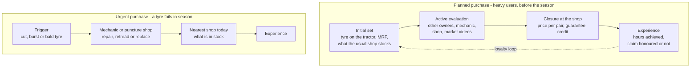

# M04. The customer: who buys by value, how the decision runs, and where Apollo drops out

Prepared 6 November 2026. Part of the McKinsey-lens re-analysis of the Apollo Round 3 case.

**What this file is.** Our own analysis using a published McKinsey framework, the consumer decision journey (2009). It is not McKinsey's work. The framework was built on car, electronics and insurance buyers in cities; using it for tractor owners is our adaptation.

**Purpose.** To replace head-count segments with segments sized by tyre purchases, to map the purchase as a decision journey, and to show with public evidence where Apollo loses the owner.

**How to read this file.**

| Label | Meaning |
|---|---|
| [Verified fact] | Primary source read, or two independent sources |
| [Fact - single source] | One credible source |
| [Outside-in; not a survey] | Public comments, videos or search data. Self-selected, skewed to younger online users in the Hindi belt and Punjab, and partly paid or dealer-made. Never representative |
| [Computed] | Arithmetic on sourced figures |
| [Interpretation] / [Strategic hypothesis] | Our reading; a belief to test |

Detail and sources: `..\research_notes\N3_customer_and_brand.md`, `..\research_notes\N6_search_interest_google_trends.md`, `..\04_Farmer_Consumer_Behaviour.md`. Register: `..\17_Source_Register_and_Verification.md`.

---

## 1. The answer in six lines

1. **Tyre purchases are concentrated.** In the one survey with enough detail, about four owners in ten account for about two-thirds of tractor hours. [Computed from a single survey]
2. **The first replacement is where a brand is actually chosen.** Only 38% of owners chose the tyre brand on their new tractor. [Verified fact: J.D. Power 2018]
3. **Apollo is fitted at the factory and then drops out.** It holds about 14% of tractor-tyre searches against MRF's 47%, was not among the three brands with published satisfaction scores, and has about 9% of replacement sales. [Outside-in; Verified fact; Computed]
4. **Owners argue about two things: how long the tyre lasted, and whether the warranty claim was honoured.** Brand slogans do not feature. [Outside-in; not a survey]
5. **The shop frames the choice.** Loyalty in the comments is to a dealer more than to a brand, and market channels sell rear tyres by the pair with a guarantee. [Outside-in; not a survey]
6. **A large price tier sits below the brands:** new pairs at half the branded price, retreads and second-hand tyres. Small owners of second-hand tractors live there. It is not Apollo's fight. [Outside-in; Interpretation]

---

## 2. Who buys by value

### 2.1 The evidence

| Finding | Detail | Label |
|---|---|---|
| Hours rise steeply with farm size | Punjab cotton belt (Mansa, Bathinda, Sri Muktsar Sahib, Fazilka), 520 households, 2016-17: marginal 73 hours a year, small 212, semi-medium 352, medium 646, large 977 | [Fact - single source] |
| Medium and large farms carry most of the hours | Medium 47%, large 17%: together 64% of tractor hours, from 39% of owners. The paper's totals do not fully reconcile, so treat as indicative | [Computed] |
| Commercial use is a minority there | 18% of tractor owners hire out or haul | [Fact - single source] |
| Small owners buy used tractors | 64% of tractors were bought second-hand: nearly all on marginal and small farms, 33% on medium, 7% on large | [Fact - single source] |
| Elsewhere, hiring out is much higher | Hired-out share of hours: Sirsa 59%, Ahmednagar 64%, Mahakoshal 34% (small, older district studies) | [Fact - single source each] |
| Western Uttar Pradesh | Up to 549 hours a year; 71 to 79% on the owner's own farm (Aligarh, Hathras, Etah) | [Fact - single source] |
| National split by use | Agriculture 70 to 75% of tractor demand; the remainder is construction-related | [Fact - single source: CRISIL Ratings, April 2025] |
| Non-farm use wears tyres faster | 6.5 more tyre-wear problems per 100 tractors | [Fact - single source: J.D. Power 2017] |
| Satisfaction is lowest on hilly land and on smaller tractors | 810 on sloped land against 836 on flat; tractors above 50 hp score 35 points higher than 31 to 40 hp | [Verified fact: J.D. Power 2018] |

Source for the Punjab survey: [Mandeep Kaur, Journal of National Development, 2024](https://jndmeerut.org/wp-content/uploads/2025/01/16.pdf). No national figure exists for tyre purchases by type of owner. Data unavailable – requires primary research or company confirmation.

### 2.2 Segments sized by tyre purchases

Sizes are indicative, from the Punjab survey and the national averages in `M02_Value_at_Stake.md`. They differ by region and must be re-measured in the baseline survey. [Interpretation on single-survey evidence]

| Segment | Who | Share of owners | Share of tyre purchases | How they buy | Priority |
|---|---|---|---|---|---|
| **A. Heavy users** | Medium and large farms; owners who hire out and haul. About 600 to 1,000 hours a year | About 4 in 10 | About two-thirds | Planned, before the season; in pairs; compare brands; count hours | **1** |
| **B. Light users with a first-hand tractor** | Semi-medium farms. About 350 hours a year | About 3 in 10 | About a quarter | Once in many years, often when a tyre fails; lean on the shop and the mechanic | **2** |
| **C. Small owners of second-hand tractors** | Marginal and small farms. Under 250 hours a year | About 3 in 10 | About a tenth | On price: market-channel pairs, retreads, second-hand | Not targeted |
| **D. New-tractor buyers** | About 11 lakh a year | – | None for years | Tyres come with the tractor; six in ten do not choose them | Through tractor makers and dealers |
| **E. Fleets** | Hiring centres, contractors | Small | Small, rising | On cost and service | Key accounts |

What changes from the first analysis:

- The first analysis put "owners who rent out and haul" first everywhere. In the Punjab belt the heavy user is mostly a medium or large farmer on his own land; in Uttar Pradesh he is more often a small owner who hires out. **The first-priority segment is the heavy user, whoever he is locally.**
- Small owners of second-hand tractors are a distinct group, about three owners in ten in the Punjab sample, who inherit whatever tyres came with the tractor and replace on price. They were not separated before.

---

## 3. The decision journey

McKinsey's 2009 study replaced the funnel with a loop of four phases. Two of its findings matter here [Verified fact: primary article read; `..\research_notes\N7_mckinsey_primary_sources.md`]:

- Brands in the buyer's initial consideration set can be up to three times more likely to be bought than brands outside it.
- During active evaluation, two-thirds of the touch points are driven by the buyer and the people around him (word of mouth, in-store conversations, past experience), not by the company.

A tractor tyre is bought in two different ways. No study measures how often each occurs. Data unavailable – requires primary research or company confirmation.

| Phase | Planned purchase | Urgent purchase | What decides it | Apollo today |
|---|---|---|---|---|
| Initial consideration | Two or three brands: the one on the tractor, the one neighbours praise, the one the shop pushes | Collapses to what is nearby | Familiarity from use, not from advertising | On the tractor at the factory for many owners; rarely the one praised |
| Active evaluation | Asks owners and the mechanic; watches market videos; compares price per pair | A few minutes with the mechanic | Buyer-driven touch points | No mechanic programme; little reasoned praise online |
| Closure | At the usual shop, on pair price, guarantee years and credit | At the nearest shop with stock | The dealer | About 6,500 dealerships of all kinds; farm stock uncounted |
| Post-purchase | Counts hours and years; tests the warranty if it fails | Same | Tyre life; whether the claim is paid | Seven-year warranty on defects; no record of the buyer |
| Loyalty loop | Buys the same again if it lasted and the claim was honoured | – | Experience | Unknown |

---

## 4. Where Apollo drops out

A funnel is still the right tool for comparing a brand's strength at each stage (the 2009 article says so). No survey gives the stages for tractor tyres, so each row uses the best public proxy.

| Stage | Proxy | Apollo | Leader | Label |
|---|---|---|---|---|
| On the tractor at the factory | Mix of Apollo's farm sales | About three-quarters of Apollo's farm sales are to tractor makers and export | Goodyear supplies six tractor makers | [Unverified as to scope]; [Fact - single source] |
| In mind when a tyre is needed | Share of searches for a brand's tractor tyre, eight states, last 14 months | About 14% | MRF about 47%; BKT about 20% | [Outside-in] |
| Rated well by owners | J.D. Power 2018, 3,768 owners | Not among the three published scores | MRF 848; CEAT 830; Goodyear 828 | [Verified fact] |
| Praised with reasons | 131 coded brand comments under 30 videos | 19 positive, of which 13 give no reason; 5 negative | Goodyear 29 positive, MRF 20, with tyre life the commonest reason | [Outside-in; not a survey] |
| Bought at replacement | Apollo's replacement sales against the market | About 9% | Not published | [Computed] |
| Bought again | – | Data unavailable – requires primary research or company confirmation. | – | – |

**Reading.** Apollo is present at the start and absent in the middle. It is fitted, then not sought, not vouched for and not bought. The break is between the factory and the first replacement. [Interpretation]

**Has the jersey changed this?** Not visibly. Apollo's share of tractor-tyre searches across eight states was 14.0% in the year before the sponsorship and 14.8% in the fourteen months after (`..\research_notes\N6_search_interest_google_trends.md`). Search is a proxy and skews young and online, so this is evidence against a strong effect, not proof of none. [Outside-in; Interpretation]

---

## 5. What owners, dealers and mechanics say

Thirty high-view Hindi and Punjabi videos on choosing tractor tyres were opened on 6 November 2026 and their top comments read: 486 in all, of which 131 evaluate a brand. One researcher coded them, with no second coder. [Outside-in; not a survey]

### 5.1 What the talk is about

| Theme | Evidence |
|---|---|
| Price and where to buy | About 23% of all comments ask a price or a location |
| Pairs | The most-viewed market videos price rear tyres by the pair; commenters ask for pair prices |
| Tyre life | The commonest reason given for praising or rejecting a brand, stated in hours or years |
| Whether the claim was honoured | "The dealer refused the claim" recurs across MRF, JK, BKT and Apollo |
| Warranty years as a selling point | Dealer videos lead with six or seven years |
| One tyre for field and road | A commenter asking for a tyre that works everywhere drew 141 likes |
| The shop | Under dealer-interview videos, commenters say their whole area buys from that shop |
| Suspicion of paid content | Five comments call a video an advertisement |

### 5.2 Brand by theme

| Brand | Positive | Negative | Reasons given for | Reasons given against |
|---|---|---|---|---|
| Goodyear | 29 | 7 | Life, grip, road use | Wear, price |
| MRF | 20 | 7 | Life | Claims refused, cracks |
| Apollo | 19 | 5 | Life (3), looks (2); 13 give none | Cracks, lug damage with a refused claim |
| BKT | 16 | 2 | Heavy duty, radial | Claims refused |
| CEAT | 6 | 12 | Life | Cuts, cracks, early failure |
| JK | 2 | 5 | – | Claims not heard |

Selection effects are strong: CEAT's complaints cluster under a CEAT-linked video, and JK's praise comes from JK's own advertisement.

### 5.3 The price tier below the brands

| Evidence | Views |
|---|---|
| A market channel offering a new rear pair for Rs 16,000 with a guarantee | About 6 lakh |
| The same channel, a new pair for Rs 22,000 | About 2.9 lakh |
| Second-hand tyres "from Rs 700" | About 16 lakh |
| New tractor tyres sold by weight in Hoshiarpur | About 1.3 lakh |

A branded rear pair costs Rs 32,000 to 35,000. Retreads are quoted at Rs 6,000 to 8,500 a tyre, and GST on retreaded tractor tyres fell to 5% on 1 November 2026 (`M05_How_to_Win.md`).

### 5.4 What the formal studies add

From J.D. Power's 2018 tyre study [Verified fact]:

- Durability is the most important of four factors, and the one owners rate lowest.
- 42% of owners received only a one-year tyre warranty. Satisfaction was highest where the warranty ran three years or more.
- Owners who report uneven wear seldom intend to buy that brand again (18%) or recommend it (22%).
- Owners under 35 are harder to please and cross-shop more (J.D. Power's 2018 tractor study).

---

## 6. What this means for how to win

| Finding | Implication | Label |
|---|---|---|
| Purchases are concentrated in heavy users | Aim proof, the guarantee and the mechanic at owners above about 600 hours a year | [Interpretation] |
| Apollo is fitted, then lost | The cheapest customers to win are owners of tractors that left the factory on Apollo tyres. Apollo knows which models those are | [Strategic hypothesis] |
| The talk is about tyre life and honoured claims | The offer should be a promise about hours that is paid without argument, not a slogan | [Strategic hypothesis] |
| The shop frames the choice | The dealer has to gain from recommending Apollo, and has to be able to settle a claim on the spot | [Interpretation] |
| Owners want one tyre for field and road | Lead with Virat, which Apollo describes as built for farm and haulage | [Interpretation] |
| A cheap tier exists | Do not chase it. Compete on cost per hour, with credit to spread the price | [Interpretation] |
| The jersey has not moved search | Use cricket where it can act on the middle of the journey: as a reward and a gathering, not as a logo | [Strategic hypothesis] |

---

## 7. What still has to be asked directly

A consulting team would run 20 to 30 interviews and a survey in its first weeks. Desk research cannot answer these:

| Question | Who to ask |
|---|---|
| What share of purchases are planned, and what share follow a failure? | 600 owners per belt |
| Do owners of Apollo-fitted tractors replace with Apollo? If not, why? | Owners of tractors three to eight years old |
| Who names the brand at the shop: owner, mechanic or dealer? | Owners, mechanics, dealers |
| What does a dealer earn on each brand, and what would change his recommendation? | 40 dealers |
| How many hours do tyres last, by brand and use? | Owners with hour meters; mechanics |
| Do owners know who sponsors the India team, and what that company makes? | Owners |

The questionnaire in `..\04_Farmer_Consumer_Behaviour.md`, section 9, covers most of these; the second and fifth are new.
