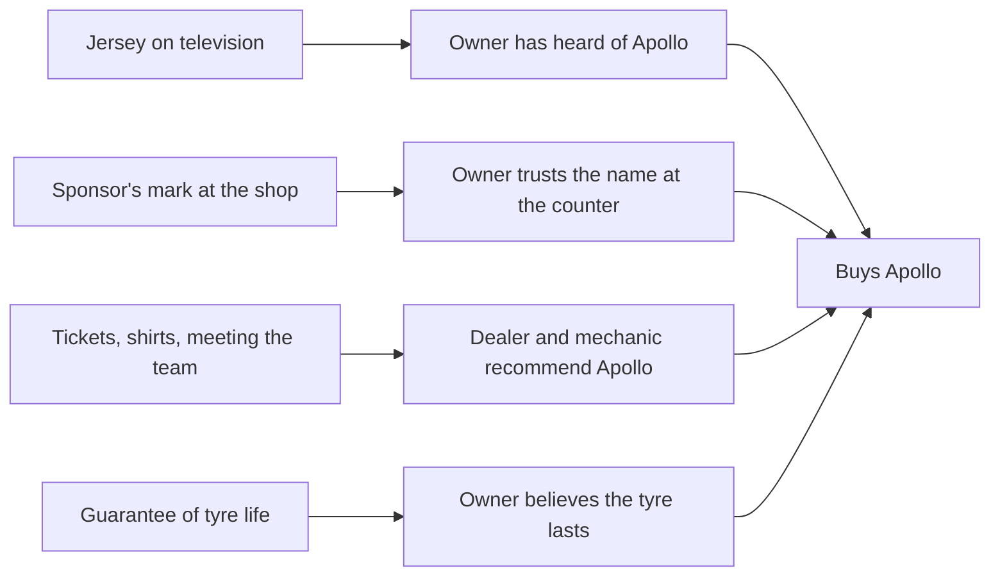

# M06. The sponsorship

Prepared 6 November 2026. Part of the McKinsey-lens re-analysis of the Apollo Round 3 case.

**What this file is.** Our own analysis. It applies the five measures in McKinsey's published article "Is sports sponsorship worth it?" (2014) to Apollo's Team India sponsorship, for the farm business only. It is not McKinsey's work.

**Purpose.** To say what the jersey is worth to the farm business, what it has done so far, which cricket activities to back, build or drop, and what Apollo needs to know before the sponsorship ends in March 2028.

**How to read this file.**

| Label | Meaning |
|---|---|
| [Verified fact] | Primary source read, or two independent sources |
| [Fact - single source] | One credible source |
| [Reported by press] | Press figure the parties have not confirmed |
| [Outside-in; not a survey] | Our own count from public data |
| [Computed] | Arithmetic on sourced figures |
| [Planning assumption] | A working choice |
| [Interpretation] | Our reading |

Asset detail: `..\02_Cricket_Assets_and_Sponsorships.md`. Notes: `..\research_notes\N3_customer_and_brand.md`, `N5_analogues_sponsorship_response.md`, `N6_search_interest_google_trends.md`, `N7_mckinsey_primary_sources.md`. Fact-check: `..\research_notes\P_factcheck_round4.md`.

---

## 1. The answer in six lines

1. **For farm, the jersey is a sunk cost of about Rs 14 crore a year with no farm activation behind it.** [Computed; Interpretation]
2. **Fourteen months in, it has not visibly moved tractor-tyre demand.** Apollo's share of tractor-tyre searches among five brands went from 14.0% to 14.8%. MRF stayed at 47%. [Outside-in; not a survey]
3. **Cricket already belongs to other tyre brands.** MRF has the bats of India's leading batters, CEAT its ratings and the IPL time-out, BKT eight IPL teams. The jersey alone will not make Apollo "the cricket tyre". [Verified fact; Interpretation]
4. **What the jersey gives that rivals cannot buy is standing and rewards:** the right to say "Team India's sponsor" at the counter, and tickets, meetings with players and team shirts. Apollo has already used these for buyers of car and motorcycle tyres. [Fact - single source]
5. **So back the cheap uses, test the middle ones and drop the costly ones.** Back the sponsor's mark at the shop and rewards for dealers and mechanics. Test match days at dealers and support for existing village tournaments. Drop farm advertising on television, player appearances and new tournaments built from nothing. [Strategic hypothesis]
6. **Measure it, so that the 2028 renewal is decided on evidence.** No study of any Team India jersey sponsor's recall has been published. Apollo can be the first to know. [Verified fact that none was found]

---

## 2. A sponsorship strategy for farm

The article's first step is to state what the sponsorship is for. For farm:

| Question | Answer |
|---|---|
| Objective | Win the tractor owner's replacement purchase (`M02_Value_at_Stake.md`) |
| Target group | About 8.5 million working tractors; within them the four in ten owners who make two-thirds of purchases (`M04_Customer.md`); and the dealers and mechanics who advise them |
| Stage of the decision journey | Two stages. Initial consideration: is Apollo a name the owner thinks of? Closure: does the dealer or mechanic say "take the Apollo"? |
| What it is not for | Explaining tyre life. That is the guarantee's job (`M05_How_to_Win.md`) |

---

## 3. The five measures, applied to farm

| # | Measure | What can be said today | What is missing | How Apollo measures it |
|---|---|---|---|---|
| 1 | Cost per person reached, in the target group | Farm's share of the fee is about Rs 14 crore a year: about Rs 16 for each working tractor. If only owners who watch television weekly count, Rs 30 to 40 each [Computed on a proxy] | Any measured reach among tractor owners. Data unavailable – requires primary research or company confirmation. | Two questions in the owner survey: watched an India match in the last month; where |
| 2 | Unaided awareness per person reached | Search share flat at 14 to 15%. No farm activation found | Unaided first mention of Apollo for tractor tyres | Owner survey, three waves (`M08_Delivery.md`) |
| 3 | Sales per rupee | Not known. Apollo reports strong farm replacement growth in the second half of FY26, but a tax cut and a demand recovery fell in the same months | Sales in areas with and without cricket activity | The test's fourth arm (`M08_Delivery.md`) |
| 4 | Long-term brand attributes | The jersey says large, national, trusted. Owners buy on tyre life | Whether "Team India's sponsor" raises belief that the tyre lasts | Attribute questions in the survey |
| 5 | Indirect benefits | Three-quarters of Apollo's farm sales go to tractor makers and exports. Hosting tractor makers and large dealers at Tests is a direct use | A count of who is hosted and what follows | A register of guests and their business |

### The fee and farm's share

| Item | Figure | Label |
|---|---|---|
| Reported fee | Rs 579 crore, September 2025 to March 2028 | [Reported by press] |
| Per year | About Rs 230 crore | [Computed] |
| Farm's share at 6% of Indian revenue | About Rs 14 crore a year | [Computed; Planning assumption on the allocation] |
| Contribution from one point of replacement share | About Rs 10 crore a year | `M02_Value_at_Stake.md` |

The fee is committed whatever farm does. The decision for farm is how much to spend on using it.

### Activation

The article reports that sponsors spent USD 0.50 to 1.60 on activation for each dollar of rights, and that shifting money from rights to activation raised awareness. [Verified fact: primary source read; United States, 2011 data]

- At that range, farm's Rs 14 crore of rights would carry Rs 7 to 22 crore a year of activation. [Computed]
- Farm activation found today: none. The cricket film has no tractor in it, and Apollo's cricket offer of 2025-26 was for car and motorcycle tyres (section 6). [Verified fact that none was found]
- The programme in `M07_Economics.md` costs about Rs 8 crore in FY28 and Rs 8 to 15 crore in FY29. That sits at the low end of the range.

---

## 4. Has the jersey moved anything?

We counted Google searches for each brand's tractor tyres in eight states, for a year before the sponsorship and fourteen months after it. Each figure is the brand's share of the five brands' searches. [Outside-in; not a survey]

| Brand | Before (1 Sep 2024 to 15 Sep 2025) | After (16 Sep 2025 to 5 Nov 2026) | Change |
|---|---|---|---|
| MRF | 47.3% | 47.3% | 0.0 |
| BKT | 19.5% | 19.6% | +0.1 |
| **Apollo** | **14.0%** | **14.8%** | **+0.8** |
| CEAT | 8.9% | 10.8% | +1.9 |
| Goodyear | 10.4% | 7.6% | -2.8 |

By state, Apollo rose in Haryana (10 to 15), Madhya Pradesh (14 to 17) and Bihar (14 to 18), fell in Maharashtra (18 to 14), and barely moved in Uttar Pradesh (14 to 13) and Punjab (9 to 8).

What it shows and does not show:

- **Apollo's gain is under one point, and CEAT gained more without a jersey.** No jersey effect is visible in farm. [Interpretation]
- **MRF is searched three times as often as Apollo.** That is the gap in the owner's first thought. [Computed]
- Search counts only owners who use the internet, state figures are small samples, and searches are not sales. It is a signal, not a measurement.

---

## 5. Whose cricket is it?

| Brand | Cricket asset | Since | Label |
|---|---|---|---|
| MRF | Bat sponsorship of leading India batters: Tendulkar for over a decade, Kohli since 2014, Gill from March 2025 (he moved from CEAT). A pace-bowling academy | Academy founded 1987 | [Verified fact: three sources] |
| CEAT | Cricket ratings and awards; the IPL strategic time-out | 1995; appointed 2015, renewed 2018 (current status not checked) | [Verified fact: two sources] |
| BKT | Tyre partner of eight of ten IPL teams in 2026 | 2020 | [Verified fact] |
| JK Tyre | None found | – | – |
| Apollo | Lead sponsor of Team India | September 2025 | [Verified fact] |

Evidence on recall:

- Among IPL viewers in 2025, tyre brands were the second most recalled category: about one viewer in three recalled one. The report gives no sample size. [Fact - single source]
- In a 2026 study of IPL sponsors, viewers linked sponsors to the wrong team between 8% and 17% of the time. [Fact - single source]
- No recall study of any Team India jersey sponsor, past or present, was found. Data unavailable – requires primary research or company confirmation.

What follows [Interpretation]:

- A tractor owner who watches cricket has seen tyre brands in it for thirty years. A new tyre logo on the shirt may be credited to a rival.
- MRF's asset is on the bat in every innings, at the moment of attention. Apollo's is on the chest of eleven players.
- The answer is to attach the name where it cannot be confused: on the dealer's board, the guarantee card and the tyre label. "Team India's sponsor" has to be read next to the word Apollo at the counter.

---

## 6. What rights Apollo has shown it can use

The contract is not public. One Apollo promotion shows what the rights allow in practice. [Fact - single source: Apollo's terms page, read through a summarising tool]

| Item | Apollo's "Champions offer" |
|---|---|
| Period | 7 December 2025 to 31 March 2026 |
| Who qualified | Buyers of at least one motorcycle tyre or four car tyres from an authorised distributor |
| Rewards | Tickets to India's home matches; meeting the players, or a Team India fan shirt; air tickets for those meeting the team |
| How winners were chosen | A skill question, fastest correct answer; the first two entries per match won; winners had to live in the match state |
| Where it did not apply | Tamil Nadu |
| Farm, tractor and truck tyres | Not mentioned |

What this tells us:

- **Tickets, player meetings and team shirts can be used as rewards.** The first analysis treated this as unconfirmed.
- **Farm was left out.** The sponsorship has been activated for the city buyer.
- **A skill contest with two winners a match is a poor fit for a tractor owner.** For farm the rewards belong with the few people who influence many sales: dealers and mechanics.
- What earlier jersey sponsors received (Sahara, Star, Oppo, Byju's, Dream11) has not been published, and no result of any of them was found. [Verified fact that none was found]

Still to confirm with Apollo's legal team: the number of tickets and shirts available, use of the team's marks on shop boards and tyre labels, and whether match screenings at dealers need the broadcaster's permission. Data unavailable – requires primary research or company confirmation.

---

## 7. Scorecard: what to back, test and drop

Scores are our judgement on the evidence above: High, Medium, Low, or Unknown. [Interpretation]

| Activity | Reach among owners | Awareness per reach | Link to sales | Fit with "lasts long" | Indirect benefit | Cost | Verdict |
|---|---|---|---|---|---|---|---|
| Logo on the shirt, on television | Medium; weakest in Uttar Pradesh, Madhya Pradesh and Rajasthan | Unknown; search flat | Low | Low | – | Sunk | Keep; add no farm media |
| "Team India's sponsor" on dealer boards, guarantee cards and tyre labels | Every buyer at the counter | High | High: at the point of decision | Medium: adds trust to the guarantee | – | Low, one-time | **Back** |
| Tickets, team shirts and player meetings for dealers and mechanics | The advisers, not the owners | – | High, if tied to registered sales | – | High | Low to medium | **Back** |
| Hosting tractor makers and large dealers at home Tests | Few, high value | – | Medium: fitment and first replacement | – | High | Low | **Back** |
| Short videos in Hindi and Punjabi on tyre life, with the sponsor's mark | Medium to high among owners online (59 to 78% of men in these states have used the internet) | Medium | Medium | High | – | Low | **Back** |
| Match days at dealers during India's matches | Local | Medium | Unknown | Low | Medium | Low | **Test** |
| Support for existing village tournaments | Local, seasonal | Medium | Unknown | Low | Medium | Medium | **Test** |
| New tournaments built by Apollo, with finals days | Local | Medium | Unknown | Low | Medium | High | Drop |
| A farm film on television during cricket | Medium | Unknown | Low | Medium | – | High; broadcast slots are not part of the rights | Drop |
| Player or ex-player appearances for farm | Small | High for those present | Low | Low | Medium | High | Drop |
| IPL team deals | High | Low: rivals crowd it | Low | Low | – | High | Drop |

The first analysis budgeted Rs 232 lakh for the cricket layer in 20 tehsils, of which finals days, a guest cricketer and content took more than half. The re-analysis keeps the cheap items and tests a slimmer layer costing about Rs 1.2 lakh a tehsil (`M07_Economics.md`).

---

## 8. The calendar

| Window | Cricket | Farm calendar | Use |
|---|---|---|---|
| 21 January to 3 March 2027 | Five home Tests against Australia | Wheat standing; harvest and buying follow in April to June | Launch the test; match days at dealers; rewards announced |
| 10 March to 15 May 2027 | IPL (not Apollo's; India not playing) | Wheat harvest | No cricket activity. The first analysis placed its cricket test here |
| 2 October to 21 November 2027 | Men's ODI World Cup in southern Africa; afternoon and evening viewing in India | Paddy and cotton harvest; buying season | Second window. Use Team India's marks only: World Cup marks belong to the ICC and its partners |
| Early 2028 | England Tests in India (reported as confirmed; the full calendar is not final) | Wheat standing | Last home window before the sponsorship ends |

[Verified fact for the Australia Tests; Fact - single source for the World Cup and England; Forecast for the IPL]

---

## 9. The renewal in 2028

The sponsorship ends in March 2028. Apollo will decide on renewal during 2027-28.

| What Apollo should know by January 2028 | Where it comes from |
|---|---|
| Unaided first mention of Apollo among tractor owners, with and without cricket activity | Owner survey, three waves |
| Whether cricket activity added sales beyond the offer and the field programme | The test's fourth arm |
| Whether owners credit the jersey to Apollo or to a rival | One survey question |
| What dealers and mechanics did for the rewards | Registered sales by rewarded and unrewarded advisers |

What to ask for if Apollo renews [Strategic hypothesis]:

- A stated allocation of tickets and team shirts for trade partners in rural districts.
- Use of the team's marks at the point of sale and on the product.
- Content in regional languages.
- The right to back local tournaments under the Team India association.

A fair test for farm: the farm business should count the jersey as worth its Rs 14 crore share only if cricket activity is shown to add about two points of replacement share beyond what the offer and the trade programme deliver (Rs 14 crore against Rs 7.4 crore of net contribution a point, `M07_Economics.md`). Otherwise the jersey is a car and truck tyre asset from which farm borrows a trust mark at no cost. [Computed; Interpretation]

---

## 10. What has to be true

| Belief | How it is checked |
|---|---|
| Owners read "Team India's sponsor" as a reason to trust the tyre | Attribute questions; guaranteed-tyre sales with and without the mark |
| A ticket or a team shirt moves a dealer or mechanic more than the same money in cash | Split the reward within the cricket arm: half are offered cash of equal value |
| Match days bring owners into the shop in the buying season | Footfall and registrations on match days against other days |
| The rights allow all of this | Contract review in November 2026 |
