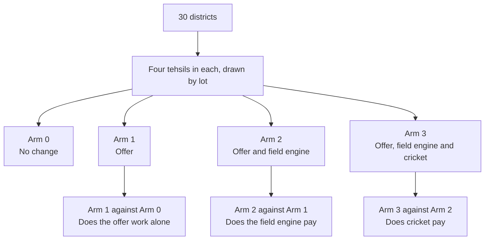
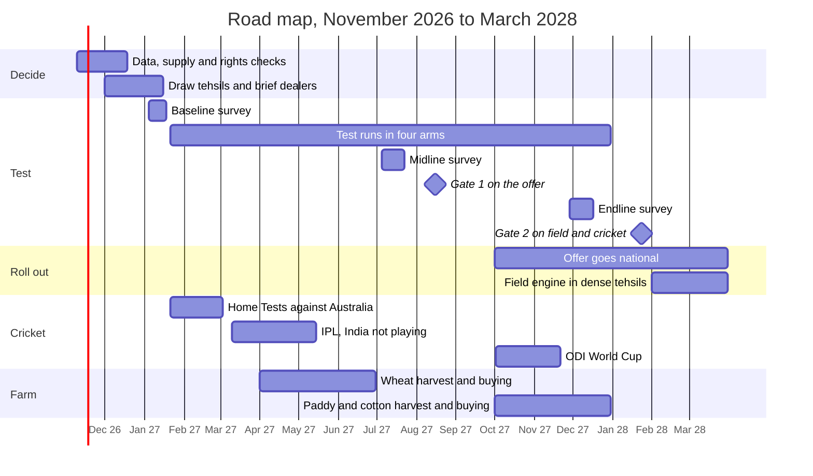

# M08. Delivery

Prepared 6 November 2026. Part of the McKinsey-lens re-analysis of the Apollo Round 3 case.

**What this file is.** Our own analysis of how the programme would be run: the supply decision, a redesigned test, the gates, who owns what, the first 100 days and rivals' likely responses. It is laid out as a strategy consulting team would lay out an implementation plan. It is not McKinsey's work.

**Purpose.** To let management start on Monday, and to make sure the test can actually answer the questions that money depends on.

**How to read this file.** The design, dates, thresholds and owners are [Planning assumption] unless labelled otherwise. Cricket dates are from `..\02_Cricket_Assets_and_Sponsorships.md`. Costs are in `M07_Economics.md`. The measurement method of `..\14_KPI_and_Impact_Measurement.md` is kept; the design and the gates below replace its sections 3 and 6.

---

## 1. The answer in six lines

1. **Settle supply before anything else.** The test needs about 300 tonnes of tyres and FY29 about 3,600. Both are small, but farm tyres are short today.
2. **Roll out the offer on the strength of the test; do not make the strategy wait for it.** The diagnosis and the offer stand on evidence already in hand. The test decides how much field and cricket spending to add.
3. **Test four things, not three.** Nothing; the offer alone; the offer with a field team; and all of that with cricket. The first analysis could not tell whether the offer worked without a field team.
4. **Test what will be rolled out.** Each tehsil gets the roll-out version at roll-out cost. The first pilot spent three times as much per tehsil as the roll-out would.
5. **Time it to India's matches.** Launch on 21 January 2027, the first day of the home Tests against Australia. The first plan tested cricket in April and May, when India was not playing.
6. **Set each gate at the higher of two numbers: what the layer must earn to pay for itself, and what the test can detect.** The first gates were below both.

---

## 2. The supply decision

| Need | Tyres | Tonnes (at about 37 kg a tyre) | When |
|---|---|---|---|
| The test: about 90 tehsils gaining four points | About 8,000 | About 300 | February to December 2027 |
| Base case, FY29: 2.5 points nationally | About 97,000 | About 3,600 | April 2028 to March 2029 |
| Aspiration, FY30: six points | About 250,000 | About 9,300 | FY30 |

[Computed], `M02_Value_at_Stake.md` and `M07_Economics.md`. The tyre weight is from one retailer listing.

| Option | For | Against | Use |
|---|---|---|---|
| Give replacement dealers in the test and priority districts first call on farm tyres when they are short | Immediate; no capital | Other channels wait | **Now**, for the test |
| Use the farm production moving from the Dutch plant to India | Already planned | Timing and sizes not public | **FY28**, if the sizes fit |
| Outsource entry tyres not covered by the guarantee | Fast; Apollo already buys in motorcycle tyres | Lower margin: at 20% contribution the base case loses Rs 2 crore in FY29; quality risk | Only for tyres outside the guarantee |
| Small debottlenecking of the existing farm lines: moulds and curing | Keeps margin and quality | Cost not public. Data unavailable – requires primary research or company confirmation. | Decide at Gate 1 |
| A new farm line | – | Rs 430 to 790 crore for Rs 60 to 110 crore of contribution a year | **No** |

**Rule:** no tyre goes under the guarantee unless Apollo made it and holds its wear data.

---

## 3. The test

### 3.1 Design

| Element | Design | What it fixes |
|---|---|---|
| Areas | 30 districts in three belts (`M03_Where_to_Play.md`). In each district, four tehsils, one for each arm, drawn by lot. Districts with only three tehsils take three arms in rotation. About 116 tehsils, about 29 in each arm | The first test used nearly every tehsil in 12 districts, next to its own control |
| Arm 0 | Nothing new | |
| Arm 1 | The offer: guarantee, sponsor's mark at the shop, dealer and mechanic rewards, credit, registration | The first test had no such arm |
| Arm 2 | The offer and the field engine | |
| Arm 3 | The offer, the field engine and the cricket layer | |
| Dose | The roll-out version at roll-out cost: Rs 1.31 lakh a tehsil for the engine, Rs 1.2 lakh for cricket | The first pilot spent about Rs 16 lakh a tehsil against Rs 5.4 lakh at scale |
| Size of tehsil | 5,000 or more working tractors where known | |
| Spillover | Main market towns at least 25 km apart where possible. Survey villages within 10 km of the town, away from another arm's boundary. Every registration records the buyer's village, so cross-buying is counted, not assumed | |
| Timing | Launch 21 January 2027. Two buying seasons: April to June and October to December 2027 | Cricket was tested when India was not playing |
| Tyre life | Not demonstrated in the field. Covered by the guarantee, and by a two-year trial with an agricultural university | A few hundred hours could not show a 2,000-hour life |

Why one tehsil per arm in each district: every arm then faces the same monsoon, prices and crops, so differences between districts cancel out.

### 3.2 What is measured

| Measure | Source | Use |
|---|---|---|
| **Apollo's farm replacement sales in the tehsil** (primary) | Apollo's billing to dealers, monthly, with 24 months of history; checked against registered sales | The gates |
| Apollo's share of the local market at the start | Audit of multi-brand dealers; brand of last purchase in the owner survey | Turns a rise in sales into points of share |
| Unaided first mention of Apollo; belief that it lasts as long as MRF; who is credited with the jersey | Owner survey: 40 owners a tehsil, three waves (January, July, December 2027) | Explains the result; `M06_Sponsorship.md` |
| What dealers and mechanics recommend | Mystery visits; mechanic survey | Explains the result |
| Guarantee claims, by dealer and use | Claims system | Gate 1 |
| Share of tractors at health camps on Apollo tyres, and whether they were factory-fitted | Camp register | First-replacement programme |

### 3.3 What the test can detect

[Computed on planning assumptions; to be re-run on Apollo's billing data before launch.]

| Measure | Assumption | Smallest difference the test can detect |
|---|---|---|
| Sales | 29 tehsils an arm, paired within districts. Year-on-year change in a tehsil's Apollo sales varies with a standard deviation of 25% | An 18% difference in sales: about 1.6 points of share from a 9% start |
| Sales, if variation is 40% | Same | 29%: about 2.6 points |
| First mention | 1,160 owners an arm; design effect 2.95 at an intra-cluster correlation of 0.05 | About 7 points from a 15% start; about 9 from a 30% start |

If Apollo's data shows more variation than 40%, tehsils are added before launch.

### 3.4 Gates

Each threshold is the higher of the layer's full-cost break-even (`M07_Economics.md`) and what the test can detect.

| Gate | When | Comparison | Break-even | Detectable | **Threshold** | If met | If not |
|---|---|---|---|---|---|---|---|
| 1. The offer | August 2027, on February to June sales | Arm 1 against Arm 0 | 1.0 point | 1.6 points | **2 points** (about 22% of starting sales), claims within the 2% reserve, supply confirmed | Launch the offer nationally in October 2027 | Between 1 and 2: keep it in the 30 districts through the second season. Below 1: stop and redesign |
| 2a. The field engine | January 2028, on February to December sales | Arm 2 against Arm 1 | 4.7 points | 1.6 to 2.6 | **5 points** (about 55% of starting sales) | Fund 200 dense tehsils in FY29 | Keep the per-tyre rewards; no field team unless Apollo's rural sales organisation carries it with other tyre categories |
| 2b. The cricket layer | January 2028 | Arm 3 against Arm 2 | 3.0 points | 1.6 to 2.6 | **3 points** (about 33% of starting sales) | Fund it in field tehsils | Keep only the sponsor's mark and trade rewards, which are in the offer |

Against the first analysis:

| | First gates | These gates |
|---|---|---|
| Engine | 2.3 points; full-cost break-even was 4.0 | 5 points; break-even 4.7 |
| Cricket | 4 points for both layers; full-cost break-even was 6.8 | 3 points for cricket alone; break-even 3.0 |
| Recall | An 8-point target; the survey could detect 10 to 13 | Recall explains; it is not a gate. The survey detects about 7 |

Other rules:

- **Pull-forward check.** If sales in a treated tehsil fall below the comparison tehsil in the three months after a season, the season's gain is reduced by that fall.
- **Claims.** If claims exceed 4% of covered sales in any month, new guarantees pause until the cause is found.
- **Independent review.** The read-out is checked by someone outside the programme team before each gate.

---

## 4. Road map

The sponsorship ends in March 2028. Both gates fall before it, so the renewal can use the results.

---

## 5. Six initiatives

| # | Initiative | Owner (role) | Outcome measure | By 21 January 2027 | By August 2027 |
|---|---|---|---|---|---|
| 1 | Guarantee and offer | Head of farm product and marketing | Guaranteed tyres sold; claims rate | Hours figure set from Apollo's wear data; terms, claims process and dealer authority limits written; finance partner signed | Claims within 2%; credit taken on three purchases in ten |
| 2 | First replacement | Key-account head for tractor makers, with rural sales | Share of Apollo-fitted tractors that replace with Apollo | List of models and years fitted with Apollo; one tractor maker's dealers in ten districts sharing service records | Baseline retention known; returning-owner offer live |
| 3 | Dealers and mechanics | Head of rural sales | Extra rear tyres per dealer; active mechanics | Home-ground dealers named in about 58 tehsils; 11 mechanics enrolled in each; rewards paid to phones | Rewards paid within seven days; mystery visits show Apollo recommended |
| 4 | Sponsorship use | Head of brand and sponsorship | Tickets and shirts used; first mention | Contract checked; marks approved for boards and labels; ticket and shirt allocation for trade | Reward split tested: tickets and shirts against cash |
| 5 | Supply | Head of supply chain | Fill rate to test dealers | Test volume ring-fenced; sizes and tyres under the guarantee confirmed | FY29 volume committed |
| 6 | Test office | Strategy or insights head, with an independent reviewer | Read-outs on time | Tehsils drawn; baseline survey done; billing baseline built | Gate 1 paper |

A steering group meets weekly until launch and monthly after. One person owns each initiative.

---

## 6. The first 100 days

| Weeks | Dates | Work |
|---|---|---|
| 1 to 2 | 9 to 20 November 2026 | Pull Apollo's data: farm sales by channel and district, fitment by tractor maker, dealers stocking farm tyres, wear data, farm capacity. Read the sponsorship contract. This confirms or overturns the 25% and the 9% |
| 3 to 4 | 23 November to 4 December | Supply decision for the test. Set the guarantee's hours. Survey 40 dealers and 60 mechanics on margins, credit and rivals' schemes. Check tehsil lists against the official directory |
| 5 to 6 | 7 to 18 December | Draw tehsils by lot. Legal opinion on the guarantee, rewards and promotions law by state. Approvals for the team's marks. Choose the survey and finance partners. Build the registration and claims system |
| 7 to 8 | 21 December to 1 January | Brief dealers; enrol mechanics; print guarantee cards and boards; train coordinators |
| 9 to 10 | 4 to 18 January 2027 | Baseline survey. Billing baseline. Dry run of registration and claims in two tehsils |
| 11 | **21 January** | **Launch**, with the first Test against Australia at Nagpur |
| 12 to 14 | To mid-February | Match days at dealers in Arm 3; first health camps; weekly check of registrations and stock |

If launch slips, the cricket arm still has the later Tests (Ranchi from 19 February, Ahmedabad from 27 February). After 3 March 2027 no India home match has been announced.

---

## 7. How rivals may respond

No case of one tyre maker answering another's farm-tyre push was found, so this is judgement. [Interpretation]

| Rival | Position today | Likely move | Early sign | Apollo's answer |
|---|---|---|---|---|
| MRF | Searched three times as often as Apollo; top of the 2018 owner study; 6 to 10% dearer; six-year warranty | Dealer schemes where it loses sales. A matching hours guarantee is costliest for the brand with the most tyres in use | Scheme circulars; dealers' talk | Do not follow on price. Settle claims faster than anyone |
| CEAT | Seven-year warranty; IPL presence; search share rising | Stretch its warranty wording; more cricket | Advertising | Registration and settlement speed, which a warranty card does not give |
| BKT | Farm specialist; well reviewed online; eight IPL teams | Price and range | Portal prices | Hold the mixed-use tyre; push the radial only with trial evidence |
| Goodyear | Says it leads in farm; strong on new tractors; search share falling | Defend fitment | Tractor makers' sourcing | The first-replacement programme works Apollo's own fitted tractors, not theirs |
| Retreads and unbranded tyres | Half the price; GST on retreaded tractor tyres fell to 5% on 1 November 2026 | Gain in a weak farm year | Dealer audits | Do not chase. Credit on the entry tyre; aim at heavy users |

---

## 8. Risks

| Risk | Guard |
|---|---|
| Farm tyres are short and the test starves | Supply decision first; fill rate tracked weekly |
| The guarantee is abused: tampered hour meters, loose settlement | Photo at registration and at claim; a cap per dealer; quarry and mining use excluded; start in the test areas |
| The team's marks or match screenings are not allowed as planned | Contract and approvals in weeks 1 to 6; the offer works without them |
| World Cup marks used by mistake | Team India marks only; the tournament's marks belong to the ICC |
| Promotions law differs by state | Legal opinion; no draws of chance; rewards tied to registered sales |
| Owners' data | Consent at registration; data used only for the guarantee and follow-up |
| A weak farm year hides the effect | Every arm shares the same districts, so the comparison holds; absolute sales will still be low |
| Results read too early | Gate 1 uses one season and is checked for pull-forward; Gate 2 uses two |

---

## 9. What stays from the first analysis

- The five-link diagnosis, with the first link restated (`M10_What_Changed_and_Why.md`).
- The dealer with eleven mechanics, health camps and registration: now the field engine.
- Difference-in-differences on matched areas, with an independent review.
- No price cut, no television campaign for farm, no player endorsement.
