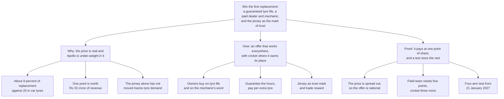

# M09. Storyline and ghost deck

Prepared 6 November 2026. Part of the McKinsey-lens re-analysis of the Apollo Round 3 case.

**What this file is.** Our own storyline, built answer-first with one message per slide, in the style strategy consulting firms are publicly known for. It is not McKinsey's work. It is a specification in Markdown; no slides have been made.

**Purpose.** To give the team a twelve-slide argument it can build from, with a title that states the finding on every slide and a description of the one exhibit that proves it.

**How to use it.** Read the twelve titles in order. They should make the whole case on their own. If the team adopts the re-analysis, this replaces the slide map in `..\16_Final_Strategic_Recommendation.md`; the slide count stays at twelve.

Every figure is from the file named in the "Source" column, with its label there. Figures marked * rest on planning assumptions and must be said so on the slide.

---

## 1. The argument on one page

**Governing thought.** Apollo's tractor tyres are fitted at the factory and lost at the first replacement. Apollo can win that replacement with a guaranteed tyre life and a paid dealer and mechanic, using the jersey as its mark of trust, for about Rs 11 crore to March 2028.

**Situation.** Apollo became Team India's lead sponsor in September 2025. Farm tyres are 6% of its Indian revenue, and management has named rural markets as a growth priority.

**Complication.** Fourteen months on, the jersey has not visibly moved tractor-tyre demand. Apollo holds about 9% of tractor-tyre replacement against about 20% in car tyres, cricket already belongs to three rival tyre brands, and farm tyres are in short supply.

**Resolution.** Stop asking cricket to sell the tyre. Sell tyre life with a guarantee, pay the people who advise the owner, and use the jersey for what only it gives: standing at the counter and rewards for the trade. Launch nationally on a test's evidence, and add field teams and cricket events only where they clear their own cost.

---

## 2. Twelve slides

| # | Action title | The one exhibit | Source | The "so what" |
|---|---|---|---|---|
| 1 | Apollo can add Rs 100 to 200 crore of farm tyre sales by winning the first replacement, with the jersey as its mark of trust | Summary: the governing thought, three supporting lines, the ask | M00 | The answer, before the evidence |
| 2 | Apollo's tractor tyres are fitted at the factory and lost at the first replacement | Left: the market, 7.7 million tyres split into fitment and replacement. Right: Apollo's share of replacement in tractor (about 9%*), car (about 20%) and truck radial (about 29%) | M02 sections 2 and 3 | The problem is retention and replacement, not awareness on new tractors |
| 3 | Each point of replacement share is worth Rs 33 crore, and closing half the gap to car tyres is worth Rs 200 crore | A ladder: 9% today, 12%, 15%, 20%, with revenue and contribution at each step* | M02 section 4 | The prize justifies a programme of Rs 10 to 15 crore a year, not a new sponsorship |
| 4 | The jersey has not moved tractor-tyre demand in fourteen months, and cricket already belongs to MRF, CEAT and BKT | Left: share of tractor-tyre searches before and after, five brands. Right: rivals' cricket assets on a time line from 1987 | M06 sections 4 and 5; N6 | More cricket exposure is not the answer for farm |
| 5 | Owners buy on tyre life and on the word of a dealer or mechanic, and four in ten owners make two-thirds of purchases | The two journeys, planned and urgent, with where Apollo drops out; a bar of owners against purchases* | M04 | Aim at heavy users and at the adviser |
| 6 | Guarantee the hours and pay the claim at the counter, at today's price | Cost per hour for Apollo, MRF and a market tyre; the guarantee's terms in five lines; the 2026 precedent | M05 sections 2 and 3 | Tyre life becomes a promise, and every buyer is registered |
| 7 | Paying the dealer and mechanic for each extra tyre costs Rs 1,255 and still leaves Rs 3,000 a tyre | Waterfall from the retail price of Rs 16,400 to net contribution* | M05 section 4; M07 section 2 | The offer is funded, and it costs money only when a tyre is sold |
| 8 | Use the jersey where it cannot be mistaken: as the trust mark at the counter and as rewards for the trade | Scorecard of eleven cricket activities: back, test, drop | M06 section 7 | Keep the cheap uses; drop finals days, films and appearances |
| 9 | The prize is spread across the country, so the offer goes national and field teams go only to dense tehsils | Twenty largest districts hold 11.5% of registrations; break-even by size of tehsil; the 30 first-wave districts | M03; M07 section 4.4 | Geography chooses where to test and where to add a field team, not where to sell |
| 10 | The offer pays at one point of share; a field team must add five points and cricket three more | Break-even by layer, in points and in rear pairs a fortnight*; the "need to believe" list | M07 sections 4 and 5 | Management can see what each rupee has to deliver |
| 11 | A four-arm test from 21 January 2027 decides how much field and cricket to add, with gates set at full cost | The four arms; the road map with the two gates, the home Tests and the World Cup | M08 sections 3 and 4 | The answer does not wait for the test; the optional spending does |
| 12 | The ask: Rs 11 crore to March 2028 in four tranches, a supply decision now, and Apollo's data in two weeks | Tranche table; results at March 2028 and March 2029 in three cases*; the first 100 days | M07 sections 6 and 8; M08 section 6 | A decision management can take on Monday |

---

## 3. Notes on each slide

**Slide 2.** State on the slide that the 9% rests on one broker's note of a meeting with management, and that Apollo can confirm it from its own books in a week. This is the fact the whole case turns on.

**Slide 3.** Show the range (Rs 25 to 40 crore a point). Add one line of scale: farm's share of the jersey fee is about Rs 14 crore a year.

**Slide 4.** Label the search data as an outside-in signal among owners who use the internet. Do not claim the jersey "failed"; say no effect is visible in farm.

**Slide 5.** Say that the segment sizes come from one survey of four Punjab districts in 2016-17.

**Slide 6.** The hours figure on the guarantee is Apollo's to set from its wear data. Show 2,000 hours only as an illustration.

**Slide 8.** The team's marks at the shop and the use of tickets need the contract's confirmation. Apollo's own 2025-26 promotion for car and motorcycle tyres is the evidence that rewards are possible.

**Slide 10.** Put the plain-terms version on the slide: where Apollo sells one rear pair a week in a tehsil, a field team has to add one more a fortnight.

**Slide 12.** Show the low case: about Rs 10 crore lost if only the offer passes and it gains one point. Judges will ask what happens if it does not work.

---

## 4. Questions to expect, and where the answers are

| Question | Short answer | File |
|---|---|---|
| The brief asks for cricket. Why is cricket not the centre? | It is used for the two things only the sponsor has: standing and rewards. The evidence says exposure alone has not moved farm demand | M06 |
| How do you know Apollo's share is 9%? | We do not know; we computed it from one note. Apollo can check in a week. If it is 15%, the prize is smaller and the plan is cheaper | M02 |
| Why would a guarantee not be abused? | Registration with a photo, a cap per dealer, exclusions, a 2% reserve, and a start in the test areas | M05, M08 |
| Why not just cut the price? | Apollo is already 6 to 10% below MRF. A cut gives margin away on every tyre; the offer pays only on extra ones | M05 |
| Is Rs 11 crore affordable? | About 2% of one year's advertising and promotion spend | M07 |
| What if rivals copy the guarantee? | It costs most for the brand with the most tyres in use. Apollo's edge is speed of settlement and its record of buyers | M08 |
| Where do the tyres come from? | Allocation first, then the farm production moving from the Netherlands; no new line | M08 |
| Why not village tournaments everywhere? | At Rs 2.5 lakh a tehsil they could not pay on farm tyres. A Rs 1.2 lakh version is tested | M07 |
| What is still unknown? | Listed in M10, each with what would settle it | M10 |

---

## 5. Backup exhibits

| Exhibit | File |
|---|---|
| Market build, units and price, with the supply-side cross-check | M02 section 2 |
| Tractors by district: Haryana counts, Punjab density, top twenty registrations | M03 section 3 |
| States: owner households and men's media exposure | M03 section 2 |
| Search share by state | N6 |
| Voice of the farmer: coded comments | M04 |
| Dealer account for one rear tyre | M05 section 4.1 |
| Cost lines: field engine and cricket layer against the first analysis | M07 sections 4.2 and 4.3 |
| Sensitivities | M07 section 6.3 |
| What the test can detect | M08 section 3.3 |
| Risks | M08 section 8 |
| What changed from the first analysis | M10 |
