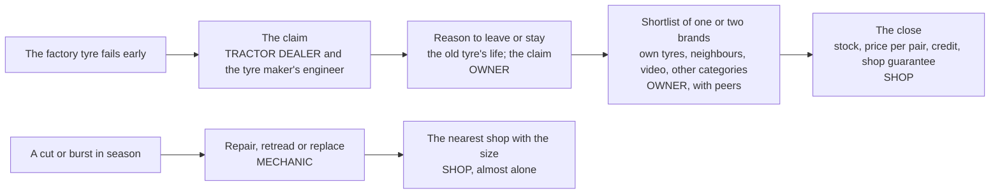

# RD01. Who decides the replacement: the owner, the shop or the mechanic?

Prepared 8 November 2026. Part of the replacement-decision analysis of the Apollo Round 3 case.

**What this file is.** Our own analysis of the question the user put after reading the three lenses: the problem is Apollo's share of the replacement market, so what makes an owner rebuy or switch, and is that choice made by the owner or by the trade? It brings together four research notes written on 8 November 2026: `..\research_notes\U1_replacement_choice_drivers.md` (published studies, India and abroad), `U2_replacement_sentiment_coding.md` with its corpus `U2_replacement_sentiment_corpus.csv` (261 items of owner voice, coded for replacement only), `U3_cricket_for_trade_precedents.md` and `U4_trade_voice_and_input_dealer_analogue.md` (dealers, mechanics, tractor dealers and the farm-input analogue). It is not the work of any consulting firm, and no firm had any part in it.

**Labels.** [Verified fact], [Fact - single source], [Reported by press], [Benchmark - external], [Outside-in count], [Computed], [Planning assumption], [Interpretation], [Strategic hypothesis]. Where nothing reliable exists: Data unavailable – requires primary research or company confirmation.

---

## 1. The answer in six lines

1. **Nobody has measured who chooses a tractor tyre at replacement, in India or anywhere else.** Not J.D. Power, not a tyre maker, not a broker, not a thesis. Every share in this file is an estimate from analogues, and section 7 says how to measure it in one season. [Verified fact that none was found: U1 section 8; U4 section 8]
2. **The decision has three layers, and they belong to different people.** The reason to leave or stay is the owner's: his verdict on how long the old tyre lasted. The shortlist is the owner's too, built from his own tyres, his neighbours' and, increasingly, videos. The close belongs to the shop: what is in stock, the price per pair, the credit and the shop's own guarantee, and, after a failure, the mechanic and the nearest shop with the size. [Interpretation on U1, U2, U4]
3. **In owners' own words the choice is theirs and tyre life is the currency.** In 261 coded items owners speak as the chooser in 61% (82% of first-hand experience reports), name a tyre dealer in 3% (8% with dealers' own videos and comments) and a mechanic once; tyre life is the reason in 42% overall and 52% of experience reports. [Outside-in count: U2] But owners understate the shop everywhere it has been measured: abroad, owners credit the salesperson 17 to 36% of the time while shop surveys say the shop sets the brand for 72 to 78% of buyers. [Benchmark - external: U1 section 5]
4. **Best estimate: a planned purchase is about half the owner's and half the shop's; an urgent one is about four-fifths the shop's; overall about three in five replacements are closed by the trade** (band 50 to 70%). The user's hypothesis ("distributor-led") holds for the close, not for the reason. [Interpretation; analogue-based]
5. **For Apollo both layers are lost.** No owner in the corpus gives a reason for choosing Apollo at replacement; six of the eight items that mention Apollo as the factory tyre are failure or claim stories, handled through the tractor dealer; and at the counter Apollo is thin (about 170 listed tractor-tyre dealers against about 3,690 for MRF on one portal). Apollo's implied pull-through from its own fitment is at most 30% if it is on 30% of the tractors reaching first replacement, below the weakest US car segment (31%). [Outside-in count; Computed]
6. **So the jersey has two jobs, in this order:** give the trade a reason to close on Apollo where Apollo is stocked (RD02), and give the owner a life number he can repeat, which only the guarantee and the registered owners' own hours can supply. The jersey on the screen does neither: one cricket mention was found in about 3,350 owner comments read, a free bat with a BKT tyre. [Interpretation; Outside-in count]

---

## 2. What drives the rebuy

Ranked by the weight of the evidence across the four notes. [Interpretation; the rows carry the labels of their sources]

| Rank | Driver | What the evidence says | Strength | Tractor-tyre evidence |
|---|---|---|---|---|
| 1 | **The life of the outgoing tyre** | Only 18% of owners reporting uneven wear intend to rebuy the brand (J.D. Power 2018, 3,768 owners); "consumption experience" is the biggest predictor of tractor repurchase (Mohanty and Patro, 2020); when two or more tyres are replaced, US loyalty to the factory brand is 42%, "with tire wear cited as the primary reason" (J.D. Power 2026; the release does not say whether wear is the reason for replacing or for leaving); owners count hours and years ("4800 ghante", "15 sal") and 4 of the 5 stated brand moves in the corpus are decided by life | Strong | Yes (J.D. Power; U2) |
| 2 | **The shop at the counter: stock, price per pair, credit, its own guarantee** | US shops say 46 to 52.5% of buyers name no brand and 26% more are switched (2003, 2011); Japan: 36% of store buyers took the salesperson's brand; CEAT's marketing head calls tyres "a low-involvement category" where "the influencer is the garage mechanic" (afaqs, 2020); the trade press calls decisions "often dealer-led" (Social Samosa, 2026); Indian tyre dealers' own videos sell on price per pair, the shop's "full guarantee" and credit; in a farm shop 92.5% switch brand when the one they want is missing and 65% follow the dealer who gives credit (pesticides, Kurnool) | Strong in analogues; direct for tyres only in dealer videos | Partly (U2 section 7) |
| 3 | **Fit for the job** | 39% of owners' questions ask whether a tyre suits puddling, hard soil, road haulage or mixed duty; every maker sells occasion lines (`..\BCG_Lens\C04`) | Moderate | Yes (U2) |
| 4 | **The claim on the factory tyre** | 66% of complaints turn on warranty and 49% on the factory tyre; 13 of 19 court records run through the tractor dealer, who forwards the claim and then says "decision to sanction warranty claims rest only with tyre manufacturers" | Strong for detractors | Yes (U2; Q6) |
| 5 | **Price per pair and terms to pay** | 9% of items; dealer videos lead on price; a US farm-tyre wholesaler (Modern Tire Dealer, 2016): "The biggest driver continues to be price", now that imports give "reasonable value" | Moderate | Partly |
| 6 | **The brand the tractor came on** | Pull-through in US cars 37 to 42% (mass market 31%); Indian car owners state 46 to 65%; only 38% of tractor owners chose their tractor's tyre; 13% of the corpus mentions the factory tyre, mostly when it fails | Moderate; weak as loyalty | Yes, mostly negative (U2) |
| 7 | **Brand trust carried across categories** | Owners buy MRF tractor tyres because MRF served them on a motorcycle; others reject CEAT for tractors because of scooter tyres | Weak, but telling | Yes (U2, 4 items) |
| 8 | **Neighbours, videos and the mechanic** | Peers 2%, video 4%, mechanic 0.4% of the corpus; progressive farmers advise 33% of farm households in five Indo-Gangetic states (NSSO); YouTube and WhatsApp lead information sources for smartphone farmers in one Uttar Pradesh block | Moderate as proxies; low as stated tyre influence | Weak |
| 9 | **Advertising, sponsorship** | One cricket mention in about 3,350 comments; Apollo's share of tractor-tyre searches went from 14.0% to 14.8% in fourteen months of the jersey | Weak | Yes, negative (U2; M06) |

---

## 3. Who decides: five lines of evidence

| Line of evidence | What it says | Who it says decides | Its bias | Source |
|---|---|---|---|---|
| **Owners abroad** | 47 to 56% of US replacement buyers arrive knowing the brand (AutoPacific, 2019 and 2024; about 50% in 2026); 17% of US owners used the staff's recommendation (J.D. Power 2022); 36% of Japanese store buyers took the salesperson's brand (J.D. Power 2015) | The owner, about half the time | Owners under-report advice they took | U1 section 5 [Benchmark - external] |
| **Shops abroad** | 52.5% do not specify a brand and 25.7% are convinced to switch (Modern Tire Dealer, 2011); 73% and 19% of dealers said these happen most often (2025 straw poll); trucks 46% and 26% (2003) | The shop, 72 to 78% of the time | Shops over-report their own influence | U1 section 5 [Reported by press; Benchmark - external] |
| **Indian makers and consultants** | "Nobody plans to buy a tyre"; "the influencer is the garage mechanic" (CEAT's marketing head, 2020, on a tyre found damaged); "decisions are often dealer-led" (Social Samosa's writer, introducing BKT's CMO, 2026); dealers are "one of the most influential" for a multi-brand shop selling to an owner-driver (Autobei, trucks, December 2025); discounts to dealers are "clearly a weapon of competition" (CEAT's submission, recorded in the CCI order of 30 October 2012) | The trade, without a share | Makers run dealer and mechanic programmes; consultants sell reports; a line often quoted as CEAT's in 2021 ("Most buyers trust their mechanics and dealers") is the interviewer's question, not CEAT's answer | U1 section 2; U4 sections 1, 2; V row 8 [Reported by press; Vendor claim; Verified fact that CEAT said so] |
| **Indian tractor owners in public** | Self 61%; tyre dealer 8% (3% from owners; the rest are dealers' own videos and comments, and no owner says a dealer chose); tractor dealer 6% (13 of them in court claims); video 4%; peer 2%; mechanic 0.4%; for planned purchases, video 16% and tyre dealer 15%; for after-failure items, the tractor dealer 32%; only one dealer says he picks the brand ("whichever customer comes, I give them all this", BKT) | The owner, in his own telling | Commenters are researchers by definition; complaint and court sources carry only failures; one video gives 21% of items | U2 sections 3, 4, 7 [Outside-in count] |
| **Farm shops for other inputs** | The input dealer is "the first contact point for majority of farmers" (DAESI guidelines, 2014); the retailer's word ranks first in three of six district studies; in Rajkot 62.5% consulted dealers, but "previous experience" (45.83%) outranked "recommendations" of any source (37.5%) as the motive for a pesticide choice; credit and stock-outs hand the choice to the shop | The shop where credit and information gaps are large; the farmer where he can judge the result | Small local samples; ranks, not shares; pesticides are bought often and judged badly, tyres rarely and judged well | U4 section 5 [Verified fact for DAESI; Fact - single source] |
| (For the tractor itself) | "recommendations by relatives/friends/local mechanics/dealers/company persons" ranked sixth of 13 factors; three-quarters of US tractors bought "in part because of the dealer" | The buyer, with the dealer as a factor | Different product | U4 row 4.4; U1 row 4.2 |

Why the accounts conflict, and why both are right [Interpretation]: owners report the reason (the old tyre lasted or did not) and the brands they had in mind; shops report what happened at the counter (the size in stock, the price for the pair, the credit, the brand the shop pushed). Both are describing the same purchase from either end. The theory in U1 section 6 predicts exactly this for a product bought every few years, whose quality shows only after hundreds of hours, and where the person who says the tyre must go also proposes the replacement: the choice is partly "subcontracted" to the adviser, more so when the buyer cannot wait.

---

## 4. The decision in layers

| Layer | Who holds it | What wins it | What Apollo has today | Label |
|---|---|---|---|---|
| The reason | The owner | A tyre that lasted, stated as a number; a claim paid without a fight | No hours promise; claims through the tractor dealer and an engineer; six of eight factory-Apollo mentions are failure stories | [Outside-in count; Interpretation] |
| The shortlist | The owner, with peers and video | Being named in the life stories owners repeat; being on the neighbours' tractors; fitting the job | Named in 16% of the 261 items, against MRF 29% and Goodyear 28%; 28 likes on Apollo items against 839 on Goodyear's positive items; no reason given for choosing Apollo at replacement | [Outside-in count] |
| The close, planned | The shop | Stock of the size; price per pair; credit; the shop's own guarantee; the dealer's margin and scheme | Thin stocking; no farm scheme found; one dealer's complaint, in two comments, about Apollo appointing "more than five dealer" in an area | [Outside-in; Outside-in count] |
| The close, urgent | The mechanic and the nearest shop | Being the brand on the shelf when the tractor stands idle | As above | [Interpretation] |
| The first-replacement trigger | The tractor dealer, in the claim | A fast, fair settlement of the factory tyre's claim | Claims "sanctioned" only by the tyre maker; nothing faster for tractor dealers | [Outside-in count] |

---

## 5. The best estimate

**Owner-led**: the owner arrives with a brand and buys it. **Trade-led**: he arrives without one, or names one and buys what the dealer or mechanic proposes or has. [Interpretation throughout; analogue-based, not a measurement]

| Purchase | Owner-led | Trade-led | Basis |
|---|---|---|---|
| **Planned**, before a season | **About 50%** (band 40 to 60%) | **About 50%** (band 40 to 60%) | U1's estimate from the owner and shop surveys abroad, adjusted for a Rs 32,000 to 35,000 pair (more search), visible life (neighbours see it) and narrow rural stock and credit (less choice). U2 and U4 lean to the owner's side for planned purchases (owners speak as choosers; even in pesticides experience can outrank the dealer), so the band's upper half is as likely as the lower |
| **Urgent**, after a cut, burst or bald tyre in season | **About 20%** (band 15 to 30%) | **About 80%** (band 70 to 85%) | No study measures urgency. The mechanism is strong: the nearest shop's stock and the mechanic's framing; US truck dealers, whose buyers most want emergency service, report setting the brand 72% of the time; 92.5% switch when the brand is missing (pesticides) |
| **All replacements**, if 50 to 70% are planned | **About 35 to 41%** | **About 59 to 65%**, call it three in five (band 50 to 70%) | [Computed] on the two rows; the planned share is itself unknown (59% of corpus items do not say) |

Three adjustments a reader should keep in mind:

- **The trade's power is mostly over stock and terms, not over advice.** Owners in the corpus do not say "the dealer told me"; dealers in their own videos sell on price per pair, guarantee and credit. A trade programme that pays for recommendation alone misses how the close is actually won. [Interpretation on U2 section 7]
- **The trade's power is conditional on trust.** Farmers follow advice when the adviser seems disinterested (04 section 5); Japanese buyers who took the salesperson's brand were 27 points less satisfied (U1 row 5.5). A dealer seen to push a brand for a prize loses the owner. [Fact - single source; Benchmark - external]
- **The trade can work against a brand as easily as for it.** A Ranchi buyer got a free Rs 700 cricket bat with two BKT tyres (the comment does not say whether the shop or BKT gave it; the only cricket item in the corpus), BKT's IPL deals include "dealer activations", and the CCI record shows makers competing for dealers with discounts. Apollo is starting from behind at the counter, not from neutral. [Outside-in count; Reported by press; Verified fact]

---

## 6. What it means for Apollo's 9%

| Finding | What it implies | Label |
|---|---|---|
| Pull-through from the factory brand is under half even in mature car markets (US 37 to 42%; mass market 31%) and lower when the tyre has worn out | Fitment gives Apollo familiarity, not a claim on the replacement; the diagnosis "fitted at the factory, lost at the first replacement" is the normal pattern made worse | [Benchmark - external] |
| Apollo's pull-through cannot exceed 9% divided by its share of the tractors reaching first replacement: 45% at 20%, 30% at 30%, 23% at 40% | At 30% or more Apollo keeps fewer of its own fitments than the weakest US car segment; Apollo's fitment share of the tractor parc is not public | [Computed]; Data unavailable – requires primary research or company confirmation |
| The factory Apollo appears in owner voice mostly when it fails, and the claim runs through the tractor dealer to an engineer | The first replacement is often decided at the claim, months before the purchase; the tractor dealer is the trade that matters at that moment | [Outside-in count; Interpretation] |
| Owners give no reason for choosing Apollo at replacement; Apollo's positive items cite long life and load, its negative ones early failure and dealers who "do not listen afterwards" | Apollo has no life number in circulation; its few promoters say "10 sal" without a brand story to attach it to | [Outside-in count] |
| Many first replacements are bought by a second owner (64% of tractors in the Punjab cotton-belt survey were bought used) | The owner at first replacement may never have met the factory tyre's maker; the shop and the neighbours matter more for him | [Fact - single source: M04] |
| Apollo is thin at the counter (about 170 against about 3,690 listed dealers), and one dealer complains, twice, about Apollo appointing too many dealers in his area | Stocking matters, but adding dealers on top of each other erodes each one's economics; the stocking push should fill gaps, not crowd existing dealers | [Outside-in; Outside-in count; Interpretation] |

---

## 7. How to measure it in one season

The single most useful piece of primary research the programme can buy, and the one that would settle sections 3 to 5.

### 7.1 The counter intercept

[Strategic hypothesis; costs are planning assumptions]

| Element | Design |
|---|---|
| Where | 40 farm-tyre counters in the ten prototype districts: 20 Apollo-stocking dealers and 20 multi-brand dealers that do not stock Apollo farm tyres |
| When | A two-week pilot in January 2027; then ten trading days at each counter in the April to June 2027 buying season |
| Who | A trained enumerator at the counter, with the dealer's consent, recording each farm-tyre buyer who agrees (consent on the spot; no names kept) |
| What is recorded | Planned or after a failure; whether the buyer named a brand before the dealer spoke, and which; the brand bought; whether the named brand was in stock; who proposed the brand bought (buyer, dealer, mechanic who came along, other); price per pair offered and paid; credit taken; the brand on the tyre being replaced and whether it came with the tractor; occasion (field, haulage, puddling, mixed) |
| Sample | About 1,000 purchase observations in the season (40 counters, about 25 buyers each) |
| Cost | About 400 enumerator-days at about Rs 1,500, plus training and supervision: about Rs 0.1 crore |
| What it settles | The owner-led and trade-led shares, planned and urgent; the stock-out rate for Apollo; Apollo's pull-through from its own fitment among buyers whose old tyre was Apollo; the price-per-pair gap at the counter |

### 7.2 Three questions added to the owner survey

The owner survey the lenses already designed (40 owners a tehsil, three waves) adds: "The last time you replaced a rear tyre, was it planned or after a failure?"; "Did you go to the shop with a brand in mind? Which? Did you buy it? If not, why not?"; "What brand came on your tractor, and what did you replace it with?" [Strategic hypothesis]

### 7.3 Apollo's own data

Apollo's fitment list by tractor model and year, matched to the registrations the programme creates, gives the true pull-through for the registered base within a year. Data unavailable – requires primary research or company confirmation.

---

## 8. What has to be true, and what is still unknown

| Belief | Evidence today | What settles it |
|---|---|---|
| About three in five replacements are closed by the trade | Analogues abroad; Indian makers' statements; farm-input studies; owner voice leans the other way | The counter intercept |
| Urgent purchases are mostly closed by the nearest shop with the size | Mechanism; pesticide stock-outs; US truck dealers | The intercept's after-failure buyers |
| Owners decide whether to leave a brand on the old tyre's life | J.D. Power; Mohanty and Patro; the corpus | The intercept and the survey |
| The tractor dealer's handling of the factory claim shapes the first replacement | 13 of 19 court records; six of eight factory-Apollo mentions | Apollo's claim records by channel; the intercept's question on the replaced tyre |
| Apollo's pull-through from its own fitment is below 30% | Arithmetic on the 9% and an unknown fitment share | Apollo's fitment list and the registrations |

For each: Data unavailable – requires primary research or company confirmation.
